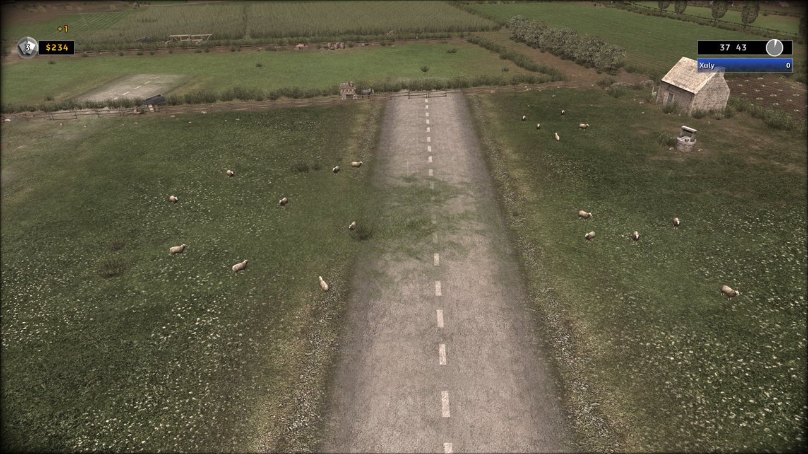

**RUSE Launcher 0.4, pro hráče.** Najde R.U.S.E. přes Steam a **Hrát** sestaví upravenou kopii hry s vašimi módy a
spustí ji. Vaše instalace Steamu se nikdy nemění.

**0.4.8.20:** Ochrany tam, kde některé sady módů zastavovaly hru; vylepšení vyráběné v jiné budově si nechá svou jednotku; editor sad říká proč a Hrát čeká na kontrolu módů; sestavení upozorní na mise, kterým sada vezme jejich místa, a jednotky módů .rmod dostanou své modely; Bug Watch říká, proč selhalo sestavení nebo Hrát, a verze 4 smlouvy; pád hry, který známe, jmenuje svou jednotku; vlastní voják družstva, změněný v Blenderu (Studio); módy s novými družstvy a animacemi ze Studia; jednotka bez obrázku karty odmítnutá při sestavení.

- **Ochrany tam, kde módy zastavovaly hru:** s R.U.S.E. Field Manual a Balance Overhaul Mod dohromady se hra zastavila, jakmile byla postavena tanková základna (hlášení o pádech od hráčů). Každá hra s módy má teď ochranu na třech místech, kde ji zastavovaly vlastní skripty hry: karty výzkumu v seznamu budovy pro jednotku, která je v jiné budově, mise, která spouští počítačového hráče strany, za kterou hraje člověk, a mise, která mění jednotky poté, co jedna z nich padla. Ochrana nic nedělá, kromě míst, kde by se hra zastavila. Vyzkoušeno ve hře s tankovou základnou; dvě ochrany misí byly vyzkoušeny mimo hru.
- **Vylepšení vyráběné v jiné budově si nechá svou jednotku:** se stejnými dvěma módy výzkum T-34 v tankové základně vzal T-26 z kasáren, protože hra jednotku odebere, jakmile je vyzkoumáno jakékoli její vylepšení, ať se vyrábí kdekoli. Sestavení teď z takového vylepšení udělá samostatný výzkum a řekne to ve varování. Vyzkoušeno ve hře za SSSR a Itálii. Mění to některé sady s Balance Overhaul Mod a sady s Field Manual před Balanced Realism Mod; varování jmenuje každou jednotku.
- **Kódy hry:** sada, kterou sestavení takto změní, dostane nový kód hry: tuto verzi potřebuje každý hráč zápasu s ní. Sada s módem, který dává obsluze děla vlastní model, dostane také nový kód: malá figurka obsluhy viděná zdálky teď vypadá jako tento model. Sada s Balanced Realism Mod, Navy Mod, Sand Box nebo kterýmkoli ze dvou Static Commandable Battleship - All Operations dostane také nový kód: pro některé jejich jednotky se teď v každé potyčce načtou balíky jednotek jiného národa (níže). Každá jiná sada si nechá svůj kód. Po aktualizaci příští **Hrát** nebo **Vyzkoušet ve hře** sestaví hru znovu samo.
- **Mise, kterým sada vezme jejich místa (Studio a Launcher):** když módy sady nechají kapitolu kampaně, Operaci nebo výuku bez místa, které její mise sleduje od začátku, sestavení na to upozorní a jmenuje mód a kolika kapitol kampaně nebo Operací se to týká, nebo výuku: hra se zastaví asi sekundu po začátku takové mise. Kontroluje se každý mód v jakékoli verzi, i ty vaše: sestavení čte mise z vaší vlastní hry, když sestavuje. Sada se sestaví a hraje jako dřív a počet varování sestavení zahrnuje i tato. Ověřeno na sestaveních komunitních módů; ve hře zatím nevyzkoušeno.
- **Jednotky módů .rmod dostanou své modely (Studio a Launcher):** jednotka, kterou mód .rmod (formát RUSE Mod Manageru) vytvoří nebo přesune k jinému národu, teď dostane stejnou kontrolu modelu jako jednotka módu ze Studia, v každé sadě i se samotným módem: když je její model jen v balících jednotek jiného národa, sestavení zařídí, aby se ty balíky načetly v každé potyčce, takže má svůj model i v zápasech, kde žádný hráč nemá tento národ, a poznámka jednotku jmenuje tak jako její karta; kde to nejde, sestavení sadu odmítne a řekne proč. Ve hře zatím nevyzkoušeno.
- **Editor sad v Launcheru říká proč:** když nemůže vytvořit nebo uložit sadu (není zaškrtnutý žádný mód, nebo mód už není v knihovně), řekne to teď přímo v editoru, pod jeho tlačítky. Dřív zpráva šla na stránku sady, schovanou za editorem, a zdálo se, že se nic neděje. **Vytvořit** a **Uložit** čekají, dokud není zaškrtnutý mód. Vyzkoušeno v náhledu obrazovky, zatím ne v nainstalovaném Launcheru.
- **Hrát čeká na kontrolu módů (Launcher):** **Hrát** zůstane vypnuté, dokud Launcher nezkontroluje, zda módy sady jdou dohromady, a jeho nápověda řekne proč. Dřív mohlo rychlé **Hrát** poslat k sestavení sadu, jejíž módy dohromady nejdou, a sestavení ji odmítlo až tam. Ověřeno testy; v nainstalovaném Launcheru zatím nevyzkoušeno.
- **Vlastní mise (Studio):** mise nové mapy, která vytváří jednotky národa, jejž kopírovaná mise nenačítá, teď dostane balíky tohoto národa, takže ty jednotky mají své modely (hra se zastavila, když se taková jednotka vytvořila). Kontrola misí také odmítne událost, která předá počítači stranu, za kterou hraje člověk. Ověřeno přečtením skutečného sestavení; ve hře zatím nevyzkoušeno.
- **Modely z Blenderu a Vlastní uniforma (Studio):** body, které Blender nechá bez kosti, se řídí kořenovou kostí a stránka řekne, kolik jich je. **Importovat model…** teď funguje i u jednotky s volbou **Vlastní uniforma**: vyjme kopii a **Použít model kopírované jednotky** ji jedním kliknutím vrátí. Vyzkoušeno ve hře na vojákovi družstva s váhami z Blenderu; část s vlastní uniformou byla ověřena mimo hru.
- **Módy udělané s novými družstvy a animacemi ze Studia (Launcher):** tento Launcher sestaví družstva modu s jejich vlastními vojáky a jeho jednotky s jejich vlastními animacemi; takový mod ho potřebuje, protože starší Launcher jim je dát nedokáže. Mod, jehož družstva mají vlastní vojáky, k tomu dostane malou záplatu hry: stáhne se jednou a použije se jen na vaši upravenou kopii, nikdy na hru ve vaší složce Steam. Z Launcheru ve hře zatím nevyzkoušeno.
- **Jednotka bez obrázku karty (Studio a Launcher):** jednotka zobrazená v nabídce stavby bez obrázku karty se teď při sestavení hry odmítne, i s tím, co změnit. V testu se hra s takovou jednotkou zastavila hned při spuštění (kopie nákladního auta velitelství zobrazená v nabídce stavby).
- **Bug Watch říká proč, pokud jste ho zaškrtli:** která kontrola odmítla sestavení nebo našla chybu (pevný název z našeho kódu), kam až došlo **Hrát** nebo **Vyzkoušet ve hře**, které módy z našeho seznamu byly zapnuté a kolik vašich vlastních, Hrát odmítnutá před spuštěním a aktualizace nabídnuté, nainstalované nebo neúspěšné. Nikdy zobrazená slova, cestu ani názvy, slova či soubory vašich vlastních módů. Hlášení o pádu hry, kterou zastavila chyba skriptu, také řekne, kolikrát ochrany popsané výše tu hru udržely v chodu (ve hře zatím nevyzkoušeno).
- **Pád hry, který známe, jmenuje svou jednotku (Launcher, pokud jste zaškrtli Bug Watch):** když hra spadne jedním ze způsobů, které známe, Launcher to po **Hrát** řekne ve vašem jazyce: jakou jednotku hra právě vytvářela, jménem z její karty (a zda ji přidal mód), a proč, prostými slovy. Čte to na vašem PC z vlastního hlášení hry o pádu a z vaší kopie s módy; jméno ani důvod se nikdy neposílají. Jednotka se řekne, až když přijmete verzi 4 smlouvy (níže). **Vyzkoušet ve hře** ve Studiu to neřekne. Ověřeno na dřívějších hlášeních o pádech; ve hře zatím nevyzkoušeno.
- **Smlouva, verze 4:** teď uvádí víc z toho, co posílá Bug Watch, pokud jste ho zaškrtli: kolik vlastních módů jste měli a jaké druhy věcí obsahují, například jednotky, mapy, mise nebo skripty (spočítáno podle druhu, nikdy pojmenováno a nikdy jejich slova, cesty ani soubory); při pádu hry mapu, na které byla (mapu hry podle jejího názvu, mapu vytvořenou módem jen jako „mapa z módu“), a jednotku, kterou hra právě vytvářela (jednotku hry podle jejího čísla, jednotku přidanou módem jen jako „jednotka z módu“), každou jen tehdy, když ji hlášení hry o pádu ukazuje; a kterou verzi smlouvy jste přijali. Teď také říká, že názvy a slova vašich vlastních módů se nikdy neposílají. Nic jiného se v ní nezměnilo. Protože se změnila, obě aplikace vám ji při otevření ukážou ještě jednou; vaše uživatelské jméno zůstává a zaškrtnutí Bug Watch zůstane, jak jste ho měli.
- **Beze změny:** RUSE Guard, hra bez módů, kampaň a potyčky.

**0.4.8.19:** RUSE Guard: hra sestavená s cheatovým módem teď hraje hry více hráčů a kooperaci s hráči, kteří mají stejné sestavení. Zatím není plně podporováno a může mít chyby: ve hře více hráčů to používáte na vlastní uvážení.

- **Nahlásil hráč:** dva přátele se stejným balíkem módů to vyhazovalo z každé hry více hráčů, protože jeden mód v balíku (Infinite Supply Depot) je označen jako cheat. RUSE Guard bral každou hru sestavenou s cheatem nebo testovacím nástrojem jako hru jen pro offline: každou hru více hráčů i kooperaci po pár sekundách opustila a nikdy se nedívala, kdo další hraje.
- **Co jsme změnili:** sekundu po začátku hry více hráčů nebo kooperace teď taková hra sdělí hrám ostatních hráčů, o jaké sestavení jde: krátký kód vytvořený z verze hry a módů, nic o vás. Asi po sedmi sekundách rozhodne. Mají-li všichni hráči stejné sestavení (stejnou verzi hry, stejné módy ve stejném pořadí, stejné verze módů), napíše to na obrazovku a hra pokračuje. Má-li někdo jiné sestavení nebo žádné módy, hru opustí jako dřív.
- **Kód hry i pro tyto sady:** v Launcheru teď sada módů s cheatovým módem dostane kód hry jako každá jiná. Stejný kód znamená stejné sestavení: porovnejte si kódy, než začnete hrát.
- **Tuto verzi potřebuje každý hráč:** hra každého hráče musí být sestavena Launcherem 0.4.8.19 nebo Studiem 0.9.8.19, případně novějšími. Po aktualizaci ji příští **Hrát** nebo **Vyzkoušet ve hře** sestaví znovu samo.
- **Zatím není plně podporováno:** vyzkoušeli jsme to ve hře s jedním hráčem, který sám hostoval hru více hráčů proti počítači, a mimo hru na 20 simulovaných hrách až se čtyřmi hráči. Ve dvou ve skutečné hře to zatím nikdo nehrál, takže to může mít chyby: ve hře více hráčů to používáte na vlastní uvážení. Vyzkoušejte to a napište nám na Discord nebo GitHub, co se stalo: jakou zprávu RUSE Guard jste viděli a jestli hra pokračovala.
- **Beze změny:** hra sestavená bez cheatů, bitva proti počítači a kampaň.

**0.4.8.18:** Oprava v pozadí: kontrola upravené kopie vypisuje, co najde, ve stejném pořadí na každém systému.

- **V pozadí:** kontrola upravené kopie (které soubory hry se po jejím sestavení změnily) teď vypisuje, co najde, ve stejném pořadí ve Windows i v Linuxu. Co najde, se nemění.

**0.4.8.17:** Importované modely stojí tam, kde jednotka, s věžemi a vrtulemi na svých místech; munice může mít vlastní třídu zbraně.

- **Povinná aktualizace:** starší verze už nelze používat. Aplikace ji po otevření sama nainstaluje a **Hrát** počká, dokud nebude nainstalovaná.
- **Mody s importovanými modely nového druhu:** Studio teď usadí importovaný model jednotky tam, kde jednotka stojí, s vlastní kostrou, takže se jeho věž otáčí tam, kde je věž na modelu, a vrtule letadla se točí tam, kde je má model, tolik, kolik jich má; vlastní modely mohou dostat i vojáci, obsluha děla a další letadla. Takové mody hrajte s tímto Launcherem nebo novějším: starší dá modelu kostru kopírované jednotky, takže se jeho věž otáčí kolem špatného bodu. Mody udělané dřív se hrají jako dosud. Vyzkoušeno ve hře na testovacích kopiích postavených tak, jak staví Launcher; přes samotný Launcher zatím nehráno.
- **Vlastní třída zbraně munice:** mod teď může dát munici vlastní poškození proti každému druhu cíle (dělá se na stránce munice ve Studiu). V Launcheru se kvůli tomu nic nezměnilo: takový mod se staví jako každý jiný.

**0.4.8.16:** Řešení potíží zachová kopie hry, které jste si udělali sami.

- **Opraveno: „Odstranit je“ v Řešení potíží mazalo kopie, které jste udělali vy.** Kopie hry postavená ručně ve složce kopií, testovací kopie nebo referenční kopie se počítala jako zbytek a „Odstranit je“ ji smazalo nadobro, ne do Koše. Každá kopie postavená jinde než jako vlastní modovaná kopie aplikace teď nese malou poznámku „ponechat“ a kopie s poznámkou nikdy není zbytek: Řešení potíží odstraňuje jen zbytky samotných aplikací (napůl postavené kopie a ty, které starší verze dělaly pro každou sadu modů). Všimli jsme si toho 1. listopadu na našem vlastním PC, když to odneslo každou testovací kopii. Kopie postavená před touto verzí poznámku ještě nemá: postavte ji jednou znovu touto verzí, nebo do té doby na „Odstranit je“ nesahejte.

**0.4.8.15:** I Původní hra má zlatý název R.U.S.E. 2.0.

- **I Původní hra má zlatý název R.U.S.E. 2.0:** Hrát u Původní hry teď sestaví kopii s módy bez módů a se zlatým názvem a spustí hru z ní, stejně jako sada módů: poprvé se sestaví, potom se spouští hned, pokud jste mezitím nehráli sadu módů. RUSE Guard běží v jejích zápasech pro více hráčů, jako u každé sady. Zrušte v Nastavení zaškrtnutí zlatého názvu a Původní hra se spustí přes Steam jako dřív. Vaše instalace Steam se nikdy nemění.

**0.4.8.14:** Módy s vlastním skriptem zápasu se znovu sestavují.

- **Opraveno: Hrát se zastavilo u některých sad módů** s hláškou „RUSE Guard's scripts can't be added: .xyz says ... bytes but holds ...“: několik módů přináší vlastní skript zápasu, jehož hlavička žádá víc místa, než skript potřebuje (mezi nimi 1 VS 7 AI, 1 VS 15 AI, Operation Overlord a Sand Box). Hra tyto skripty spouští bez potíží, ale Launcher je odmítal, takže nešlo sestavit žádnou sadu s některým z těchto módů. Teď je čte stejně jako hra.

**0.4.8.13:** Hlášení o pádech hry říkají, co k pádu vedlo.

- **Hlášení Bug Watch o pádech hry říkají víc:** pokud jste zaškrtli Bug Watch a hra spadne, hlášení teď také říká, co se hra pokoušela číst nebo zapisovat, a až 16 míst ve hře, která k pádu vedla, přečtených z vlastního hlášení hry o pádu na vašem PC, které ho stále nikdy neopouští. Hlášení, které říkalo jen, kde se hra zastavila, nemohlo ukázat proč; teď můžeme dohledat pády jako ten, který nám tento týden poslal jeden hráč, a opravit je.
- **Smlouva, verze 3:** nyní mezi tím, co obsahuje hlášení o pádu hry, uvádí i tyto dvě nové věci; nic jiného se v ní nezměnilo. Protože se změnila, obě aplikace vám ji při otevření ukážou ještě jednou.

**0.4.8.12:** Hrát znovu sestavuje upravené hry.

- **Opraveno: Hrát se zastavilo u každé sady módů** s hláškou „No such file or directory: ...fairplay_watch.bin“: instalátorům verzí 0.4.8.10 a 0.4.8.11 chyběly tři soubory RUSE Guard, takže nešlo sestavit žádnou upravenou hru. Jsou zpět a aplikaci, které chybí některý z jejích souborů, už nelze vydat.

**0.4.8.11:** přihlášení přes Steam se v aplikacích dokončí; v Linuxu se pomocné programy sestavení spouštějí stejně jako ve Windows.

- **Opraveno: přihlášení přes Steam.** Po přihlášení na stránce Steamu Launcher a Studio dál čekaly a nikdy se našeho serveru nezeptaly, jestli jste hotovi: okno zastavilo vlastní kontroly ještě před první. Teď kontroluje každých pár sekund a přihlásí vás, jakmile to Steam potvrdí. Vyzkoušeno v náhledu: kontrola proběhne a okno ukáže, že jste přihlášeni.
- **Pomocné programy se spouštějí znovu na každém systému:** programy, mezi které sestavení dělí práci (importované modely, opravy mapy, pohyb, voda), se teď i v Linuxu spouštějí znovu, jak to vždy bylo ve Windows. V Linuxu se spouštěly jako kopie běžící aplikace, což mohlo občas sestavení zaseknout a jedna z našich kontrol tam neprošla. Ve Windows ani v Protonu na Steam Decku se nic nemění.

**0.4.8.10:** módy nad 4 GB, seznamy stavby ve skupinách, rychlejší sestavení velkých módů, perština a každá stránka v 11 jazycích, opravy z hlášení testerů; a RUSE Guard, náš anticheat pro skutečné hry více hráčů, s kódem hry; Bug Watch, hlášení o pádech a používání, která si můžete zapnout; přihlášení přes Steam; a dohoda při prvním spuštění.

- **Opraveno, nahlásil hráč: módy nad 4 GB.** Sada módů, jejíž upravená hra přesáhla 4 GB, se přestala sestavovat po stisku Hrát („'I' format requires 0 <= number <= 4294967295“). Balíčky teď nesou svou plnou délku a balíček nad 4 GB se zapisuje v širším uspořádání, které hra dokáže číst díky malé záplatě hry: stáhne se jednou a použije se jen na vaši upravenou kopii, nikdy na hru ve vaší složce Steam. Nad 32 GB nebo u jednoho souboru nad 4 GB to sestavení řekne jasně. Vyzkoušeno ve hře: kopie nad 4 GB a s 200, 283 a všemi 366 jednotkami z jiných období.
- **Mnoho vlastních modelů:** hra hledá náhradní textury balíčku přes index a sestavení, které je přidávalo pro importované modely, ho zapisovalo špatně: s mnoha jednotkami z jiných období se hra při načítání zasekla nebo spadla. Teď se zapisuje tak, jak ho hra čte, pro každý mód, který je přidává. Vyzkoušeno ve hře se všemi 366 jednotkami z jiných období.
- **Seznamy stavby ve skupinách:** mód s mnoha jednotkami dostane seznam stavby každé budovy ve skupinách, vlastních liniích hry: nejvýš 6 jednotek ve skupině a 10 skupin v budově, aby celý seznam zůstal na obrazovce a každá jednotka šla postavit. Mód udělaný dřív, který tyto limity překračuje, se přesto sestaví, s varováním. Vyzkoušeno ve hře s 297 jednotkami z jiných období ve skupinách.
- **Rychlejší sestavení:** modely ve vašich módech se uchovávají mezi sestaveními a nové vznikají souběžně na jádrech vašeho PC. Mód s 366 jednotkami z jiných období se na PC s 8 jádry sestavoval asi 18 minut; teď asi 5 poprvé a asi 3 potom, se stejnými soubory hry, bajt po bajtu.
- **Hlášení testerů:** mód jednotek a změny mapy udělané pod jedním jménem se sestaví spolu (zastavovaly Hrát); mapa s odebranými vlastními mosty se sestaví s novými mosty; importované části věží a tažená děla se sestaví tak, jak je dělá Studio 0.9.8.10. Mosty a části věží zatím nevyzkoušeny ve hře.
- **Vaše soubory:** Odebrat pošle mód z knihovny do Koše, Ukázat ve složce otevře mód tam, kde je, a Nastavení ukazuje, kde se vaše soubory uchovávají. Viděno v náhledu; zatím nevyzkoušeno v okně aplikace.
- **Perština a 11 jazyků:** perština je 11. jazyk aplikací, psaný zprava doleva; README, wiki, tyto poznámky a obrazovky instalace jsou ve všech 11.
- **Povinné aktualizace:** aktualizace, kterou označíme jako povinnou, se nainstaluje sama, s oknem, které nikdo nemůže zavřít (aplikace od této verze tu značku umí přečíst).
- **Jen vlastní kopie:** než Hrát sestaví upravenou kopii, aplikace zkontrolují, že složka hry je kopie, kterou vlastníte, podle toho, co tam nechal Steam, ve Windows, v Protonu na Steam Decku i v Linuxu. Když tu vaši nejde potvrdit (krabicová kopie z doby, než byl R.U.S.E. na Steamu), okno vám dovolí otevřít tiket a my vám pošleme odemykací kód pro ten PC.
- **Discord:** aplikace a stránky používají novou pozvánku, která nevyprší.
- **Dohoda při prvním spuštění:** když se Studio nebo Launcher otevře poprvé, řekne, co RUSE Guard dělá, a požádá vás o jeho přijetí (pro hraní online s aplikacemi je to nutné), zda zapnout Bug Watch (volitelné), a o uživatelské jméno, které naši vývojáři vidí u vašich hlášení: přidá se # a čtyři číslice, aby bylo jedinečné, třeba Nick#4821. Jedno jméno platí pro obě aplikace. Dohoda se ukáže znovu, když se změní. Viděno v obou aplikacích. Ve všech 11 jazycích.
- **RUSE Guard:** náš anticheat podle návrhu DomesticNukes. Pracuje jen v hrách více hráčů a kooperaci, nikdy v hře jednoho hráče, v bitvě proti počítači ani v kampani. Vaše módovaná hra dostane **kód hry**, který pošlete lidem, s nimiž hrajete: stejný kód znamená stejnou hru, stejnou verzi, stejné módy a verze módů, takže se hra nemůže rozejít. Mód, který mění skripty hry, má odznak **Spouští skripty** a Hrát čeká, než zaškrtnete, že jeho autorovi věříte; cheat nebo testovací nástroj má odznak **Cheat** a dělá z kopie kopii jen pro offline: hry více hráčů a kooperaci sama opustí. Během skutečné hry RUSE Guard porovnává názvy vašich běžících programů se seznamem známých cheatovacích nástrojů (jen názvy; nic jiného se nečte) a to, co sesbírá, se ukládá pod vaše uživatelské jméno, nikdy pod váš účet Steam. Vyzkoušeno ve hrách více hráčů proti skutečnému soupeři; důkazy dorazí na náš server.
- **Bug Watch (volitelné):** když ho zaškrtnete, Studio a Launcher počítají, co používáte a kdy se něco pokazí, pády aplikací i hry, s tím, které módy byly zapnuté, a jednou denně to posílají našim vývojářům s vaším uživatelským jménem. Žádná skutečná jména, žádný účet Steam, žádné soubory. Vypnuto, dokud ho nezaškrtnete; odškrtněte ho kdykoli a to, co bylo uchováno, se smaže. Viděno v obou aplikacích.
- **Přihlásit se přes Steam:** přihlášení na vlastní stránce Steamu ve vašem prohlížeči potvrdí, že R.U.S.E. vlastníte, pro hru online, RUSE Guard a stahování obsahu. Vaše heslo nikdy nevidíme a vaše Steam ID se nikdy neukládá: jen propustka uložená na vašem počítači na 30 dní. Je v Nastavení, **Přihlášení přes Steam**; Launcher se zeptá jednou. Zatím ji nic nepotřebuje. V aplikaci zatím nevyzkoušeno.

**0.4.8.9:** módy se instalují na více PC, a bezpečnější čtení obrázků.

- **Opraveno, nahlášeno hráčem:** na některých PC se nenainstaloval žádný mód: „tento PC nedůvěřuje bezpečnostnímu certifikátu webu (unable to get issuer certificate)“. Windows na těchto PC nemá certifikát, kterým se ověřuje stahování z GitHubu, a nedokáže ho získat. Launcher teď zkouší i seznam certifikátů Firefoxu, který nese s sebou. Do té doby se mód stažený v prohlížeči ze seznamu módů nainstaluje přes **Přidat soubor módu…**.
- **Bezpečnější obrázky:** knihovna, kterou Launcher čte obrázky (Pillow), je teď ve verzi 13.0.0, s opravami proti schválně upraveným souborům obrázků, které mohly aplikaci shodit, vyčerpat její paměť nebo hůř.
- **Pečlivější kód:** 12 varování kontroly kódu GitHubu k tomuto projektu je vyřešeno. Když Launcher ukazuje své stránky ve vašem prohlížeči, otevírají jen jeho vlastní soubory, ověřené způsobem, který ta kontrola rozpozná, a stahování vyžaduje TLS 1.2 nebo novější, jako už dřív. Na tom, jak Launcher funguje, se nic nemění.

**0.4.8.8:** spouští mody vytvořené ve Studiu 0.9.8.8 a vaše upravená hra říká R.U.S.E. 2.0 ve zlaté.

- **Mody ze Studia 0.9.8.8 hrají:** vlastní budovy (druhá a třetí národa potřebují malou záplatu hry, jednou staženou a použitou jen na vaši upravenou kopii, nikdy na hru ve vaší složce Steamu), vlastní vzhled nových budov a předměty, zvuky a animace změněné v RUSE Decoy, hodnoty počítačových hráčů a pravidla hry, a uzavřené přechody po starých mostech.
- **R.U.S.E. 2.0 ve zlaté:** vaše upravená hra začne bitevní scénou se startujícím motorem a její hlavní nabídka, malý název každé nabídky, obrysy nabídek a načítací obrazovky říkají R.U.S.E. 2.0 ve zlaté. Udělá se na vašem PC ze souborů vaší vlastní hry napoprvé (jednou pár minut, pak se uchová). Nastavení má zaškrtávací pole pro zachování názvu hry.
- **Opraveno: tmavé a světlé skvrny na mapách vytvořených ve Studiu** (prázdné, zvětšené, reliéfní a sektorové mapy): taková mapa je osvětlená správně, jakmile se sestaví touto verzí (její terén se poprvé udělá znovu).
- **Opraveno, nahlášeno hráčem:** na stránce Podporované módy „Nová sada módů…“ nic nedělala. Teď otevře novou sadu. Zatím nevyzkoušeno v aplikaci samotné.
- **Písmo hry:** Launcher je psaný písmem nabídek hry, vzatým z vaší hry při každém spuštění.
- **Stále chybové, hrajte na vlastní uvážení:** mapy vytvořené s texturami Map Paint a prázdné mapy (Prázdný terén, Prázdný oceán).

**0.4.8.7:** spouští mody vytvořené ve Studiu 0.9.8.7.

- **Mody ze Studia 0.9.8.7 hrají:** objekty přesunuté nebo umístěné mřížkou, obdélníkem a podél cest, větší prázdné mapy s jejich sektory a změny ekonomiky jen Jaderného režimu.
- **Řádky sestavení ve vašem jazyce**, ve všech deseti.
- **Uchované výsledky sestavení zůstanou platné i po aktualizaci.**
- **Stále chybové, hrajte na vlastní uvážení:** mapy vytvořené s texturami Map Paint a prázdné mapy (Prázdný terén, Prázdný oceán).

**0.4.8.6:** spouští mody vytvořené ve Studiu 0.9.8.6.

- **Mody ze Studia 0.9.8.6 hrají:** prázdné mapy se stíny na rovném terénu, umístěné věci tam, kde kopírovaná mapa měla moře, nakreslené, a podlaha kamery na novém terénu.
- **Známý pád odmítnut:** mod, jehož ozbrojené letadlo nese flag průzkumu bez flagu stíhačky, shazoval hru, když bylo letadlo posláno útočit; teď ho Launcher odmítne sestavit a řekne proč.
- **Stále chybové, hrajte na vlastní uvážení:** mapy vytvořené s texturami Map Paint a prázdné mapy (Prázdný terén, Prázdný oceán).

**0.4.8.5:** spouští módy vytvořené ve Studiu 0.9.8.5.

- **Módy ze Studia 0.9.8.5 fungují:** letadla v nové roli (bombardér s pumovnicí, průzkumník, který si nechá zbraně), průzkumná vozidla, zbraně, které zasahují letadla, a terén namalovaný z knihovny štětce Textura s detailem hry navrch. Starší Launcher některé z nich nesestaví.
- **Rychleji:** mapa namalovaná stejně dostane namalovaný terén z minulého sestavení zpět za pár sekund.
- **Stále chybové, hrajte na vlastní uvážení:** mapy vytvořené s texturami Map Paint a prázdné mapy (Prázdný terén, Prázdný oceán).

**0.4.8.4:** módy se stahují na každém PC a spouští módy vytvořené ve Studiu 0.9.8.4.

- **Módy se stahují na každém PC:** na některých PC se nestáhl žádný mód („certificate verify failed: unable to get local issuer certificate“). Teď Launcher požádá Windows o certifikát, jako prohlížeč, a zkusí to znovu; i u vlastních aktualizací. Zatím nevyzkoušeno na PC, které mělo ten problém.
- **Módy ze Studia 0.9.8.4 fungují:** vlastní mise, prázdné mapy s jejich velitelstvími a sektory, sklady s víc auty (starší Launcher sklady s víc než 1 000 auty odmítne), jednotky s vlastním vzhledem a uniformami, úpravy cizích módů pod vlastním jménem.
- **Stále chybové, hrajte na vlastní uvážení:** mapy vytvořené s texturami Map Paint a prázdné mapy (Prázdný terén, Prázdný oceán).

**0.4.8.3:** kopie s módy se ukládají tam, kam řeknete.

- **Kam se ukládají kopie s módy**, v Nastavení: vyberte složku, ve které se sestavuje kopie hry s módy, nebo se vraťte
  na doporučené místo, `RUSE-Instances` na disku hry (tam kopie sdílí soubory hry a je hotová za pár sekund; na jiném
  disku je to úplná kopie hry, pomalejší a větší). Čistá záloha hry jde vedle. Další Hrát sestaví na novém místě;
  starou složku lze smazat ručně. Studio používá stejnou složku.

**0.4.8.2:** otevře se ve vašem webovém prohlížeči, když jeho vlastní okno nemůže, a spouští mody ze Studia 0.9.8.2.

- **Linux a Steam Deck (přes Proton):** Launcher se otevře ve vašem webovém prohlížeči, když jeho vlastní okno
  nemůže. Na Linuxu zatím nevyzkoušeno: dejte nám vědět, jak to šlo.
- Mody ze Studia 0.9.8.2 fungují: jednotky z jiných období s vlastními modely, velikostmi, výzkumem a kartami.

**0.4.8.1:** převádí staré mody a spouští mody ze Studia 0.9.8.1.

- **Převést starý mod…**, nástroj Convert od LittleGroove: starší mod v podobě balíků hry, určený ke zkopírování do
  složky hry, se stane modem, který vaše knihovna spustí vedle ostatních. Se skutečným starým modem zatím nevyzkoušeno.
- **Dva mody mění stejný soubor hry:** Launcher to řekne před Hrát a **Použít verzi…** vybere který.
- Mody ze Studia 0.9.8.1 fungují: skladby a hlasy, národ proměněný v jiný.

**0.4.8:** spouští módy udělané ve Studiu 0.9.8, mezi nimi nové mapy, které začínají prázdné, a ukazuje novinky ve
vašem jazyce.

| Dřív | Teď |
|---|---|
| Nová mapa ukazovala obrázky v nabídce kopírované mapy. | Vlastní obrázky, jak je udělal její autor, se startovními body tam, kde začínají její hráči. |
| Jednotka postavená na vysušeném moři mohla shodit hru. | Opraveno (ověřeno ve hře). |
| Stará říční voda stála jako zdi podél okraje mapy a smazané majáky dál svítily nad mořem. | Opraveno (ověřeno ve hře). |
| Mód, který smaže celou mapu, mohl při sestavování vyčerpat paměť počítače. | Sestaví se. |
| Novinky byly jen anglicky. | Jsou v jazyce Launcheru. |

Známé: **námořní mapy nejsou hotové.** Prázdný oceán se sestaví a hraje, ale jednotky pod jeho vodou zatím nebyly
vyzkoušeny.

**0.4.7:** velmi velké módy map se teď sestaví za několik minut (dřív to trvalo velmi dlouho) a spouští módy vytvořené
ve Studiu 0.9.7.

| Dřív | Teď |
|---|---|
| **Hrát** mohlo sestavovat velký mód mapy hodiny. | Ten nejextrémnější, který máme (mapa „Den D“ s vysušeným mořem), se sestavoval asi čtyři hodiny; teď za méně než 10 minut, se stejným výsledkem. |
| První sestavení velkého módu mapy počítalo všechno na vašem počítači. | Mód exportovaný ve Studiu 0.9.7 si nese to, co jeho sestavení spočítalo pro pohyb na mapě: vaše první sestavení je kratší. Každá odpověď se kontroluje a soubory hry vyjdou stejné. |

Známé: **námořní mapy ještě nejsou vyřešené.** Vysušené nebo namalované moře se sestaví a načte, ale voda je stále vidět.

**0.4.6:** **Hrát** spustí hru hned, když se nic nezměnilo, a hraje módy vytvořené ve Studiu 0.9.6: nové jednotky
s vlastním 3D modelem.

| Dřív | Teď |
|---|---|
| **Hrát** pokaždé znovu sestavilo celou upravenou kopii, i když se nic nezměnilo (hráč: „pokaždé čekám 30 minut“). | Nic se nezměnilo: hra se spustí hned. Změna kopii znovu sestaví, ale nezměněné soubory poslední kopie se použijí znovu, takže kopie na jiném disku, než je hra, už znovu nekopíruje každý balík. Hrát řekne, kolik zkopírovalo. |
| Každé sestavení četlo data jednotek hry znovu od začátku. | Uchovávají se mezi sestaveními: velký testovací mód trval pokaždé 213 s; teď další sestavení po prvním trvají 68 s. |
| Nová jednotka módu měla model jednotky, kterou kopíruje. | Její vlastní model z módu (`files/models`) je ve hře. **Viděno ve hře:** M1 Abrams vedle Shermana. |
| Nová jednotka módu s vlastní kartou shodila hru, když byla postavena. | Opraveno. **Viděno ve hře.** |
| Barvy přebarvených jednotek místy vycházely trochu jinak. | Blíž obrázku z módu. Mód s přebarvenými jednotkami nebo namalovaným terénem dostane nový otisk a kód pro připojení: všichni, kdo hrají spolu, by měli aktualizovat. |
| Pomalé spuštění nezanechalo žádnou stopu. | **Kopírovat zprávu** vypíše kroky posledních pěti spuštění. |
| — | Hraje módy s vymazáním celé mapy, silnicemi na přetvořeném terénu a vyplněním koryt řek ze Studia 0.9.6 (nové, ve hře zatím neviděno ve velkém). |

**0.4.5:** hraje módy vytvořené ve Studiu 0.9.5: přebarvené jednotky, jejich vlastní karty a jednotky s vlastními modely.

| Dřív | Teď |
|---|---|
| Mód nemohl změnit vzhled jednotky. | Přebarvené jednotky a karty z módu jsou vidět ve hře. **Viděno ve hře:** červený Sherman, karta vytvořená ve Studiu. |
| Mód, jehož balíky modelů jednotek narostly, hra zahodila: pád u první továrny. | Sestavené tak, jak je hra kontroluje. **Viděno ve hře:** druhý Sherman s vlastním modelem. |
| Mód, který v kapitole kampaně nebo Operaci nechá objevit jednotky jiného národa, spadl při načítání (francouzské jednotky na mapě Holland). | Jejich modely se načtou i tam. **Viděno ve hře.** |
| Srovnání hor na okraji mapy tam nechalo útes. | Okraj sleduje terén. **Viděno ve hře.** |

**0.4.4:** hraje módy s novými mapami, vytvořenými pomocí Duplikovat mapu ve Studiu 0.9.4.

| Dřív | Teď |
|---|---|
| Nové mapy z módu nebyly ve hře vyzkoušené. | **Viděno ve hře:** nová mapa z módu je v nabídce BITVY a hraje se na vlastním terénu, 101 naráz. Raná verze: nahlaste, na co narazíte. |
| Aktualizace přicházely jen jako celé verze. | Malé opravy mohou přijít mezi verzemi (0.4.4.1), nabízené jako každá aktualizace. |

**0.4.3:** hraje módy vytvořené ve Studiu 0.9.3 a sestavuje je asi třikrát rychleji.

| Dřív | Teď |
|---|---|
| Kameny a většina dalších předmětů umístěných módem zmizely, jakmile kamera opustila blízkou vzdálenost. | Kreslí se až do velké dálky; vlastní objekty mapy beze změny. **Viděno ve hře.** |
| Nová silnice módu lesem byla shora světlým pruhem, nebo ze středně dlouhé vzdálenosti zmizela. | Malovaná lesem tak, jak jsou malované vlastní silnice mapy. **Viděno ve hře.** |
| Silnice módu vždy odstranily stromy ze své cesty. | Silnice je může ponechat (`keep_trees`): vede pod stromy, v lese slabší a šedší. |
| **Hrát** sestavovalo mód s novými silnicemi na M03_Italie asi 5 minut. | Asi 1½ minuty, když už se na mapě jednou sestavovalo. |

**0.4.2:** hraje módy vytvořené ve Studiu 0.9.2.

| Dřív | Teď |
|---|---|
| Mód se silnicí přes vodu na mapách Itálie, Německa, Holandska a dalších byl odmítnut: jeho most „by neměl podlahu“. | Sestaví se: most dostane vlastní podlahu mapy. Na těchto mapách ve hře zatím neviděno. |
| Mód, který dává jednotky hráči v kapitole kampaně (strana 0), byl odmítnut a jednotky pro strany počítače dostaly varování „se možná nikdy neobjeví“. | Sestaví se; varování dostane jen strana, kterou mise kapitoly nemá. |
| Na M03_Italie a dalších mapách nová silnice módu v otevřeném terénu skrývala scenérii mapy z dálky a předměty módu byly vidět jen zblízka. | Pohled na mapu z dálky zůstává, jak byl, a předměty módu jsou vidět z dálky. Ve hře zatím neviděno. |

**0.4.1:** váš jazyk od prvního spuštění a editor sad módů, který najde módy podle názvu.

| Dřív | Teď |
|---|---|
| Vytváření sady módů vypsalo celou vaši knihovnu s Vytvořit dole a mód se nedal najít podle názvu. | Vytvořit je nahoře, hned pod ním módy, které už v sadě jsou; níž „Přidat módy z knihovny“ s hledáním, které zužuje seznam, jak píšete. |
| Jazyk byl schovaný v Nastavení, takže hráči nevěděli, že Launcher mluví jejich jazykem. | První spuštění se zeptá: „Vyberte jazyk“, každý jazyk vlastními slovy, s označeným jazykem, na který je vaše hra nastavená ve Steamu (hráči, kteří aktualizují, to uvidí jednou). Pak tlačítko jazyka nahoře, vždy na očích. |
| Seznam nainstalovaných aplikací ve Windows ukazoval vůbec první nainstalovanou verzi. | Ukazuje verzi, kterou máte. |

**0.4.0:** hraje módy s novými silnicemi tak, jak je sestavuje Studio 0.9: vypadají jako vlastní silnice mapy, shora
i těsně u země (vyzkoušeno ve hře na mapě Den D).

| Dřív | Teď |
|---|---|
| Nové silnice módu zblízka mizely. | Kreslí se vlastním asfaltem a okrajovými obtisky mapy, malované tak, jak jsou malované silnice mapy, a rostliny na jejich cestě se odstraní. |
| Mód s mnoha mazacími kruhy se sestavoval minuty. | Mnohem rychleji. |

**0.3.3:** hraje módy vytvořené ve Studiu 0.8.3.

| Dřív | Teď |
|---|---|
| Mód s natočenou úvodní kamerou (Studio 0.8.3) byl odmítnut. | Sestaví se: kamera je natočená tak, jak říká mód. |
| Úvodní kamera přesunutého startovního bodu zůstala na starém místě. | Kamera se přesune s ním; nový startovní bod dostane vlastní kameru. |
| Mód se startovním bodem v lese byl odmítnut. | Sestaví se: velitelství tam funguje. |

**0.3.2:** jedna kopie hry pro celé PC, zobrazená verze a přehlednější knihovna.

| Dřív | Teď |
|---|---|
| Každá sada módů sestavovala vlastní kopii hry. | Jedna upravená kopie pro celé PC, sdílená se Studiem. |
| Verze nebyla vidět a Co je nového byl seznam. | Verze je vedle názvu a Co je nového otevře tabulku dřív/teď, jako je tato. |
| Mapy a módy vypadaly v knihovně stejně. | Mapa má štítek MAPA. |
| Málo popisků. | Popisky u hlavních ovládacích prvků. |
| Módům s novými silnicemi na mapách Twilight of the Gods, Alpha, Ostfriesland a Robert chyběl model silnic mapy. | Dostanou ho také. |

**0.3.1:** módy s jednotkami z jiného národa (třeba německý Tiger pro USA) fungují, i v zápase, kde ten národ nikdo
nehraje (vyzkoušeno ve hře, 2026-10-02). A nový vzhled: modré barvy R.U.S.E. místo černé a zlaté a nové logo: stíhačka
stoupající mraky. Boční panel má dvě záložky, **Sady módů** a **Knihovna módů**, každou na celou výšku, takže se
dostanete k celé knihovně (polovina byla schovaná za posuvníkem), s hledáním a počtem. Instalátor nabízí
**čistou zálohu hry** vedle zástupce na ploše a říká proč.

**0.3.0:** **Podporované módy:** Launcher ukazuje náš seznam módů
([sneadtristen6/Ruse-Mods](https://github.com/sneadtristen6/Ruse-Mods)); zaškrtněte ty, které chcete, a stáhnou se a
zkontrolují. Při prvním spuštění si módy vyberete; cheatovací módy jsou oddělené a nikdy se nezaškrtnou za vás.
Tlačítko **Řešení potíží** (na spodní liště a u každé zprávy o problému) jedním během zkontroluje, co může zastavit
**Hrát**, a opraví, co může, se zprávou k vložení do hlášení chyby. **Čistá záloha hry** v Nastavení uchová čistou
kopii souborů vaší hry a vrátí cokoli, co změnil jiný správce módů (nebo nechte hru opravit Steamem). Módy vytvořené
v novém Studiu fungují tak, jak byly vytvořeny: tanky a pěchota přejíždějí nové mosty po mostovce, pěchota sleduje nové
silnice, vykácené lesy jsou pro jednotky otevřené, umístěné budovy stojí na zemi v jakékoli velikosti a kryt leží tam,
kde byl namalován, na mapě Den D a dalších mapách, které nejsou čtvercové. Známý problém: nové silnice se zatím
nekreslí zblízka (jsou vidět z dálky).

**0.2.11:** **Hrát** funguje pokaždé: upravená kopie, kterou Windows nechce smazat (soubor, který propojila starší
verze, program, který ho ještě drží), se odsune stranou do `RUSE-Instances\.trash`, místo aby zastavila hru, a hra,
která z kopie ještě běží, se jmenuje. Módy s novými mosty už nikdy nevytvoří terén, kam se jednotky nedostanou (to
shazovalo hru).

**0.2.9:** **Hrát** funguje, když jsou soubory vaší hry označené jen pro čtení: selhávalo s „[WinError 5] Access is
denied“, jakmile zůstala upravená kopie napůl sestavená. Pokud hra z upravené kopie ještě běží, dozvíte se, že ji máte
zavřít, místo chyby Windows. Módy s novými silnicemi sestaví své namalované silnice a mosty.

**0.2.8:** mód, který přidáte, se hned zkontroluje tak, jak ho přečte sestavení hry: poškozený soubor mapy nebo složka
mapy pojmenovaná podle titulu mapy (maps/Blitz místo maps/SuperCrossRoads4) se jmenuje i s opravou dřív, než by se na
tom Hrát zastavilo.

**0.2.7:** **Nápověda** a **Nahlásit problém** na spodní liště: wiki (příručka pro hraní módů) a hlášení chyby ve
vašem prohlížeči s vyplněnou verzí Launcheru. Zpráva o problému má vlastní odkaz **Nahlásit**. Launcher nic neodesílá:
hlášení si přečtete a zveřejníte sami. Módy, jejichž složka mapy je pojmenovaná podle titulu mapy (maps/Blitz místo
maps/SuperCrossRoads4), se teď dozví, jak to opravit.

**0.2.6:** tlačítko **Nastavení** (vpravo nahoře): jazyk, složka hry a aktualizace na jednom místě, připravené na
další.

**0.2.5:** hledání aktualizací je spolehlivější: když GitHub odmítne jedinou kontrolu při spuštění (povoluje 60 za
hodinu na internetovou adresu, sdílených vším, co ji používá), Launcher místo toho přečte seznam vydání na GitHubu.

**0.2.4:** váš jazyk se zachová přes restarty, aktualizace a přeinstalace.

**0.2.3:** červený rámeček se sbaluje jako žlutý (velká sada může vypsat desítky střetů).

**0.2.2: Seřadit v nejlepším pořadí.** Když módy v sadě mění stejné hodnoty, má žlutý rámeček tlačítko **Seřadit
v nejlepším pořadí**: módy, které mění víc, jdou první a menší po nich, aby si každý ponechal co nejvíc svých změn.
Řekne, které módy tím zachrání, a módy se dají dál přesouvat ručně.

**0.2.1: módy, které k sobě nepasují, nejde hrát, a Launcher řekne proč.** Když dva módy v sadě nahrazují stejný
soubor nebo skript, červený rámeček jmenuje módy a co oba mění, a Hrát zůstane vypnuté, dokud se jeden nevyjme. Když
pozdější mód jen přepisuje hodnoty dřívějšího (třeba rychlost lodi), žlutý rámeček je vypíše a sada se dá dál hrát.

**Nové v 0.2:**

- **Sady módů vytvořené v okně:** nová, upravit, přejmenovat, duplikovat, smazat a seřadit módy. Žádné další soubory
  k ruční úpravě. Průvodce ve třech krocích na první obrazovce ukáže cestu.
- **Přidat soubor módu…** (nebo ho pusťte na okno): `.rusemod` exportovaný z RUSE Studio, složka módu v `.zip`, nebo
  **RUSE Mod Manager `.rmod`**, použitý tak, jak je (aplikovaný vlastním enginem LittleGroove).
- **Sdílet pořadí načítání** jako text a **Importovat pořadí načítání…** od přítele: Launcher řekne, které módy máte,
  které chybí a které jsou v jiné verzi, a pak vytvoří sadu. Je to stejný text, který kopíruje a čte RUSE Mod Manager,
  takže pořadí načítání jdou oběma směry.
- **Aktualizuje se sám:** od této verze, když vyjde novější Launcher, lišta to oznámí; **Aktualizovat** ho stáhne,
  zkontroluje jeho SHA-256 a nainstaluje, a Launcher se sám znovu spustí.

Vaše sady módů z 0.1 zůstanou zachované. Problémy a nápady: GitHub Issues.

