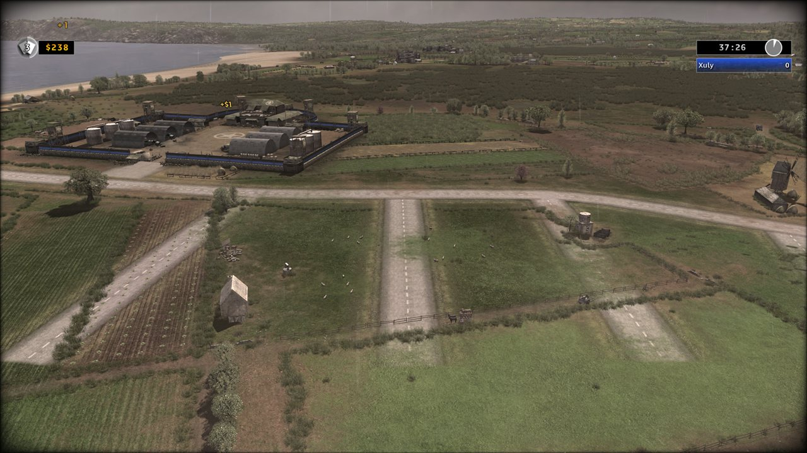
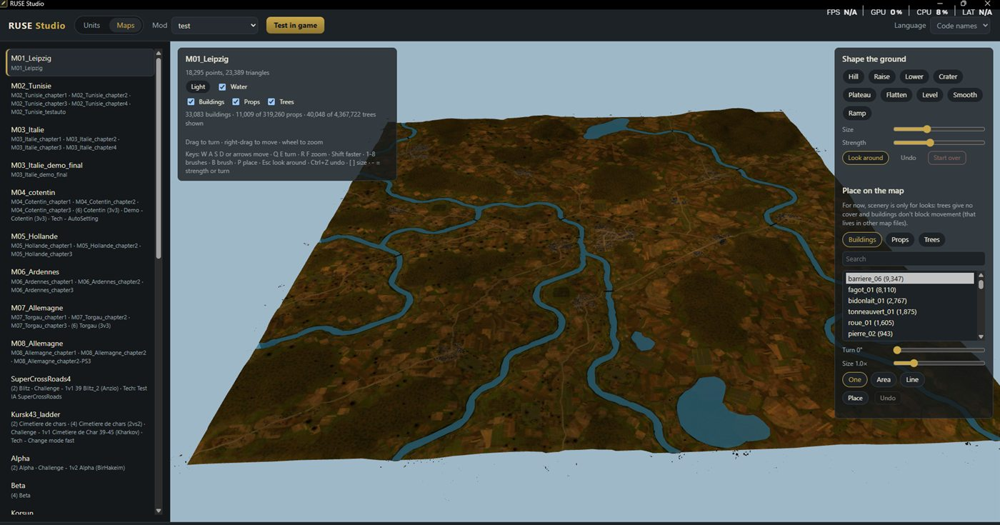
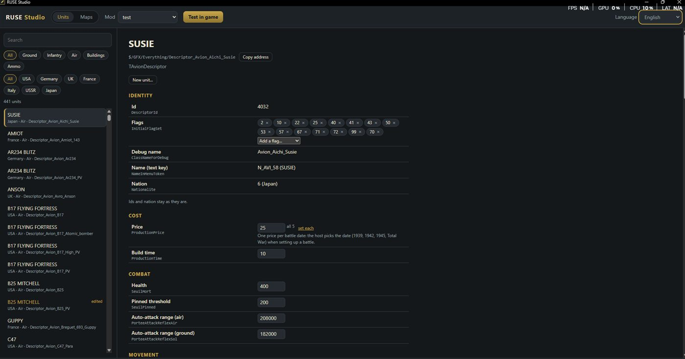

**RUSE Studio, un aperçu pour les moddeurs.** Parcourez les unités du jeu dans n'importe laquelle de ses dix langues,
modifiez-les dans un mod à vous et testez-le en jeu. Votre installation Steam n'est jamais modifiée.

**0.9.8.13:** Les rapports de plantage du jeu disent ce qui a mené au plantage.

- **Les rapports de plantage du jeu de Bug Watch en disent plus :** si vous avez coché Bug Watch et que le jeu plante, le rapport indique maintenant aussi ce que le jeu essayait de lire ou d'écrire, et jusqu'à 16 endroits du jeu qui ont mené au plantage, lus dans le propre rapport de plantage du jeu sur votre PC, qui ne le quitte toujours jamais. Un rapport qui disait seulement où le jeu s'était arrêté ne pouvait pas montrer pourquoi ; nous pouvons maintenant remonter la piste de plantages comme celui qu'un joueur nous a envoyé cette semaine, et les corriger.
- **L'accord, version 3 :** il liste maintenant ces deux nouveautés parmi ce que contient un rapport de plantage du jeu, et rien d'autre n'y a changé. Comme il a changé, les deux applications vous le montrent encore une fois à leur ouverture.

**0.9.8.12:** Tester en jeu construit de nouveau les jeux moddés.

- **Corrigé : Tester en jeu s'arrêtait pour chaque mod** avec « No such file or directory: ...fairplay_watch.bin » : les installateurs des versions 0.9.8.10 et 0.9.8.11 avaient oublié trois fichiers de RUSE Guard, si bien qu'aucun jeu moddé ne pouvait être construit. Ils sont de retour, et une application à laquelle il manque un de ses fichiers ne peut plus être publiée.

**0.9.8.11:** la connexion via Steam aboutit dans les applications ; sous Linux, les programmes d'aide d'une construction démarrent comme sous Windows.

- **Corrigé : la connexion via Steam.** Après votre connexion sur la page de Steam, le Launcher et le Studio attendaient sans jamais demander à notre serveur si c'était fait : la fenêtre arrêtait ses propres vérifications avant la première. Elle vérifie maintenant toutes les quelques secondes et vous connecte dès que Steam le confirme. Essayé dans l'aperçu : la vérification a lieu et la fenêtre vous montre connecté.
- **Les programmes d'aide démarrent à neuf sur tous les systèmes :** les programmes entre lesquels une construction répartit son travail (modèles importés, réparation de la carte, déplacements, eau, terrain de la vue de la carte) démarrent maintenant à neuf sous Linux aussi, comme ils l'ont toujours fait sous Windows. Sous Linux, ils démarraient comme des copies de l'application en cours, ce qui pouvait parfois bloquer une construction, et faisait échouer l'une de nos vérifications. Rien ne change sous Windows ni avec Proton sur le Steam Deck.

**0.9.8.10:** des mods de plus de 4 Go, des listes de construction en groupes, des constructions plus rapides pour les gros mods, vos fichiers dans Documents\RUSE 2.0, le persan et chaque page en 11 langues, des corrections signalées par des testeurs ; et RUSE Guard, notre anti-triche pour les vraies parties multijoueur ; Bug Watch, des rapports de plantages et d'utilisation que vous pouvez activer ; la connexion via Steam ; et un accord au premier démarrage.

- **Corrigé, signalé par un joueur : les mods de plus de 4 Go.** Un jeu moddé dont les paquets dépassaient 4 Go ne se construisait plus (« 'I' format requires 0 <= number <= 4294967295 »). Les paquets portent maintenant leur longueur complète, et un paquet de plus de 4 Go est écrit dans une disposition plus large qu'un petit correctif du jeu permet au jeu de lire : téléchargé une fois et appliqué seulement à votre copie moddée, jamais au jeu dans votre dossier Steam. Au-delà de 32 Go, ou pour un seul fichier de plus de 4 Go, la construction le dit clairement. Testé en jeu : des copies de plus de 4 Go, et avec 200, 283 et les 366 unités d'autres époques.
- **Beaucoup de modèles à vous :** le jeu trouve les textures de remplacement d'un paquet grâce à un index, et une construction qui en ajoutait pour des modèles importés l'écrivait mal : avec beaucoup d'unités d'autres époques, le jeu se figeait ou plantait au chargement. Il est maintenant écrit comme le jeu le lit, pour chaque mod qui en ajoute. Testé en jeu avec les 366 unités d'autres époques.
- **Listes de construction en groupes :** avec beaucoup d'unités, la liste de construction d'un bâtiment dépassait de l'écran et les unités du bas étaient inaccessibles. Chaque liste montre maintenant une ligne par groupe, les lignées du jeu lui-même (une nouvelle unité rejoint le groupe de son type) : 6 unités au plus par groupe et 10 groupes au plus par bâtiment, pour que toute la liste reste à l'écran. Le Studio dit pourquoi quand un groupe est plein et montre les groupes là où vous ajoutez des unités ; un mod fait avant qui dépasse ces limites se construit quand même, avec un avertissement. Testé en jeu avec 297 unités d'autres époques en groupes.
- **Constructions plus rapides :** les modèles que vous importez sont gardés d'une construction à l'autre, et les nouveaux sont faits côte à côte sur les cœurs de votre PC. Un mod avec 366 unités d'autres époques prenait environ 18 minutes à construire sur un PC à 8 cœurs ; maintenant environ 5 la première fois et environ 3 ensuite, avec les mêmes fichiers de jeu, octet pour octet.
- **Modèles importés (rapports de testeurs) :** une pièce de tourelle sur un os que l'apparence copiée ne liste pas (un M109 copié du M7 Priest) arrêtait l'importation ; elle va maintenant sur la propre liste de la copie. Une pièce de tourelle sur un modèle sans tourelle (le P-40, la M274 Mule) suit la caisse, un canon tracté vu de loin montre son propre modèle, et une texture en fine bande reçoit sa texture de remplacement. Les canons tractés testés en jeu ; les pièces de tourelle pas encore regardées de près.
- **Ponts (rapport d'un testeur) :** un seul onglet Ponts : un nouveau pont, vos ponts (chacun avec Aller et Supprimer), et les ponts propres à la carte avec leurs passages, retirés ou remis d'un seul bouton. Un nouveau pont compte quand retirer les anciens coupe la carte en deux, et façonner le terrain garde les extrémités des ponts de la carte à leur hauteur. L'effacement est plus facile à trouver (Peindre et effacer, ou la touche X). Un mod d'unités et des changements de carte faits sous un même nom se construisent ensemble, et la vue de la carte montre de nouveau les modèles du jeu. Pas encore essayé en jeu.
- **Vos fichiers dans Documents\RUSE 2.0 :** vos mods, cartes, exports et sauvegardes vont dans Documents\RUSE 2.0, où l'Explorateur de fichiers les montre ; ce que le Studio gardait dans son ancien dossier y est déplacé une fois, et il le dit. Supprimer un mod… l'envoie à la Corbeille, Afficher le dossier de ce mod l'ouvre, et les Réglages montrent où tout se trouve. Vu dans un aperçu ; pas encore essayé dans les fenêtres des applications.
- **Le persan et 11 langues :** le persan est la 11e langue des applications, écrit de droite à gauche ; le README, le wiki, ces notes et les écrans d'installation sont dans les 11.
- **Mises à jour obligatoires :** une mise à jour que nous marquons obligatoire s'installe d'elle-même, avec une fenêtre que personne ne peut fermer (les applications à partir de cette version savent lire la marque). La fenêtre Nouveautés garde sa hauteur quand vous la faites défiler.
- **Copies possédées seulement :** avant que Jouer ou Tester en jeu ne construise une copie moddée, les applications vérifient que le dossier du jeu est une copie que vous possédez, d'après ce que Steam y a laissé, sous Windows, sous Proton sur le Steam Deck et sous Linux. Si la vôtre ne peut pas être confirmée (une copie en boîte d'avant l'arrivée de R.U.S.E. sur Steam), une fenêtre vous permet d'ouvrir un ticket, et nous vous envoyons un code de déblocage pour ce PC.
- **Discord :** les applications et les pages utilisent une nouvelle invitation qui n'expire pas.
- **Un accord au premier démarrage :** la première fois que le Studio ou le Launcher s'ouvre, il explique ce que fait RUSE Guard et vous demande de l'accepter (c'est obligatoire pour jouer en ligne avec les applications), si vous voulez activer Bug Watch (facultatif), et un nom d'utilisateur que nos développeurs voient avec vos rapports : un # et quatre chiffres y sont ajoutés pour qu'il soit unique, comme Nick#4821. Un seul nom sert aux deux applications. L'accord s'affiche à nouveau quand il change. Vu dans les deux applications. Dans les 11 langues.
- **RUSE Guard :** notre anti-triche, d'après la conception de DomesticNukes. Il ne fonctionne qu'en parties multijoueur et coopératives, jamais en solo, en escarmouche contre l'ordinateur, dans la campagne, ni pendant que vous créez des mods. Une copie moddée construite avec une triche ou un outil de test ne sert qu'au jeu hors ligne : elle quitte d'elle-même les parties multijoueur et coopératives. Pendant une vraie partie, il compare les noms de vos programmes en cours d'exécution à une liste d'outils de triche connus (les noms seulement ; rien d'autre n'est lu), et ce qu'il recueille d'une partie est classé sous votre nom d'utilisateur, jamais sous votre compte Steam. Tester en jeu construit ses copies avec lui. Testé en parties multijoueur contre un vrai adversaire ; les preuves arrivent sur notre serveur.
- **Bug Watch (facultatif) :** quand vous le cochez, le Studio et le Launcher comptent ce que vous utilisez et quand quelque chose va mal, les plantages des applications et ceux du jeu, avec les mods qui étaient actifs, et l'envoient une fois par jour à nos développeurs avec votre nom d'utilisateur. Pas de vrai nom, pas de compte Steam, pas de fichier. Désactivé tant que vous ne le cochez pas ; décochez-le quand vous voulez et ce qui était conservé est supprimé. Vu dans les deux applications.
- **Connexion via Steam :** une connexion sur la page de Steam dans votre navigateur confirme que vous possédez R.U.S.E., pour le jeu en ligne, RUSE Guard et les téléchargements de contenu. Nous ne voyons jamais votre mot de passe, et votre identifiant Steam n'est jamais enregistré : seulement un laissez-passer conservé sur votre PC pendant 30 jours. Le Studio le demande une fois ; les Réglages du Launcher l'ouvrent à tout moment. Rien n'en a encore besoin. Pas encore essayé dans les applications.

**0.9.8.9:** des téléchargements sur plus de PC, et une lecture d'images plus sûre.

- **Corrigé, signalé par un joueur :** sur un PC dont Windows n'a pas le certificat avec lequel les téléchargements de GitHub sont vérifiés et ne peut pas le récupérer, les téléchargements échouaient (« unable to get issuer certificate »). Les téléchargements du Studio (ses mises à jour, les patchs du jeu, les modèles des unités d'époque et les textures en ligne de Map Paint) essaient maintenant aussi avec la liste de certificats de Firefox, qu'il emporte.
- **Des images plus sûres :** la bibliothèque avec laquelle le Studio lit les images (Pillow) passe en version 13.0.0, avec ses corrections contre des fichiers d'image piégés qui pouvaient faire planter l'application, épuiser sa mémoire, ou pire.
- **Un code plus strict :** les 12 avertissements de la vérification de code de GitHub sur ce projet sont traités. Quand le Studio affiche ses pages dans votre navigateur, elles n'ouvrent que ses propres fichiers, vérifiés d'une façon que cette vérification reconnaît ; les téléchargements demandent TLS 1.2 ou plus récent, comme avant ; et la lecture des erreurs de routes d'un test échoué reste rapide sur n'importe quel message. Rien d'autre ne change dans le fonctionnement du Studio.

**0.9.8.8:** un écran de départ et un tableau des bâtiments, des bâtiments à vous, RUSE Decoy pour les sons et les animations, chaque règle du jeu dans un onglet, et R.U.S.E. 2.0 en or.

- **Un écran de départ :** reprendre votre mod, en commencer un nouveau, ou le passer (même toujours). Les étapes d'un nouveau mod : son nom, chaque nation garde ses unités ou part vide, la recherche (celle du jeu, aucune ou la vôtre), le tableau des bâtiments, puis ce que le mod changera. Vu en jeu.
- **Le tableau des bâtiments :** les bâtiments de chaque nation en rangées des unités que leurs menus de construction offrent, dans l'ordre du jeu. Mettez-y une unité (de la nation, la copie d'une unité d'une autre nation, une unité d'époque), glissez-la le long d'une rangée ou vers un autre bâtiment, retirez-la, ou faites-la rechercher depuis l'unité sous laquelle elle va. La page de chaque unité dit où elle est construite. Vu en jeu.
- **Ajouter un bâtiment… :** une copie d'un bâtiment du jeu qui fait les mêmes unités, ou un bâtiment avec ses propres unités et son propre onglet dans la barre de construction, jusqu'à trois par nation. Le deuxième et le troisième demandent un petit patch du jeu pour plus de bâtiments : le Studio le télécharge une fois et ne l'applique qu'à votre copie moddée, jamais au jeu de votre dossier Steam. Vu en jeu.
- **L'apparence propre d'un bâtiment :** sur la page d'un nouveau bâtiment, importez un modèle 3D à la place d'une pièce de l'apparence qu'il copie (le bâtiment principal d'une usine ou d'un QG, ou la pièce choisie), et donnez-lui sa propre image dans le menu de construction. Vu en jeu.
- **Importer un modèle… dans l'onglet Cartes :** un modèle 3D (.glb, .gltf ou .3ds) devient un rocher, un objet, une plante ou un arbre de votre carte, placé comme ceux du jeu, avec une taille et le crédit de son auteur (modèles d'autrui : CC0 ou CC-BY seulement). Les unités le renversent comme ceux du jeu ; avec **Solide** coché, elles le contournent. Vu en jeu.
- **RUSE Decoy, le concepteur de sons et d'animations,** à la place de l'onglet Musique. Chaque son du jeu par type (armes proches et lointaines, impacts, moteurs, ambiances, interface, cartes ruse, voix des unités, radio, répliques des missions avec ce que dit chacune, musique) : écoutez-le, donnez-lui son propre volume (0 à 200 %) ou remplacez-le. Animations : un autre clip à la place d'un clip, un clip plus lent ou plus rapide, un os agrandi ou tourné, ou de la capture de mouvement sur les soldats, depuis une bibliothèque de 3 205 mouvements libres (la base de capture de mouvement CMU et 100STYLE, crédités), chacun téléchargé quand vous le choisissez. La page d'une unité ouvre RUSE Decoy sur ses propres sons et animations. Vu en jeu. Ses messages d'erreur sont en anglais seulement pour l'instant.
- **Réglages de l'IA et des joueurs :** les onglets Économie et IA ne font plus qu'un. Réglages des joueurs : argent et revenu, dépôts de ravitaillement, production et cartes ruse, comme avant. Joueurs ordinateur : chacune de leurs 47 valeurs sur le jeu par défaut, chaque difficulté et chaque personnalité (une valeur que le jeu omet dans un jeu de valeurs montre le 0 que le jeu compte). **Règles du jeu :** 172 autres valeurs du jeu en 16 groupes (bataille et reddition, population, déplacement et routes, tir et cibles, dégâts, bois et couvert, avions, cartes de ruse en action, placement des bâtiments, parties classées en ligne, contours et effets à l'écran, couleurs des joueurs et des secteurs avec un sélecteur de couleur, et d'autres), chacune nommée et expliquée. Pas encore essayé en jeu.
- **Toutes les valeurs et fichiers :** les onglets Toutes les valeurs et Fichiers ne font plus qu'un, avec un interrupteur en haut ; il s'ouvre sur la partie utilisée en dernier.
- **Corrigé :** Toutes les valeurs montrait les nombres d'une couleur dans le mauvais ordre (le jeu garde le bleu en premier) : la couleur de joueur 1, bleue, paraissait orange, et taper le rouge changeait le bleu. Les couleurs se montrent et se saisissent maintenant rouge en premier ; un fichier de mod garde l'ordre du jeu, comme avant.
- **Corrigé : des taches sombres et claires sur les cartes faites par le Studio** (cartes vierges, agrandies, en relief et à secteurs) : l'inclinaison du sol était mal écrite, donc l'herbe et les champs étaient éclairés inégalement. Une carte est bien éclairée une fois construite avec cette version (son sol est refait la première fois). Vu en jeu.
- **Retirer les anciens passages (de DomesticNukes) :** dans les routes de l'onglet Cartes, avec **Retirer les ponts de la carte** activé, **Fermer les passages des anciens ponts** ferme aussi le sol où chaque ancien pont franchissait l'eau et coupe les liens de route qui le traversent : plus rien ne traverse là ; le reste du réseau routier reste. Pas encore essayé en jeu.
- **R.U.S.E. 2.0 en or :** le jeu moddé que construit Tester en jeu s'ouvre sur une scène de bataille avec un moteur qui démarre, et son menu principal, le petit titre de chaque menu, les contours des menus et les écrans de chargement disent R.U.S.E. 2.0 en or. Il est fait sur votre PC à partir des fichiers de votre propre jeu la première fois (quelques minutes une fois, puis gardé). Réglages a une case pour garder le titre du jeu. Vu en jeu.
- **Les lettres du jeu :** le Studio est écrit dans la police des menus du jeu, prise dans votre jeu à chaque démarrage (la police n'est pas fournie avec le Studio).
- **Corrigé, signalé par un moddeur :** un modèle importé sur une nouvelle unité faite à partir du Panther se posait loin de l'unité ; sur des unités faites à partir de 85 autres (le GPF de 155 mm, le SU-85, le Carro Veloce, le StuG III, le M7 Priest...), il était décalé de la tourelle. Le Studio lit maintenant bien où leurs tourelles tournent. Un modèle importé avant garde son ancienne place : utilisez de nouveau Importer un modèle… sur cette unité. Pas encore essayé en jeu.
- **Corrigé, signalé par un joueur :** un modèle aux images JPG ou WebP (la plupart des .glb téléchargés) était refusé ; il s'importe maintenant. Un modèle que l'import ne sait toujours pas lire (maillages compressés, images KTX2) le dit, et comment le corriger dans Blender. Pas encore essayé en jeu.
- **Corrigé, signalé par un joueur :** un char du jeu, ouvert dans Blender et réimporté, gardait sa tourelle fixe. Ouvrir dans Blender nomme maintenant l'os de chaque pièce comme le jeu, et l'import fait tourner une pièce sur l'os de la tourelle avec la tourelle. Un modèle exporté avant garde ses anciens noms : rouvrez-le dans Blender. Pas encore essayé en jeu.
- **Nommez vos munitions :** une munition copiée porte en jeu le nom que vous lui donnez, et la page de chaque munition a **Son nom en jeu** : un nouveau nom ou type, dans toutes les langues à la fois, puis une langue seule. Pas encore essayé en jeu.
- **Des types de drapeaux à vous :** sous les drapeaux d'une unité, **Créer ou changer des types de drapeaux…** crée un type nommé : cochez les drapeaux du jeu qu'il active et désactive. Donnez-le à n'importe quelle unité ; retirez-le et ses drapeaux redeviennent comme avant. Changez un type et chaque unité qui l'a change aussi. Le jeu n'agit que sur ses propres drapeaux : un type combine ce qu'ils font déjà. Pas encore essayé en jeu.
- **La vitesse des tirs bien expliquée :** le guide des nombres disait que la vitesse d'un tir, sa traînée, l'interrupteur « sans physique » et le temps avant le départ n'étaient que de l'apparence. Ils décident quand le coup arrive : un tir plus lent touche plus tard, et une cible en mouvement est visée en avance du temps de vol (d'après le fonctionnement du jeu ; pas encore essayé en test).
- **Chaque erreur en dix langues :** les 35 erreurs du Studio venues avec l'import de modèles et le tableau des bâtiments.
- **Crédits :** le README dit ce que le moteur de LittleGroove fait encore dans le nôtre, ce qui est à nous, et que notre lecteur de textures utilise aussi le codec de ProLution.
- **Encore buggé, à utiliser à vos risques :** les textures de Map Paint, et les deux cartes vierges (Terrain vierge et Océan vierge).

**0.9.8.7:** Rétablir et sélectionner ce qui est placé, placement en Grille / Boîte / Chemin, des cartes vierges plus grandes, et chaque valeur expliquée.

- **Corrigé, signalé par un moddeur :** sur une nouvelle unité faite à partir de 17 des unités du jeu (le Tigre royal, les canons atomiques, le V2...), la case pour changer son modèle n'apparaissait jamais. Le Studio trouve ces modèles maintenant, et s'il n'en trouve pas un, la case le dit au lieu de disparaître.
- **L'onglet IA expliqué :** chaque valeur des joueurs de l'ordinateur dit ce qu'elle fait, en unités simples, et laquelle l'emporte en bataille pour chaque difficulté et profil ; modes, difficultés, profils et unités choisis par leur nom.
- **Chaque valeur expliquée, partout :** Toutes les valeurs, l'onglet Unités, les pinceaux de l'onglet Cartes (taille en mètres, force selon ce qu'elle fait) et l'onglet Musique (quand chaque liste de bataille joue).
- **L'onglet Économie, Normal et Nucléaire à part :** là où les deux modes diffèrent, chacun a ses propres cases. Un changement du seul mode Nucléaire n'a pas encore été essayé en jeu.
- **Rétablir et sélectionner :** Rétablir dans chaque outil de carte (Ctrl+Y ou Ctrl+Maj+Z, et un bouton) ; dans les plateaux Bâtiments et Objets & arbres, sélectionnez ce qui est placé (clic, Maj+clic ou un cadre), faites-le glisser, tournez-le, redimensionnez-le ou supprimez-le, ceux de la carte aussi.
- **Grille, Boîte et Chemin :** placez des rangées d'objets en grille ou en boîte, des bâtiments face aux routes, et des haies, alignements et bandes d'arbres le long d'un chemin, avec couvert.
- **Des cartes vierges plus grandes :** la fenêtre Taille de la carte d'une nouvelle carte vierge ajoute ou retire des bandes de terrain de chaque côté, et Faire les secteurs la remplit de secteurs.
- **Menus et confort :** des lignes de nombres au lieu de curseurs, une recherche avec #étiquettes et vos recherches récentes, des fiches qui s'ouvrent, et des touches à réassigner (Échanger, La prendre, Annuler).
- **Plus sûr :** fermer le Studio avec du travail non enregistré demande d'abord ; une carte avec un nouveau terrain coupé est refusée avant Tester en jeu ; un mod fait avec un ancien Studio est mis à jour après une sauvegarde (Mettre à jour ce mod) ; les résultats de construction gardés restent bons après une mise à jour du Studio.
- **Chaque message dans les dix langues :** les erreurs du Studio et les lignes de la construction.
- **Nouvelle unité** laisse de côté les deux unités sans modèle de départ (le canon SOLO de 57 mm et les parachutistes SOLO).
- Pas encore essayé en jeu : ce qui est placé avec Grille, Boîte et Chemin, les objets déplacés, et une plus grande carte faite dans le Studio.
- **Encore buggé, à utiliser à vos risques :** les textures de Map Paint, et les deux cartes vierges (Terrain vierge et Océan vierge).

**0.9.8.6:** chaque drapeau et chaque nombre des unités expliqués, les outils de carte montrent ce qu'ils ont fait, et les cartes vierges bien dessinées.

- **Les drapeaux des unités expliqués :** chaque drapeau sur la page d'une unité montre son nom, et en le survolant on voit ce qu'il fait, comment s'en servir et à quel point nous en sommes sûrs. **Guide des drapeaux : tous expliqués** liste les 105, avec une recherche. Le Studio vérifie les drapeaux d'une unité : un plantage connu (les drapeaux d'un camion sur autre chose qu'un camion, un avion armé avec le drapeau de reconnaissance sans celui de chasseur) montre sa correction, et le Studio ne lance pas le jeu tant qu'il n'est pas corrigé ; les drapeaux qui devraient casser une unité donnent un avertissement.
- **Chaque nombre expliqué :** survolez le nom de n'importe quel nombre d'une unité ou d'un bâtiment pour voir ce qu'il veut dire ; à côté, sa valeur en unités simples (mètres, km/h, secondes, degrés, $, %), un curseur pour le rendre plus petit ou plus grand que la valeur du jeu (sa valeur de base, de -90 % à +300 %), et où il se place parmi les unités du jeu de son genre. Les vitesses sont dans les km/h du jeu.
- **Comment marchent les armes et les munitions**, pas à pas, dans le cadre Armes.
- **Les outils de carte montrent ce qu'ils ont fait :** Couvert, Découvrir, Ville, Forêt, Bloquer et Ouvrir marquent le sol que chaque trait a parcouru et disent combien de m² ont changé pour les unités, ou que rien n'a changé. Ville marche en vrais mètres et entoure d'abord les bâtiments qu'un clic couvrira.
- **Placer :** les bâtiments, arbres et objets placés montrent leurs vrais modèles (avec un point à leur pied) ; celui choisi apparaît en transparence sous le pointeur avant le clic ; la liste à placer est une grille d'images. Les arbres ne sont plus noirs, et les numéros de secteur se cachent quand la caméra est proche.
- **Cartes vierges** (vu en jeu sur un Terrain vierge) : des ombres sur le sol plat ; ce que vous placez là où la carte copiée avait la mer est dessiné ; le plancher de la caméra suit le nouveau sol.
- **Encore buggé, à utiliser à vos risques :** les textures de Map Paint, et les deux cartes vierges (Terrain vierge et Océan vierge).

**0.9.8.5:** des avions dans n'importe quel rôle, des armes qui touchent les avions, et une bibliothèque pour le pinceau Texture de Map Paint.

- **Le rôle d'un avion** (signalé par un joueur : un chasseur-bombardier à qui l'on donnait les bombes en tapis d'un bombardier volait jusqu'à sa cible et ne larguait rien) : une nouvelle case Rôle sur la page d'un avion en fait un Chasseur, un Chasseur-bombardier, un Bombardier ou un Éclaireur. Son comportement, la façon dont les joueurs de l'ordinateur l'utilisent et ses mots dans le menu de construction changent avec. Les bombes d'un bombardier vont dans une soute (copiée sur celle d'un bombardier du jeu), la seule façon dont le passage d'un bombardier les largue. Vu en jeu : un chasseur-bombardier devenu bombardier largue ses bombes ; un éclaireur qui garde ses armes (un Stuka, un ME109) attaque toujours et a la vue des éclaireurs.
- **Véhicules de reconnaissance :** la case Rôle d'un véhicule terrestre en fait un véhicule de Reconnaissance : la vue des voitures de reconnaissance (bien plus loin que celle d'un char), la façon dont les joueurs de l'ordinateur les utilisent, leurs mots dans le menu de construction, et il peut entrer dans les bois (vu en jeu avec un Panzer IV).
- **Ce qu'une arme touche :** le Touche de chaque arme choisit le sol, les avions, ou les deux (une seconde arme à côté, comme les canons antiaériens du jeu en portent une pour chacun). Vu en jeu : des obus de char tirés sur des avions. Connu : une arme d'avion réglée pour toucher le sol seul ne fait encore aucun dégât.
- **Le pinceau Texture de Map Paint a une bibliothèque :** les textures de sol du jeu (herbe, champs, sable, neige, roche, routes..., par théâtre, avec une recherche), un carré du sol de n'importe quelle carte, vos propres images, et des images gratuites en ligne (Poly Haven et ambientCG, CC0 ; photos aériennes des États-Unis, domaine public), une image téléchargée par clic et gardée dans votre mod avec son crédit. Un curseur Taille, les textures utilisées récemment, et **Détail du jeu de près**, qui pose les décalques du jeu d'une texture du jeu sur le sol que vous peignez. Pas encore vu en jeu ; les téléchargements en ligne pas encore essayés.
- **Les objets placés en terrain dégagé**, loin des villes, des fermes et des bois de la carte, sont maintenant à la portée de l'affichage du jeu, et les grands groupes de nouveaux objets sont rangés comme ceux du jeu (pas encore vu en jeu).
- **Repeindre plus vite :** le sol peint est gardé d'une construction à l'autre, quelle que soit la copie ou le mod qui l'a peint : une carte repeinte de la même façon le reprend en quelques secondes, pas en minutes.
- **Encore buggé, à utiliser à vos risques :** les textures de Map Paint, et les deux cartes vierges (Terrain vierge et Océan vierge).

**0.9.8.4:** vos propres missions, des cartes vierges à construire, et bien plus à personnaliser.

- **Encore buggé, à utiliser à vos risques :** les textures de Map Paint, et les deux cartes vierges (Terrain vierge et Océan vierge).
- **Vos propres missions :** une nouvelle Opération ou un nouveau chapitre de campagne a sa propre mission, côté Scénario de l'écran de carte : camps, objectifs, événements (Quand → Faire : faire venir des unités, déplacer, attaquer, tenir une zone, artillerie, bombardement, parachutistes, messages, argent, victoire, défaite) et mouvements de caméra. Vu en jeu : son mouvement de caméra, les objectifs (une zone, un groupe détruit, un temps), les événements répétés, l'argent, un camp confié à l'ordinateur. Pas encore essayé : les parachutistes, un mouvement de caméra lancé par un événement.
- **Carte | Scénario** sur l'écran de carte : ce qui est de l'autre côté est estompé et ne peut pas être pris par erreur.
- **Cartes vierges :** plus rien de la carte copiée ne s'affiche, et vous placez le QG de chaque joueur (la construction attend qu'ils soient tous placés). Terrain vierge marche aussi pour les Opérations et les chapitres de campagne.
- **Vos propres secteurs :** peignez-les, tirez leurs coins, tracez-en un nouveau en boîte, laissez du terrain sans secteur, supprimez-en un (vu en jeu).
- **Dépôts de ravitaillement :** l'onglet Économie donne plus de camions à chaque dépôt de chaque carte, ou d'une carte (fois, ou un nombre chacun) ; plus de plafond à 1 000 camions.
- **Onglet Nations :** cachez d'un coup toutes les unités d'une nation, montrez-les de nouveau, ou remplissez ses menus avec les unités d'une époque.
- **Modifier un mod installé :** ouvrez n'importe quel mod du Launcher ; celui de quelqu'un d'autre devient une copie à vous sous son propre nom. Les mods RUSE Mod Manager (.rmod) sont convertis pour que leurs valeurs puissent être changées.
- **La vérification du mod en mots simples**, avec un bouton pour corriger chaque problème.
- **Le look propre d'une unité :** sa propre copie de son modèle à repeindre ; les escouades portent l'uniforme par défaut ou un uniforme personnalisé ; choisissez le camion dans lequel une escouade ou un canon roule. L'infanterie s'affiche en 3D et s'ouvre dans Blender.
- **Le blindage** se choisit parmi les niveaux du jeu, pour que la carte montre ce avec quoi l'unité se bat ; **les avions importés** gardent leurs hélices qui tournent et reviennent tournés vers l'avant (les deux vus en jeu).
- **Tailles des modèles sur un curseur** (Minuscule, Taille du jeu, Taille réelle, Énorme : 0,05 à 20), à changer quand vous voulez, tous les avions d'un coup.
- **Plus à changer :** une valeur propre à une difficulté ou un profil d'IA pour une valeur que seul Défaut liste ; des nombres au-delà des curseurs des outils de carte ; des retouches de musique plus fortes et plus longues.
- **Corrigé :** une unité montrée dans un menu mais recherchée depuis une unité cachée arrêtait le jeu : la vérification la nomme et la construction la refuse. Les chars tirent de nouveau à travers les villes effacées, et les unités ne tombent plus dans les trous laissés là où les ponts ont été retirés (vu en jeu).
- **Les téléchargements marchent sur tous les PC :** quand Windows n'a pas encore récupéré le certificat qui sert à vérifier GitHub, le Studio le lui demande, comme un navigateur, puis réessaie (pas encore essayé sur un PC qui avait le problème).

**0.9.8.3:** les copies avec les mods vont où vous le dites.

- **Où vont les copies avec les mods**, dans les Réglages : choisissez le dossier où la copie du jeu avec les mods est
  construite, ou revenez à l'emplacement recommandé, `RUSE-Instances` sur le disque du jeu (la copie y partage les
  fichiers du jeu et est prête en quelques secondes ; sur un autre disque, c'est une copie complète du jeu, plus lente
  et plus grosse). La sauvegarde propre du jeu va à côté. Le prochain Tester en jeu construit au nouvel endroit ;
  l'ancien dossier peut être supprimé à la main. Le Launcher utilise le même dossier.

**0.9.8.2:** les unités d'autres époques arrivent : leurs modèles, à leur vraie taille, derrière une recherche.

- **Des unités d'autres époques :** les époques WWI, WWII+, Guerre froide et Moderne de l'onglet Unités ont désormais
  leurs unités : 366, chacune sur le modèle gratuit d'un autre auteur (CC0 ou CC BY), crédité. Chaque époque se
  télécharge dans le Studio quand vous la choisissez, depuis notre GitHub (chaque fichier vérifié : WWI 232 Mo, WWII+
  198 Mo, Guerre froide 996 Mo, Moderne 709 Mo), et se met à jour d'elle-même à mesure que d'autres sont terminées.
  - **À leur vraie taille :** la vraie largeur de chaque unité (pour un avion, son envergure) à l'échelle du jeu ;
    modifiable de 0,2 à 5 fois.
  - **Recherchées comme les unités du jeu :** depuis n'importe quelle unité du bâtiment de sa nation, y compris les
    unités d'époque du mod, pour faire une chaîne (un T-80, puis un T-90M), avec un prix et une durée de recherche.
    Les unités WWI et WWII+ s'achètent directement ; celles de la Guerre froide et Modernes partent d'une recherche
    depuis une unité adaptée.
  - **Leurs propres cartes** dans le menu de construction et à la sélection.
  - Vu en jeu : elles se chargent tout de suite, les onglets de recherche et une chaîne, un Land Rover avec son
    propre modèle, les tailles. Pas encore essayé : les canons tractés (pas encore de canon du jeu auquel les
    ajuster).
- **Importer un modèle… :** un modèle qui commence par une figurine d'équipage a maintenant son propre modèle (les
  jeeps copiées sur le Kübelwagen montraient celui du Kübelwagen) ; les modèles peints en spéculaire-brillance
  gardent leur peinture ; les couleurs données en nombres ne sont plus noires ; les gros modèles s'importent plus
  vite.
- **Une unité recherchée depuis l'unité d'une autre armée** laissait le jeu sur un écran de chargement sans fin :
  **Nouvelle unité…** retire ce lien désormais, et la construction du mod refuse une unité recherchée depuis une
  unité absente ou d'une autre nation, en disant pourquoi et comment corriger.
- **Retirer une unité dont d'autres sont recherchées :** choisissez dans **Réglages > Recherche** d'être averti
  d'abord (par défaut), de refuser, ou de les relier à nouveau à son propre parent ; une unité qui pointe vers une
  unité disparue le montre sur sa page et dans la vérification. Les durées de recherche se tapent en secondes ou en
  minutes (que le jeu les compte en secondes n'est pas encore essayé en jeu).
- **Linux et Steam Deck (via Proton) :** le Studio s'ouvre dans votre navigateur web quand sa propre fenêtre ne le
  peut pas. Pas encore essayé sur Linux : dites-nous ce qu'il en est.

**0.9.8.1:** Les outils de LittleGroove arrivent dans le Studio, avec la musique et les sons, et une nation changée en une autre.

- **Les outils de LittleGroove, repris** de son RUSE-Mod-Manager :
  - **Onglet Économie :** argent de départ et revenus, dépôts de ravitaillement, et les cartes de ruse de départ de
    chaque camp. Vu en jeu : l'argent de départ et les cartes de départ.
  - **Onglet IA :** la façon de jouer des joueurs ordinateur, les unités qu'ils préfèrent et les cartes de ruse ; et les
    scripts de cartes et de missions du jeu, montrés en Python, en lecture seule. Vu en jeu.
  - **Encadré Amélioration** sur la page d'une unité : l'unité qu'elle améliore, ses propres améliorations, le prix et
    la durée de sa recherche.
  - **Onglet Toutes les valeurs :** n'importe quel objet ou valeur du jeu, changé dans un mod : ajouter ou
    retirer une valeur, créer ou supprimer un objet, donner à une valeur de texte ses propres mots.
  - **Onglet Fichiers :** n'importe quel fichier des packs du jeu, visible et enregistrable. Remplacez-en un par un fichier à
    vous ou ajoutez-en un : votre mod ne garde que les changements, chacun vérifié selon son type.
  - **Missions :** changer les scripts d'une mission ; voir si elle est dans les menus, si chaque fichier dont elle a
    besoin se charge, et ses textes ; la monter ou la descendre dans son menu.
  - **Cartes :** noms de villes et de collines, points et zones nommés, nom et orientation d'un objet de la carte.
    **Notes** sur une unité, une valeur ou un joueur ordinateur.
- **Onglet Musique :** chaque morceau selon l'endroit où il joue, chacun remplacé dans un petit éditeur du Studio
  (couper, fondu, volume) ; de nouveaux morceaux ajoutés aux listes de bataille ; les répliques d'une unité sur sa
  page ; le son d'ambiance d'une carte. Vu en jeu : les morceaux, les nouveaux morceaux et les répliques.
- **Faire d'une nation une autre.** Le nouvel onglet **Nations** donne à l'une des sept nations du jeu un nouveau
  nom (dans le salon, et pour son armée) et un nouveau drapeau à partir de n'importe quelle image : la Chine à la
  place de l'Italie, par exemple. Ses unités et ce qu'elles disent se changent comme avant, dans l'onglet Unités et
  sur la page de chaque unité. Vu en jeu : le nouveau nom dans le salon, le nouveau drapeau dans une partie.
- **Des unités d'autres époques :** l'onglet Unités propose les époques WWI, WWII+, Guerre froide et Moderne à côté
  des unités du jeu. Elles n'ont pas encore d'unités : elles arriveront dans une prochaine mise à jour.
- **Nouvelle carte : partir de zéro…** est dans l'onglet Cartes avant qu'une carte soit ouverte.
- **Le sol de Terrain vierge est dessiné pour lui-même.** Une nouvelle carte partie de zéro a un sol fait à partir de
  vos traits de terrain, et non plus le sol de la carte du jeu déplacé : des rivages arrondis de près comme de haut,
  plus de creux au sommet des collines, et les bâtiments et les chars posés exactement dessus. Vu en jeu sur des
  cartes de test.
- **Océan vierge reste, avec un avertissement** sur son bouton : des îles séparées ne sont pas prêtes pour de
  vraies batailles (ci-dessous).

Pas encore essayé en jeu : l'encadré Amélioration, Toutes les valeurs, Fichiers, les outils des missions, les ajouts
aux cartes et les sons d'ambiance.

**Pourquoi il n'y a pas encore de cartes navales.** Nous avons essayé des cartes d'îles pour de vraies batailles avec
des navires, et c'est le jeu lui-même qui bloque :

- Une unité terrestre envoyée vers une île qu'elle ne peut pas atteindre fait planter le jeu.
- Relier les îles par une bande de terre évite le plantage, mais l'ordinateur y envoie alors simplement son infanterie.
- Sans route entre les îles, aucun bâtiment ne peut être placé nulle part.
- Avec les armes du jeu, navires et unités terrestres ne peuvent presque pas se blesser.

Les données de carte seules ne peuvent pas corriger le plantage, donc les cartes navales attendent.

**0.9.8:** une nouvelle carte peut partir de zéro, en terre plate ou en pleine mer, et chaque carte peut avoir ses
propres images dans les menus du jeu.

- **Partir d'une carte vierge.** **Dupliquer la carte** a un nouveau choix, **Partir de** : **Terrain vierge** (une
  terre plate sans rien dessus, sauf les points de départ) ou **Océan vierge** (la mer sur toute la carte). Vérifié en
  jeu.
- **Des images de menu pour chaque carte.** Choisissez un PNG pour l'image de la carte et sa carte 3D dans les menus,
  ou revenez à celles du jeu ; les points de départ blancs sont dessinés là où partent les joueurs de la carte.
  **Créer dans Blender…** ouvre le modèle 3D de la carte elle-même pour les faire, et **Récupérer** les place dans
  votre mod. Vérifié en jeu.

| Avant | Maintenant |
|---|---|
| Une nouvelle carte partait d'une copie complète d'une carte du jeu. | **Dupliquer la carte** peut la faire partir de zéro : Terrain vierge ou Océan vierge. |
| Une nouvelle carte montrait les images de menu de la carte copiée. | **Images du menu…** lui donne les siennes : un PNG à vous ou une image faite dans Blender, avec les points de départ là où partent ses joueurs. |
| Les dépôts, unités, bâtiments et noms de la carte restaient. | **Retirer** en retire un, ou tous les dépôts ou tous les noms d'un coup (vérifié en jeu). |
| Les routes et les ponts de la carte restaient. | Le dock Routes les retire (les tracés des routes disparus : vérifié en jeu). |
| Les secteurs laissaient de côté la mer et les bords de la carte. | **Secteurs sur toute la carte** : toute la carte peut être prise (vérifié en jeu). |
| L'eau d'une carte venait seulement de ses rivières et de sa mer. | **Eau sur toute la carte** : une fine couche, comme la mer peinte d'une carte navale (vérifié en jeu ; les unités dessous pas encore essayées). |
| L'éditeur de carte prenait les apparitions une par une, sous des noms de code. | Tracez un cadre pour les sélectionner comme dans le jeu ; les icônes de la carte montrent ce qui est sélectionné, et combien. |
| Les panneaux de l'éditeur de carte avaient une seule taille. | Chaque panneau flottant se redimensionne, de 40 % à 125 %. |
| Les nouveautés étaient en anglais seulement. | Elles sont dans la langue du Studio. |
| Envoyer un mod à la liste des mods voulait dire écrire son entrée à la main. | **Publier sur la liste des mods** ouvre le formulaire de la liste, déjà rempli, avec une copie .zip prête à y glisser ; chaque export indique qu'il a été fait avec RUSE Studio. |
| Importer un modèle perdait l'ombrage et les parties transparentes du modèle. | Il les garde, et dit ce qu'il a gardé (pas encore vu en jeu). |
| Une unité construite sur une mer asséchée pouvait faire planter le jeu ; une vieille eau de rivière se dressait en murs le long du bord d'une carte ; des phares effacés brillaient encore sur la mer. | Corrigé, chaque point vérifié en jeu. |

Connu : **les cartes navales ne sont pas finies.** Océan vierge se construit et se joue, mais les unités sous son eau
n'ont pas encore été essayées.

**0.9.7:** les très grands mods de carte se construisent maintenant en quelques minutes. Avant, leur construction
prenait très longtemps, et c'est pour cela que cette mise à jour était nécessaire. Et **Exporter le mod…** emporte ce
que la construction a calculé : la première construction d'un tel mod chez un joueur est plus courte.

- **Le mod de carte le plus extrême que nous ayons** (la carte « Le jour J » avec sa mer asséchée : 154 coups
  d'aplanissement, 135 coups de peinture, 33 385 bâtiments effacés) prenait environ quatre heures à construire.
  Maintenant il se construit en **moins de 10 minutes**, sans rien garder d'une construction précédente, et les
  fichiers du jeu sortent identiques. Cela nous a pris environ 15 heures ; où cela bloquait et pourquoi :
  [Comment nous en sommes arrivés là](https://github.com/sneadtristen6/R.U.S.E-2.0-Project#how-we-got-here) (en
  anglais). Nous continuons à le rendre plus rapide.

| Avant | Maintenant |
|---|---|
| Une carte remodelée sur des kilomètres pouvait prendre des heures à construire, épuiser la mémoire du PC, ou être refusée comme trop grande pour les déplacements de la carte. | Son sol est remodelé en quelques secondes, ses lits de rivière réparés et son sol peint sur tous les cœurs du PC, et ses déplacements calculés sur deux cœurs de plus pendant la peinture. Chaque étape donne les mêmes fichiers qu'avant. |
| Une mer asséchée restait fermée aux unités. | Un large lit asséché reçoit des zones de déplacement aussi grandes que la place le permet. **Pas encore essayé en jeu :** des unités sur la mer ouverte. |
| Une reconstruction après un petit changement recalculait toute une grande carte. | Ce qui a été fait est gardé : une peinture inchangée prend une demi-seconde, des déplacements inchangés viennent du cache de construction, et un nouveau coup ne repeint que les tuiles qu'il touche. |
| La première construction d'un grand mod de carte chez un joueur recalculait tout. | **Exporter le mod…** met dans le mod ce que la construction a calculé pour les déplacements de la carte (`maps/<map>/solved.bin`). C'est verrouillé avec le fichier du jeu pour cette carte et cela ne contient aucun fichier du jeu. La construction du joueur le prend, vérifie chaque réponse et donne les mêmes fichiers. La peinture du sol et les lits de rivière sont toujours faits sur chaque PC. |
| Importer un modèle n'apparaissait que sur la page d'une nouvelle unité : difficile à trouver. | L'onglet Unités commence par deux boutons : **Modifier une unité** et **Nouvelle unité (importer un modèle)**. Choisissez l'unité de départ, nommez-la, Créer : sa page s'ouvre sur Importer un modèle. La page d'une unité du jeu a **Nouvelle unité à partir de celle-ci…**. |
| Le drapeau navire (76) disait qu'une unité qui l'a se déplace sur l'eau. | Il dit que l'unité ne se déplace pas du tout, comme un bâtiment (pas encore testé en jeu). |

Connu : **les cartes navales ne sont pas encore au point.** Une mer asséchée ou peinte se construit et se charge, mais
l'eau s'affiche toujours.

**0.9.6:** une nouvelle unité peut avoir son propre modèle 3D, venu de n'importe quel outil 3D, et **Tester en jeu**
démarre tout de suite quand rien n'a changé. Et une première :

- **Le premier modèle d'un autre programme 3D dans R.U.S.E. :** un M1 Abrams, devenu une nouvelle unité américaine à
  côté du Sherman. Il s'achète à l'Armor Base avec sa propre carte, se construit, et fait tourner sa tourelle comme les
  chars du jeu. Vu en jeu.

| Avant | Maintenant |
|---|---|
| Une nouvelle unité avait le modèle de l'unité qu'elle copie. | **Importer un modèle…** sur la page d'une nouvelle unité : choisissez un **.3ds** (ses images à côté, ou dans le dossier au-dessus) ou un **.glb** (depuis Blender et la plupart des outils 3D). Le Studio l'ajuste à l'unité qu'elle copie : sa longueur (fois **Taille** : 1 est aussi long, un Abrams face à un Sherman fait 1,36), sa tourelle sur la tourelle de cette unité pour que le jeu la fasse tourner de la même façon, ses images comme textures à lui. La page le montre en 3D ; **Utiliser le modèle de l'unité copiée** le retire. Il va dans votre mod sous `files/models/<the unit's name>.glb`, qui s'ouvre dans Blender. **Vu en jeu.** Encore à ses débuts : les chenilles et les roues ne tournent pas encore, l'éclair du tir apparaît là où se trouve la bouche du canon de l'unité copiée, et l'épave est celle de l'unité copiée. |
| Une nouvelle unité avec sa propre carte faisait planter le jeu quand elle était construite (0.9.5). | Sa carte est aussi là où le jeu la lit pendant une partie. **Vu en jeu.** |
| Une carte faite avec **Dupliquer la carte** ne pouvait pas être supprimée dans le Studio. | **Supprimer la carte**, sous Dupliquer la carte sur une nouvelle carte : il demande une fois, puis son dossier va dans la Corbeille, d'où vous pouvez le récupérer. Les cartes propres au jeu ne peuvent pas être supprimées. |
| Le Studio disait que Blender n'était pas installé s'il avait été décompressé plutôt qu'installé. | Il trouve Blender où que vous l'ayez décompressé (le dossier racine d'un disque ou un dossier en dessous, Téléchargements, Bureau, Documents). |
| Les repeints sortaient avec certaines couleurs un peu fausses (une tache rouge et bleue pouvait devenir violette). | Chaque carré de 4 x 4 garde ses propres couleurs. Les unités repeintes et le sol peint sortent avec des données d'image légèrement différentes de la 0.9.5 (la même apparence), donc l'empreinte et le code pour rejoindre d'un tel mod changent : les joueurs doivent tous mettre à jour avant de jouer ensemble. |
| **Tester en jeu** reconstruisait toute la copie moddée à chaque fois, même quand rien n'avait changé. | Rien n'a changé depuis la dernière construction : le jeu démarre tout de suite, sans construction (un mod de test : de 21-29 s à moins de 0,1 s). Une construction réutilise les fichiers inchangés de la dernière copie au lieu de les recopier. |
| Chaque construction relisait de zéro les données des unités du jeu. | Elles sont gardées d'une construction à l'autre : un gros mod de test prenait 213 s à chaque fois ; maintenant, la première construction prend à peu près autant, et les suivantes 68 s. Le jeu ne copie plus toutes ses données avant une construction. |
| Effacer la plus grande partie d'une grande carte épuisait la mémoire du Studio, et effacer toute la carte était refusé comme trop grand. | L'effacement fait ses comptes en quelques secondes, un à la fois ; **Effacer toute la carte** dans le plateau Effacer (Annuler le reprend). Le décor effacé est écrit de façon compacte. Nouveau : pas encore vu en jeu à grande échelle. |
| Le sol aplani sous une route laissait la route vue de loin à l'ancienne hauteur. | Le modèle de la route suit le nouveau sol. Nouveau : pas encore vu en jeu. |
| Un lit de rivière aplani gardait de près ses images de roche et de gorge. | Il est comblé depuis les deux rives et son couvert bas est retiré. Nouveau : pas encore vu en jeu une fois fait par la construction. |
| Pendant que l'index du jeu se construisait (environ une minute), le Studio ne pouvait qu'attendre. | Les Cartes et les Réglages restent utilisables ; la ligne en bas dit quand il est prêt. |
| Un démarrage lent ne laissait aucun indice. | Les étapes de chaque démarrage sont chronométrées ; **Copier le rapport** dans Dépannage liste les cinq dernières. |
| La page de la fenêtre pouvait atteindre plus de l'application que ses propres appels. | Elle n'a accès qu'aux propres appels de l'application. |

Aussi, `ruse import-model <file> --like <model> --unit <name>` fait la même chose en ligne de commande.

**0.9.5:** les unités ont leur propre apparence. Voyez n'importe quelle unité en 3D, repeignez-la dans Blender,
donnez-lui votre propre carte dans le menu de construction. Et nos premières, toutes vues en jeu :

- **La première unité repeinte par un mod :** un Sherman rouge, de près et de loin.
- **La première unité peinte dans Blender** et ramenée dans le jeu.
- **La première carte du menu de construction faite dans le Studio,** montrée dans le propre menu Armor Base du jeu.
- **La première nouvelle unité avec son propre modèle,** à côté de celles du jeu : le Tall Sherman, à côté du Sherman
  (fait pendant les tests ; faire vos propres modèles dans le Studio arrive ensuite).
- **La première mission à nous** jouée jusqu'à la victoire : une nouvelle Opération avec ses propres objectifs, ses
  unités et une frappe d'artillerie (faite pendant les tests).

| Avant | Maintenant |
|---|---|
| La page d'une unité ne montrait que ses valeurs. | **Modèle 3D** sur la page de l'unité : tournez-le, zoomez, voyez dessus la peinture de votre mod. |
| L'apparence d'une unité était celle du jeu. | **Repeindre dans Blender :** **Ouvrir dans Blender** ouvre les modèles de l'unité avec leurs images ; peignez sur le modèle, puis **Récupérer** enregistre votre peinture et la met dans votre mod. **Vu en jeu**, de près et de loin. Blender est gratuit : si le Studio ne le trouve pas, **Obtenir Blender (gratuit)** et **Choisir Blender…** sont juste là. |
| L'image d'une unité dans le menu de construction était celle du jeu. | **Utiliser cette vue comme carte :** tournez et zoomez le modèle 3D jusqu'à ce qu'il rende bien dans le cadre en pointillés ; cette vue devient la carte de l'unité dans le menu de construction. **Vu en jeu.** |
| Une nouvelle unité montrait la même carte que l'unité qu'elle copie, donc les deux se ressemblaient dans le menu. | La carte d'une nouvelle unité est la sienne (`files/cards/<the unit's name>.png`) : faire sa carte ne change jamais celle de l'original. Pas encore vu en jeu. |
| Un pack de modèles d'unités qui grossissait était écarté par le jeu, avec tous ses modèles manquants : un plantage à la première usine. | Les packs de modèles sont écrits comme le jeu les vérifie, quelle que soit leur taille. **Vu en jeu :** un deuxième Sherman avec son propre modèle. |
| Les unités d'une nation données à une autre armée n'avaient pas de modèle dans les chapitres de campagne et les Opérations : un mod qui faisait apparaître des unités françaises sur Holland plantait au chargement. | Leurs modèles s'y chargent aussi. **Vu en jeu** (des unités françaises sur Colditz). |
| **Dupliquer la carte** ne faisait que des cartes de BATAILLES. | Il fait aussi une nouvelle **Opération** ou un nouveau **Chapitre de campagne** à partir de l'entrée de n'importe quelle carte. **Vu en jeu :** une nouvelle Opération. Encore à ses débuts : un nouveau chapitre de campagne n'a pas encore été essayé. |
| Aplanir les montagnes au bord d'une carte y laissait une falaise. | Le bord de la carte suit le sol. **Vu en jeu** (Blitz Twin, plat jusqu'au bord). |
| Les unités contournaient les endroits où se trouvaient les bâtiments de ville effacés. | Le sol s'ouvre à toutes les unités là où les bâtiments disparaissent, comme pour les arbres. **Vu en jeu.** |
| Aucun moyen de peindre le sol de la carte. | **Peinture de carte :** peignez l'image du sol avec une couleur (la roue, les couleurs propres à la carte, ou la pipette) ou avec le sol propre à la carte copié depuis un autre endroit. **Dégager le sol dessous** (activé par défaut) retire l'herbe, les cultures et les pierres sous la peinture pour qu'elle se voie à toutes les hauteurs. Encore à ses débuts : vu en jeu de haut. |

**0.9.4:** de nouvelles cartes, encore à leurs débuts. **Dupliquer la carte** fait une nouvelle carte à partir de
n'importe quelle carte de BATAILLES, et les cartes s'ouvrent en une seconde.

| Avant | Maintenant |
|---|---|
| Les modifications de cartes ne pouvaient changer que les cartes propres au jeu. | **Dupliquer la carte** (onglet Cartes, sous le nom de la carte ouverte) fait une **nouvelle carte** : une copie complète avec son propre nom, listée dans BATAILLES à côté de l'originale, que vous changez ensuite comme n'importe quelle carte. La fenêtre dit ce qu'il fait et comment il marche. **Vu en jeu :** une nouvelle carte joue son propre sol, et 101 nouvelles cartes à la fois ont toutes été listées et jouées. Encore à ses débuts : les copies de cartes autres que Blitz se construisent mais n'ont pas encore été essayées en jeu, et aplanir les montagnes au bord d'une carte y laisse une falaise. Merci de signaler ce que vous trouvez. |
| Une carte prenait des secondes à s'ouvrir à chaque fois (M03_Italie : 7,6 s). | Ses données sont gardées entre les visites et les lancements : 1,7 s la deuxième fois. |
| « Mod » et « Carte » étaient deux menus semblables. | **Mod d'unités** (avec un char) et **Modifs de cartes** (avec une carte). |
| Les camps et les zones étaient faciles à confondre. | **Pour qui ?** dit qu'un camp est celui qui contrôle les unités (un pays peut en avoir plusieurs), et le survol d'une zone dit que c'est une région de la carte, pas un camp. |
| Les mises à jour ne venaient que sous forme de versions complètes. | De petites corrections peuvent arriver entre deux versions (0.9.4.1), proposées comme n'importe quelle mise à jour. |

**0.9.3:** tout ce que vous placez s'affiche de loin, les nouvelles routes à travers les bois ressemblent à celles de la
carte, des arbres que vous pouvez garder sur une route, les objets et les arbres par leur nom dans votre langue, et des
constructions environ trois fois plus rapides.

| Avant | Maintenant |
|---|---|
| Les bâtiments, objets et arbres à placer étaient listés par des noms de code français : Caillou_10, ChampsPierres_02, Osier... | Par des noms dans la langue du Studio, les dix, avec le genre de chose qu'est chacun : « Stony field 2 », « Champ de pierres 2 », « Steiniges Feld 2 ». Ils changent avec le bouton de langue. Le nom de code et son dossier sont dans l'infobulle. |
| Les rochers et la plupart des autres objets que vous placiez disparaissaient dès que la caméra s'éloignait un peu, et apparaissaient et disparaissaient quand vous la tourniez. | Tout ce qu'un mod place est dessiné jusqu'au plus loin, sans rien changer aux objets propres à la carte. **Vu en jeu :** les rochers placés s'affichent à toutes les hauteurs. |
| Vue de haut, une nouvelle route à travers un bois était une bande claire, et après une première correction elle disparaissait à moyenne et longue distance. | Peinte à travers les bois comme les routes de la carte, à toutes les hauteurs. **Vu en jeu.** |
| Une nouvelle route retirait toujours les arbres de son tracé, environ 6 m de chaque côté. | **Garder les arbres sur les nouvelles routes** dans le plateau Routes : les arbres et les buissons restent au-dessus de la route, et dans un bois la route est plus pâle et plus grise. **Vu en jeu.** |
| **Tester en jeu** prenait environ 5 minutes pour construire un mod avec de nouvelles routes sur M03_Italie. | Environ 1½ minute : l'apparence des routes d'une carte est mesurée une fois et gardée, et les copies sautent une vérification lente dont elles n'ont pas besoin. |

**0.9.2:** des corrections venues de la carte de campagne d'un testeur : des ponts pour les nouvelles routes sur toutes
les cartes, des extrémités de route qui s'accrochent aux ponts (ou pas du tout), les noms qu'un joueur connaît, des
unités pour le joueur, un décor qui s'affiche de loin, et les zones du scénario en frontières sur le sol.

| Avant | Maintenant |
|---|---|
| Une route sur l'eau arrêtait la construction sur 20 des 29 cartes avec des ponts (Italie, Allemagne, Hollande...) : son pont « n'aurait pas de plancher ». | Elle reçoit son pont et son plancher sur chaque carte avec des ponts. Pas encore vu en jeu sur ces cartes. |
| Chaque point d'une route s'accrochait à la route la plus proche, sur une route même quand vous aviez placé un pont à cet endroit. | Seules les deux extrémités d'une route s'accrochent, d'abord à l'extrémité d'un pont placé. **Accrocher les extrémités aux routes et aux ponts** dans le plateau Routes le désactive. |
| Les bâtiments et les unités par leurs noms de code, comme « Descriptor_Building_VehiculeFactoryLeurre ». | Par les noms que le jeu leur donne (DECOY ARMOR BASE), avec la ligne du jeu qui dit ce que fait chacun. |
| Aucun moyen de donner des unités au joueur dans un chapitre de campagne : le camp du joueur (0) était refusé. | **Pour qui ?** liste les camps propres au scénario d'après sa mission : « Joueur · USA (camp 0) », « Ordinateur · Allemagne (camp 1) »... |
| Sur M03_Italie et d'autres cartes, une nouvelle route en terrain dégagé cachait de loin le décor de la carte, et les objets que vous placiez ne s'affichaient que de près. | La vue lointaine de la carte reste comme elle était, et les objets placés s'affichent de loin comme ceux de la carte. Pas encore vu en jeu. |
| Les zones du scénario étaient des feuilles colorées flottant au-dessus de la carte, qui couvraient son sol et les icônes. | Chaque zone est une ligne claire le long de sa frontière sur le sol, avec une teinte transparente à l'intérieur, comme les frontières de Stellaris. **Remplissage des zones** règle l'intérieur (0 % : les frontières seules). |

**0.9.1:** faites glisser n'importe quoi sur la carte, des icônes plus claires que vous pouvez redimensionner et cacher,
votre langue dès le premier démarrage, et le type de chaque unité tel que le jeu le nomme.

| Avant | Maintenant |
|---|---|
| Les points de départ, les dépôts de ravitaillement et les unités qui apparaissent ne se déplaçaient qu'avec l'outil Déplacer, un clic puis un autre. | Attrapez n'importe lequel d'entre eux sur la carte et faites-le glisser, sans choisir d'outil, comme les caméras d'ouverture se tournaient déjà. Les dépôts et les QG collent toujours aux routes pendant que vous les faites glisser. |
| Les icônes de la carte étaient des bonshommes et des boîtes, et tous les bunkers se ressemblaient. | Une icône pour chaque genre : un soldat, un char, un camion pour les dépôts de ravitaillement, un avion, des canons, un QG bien marqué, la base de blindés et l'aérodrome bien distincts, et chaque bunker le sien (antichar, mitrailleuse, antiaérien, artillerie, fort, poste d'observation). |
| Les icônes étaient encombrantes vues de haut, et la seule façon de les cacher était de cacher tout le scénario. | Les icônes rapetissent quand la caméra s'éloigne, un curseur règle leur taille, et le plateau Scénario montre ou cache chaque genre (départs, caméras, dépôts, bâtiments, unités, zones, villes). Gardé pour la prochaine fois. |
| Le Studio démarrait sur les noms de code, et la langue se trouvait dans les Réglages, donc les joueurs ne savaient pas qu'il parle leur langue. | Le premier démarrage demande : « Choisissez votre langue », chaque langue dans ses propres mots, celle de votre jeu dans Steam marquée. Ensuite, un bouton de langue en haut, toujours visible. |
| Les unités étaient seulement « Terrestre » ou « Aérien ». | Sous Terrestre, Infanterie et Aérien, les types propres au jeu : Char léger, moyen et lourd, Chasseur de chars, Reconnaissance blindée, Chasseur, Chasseur-bombardier, Bombardier léger, moyen et lourd, Reconnaissance aérienne... sur la ligne de chaque unité aussi, dans votre langue. La recherche les trouve (« bombardier », « reco »). |
| La liste des applications installées de Windows montrait la toute première version installée. | Elle montre la version que vous avez. |

**0.9.0:** les routes ont la bonne apparence. Une route que vous tracez ressemble maintenant aux routes de la carte, vue
de haut comme au ras du sol. Il a fallu beaucoup de temps et beaucoup de tests pour y arriver, plus que pour les
ponts. Essayé en jeu sur la carte Le jour J.

| Avant | Maintenant |
|---|---|
| Une nouvelle route disparaissait quand la caméra descendait vers elle : seule sa peinture s'affichait, de haut. | De près, elle est dessinée avec les décalques d'asphalte de la carte, posés le long de la route comme la carte les pose, avec un décalque de bord de chaque côté : de l'asphalte, une ligne centrale en pointillés, des accotements de gravier. |
| La peinture était d'une seule couleur uniforme, plus pâle et plus large que les routes de la carte. | La peinture est mesurée sur les routes propres à la carte : leur couleur, leurs accotements, et la façon dont elles se fondent dans le sol. Chaque carte a la sienne. |
| L'herbe, les buissons et les arbres de la ferme poussaient à travers une nouvelle route. | Les plantes et les objets de la carte sur le tracé de la route sont retirés (environ 6 m de chaque côté). Les bois gardent leur couvert et leurs règles de déplacement, et les bâtiments restent. |
| Seuls les décalques de route de la carte Le jour J étaient connus. | Les décalques propres aux cartes du désert y sont utilisés, posés de la même façon (pas encore vu en jeu). |
| Un grand effacement (des milliers de cercles) mettait de nombreuses minutes à se construire. | Bien plus rapide : seuls les cercles proches de chaque partie de la carte sont examinés. |

**0.8.3:** les outils de scénario de l'éditeur de carte du RUSE-Mod-Manager de LittleGroove : les dépôts de
ravitaillement et les QG collent aux routes, une icône pour chaque bâtiment et chaque unité, et la caméra d'ouverture de
chaque joueur montrée, emportée et tournée. Pas encore essayé en jeu.

| Avant | Maintenant |
|---|---|
| Un emplacement de dépôt de ravitaillement ne pouvait pas être placé. | **Emplacement de dépôt de ravitaillement** est le premier sous Ajouter une unité → Bâtiments → Argent. |
| Un point de départ allait exactement là où vous cliquiez, sur la route comme loin d'elle. | **Coller aux routes** (activé par défaut) le pose à côté de la route la plus proche, aussi loin d'elle que sur les cartes du jeu (LittleGroove l'a mesuré). Décochez-le pour le placer au milieu d'un champ. |
| Les apparitions étaient quelques icônes, avec des lettres pour le pays. | Une icône pour ce qu'est chacune (QG, dépôt de ravitaillement, usine, fort, leurre, soldat, char, antichar, artillerie, prototype, avion, tourelle) et la cocarde du pays. |
| On ne voyait pas où s'ouvre la partie d'un joueur. | Chaque point de départ montre sa caméra d'ouverture : l'arrivée en vol (en pointillés), où elle s'arrête, ce qu'elle regarde, et la partie de la carte que l'écran montre. |
| La caméra d'ouverture d'un point de départ déplacé restait à l'ancien endroit. | La caméra se déplace avec lui ; un nouveau point de départ reçoit sa propre caméra. |
| La caméra d'ouverture ne pouvait pas être changée. | Avec **Déplacer**, faites glisser la caméra d'un départ autour de son QG pour ouvrir la partie d'un autre côté ; **Remettre la caméra** l'annule. |
| Un point de départ dans un bois était refusé. | Autorisé : un QG y fonctionne, et les camions de ravitaillement traversent les bois. Seuls l'eau, les falaises et le sol bloqué sont refusés. |

**0.8.2:** un test arrêté par une erreur dans votre mod vous dit laquelle et la corrige, les mods et les cartes séparés,
des couleurs de carte et des apparitions plus claires, et une seule copie du jeu pour tout le PC.

| Avant | Maintenant |
|---|---|
| Un test arrêté par une erreur dans votre mod enterrait la raison dans le journal et renvoyait vers Dépannage, qui ne peut pas corriger un mod. | Chaque erreur est listée au-dessus du journal avec un bouton qui la corrige : une apparition d'équipe sur une carte de BATAILLES rendue neutre ou retirée (toutes d'un coup aussi), une route qui ne rejoint rien retirée. Dépannage ne s'affiche que pour les autres échecs. |
| Le message en bas ne pouvait pas être fermé. | Chaque message a un × pour le fermer. |
| Le journal du test ne pouvait pas être copié. | **Copier le rapport** copie le journal et le message, pour un rapport de bug ou Discord. |
| Les mods et les cartes partageaient un même menu. | Les mods et les cartes ont chacun leur propre menu, et Exporter met le fichier directement dans la bibliothèque du Launcher. |
| Toutes les apparitions sur la carte se ressemblaient. | Chaque apparition est une icône de bâtiment, de char, de soldat ou d'avion dans la couleur de son camp, avec son pays. |
| Les couleurs de la carte n'étaient pas expliquées. | Une légende des couleurs pour le couvert, les endroits où vont les unités et Effacer ; le couvert de l'outil Ville a sa propre couleur ; un curseur de transparence pour chaque calque. |
| Les collines et les arbres perçaient les zones d'un scénario. | Les zones flottent au-dessus du sol, et un curseur **Hauteur des zones** règle à quelle hauteur. |
| Chaque test gardait sa propre copie du jeu. | Une seule copie moddée pour tout le PC, partagée avec le Launcher. |
| La version n'était pas affichée, et Nouveautés était une liste. | La version est à côté du nom, et Nouveautés ouvre un tableau avant/après comme celui-ci. |
| Peu d'infobulles. | Des infobulles sur les principales commandes, écrites pour les joueurs qui découvrent le modding. |
| Les nouvelles routes sur Twilight of the Gods, Alpha, Ostfriesland et Robert n'avaient pas le modèle de route de la carte. | Elles l'ont aussi. |
| La construction disait que les nouvelles routes étaient « dessinées de près ». | Elle dit qu'elles s'affichent de loin ; de près, elles ne s'affichent pas encore (toujours un problème connu). |

**0.8.1:** des unités de n'importe quelle nation, un nouveau look, une barre d'outils plus courte, et l'outil Effacer.
- **Les unités d'une autre nation fonctionnent.** Une nouvelle unité peut aller dans le menu de construction de
  n'importe quelle nation, quelle que soit l'armée d'où vient son modèle : un Tiger ou un Ju 87 allemand pour les
  États-Unis, un Zero ou un Chi-Ha japonais aussi. Elle se construit, se bat, montre son image sur sa carte et son
  marqueur, et peut être sélectionnée au sol comme dans les airs, même dans une partie où personne ne joue la nation
  d'où elle vient (testé en jeu, 2026-10-02). La construction fait charger les modèles de cette nation dans chaque
  partie ; une partie prend un peu plus de mémoire et de temps de chargement.
- **Un nouveau look :** les bleus de R.U.S.E. au lieu du noir et or, et un nouveau logo : la table de la salle des
  opérations.
- **La barre d'outils de l'éditeur de carte est plus courte.** Les outils qui vont ensemble partagent une tuile, avec un
  onglet pour chacun : Terrain et eau, Couvert et mouvement, Routes et ponts, Bâtiments, Objets et arbres, puis Effacer,
  Scénario et Vérifier. Une tuile s'ouvre sur l'onglet utilisé en dernier.
- **Outil Effacer :** faites-le glisser sur les arbres et les objets de la carte (les bâtiments aussi, si vous les
  choisissez) et ils disparaissent quand le mod est construit. Les cercles rouges sont enregistrés dans le mod, ce
  qu'ils couvrent est teinté de rouge, et le plateau compte ce qu'ils vont retirer. Là où les arbres disparaissent, le
  sol s'ouvre à toutes les unités et perd son couvert de forêt. Effacer correctement les bâtiments, routes, arbustes et
  rochers de la carte arrive ensuite.
- **L'installateur propose une sauvegarde propre du jeu** à côté du raccourci sur le bureau, et dit pourquoi : avec
  elle, le dépannage peut remettre en place tout ce qu'un autre gestionnaire de mods a changé.

**0.8.0:** l'éditeur de carte grandit : de nouveaux pinceaux et docks, des ponts que les unités traversent vraiment, des
bois que vous pouvez dégager, et une construction qui vérifie les règles du jeu pour que ce que vous faites marche du
premier coup. Plus un outil de dépannage et une sauvegarde propre du jeu.
- **Nouveau dans l'éditeur de carte :**
  - **Pinceaux Ouvrir** (Mouvement) : l'inverse de Bloquer. Donnez aux unités du sol que la carte leur interdit
    (toutes les unités, l'infanterie ou les véhicules). Ouvrir l'eau est permis, avec un avertissement : les unités s'y
    tiennent sur le lit de la rivière.
  - **Pinceau Forêt** (Couvert) : des arbres et du couvert en un seul trait ; Annuler retire les deux.
  - **Dock Ponts :** les genres de ponts propres à la carte, et un pont placé à la main avec la longueur et l'angle que
    vous choisissez ; les traversées d'eau des nouvelles routes dessinées en or.
  - **Vérifier cette carte :** liste ce qui irait mal avant que vous testiez (sol coupé, routes ou ponts que les unités
    ne peuvent pas utiliser, extrémités de route non reliées, bâtiments sur des routes), et cliquer sur un problème
    montre où il est.
  - Les lits de rivière asséchés ou surélevés au sec sont ouverts aux unités par la construction.
- **Dégager les arbres et les objets de la carte :** des cercles `[[erase]]` dans le `scenery.toml` d'un mod (écrits à
  la main pour l'instant ; un outil Effacer dans le Studio est en route). Les chars entrent dans un bois dégagé, et
  l'infanterie qui s'y trouve n'est plus cachée.
- **Les objets placés reposent sur le sol à n'importe quelle taille.** Un bâtiment agrandi 10× flottait en l'air ; il
  repose maintenant sur le sol comme ceux de la carte.
- **Corrigé : le couvert sur les cartes qui ne sont pas carrées** (Le jour J, Frontline, Djebel, Medjez, Handshake over
  the Elbe, et les cartes de campagne de Tunisie, de Hollande et des Ardennes). Le couvert peint ou dégagé sur ces
  cartes (les pinceaux Couvert, Découvrir, Ville et Forêt, `cover.toml`) arrivait jusqu'à un kilomètre de l'endroit où
  il avait été dessiné, et la vue de la carte le montrait aussi à ce mauvais endroit. Les deux sont justes maintenant :
  si vous avez peint du couvert sur l'une de ces cartes, regardez-le de nouveau dans la vue de la carte. Les cartes
  carrées (Blitz et la plupart des autres) ont toujours été justes.
- **Les ponts fonctionnent en jeu.** Une route que vous tracez sur l'eau reçoit le genre de pont propre à la carte
  (celui des cartes hollandaises aussi), et les chars, l'infanterie et les camions de ravitaillement le traversent sur le
  tablier, l'infanterie à la hauteur du tablier. Les extrémités des ponts rejoignent les routes que les unités utilisent
  déjà et restent à l'écart des bâtiments de la carte ; un pont qui ne peut pas être relié reste fermé, et la note de la
  construction dit ce que la route a rencontré et où.
- **La construction vérifie les règles du jeu.** Chaque fichier qu'un mod change a été vérifié par rapport à ce que le
  jeu en fait, et un mod qui casserait en jeu est refusé avec une note qui dit pourquoi, avant que quoi que ce soit ne
  soit écrit :
  - routes : les unités suivent maintenant les nouvelles routes, pas seulement les camions de ravitaillement, et une
    nouvelle route qui ne rejoint aucune autre route est refusée (le réseau routier doit rester d'un seul tenant) ;
  - bâtiments et blocs placés : les unités ne peuvent plus les traverser ; les nouveaux bâtiments, ponts et arbres
    s'affichent à toutes les distances ;
  - terrain : la nouvelle eau est fermée aux unités, la carte de l'IA suit vos bois, blocs, ponts et eau, et un trait
    qui ne peut pas changer le sol (ou qui atteint le plancher d'un pont) le dit ;
  - unités : une mauvaise salve, un mauvais ID, une mauvaise nation ou une mauvaise liste de menu est refusé, les
    drapeaux des unités sont vérifiés, et chaque drapeau est expliqué dans le sélecteur de drapeaux (les drapeaux 62 et
    63, qui font planter le jeu sur une unité qui n'est pas un camion, sont une erreur) ; une unité mise dans l'usine
    d'une autre nation est refusée pour l'instant (cela faisait planter le jeu à sa construction ; la faire marcher est
    la prochaine étape) ;
  - scénario : les apparitions sont neutres par défaut, l'apparition d'une unité dont la partie pourrait ne pas charger
    les modèles est refusée (cela faisait planter le jeu au départ), un départ où les véhicules ne peuvent pas aller est
    refusé, un départ déplacé emporte sa caméra, et les places sont comptées par équipe.
- **Le rapport de la construction** montre chaque avertissement (certains étaient perdus), et une reconstruction retire
  d'abord l'ancienne copie de test, pour qu'une ancienne copie ne puisse pas être lancée par erreur.
- **Couvert carré :** `square = true` sur une peinture de `cover.toml`, ou sur un trait Couvert ou Découvrir dans
  `terrain.toml`, peint un carré aligné sur les axes de la carte (écrit à la main pour l'instant ; la vue de la carte
  le dessine en carré).
- **Dépannage** (à côté de *Tester en jeu*, et dans Réglages > Aide) : vérifie en une fois ce qui peut empêcher un test
  (le jeu trouvé, Steam, un jeu resté lancé depuis une copie moddée, le disque et son espace libre, des copies restantes,
  des fichiers en lecture seule, si l'application peut écrire là où vont les copies), avec un bouton pour chaque
  correction qu'il peut faire, et un rapport à coller dans un rapport de bug, sans votre nom d'utilisateur Windows.
- **Sauvegarde propre du jeu** (Réglages) : gardez une copie propre des fichiers de votre jeu, vérifiez-les par rapport à
  elle, et remettez en place tout ce qu'un autre gestionnaire de mods ou une modification à la main a changé. Les
  fichiers qui ne sont pas ceux du jeu sont mis de côté, jamais supprimés. Ou laissez Steam réparer le jeu (*Vérifier
  avec Steam*). C'est le seul endroit où le Studio écrit dans le dossier de votre jeu, et seulement quand vous le
  demandez.
- **Partagez votre mod :** vous avez fait un mod ? Après l'export, le Studio montre sa taille et son SHA-256, et
  comment l'ajouter à la liste des mods sur GitHub et devenir contributeur.
- **Problème connu : les nouvelles routes ne sont pas encore dessinées de près.** Elles sont peintes sur le sol et
  s'affichent de loin, et les unités les utilisent, mais avec la caméra près du sol une nouvelle route disparaît. Nous y
  travaillons.

**0.7.6:** un deuxième Tester en jeu fonctionne, et des ponts que les unités peuvent toujours atteindre.
- **Corrigé :** un *Tester en jeu* sur deux pouvait échouer avec « An old modded copy ... can't be removed ... (Access
  is denied) ». Une copie que Windows refuse de supprimer (un fichier qu'une ancienne version a lié à un fichier du jeu
  remplacé, un programme qui le tient encore) n'arrête plus un test : elle est mise de côté dans `RUSE-Instances\.trash`
  et supprimée dès que plus rien ne la tient. Si R.U.S.E. tourne encore depuis la copie de test, on vous le dit, avec le
  nom du programme. Appuyer deux fois sur *Tester en jeu* lance un seul test, pas deux.
- **Corrigé :** le nouveau pont d'une route pouvait faire planter le jeu quand des unités recevaient l'ordre d'y aller :
  son tablier n'atteignait aucun sol utilisé par les unités. Chaque extrémité d'un pont rejoint maintenant le sol le
  long de la route (jusqu'à 62 m d'approche) ; un pont qui ne peut pas être relié reste fermé aux unités, avec une note,
  et la construction n'écrit jamais de sol que les unités ne peuvent pas atteindre.

**0.7.4:** Tester en jeu fonctionne quand les fichiers de votre jeu sont en lecture seule.
- **Corrigé :** *Tester en jeu* échouait à chaque fois avec « [WinError 5] Access is denied » quand les fichiers de
  R.U.S.E. sont en lecture seule (une installation depuis un disque, une sauvegarde restaurée) : la copie de test
  gardait cette marque, donc une copie laissée à moitié construite ne pouvait jamais être supprimée. La copie de test ne
  garde plus jamais la marque, et un reste d'une ancienne version est supprimé de lui-même (les fichiers de votre jeu
  restent exactement comme ils étaient). Si le jeu tourne encore depuis la copie de test, on vous dit de le fermer au
  lieu de vous montrer une erreur de Windows.
- **Une route affiche sa longueur** pendant que vous la tracez, à côté du pointeur (comme dans Cities: Skylines) ; les
  outils Routes montrent le total de vos nouvelles routes.
- **Les nouvelles routes sont peintes sur le sol** dans la couleur de route propre à la carte (prouvé en jeu), et **une
  route sur l'eau reçoit un pont** : le genre propre à la carte, une seule pièce étirée d'une rive à l'autre comme les
  ponts du jeu, pour que les unités puissent traverser. Une route sur l'un des ponts de la carte reçoit le nouveau pont à
  sa place. (Les ponts sont nouveaux : pas encore vérifiés en jeu.)

**0.7.3:** organisez la vue de la carte à votre façon. Le panneau de la carte (en haut à gauche) et les outils (en bas)
se déplacent n'importe où par leur poignée (⠿) et se replient avec la flèche à côté : le panneau de la carte jusqu'à son
titre, les outils jusqu'à leur barre. Double-cliquez sur une poignée pour remettre ce panneau à sa place. Votre
disposition est gardée.

**0.7.2:** des routes, et des tests plus clairs.
- **Tracez des routes**, comme dans Cities: Skylines (le genre Routes dans la barre) : **Droite**, **Courbe** et
  **Libre**. Une extrémité près d'une route s'y accroche et la rejoint. Les nouvelles routes se dessinent en rubans bleus
  et **les convois de ravitaillement les empruntent** (prouvé en jeu). Elles ne sont pas encore peintes sur le sol.
- La case **Routes** montre en or les routes propres à la carte.
- Les mots du jeu : un scénario est nommé d'après le bouton du menu principal qui le lance (**Batailles**, Opération,
  Campagne, lus dans le texte de votre jeu, dans votre langue), et une ligne dorée sous le menu des scénarios dit où il
  se joue, par exemple *Dans le jeu : Batailles › Le jour J (6 joueurs)*.
- **Tester en jeu** dit où il a construit et exactement quoi ouvrir pour voir vos changements (par exemple
  *BATAILLES > Le jour J*).
- Le bouton du milieu de la souris tourne aussi la vue en mode Regarder (avant, il y zoomait).

**0.7.1:** plusieurs unités à la fois, une vérification du mod, et de l'aide à portée de main.
- **Ajouter une unité** en place 1, 2, 4, 6, 8 ou 10 à la fois, en **ligne, colonne, coin, carré ou cercle**, tournées
  vers le haut de l'écran, avec un curseur d'espacement et des anneaux qui montrent où chacune se tiendra.
- La **vérification du mod** : chaque fichier de votre mod est lu comme la construction du jeu le lit, quand vous
  choisissez le mod et avant **Tester en jeu**. Une barre rouge nomme chaque problème ; un fichier de carte cassé peut
  être **mis de côté** (renommé, jamais perdu), et un dossier de carte nommé d'après le titre de la carte (maps/Blitz)
  peut être **renommé** avec son nom de pack (maps/SuperCrossRoads4) en un clic.
- Corrigé : les traits **Eau** étaient enregistrés sans leur niveau, donc la construction du jeu refusait le mod. Chaque
  fichier que le Studio écrit est maintenant relu avant d'être enregistré.
- La liste des cartes **se replie** («) pour faire de la place.
- **Réglages > Aide et communauté** : le wiki (le nouveau manuel), les Discussions, et **Signaler un problème**, qui
  ouvre un rapport de bug avec votre version déjà remplie. Une erreur en bas a son propre lien **Signaler**.
  L'application n'envoie rien : vous lisez le rapport et vous le publiez.

**0.7.0:** un nouveau look et des outils de déplacement. Les outils de carte sont passés dans une barre le long du bas,
comme dans Cities: Skylines, dans le style de l'interface de R.U.S.E. : choisissez un genre (Terrain, Eau, Couvert,
Mouvement, Bâtiments, Objets, Arbres, Scénario) et ses outils s'ouvrent au-dessus ; cliquez de nouveau dessus ou
appuyez sur Esc pour simplement regarder. Les sélecteurs du scénario sont maintenant des tuiles, et non des listes
déroulantes. **Mouvement :** la case **Où vont les unités** le montre sur la carte (rouge : aucune unité ; jaune :
infanterie seulement), et trois nouveaux pinceaux ferment le sol : **Bloquer** (toutes les unités), **Bloquer
l'infanterie** et **Bloquer les véhicules**. Les bâtiments que vous placez arrêtent les unités (la case **Solide**,
cochée par défaut). Prouvé en jeu : les unités prévoient leur trajet autour d'une fosse bloquée et passent entre des
tours placées.

**0.6.9:** les bâtiments, objets et arbres que vous placez s'affichent maintenant en jeu à tous les niveaux de zoom
(prouvé sur Blitz, jusqu'à 8× leur taille) : chaque groupe va dans un nouveau bloc enroulé autour du village ou de la
ferme la plus proche que la carte dessine de loin. Vérifié sur les 32 cartes : rien d'autre ne bouge. Les unités
traversent toujours les bâtiments placés ; les rendre solides est la prochaine étape.

**0.6.8:** créez des villes et des bois où les unités peuvent se cacher. La vue de la carte montre où les unités se
cachent (la case **Couvert**, en vert), et trois nouveaux pinceaux le peignent : **Couvert**, **Découvrir** et **Ville**
(cliquez sur une ville : le couvert entoure chacun de ses bâtiments, ceux que vous avez placés aussi). Prouvé en jeu :
l'infanterie sur un couvert peint est cachée.

**0.6.7:** les objets placés vont jusqu'à 10× leur taille (le curseur Taille de l'outil Placer ; [ et ] avancent de 0,1
jusqu'à 3×, puis de 0,5).

**0.6.6:** les munitions sont aussi triées par type : obus perforants, obus explosifs, antiaérien, mitrailleuses, armes
d'infanterie, antichar d'infanterie, bombes et roquettes (la liste Type au-dessus des munitions). Les mods peuvent aussi
peindre du couvert (là où les unités se cachent, comme dans un bois) et du sol bloqué sur une carte
(`maps/<map>/cover.toml`) ; l'outil du Studio pour cela arrive ensuite.

**0.6.5:** les scénarios peuvent être modifiés sur la carte. **Déplacer** un point de départ ou une apparition
(cliquez dessus, puis là où il va ; Remettre l'annule). **Ajouter une unité** fait apparaître une unité ou un bâtiment
quand le scénario commence : choisissez son genre (bâtiments, terrestre, infanterie, aérien), puis son type (pour les
bâtiments : QG, argent, usines, forts et défenses, faux leurres ; pour les unités : l'usine qui les construit), puis
l'unité (par nation) et son camp. Enregistré dans le `maps/<map>/scenario.toml` du mod. La liste des unités a le même
filtre Type.

**0.6.4:** la liste des cartes a un filtre par type : toutes les cartes, ou seulement les cartes d'escarmouche, les
Opérations, la campagne, les cartes de démo ou de test (d'après les menus propres au jeu ; une carte peut être de
plusieurs types). Il est retenu.

**0.6.3:** un onglet **Réglages** (à côté d'Unités et de Cartes) : la langue, les touches de la vue de la carte, le
dossier du jeu et les mises à jour au même endroit, prêt pour la suite.

**0.6.2:** la recherche de mises à jour est plus solide : quand GitHub refuse l'unique vérification au démarrage (il en
permet 60 par heure par adresse internet, partagées par tout ce qui l'utilise), le Studio lit à la place la liste des
versions publiées sur GitHub. Les mods peuvent aussi faire apparaître des unités et des bâtiments dans un scénario
(`[[spawn]]` dans `maps/<map>/scenario.toml`).

**0.6.1:**

- **Votre langue et vos touches sont gardées** après les redémarrages, les mises à jour et les réinstallations (elles
  étaient perdues à chaque démarrage).
- **Les scénarios groupés comme le jeu les utilise :** Escarmouche, Opérations, Campagne, Démo, Test, et ceux qu'aucun
  menu ne charge, chacun nommé comme les menus du jeu le nomment (« 10. UTAH BEACH », « Anzio »).
- **Les mods peuvent déplacer les points de départ et les apparitions** (`maps/<map>/scenario.toml`) ; vérifié en jeu :
  le QG démarre là où le mod le met.

**Nouveau dans la 0.6 :**

- **Un terrain qui marche en jeu :** le sol que vous surélevez, abaissez ou aplanissez accepte maintenant les ordres de
  déplacement, la caméra reste au-dessus, et les arbres et les bâtiments reposent dessus. La recette de DomesticNukes et
  de son Claude : le sol de jeu bouge d'abord, le sol dessiné le suit, et les limites de hauteur cachées du jeu sont
  élargies. Vérifié sur les 32 cartes.
- **Les scénarios sur la carte :** une ligne « Scénario » choisit l'un des scénarios de la carte (escarmouche, défis,
  chapitres de campagne) et montre ses zones, ses points de départ (des piliers à la couleur de chaque alliance), ses
  apparitions (des losanges blancs) et les noms des villes. Pointez sur l'un d'eux pour voir ce que c'est. Le premier pas
  vers la création de cartes.

**0.5.2:**

- **Pinceaux Eau et Assécher** (Eau sur la touche 0) : inondez le sol sous un niveau pour en faire un lac, ou asséchez
  un lac ou une rivière. Par DomesticNukes et son Claude, vérifié en jeu sur Blitz.
- **Vos propres touches :** « Changer les touches… » sous la ligne d'aide de la vue de la carte : cliquez sur une
  action, appuyez sur une touche. Par défaut les remet comme avant.

**0.5.1:**

- **Une arme garde son propre éclair et son propre son :** quand une arme tire la munition d'une autre unité, elle prend
  maintenant aussi l'éclair de bouche et le bruit de tir de cette unité (le canon du Sherman sur un fusilier tire comme
  un Sherman). L'arme montre lequel elle joue.
- **Pinceau Niveler** (touche 7) : peint le sol à plat, à la hauteur où vous commencez à faire glisser.
- **WASD suit la caméra** : W est toujours vers l'avant à l'écran, quelle que soit l'orientation de la vue.
- L'index du jeu est reconstruit une fois, la première fois que la 0.5.1 s'ouvre (environ une demi-minute).

**Nouveau dans la 0.5 :**

- **Nouvelles unités :** copiez une unité depuis sa page, nommez-la, donnez-lui un prix et mettez-la dans un menu de
  construction.
- **Munitions et drapeaux :** un genre Munitions avec toutes les munitions. Une arme peut tirer la munition d'une autre
  arme (la nation d'où elle vient est indiquée) ou sa propre copie de celle-ci. Les listes de drapeaux (ce qu'une unité
  est et fait) peuvent être modifiées, comme dans l'éditeur d'unités de RUSE Mod Manager.
- **Cartes :** chaque carte montre son nom en jeu, dans votre langue, à côté de son nom de code. Les bâtiments, objets et
  arbres sont dessinés avec **les vrais modèles 3D et textures du jeu**, grâce à DomesticNukes et son Claude.
- **Pinceaux de terrain :** surélevez, abaissez, adoucissez le sol et faites-y des rampes, enregistré dans le mod.
  **Tout effacer** vide une carte.
- **Outil Placer :** un clic place un bâtiment, un objet ou un arbre. Peignez une zone, ou cliquez deux fois pour une
  ligne (une haie, une rue). Annuler reprend toute une zone ou toute une ligne. Le décor n'est que pour l'apparence pour
  l'instant : les unités le traversent.
- **Touches :** WASD / flèches déplacent la vue, Q/E la tournent, R/F zooment. Survolez n'importe quel bouton pour voir
  une infobulle.
- **Exporter en .rusemod :** un seul fichier que le Launcher installe.
- **Il se met à jour tout seul :** à partir de cette version, une barre dit quand un Studio plus récent est sorti ;
  **Mettre à jour** l'installe.

C'est nouveau et à peine testé en dehors du PC du développeur, alors merci de signaler tout ce qui paraît bizarre sur
GitHub Issues.

