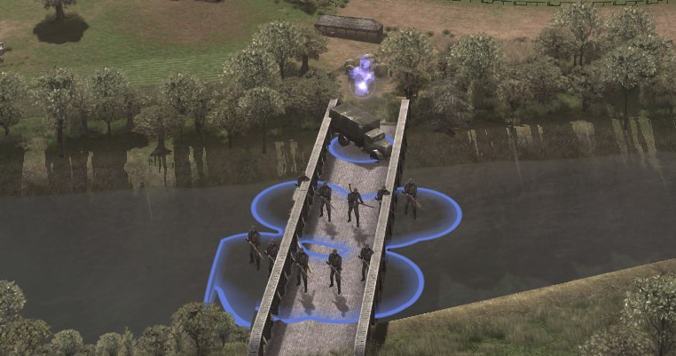
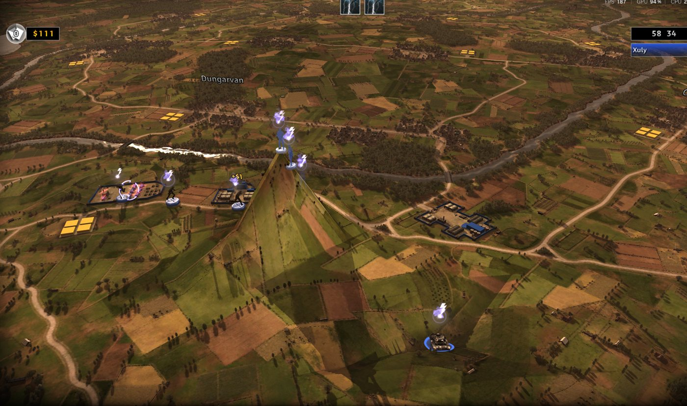

<div align="center">

# R.U.S.E. 2.0

**میدان نبرد را بسازید، بعد روی آن بجنگید.**

[English](README.md) · [Français](README.fr.md) · [Deutsch](README.ger.md) · [Italiano](README.ita.md) · [Español](README.spa.md) · [Polski](README.pol.md) · [Русский](README.ru.md) · [Čeština](README.cz.md) · [日本語](README.jpn.md) · [简体中文](README.sc.md) · **فارسی**


[](https://github.com/sneadtristen6/R.U.S.E-2.0-Project/releases?q=launcher)
&nbsp;&nbsp;
[](https://github.com/sneadtristen6/R.U.S.E-2.0-Project/releases?q=studio)
&nbsp;&nbsp;
[](https://www.patreon.com/SneadTristen6)

<sub>Windows. به R.U.S.E. در Steam نیاز دارد. هرگز به نصب Steam شما دست نمی‌زند.</sub>

</div>

> [!TIP]
> **نصب و بازی (5 دقیقه):**
> 1. [نسخه‌های منتشرشدهٔ لانچر](https://github.com/sneadtristen6/R.U.S.E-2.0-Project/releases?q=launcher) را باز کنید، تازه‌ترین را
>    (با نشان **Latest**) بردارید، و زیر **Assets** روی **RUSE-Launcher-Setup-0.4.8.9.exe** کلیک کنید.
> 2. اجرایش کنید. اگر Windows گفت «Windows protected your PC»: **More info**، بعد **Run anyway**.
> 3. **RUSE Launcher** را باز کنید: خودش R.U.S.E. را از طریق Steam پیدا می‌کند.
> 4. روی **مادهای پشتیبانی‌شده** کلیک کنید، مادهایی را که می‌خواهید تیک بزنید و **نصب** را بزنید.
> 5. آن‌ها را در یک مجموعهٔ ماد بگذارید (**مجموعهٔ ماد جدید…**) و **بازی** را بزنید.
>
> همهٔ گام‌ها، همراه با کاری که باید کرد وقتی چیزی درست پیش نمی‌رود: **[نصب و بازی](https://github.com/sneadtristen6/R.U.S.E-2.0-Project/wiki/%D9%86%D8%B5%D8%A8-%D9%88-%D8%A8%D8%A7%D8%B2%DB%8C)**.
> برای ساختن ماد، **RUSE Studio** را هم به همین روش از
> [نسخه‌های منتشرشدهٔ استودیو](https://github.com/sneadtristen6/R.U.S.E-2.0-Project/releases?q=studio) بگیرید و با
> [اولین ماد شما](https://github.com/sneadtristen6/R.U.S.E-2.0-Project/wiki/%D8%A7%D9%88%D9%84%DB%8C%D9%86-%D9%85%D8%A7%D8%AF-%D8%B4%D9%85%D8%A7) شروع کنید.

## R.U.S.E. چیست

**R.U.S.E.** (2010) بازی استراتژی بی‌درنگ Eugen Systems دربارهٔ جنگ جهانی دوم است. کل جبهه روی یک میز نقشه قرار دارد
که می‌توانید از اتاق جنگ تا یک تانک تنها روی آن زوم کنید، و نبردها همان‌قدر با فریب برده می‌شوند که با زور:
**کارت‌های ترفند** یگان‌هایتان را پنهان می‌کنند، حمله‌ای ساختگی نشان می‌دهند، نقشه‌های دشمن را لو می‌دهند یا نیروهایتان را سریع‌تر می‌کنند. بازی یک
کارزار، عملیات‌ها، و نبردهای آزاد و چندنفره روی نقشه‌هایی از نرماندی تا تونس دارد.

## R.U.S.E. 2.0 چیست

**نقشه‌های تازه، یگان‌های تازه و بازی با ماد با یک کلیک، برای R.U.S.E.** دو برنامهٔ رایگان:

- **RUSE Launcher، برای بازیکنان.** یک مجموعه ماد انتخاب کنید و **بازی** را بزنید. همین.
- **RUSE Studio، برای سازندگان ماد.** هر یگانی را تغییر دهید، یگان‌های تازه با مدل‌های سه‌بعدی خودشان بسازید، نقشه‌ها را از یک صفحهٔ
  سفید بسازید یا نقشه‌های خود بازی را از نو شکل دهید، بعد **آزمایش در بازی** را بزنید.

**پیش از شروع بازی بررسی می‌شود.** استودیو ماد شما را همان‌طور می‌خواند که بازی خواهد خواند: جلوی هر چیزی که در
بازی خراب شود از قبل گرفته می‌شود، با یادداشتی که می‌گوید چه چیزی را تغییر دهید. هدف: آنچه می‌سازید هر بار، از همان بار
اول، در بازی کار کند.

**فقط داده.** یک ماد در اینجا داده‌های بازی را تغییر می‌دهد، در یک نسخهٔ جداگانه از بازی، و همین. نصب Steam شما
هرگز تغییر نمی‌کند.

**متن‌باز** (GPL-3.0)، به یازده زبان: ده زبان بازی، و فارسی.

<table>
  <tr>
    <td width="33%" valign="top">
      <br>
      <sub><b>یک تانک از آن خودتان.</b> یک M1 Abrams، مدل‌سازی‌شده در یک برنامهٔ سه‌بعدی دیگر، در بازی.</sub>
    </td>
    <td width="33%" valign="top">
      <br>
      <sub><b>از جنگ جهانی اول تا امروز، همه با هم.</b> هواپیماهای دوباله، بمب‌افکن‌ها و جت‌ها در یک فرودگاه.</sub>
    </td>
    <td width="33%" valign="top">
      <br>
      <sub><b>جاده‌هایی که خودتان می‌کشید.</b> شبیه جاده‌های خود نقشه، هم از بالا و هم از نزدیکِ زمین.</sub>
    </td>
  </tr>
</table>

## R.U.S.E. 2.0 چه چیزهایی را تغییر می‌دهد

### یگان‌ها

- **تغییر هر یگان:** قیمت، زره، سرعت، سلاح‌ها و هر عدد دیگرش، با واگرد، بعد **آزمایش در بازی**.
- **توضیح هر پرچم و هر عدد**، با کلمات ساده و واحدهای ساده (متر، km/h، ثانیه): اینکه چه می‌کند، یگان‌های خود بازی کجای آن
  قرار می‌گیرند، و یک لغزنده از مقدار پایه‌اش. جلوی پرچم‌هایی که معلوم است بازی را کرش می‌دهند گرفته می‌شود، همراه با راه درست کردنش.
- **یگان‌های تازه:** از هر یگانی شروع کنید، آن را در منوی ساخت هر کشوری بگذارید، پشت یک تحقیق یا خریدنی از همان آغاز.
- **هواپیما در هر نقشی** (جنگنده، جنگنده‌بمب‌افکن، بمب‌افکن با محفظهٔ بمبش، شناسایی)، **خودروهای شناسایی**، و
  **سلاح‌هایی که به زمین، به هواپیماها یا به هر دو می‌زنند**.
- **مدل‌های سه‌بعدی خودتان:** یک مدل را از Blender یا هر ابزار سه‌بعدی دیگری وارد کنید، هر یگانی را در Blender دوباره رنگ کنید، به یک جوخه
  یونیفرم خودش را بدهید، کامیونی را که جوخه سوارش می‌شود انتخاب کنید، و کارتش را برای منوی ساخت بسازید.
- **366 یگان از جنگ جهانی اول تا امروز:** مدل‌های رایگانِ سازندگان دیگر، با ذکر نام هر سازنده، در اندازهٔ واقعی‌شان، که مثل
  یگان‌های خود بازی با تحقیق به دست می‌آیند.
- **کشورها:** یکی از هفت کشور بازی را به کشوری دیگر تبدیل کنید، با نام و پرچمی از آن خودش؛ یگان‌های یک کشور را
  یک‌جا پنهان کنید یا پر کنید.
- **ساختمان‌ها و آنچه می‌سازند:** ساختمان‌های هر کشور به‌صورت ردیف‌هایی از یگان‌هایی که منوهای ساختشان پیشنهاد می‌دهند؛ یگان‌ها را
  به آن‌ها اضافه کنید، جابه‌جایشان کنید، از کشوری دیگر کپی کنید، آن‌ها را با تحقیق از یگانی دیگر به دست آورید. **افزودن ساختمان:** کپی یکی از
  ساختمان‌های بازی، یا ساختمانی با یگان‌های خودش، زبانهٔ خودش در نوار ساخت، و ظاهر سه‌بعدی و تصویر منوی ساخت خودش.
- **نام‌های مهمات و نوع‌های پرچم از آن خودتان:** نام یک مهمات کپی‌شده را به همهٔ زبان‌ها عوض کنید؛ یک مجموعهٔ نام‌دار از
  پرچم‌های بازی بسازید و به هر یگانی بدهید.

### نقشه‌ها

- **نقشه‌های تازه** که در BATTLES کنار نقشه‌های خود بازی فهرست می‌شوند. از **زمین خالی یا دریای باز** شروع کنید، به اندازهٔ نقشه‌های بازی یا
  بزرگ‌تر، تصویرهای خودشان را در منوها به آن‌ها بدهید، و بخش‌هایشان را رنگ کنید.
- **شکل دادن به زمین:** تپه‌ها، گودال‌ها، فلات‌ها، شیب‌راه‌ها، زمین ترازشده و نرم‌شده؛ دریاچه‌ها و رودهای خشک‌شده. یگان‌ها
  روی آن حرکت می‌کنند و می‌جنگند.
- **جاده‌ها و پل‌ها:** جاده‌های مستقیم، منحنی یا آزاد که کامیون‌های تدارکات از آن‌ها پیروی می‌کنند؛ جایی که جاده‌ای از آب می‌گذرد، پلی از نوع پل‌های
  خود نقشه که تانک‌ها، پیاده‌نظام و کامیون‌ها از رویش رد می‌شوند. پل‌های خود نقشه را بردارید و گذرگاه‌هایشان را
  ببندید.
- **ساختمان‌ها، اشیای صحنه و درختان:** آن‌ها را یکی‌یکی، در یک شبکه، در یک جعبه، یا در امتداد یک مسیر (پرچین‌ها و ردیف‌های درخت) بگذارید،
  ساختمان‌ها رو به جاده‌ها؛ انتخابشان کنید، جابه‌جا کنید، بچرخانید، اندازه‌شان را عوض کنید و حذفشان کنید، حتی آن‌هایی که مال خود نقشه‌اند؛ جنگل‌ها و
  اشیای صحنهٔ نقشه را پاک کنید. **وارد کردن مدل** یک مدل سه‌بعدی را به یکی از سنگ‌ها، اشیای صحنه، گیاهان یا درختان خود نقشه‌تان تبدیل می‌کند.
- **پوشش و حرکت:** شهرها و جنگل‌هایی را که یگان‌ها در آن‌ها پنهان می‌شوند رنگ کنید، و زمین را به روی همهٔ یگان‌ها، فقط پیاده‌نظام یا فقط
  خودروها ببندید. نقشه نشان می‌دهد هر ضربه چه چیزی را تغییر داد.
- **رنگ‌آمیزی نقشه:** تصویر زمین را با یک رنگ، با زمین خود نقشه از نقطه‌ای دیگر، با بافت‌های بازی،
  با تصویرهای خودتان یا با بافت‌های رایگان آنلاین رنگ کنید.
- **سناریوها و مأموریت‌ها:** نقطه‌های آغاز را جابه‌جا کنید، یگان‌هایی را که یک نبرد با آن‌ها شروع می‌شود اضافه کنید، و مأموریت‌هایی از آن خودتان
  با هدف‌ها، رویدادها و حرکت‌های دوربین بسازید، برای عملیات‌ها و فصل‌های کارزار.

### قواعد بازی

- **هوش مصنوعی و تنظیمات بازیکن**، در یک زبانه:
  - **تنظیمات بازیکن:** پول آغازین و درآمد، انبارهای تدارکات و کامیون‌هایشان، کارت‌های ترفندی که هر طرف با آن‌ها شروع
    می‌کند، برای نبردهای معمولی و هسته‌ای جداگانه.
  - **بازیکنان رایانه‌ای:** همهٔ مقدارهایشان در هر سطح دشواری و هر شخصیت، یگان‌هایی که ترجیح می‌دهند و
    کارت‌های ترفندشان، هر مقدار با توضیح.
  - **قواعد بازی:** 172 مقدار دیگر از بازی در 16 گروه (نبرد و تسلیم، جمعیت، حرکت، شلیک،
    آسیب، جنگل و پوشش، هواپیماها، کارت‌های ترفند در عمل، رنگ‌های طرف‌ها و بخش‌ها، و بیشتر)، هر کدام با توضیح.
- **همهٔ مقدارها و فایل‌ها:** هر شیء و هر مقدار از داده‌های بازی، تغییریافته در ماد شما.

### صدا و پویانمایی: RUSE Decoy

- **همهٔ صداهای بازی** بر اساس نوع: پخششان کنید، بلندتر یا آهسته‌ترشان کنید، یا جایگزینشان کنید؛ آهنگ‌های تازه در فهرست‌های نبرد؛
  جمله‌های مأموریت با صدای تازه.
- **پویانمایی‌ها:** یک کلیپ را با دیگری عوض کنید، آهسته یا تندش کنید، یک استخوان را بزرگ‌تر کنید یا بچرخانید، و روی سربازها موشن
  کپچر بگذارید، از کتابخانه‌ای با 3,205 حرکت رایگان (پایگاه دادهٔ CMU و 100STYLE، با ذکر نام).

### برای بازیکنان

- **یک کلیک:** یک مجموعهٔ ماد انتخاب کنید و **بازی** را بزنید؛ لانچر یک نسخهٔ مادشدهٔ جداگانه می‌سازد و اجرایش می‌کند.
- **R.U.S.E. 2.0 به رنگ طلایی:** بازیِ مادشده روی یک صحنهٔ نبرد باز می‌شود، و منوها و صفحه‌های بارگذاری‌اش R.U.S.E. 2.0 را
  به رنگ طلایی نشان می‌دهند (اگر ترجیح می‌دهید، تنظیمات عنوان خود بازی را نگه می‌دارد).
- **مادهای انجمن همان‌طور که هستند** (فایل‌های `.rmod` ساخت RUSE-Mod-Manager هم)، فهرستی از مادهای پشتیبانی‌شده برای تیک زدن، ترتیب‌های بارگذاری
  که در هر دو جهت با RUSE-Mod-Manager به اشتراک گذاشته می‌شوند، و یک عیب‌یاب که آنچه جلوی «بازی» را می‌گیرد پیدا و درست می‌کند.
- **خودش را به‌روز می‌کند**، به یازده زبان: ده زبان بازی، و فارسی.

## آن را در بازی ببینید

<table>
  <tr>
    <td width="33%" valign="top">
      <br>
      <sub><b>فهرست‌های ساخت گروه‌بندی‌شده.</b> جنگنده‌های جنگ جهانی اول در گروه Me 109.</sub>
    </td>
    <td width="33%" valign="top">
      <br>
      <sub><b>همهٔ دوره‌ها در یک گروه.</b> گروه Panzer IV، از یک تانک جنگ جهانی اول تا تانک‌های امروزی.</sub>
    </td>
    <td width="33%" valign="top">
      <br>
      <sub><b>یگان‌هایی با ظاهر خودشان.</b> هر یگانی را در Blender دوباره رنگ کنید و به بازی برگردانید.</sub>
    </td>
  </tr>
  <tr>
    <td width="33%" valign="top">
      <br>
      <sub><b>پل‌هایی که یگان‌ها از رویشان رد می‌شوند.</b> جایی که جادهٔ شما به آب می‌رسد، پلی از نوع پل‌های خود نقشه.</sub>
    </td>
    <td width="33%" valign="top">
      <br>
      <sub><b>زمینی که خودتان شکل می‌دهید.</b> تپه‌ها، گودال‌ها، دریاچه‌ها و رودهای خشک‌شده که یگان‌ها رویشان حرکت می‌کنند و می‌جنگند.</sub>
    </td>
    <td width="33%" valign="top">
      <br>
      <sub><b>نقشه‌های تازه</b>، که از صفر شروع شده‌اند، با تصویرهای منوی خودشان.</sub>
    </td>
  </tr>
  <tr>
    <td width="33%" valign="top">
      <br>
      <sub><b>پوشش رنگ‌شده.</b> پیاده‌نظامِ روی آن پنهان است.</sub>
    </td>
    <td width="33%" valign="top">
      <br>
      <sub><b>RUSE Guard.</b> بازی‌ای که با تقلب ساخته شود آفلاین می‌ماند.</sub>
    </td>
    <td width="33%" valign="top">
      <br>
      <sub><b>رودی که آبش خالی شده.</b> یگان‌ها در بسترش راه می‌روند.</sub>
    </td>
  </tr>
</table>

## درون استودیو

<table>
  <tr>
    <td width="50%" valign="top">
      <br>
      <sub><b>هر نقشه به‌صورت سه‌بعدی.</b> Blitz با منطقه‌ها و شهرهایش؛ ابزارها در پایین ردیف شده‌اند.</sub>
    </td>
    <td width="50%" valign="top">
      <br>
      <sub><b>یگان‌هایی از دوره‌های دیگر</b>، با نام سازندهٔ هر مدل.</sub>
    </td>
  </tr>
  <tr>
    <td width="50%" valign="top">
      <br>
      <sub><b>رنگ‌آمیزی نقشه.</b> تصویر زمین را رنگ کنید.</sub>
    </td>
    <td width="50%" valign="top">
      <br>
      <sub><b>جاده‌ها و پل‌ها.</b> مستقیم، منحنی یا آزاد.</sub>
    </td>
  </tr>
  <tr>
    <td width="50%" valign="top">
      <br>
      <sub><b>RUSE Launcher:</b> مادهای شما، سه گام، و «بازی».</sub>
    </td>
    <td width="50%" valign="top">
      <br>
      <sub><b>ورود با Steam.</b> تأیید می‌کند R.U.S.E. را دارید؛ ما هرگز گذرواژهٔ شما را نمی‌بینیم.</sub>
    </td>
  </tr>
</table>

## آنچه در راه است

- **شهرهایی که خودتان می‌کشید:** خیابان‌ها را طرح بریزید، بلوک‌ها را خانه، مغازه یا صنعت علامت بزنید، و استودیو آن‌ها را با
  ساختمان‌های خود بازی پر می‌کند.
- **یک مکان واقعی به‌صورت نقشه:** واردکنندهٔ نقشه (پایین‌تر).
- **کوه‌های تولیدشده و بافت‌های زمینِ با وضوح بالای خودمان**، و قلم‌موی کشتزار در رنگ‌آمیزی نقشه، که کل
  کشتزارها را به گندم، خاک شخم‌خورده یا محصولی سبز تبدیل می‌کند، همان‌طور که نقشه‌های خود بازی رنگشان می‌کنند.

### واردکنندهٔ نقشه: کجای کار هستیم

واردکنندهٔ نقشه یک مکان واقعی را به نقشه‌ای برای R.U.S.E. تبدیل می‌کند: زمین و تپه‌هایش، کشتزارها، جنگل‌ها، رودها، جوی‌ها، ساحل
و دریا، و اگر بخواهید، جاده‌ها و ساختمان‌هایش، همه ساخته‌شده از قطعه‌های خود بازی تا نقشه شبیه نقشه‌های خود بازی دیده و
بازی شود. شما یک مکان را انتخاب می‌کنید، و استودیو آن را به نقشه‌ای تبدیل می‌کند که می‌توانید ویرایشش را ادامه دهید.

استودیو همین حالا هم می‌تواند تکهٔ کوچکی از یک مکان واقعی (بخشی از Utah Beach) را به نقشه‌ای تبدیل کند که در بازی باز می‌شود.
اما هنوز درست نیست: ساحل، آب و زمین از نزدیک هنوز آن‌طور که باید به نظر نمی‌رسند. چرا این کار
طول می‌کشد:

- **یک نقشه لایه‌های زیادی است که باید با هم جور باشند:** شکل زمین، ظاهرش از نزدیک، تصویری که از بالا دیده می‌شود،
  آب، جاهایی که یگان‌ها می‌توانند حرکت کنند و پنهان شوند، جاده‌ها و پل‌ها. یک مکان واقعی باید هم‌زمان در همهٔ این‌ها درست
  از آب دربیاید، و ایرادی در یکی در بقیه هم دیده می‌شود.
- **از نزدیک و از دور:** بازی زمینش را به دو روش می‌کشد، و این دو باید با هم جور باشند. اینکه رنگ‌های یک مکان واقعی
  هم از نزدیک و هم از آسمان شبیه رنگ‌های بازی شود، بیشترِ کار است.
- **آب تعیین می‌کند یگان‌ها کجا بروند:** رودها، جوی‌ها و ساحل تعیین می‌کنند تانک‌ها و پیاده‌نظام کجا می‌توانند حرکت کنند. یک نقطهٔ اشتباه
  کافی است تا تانک‌ها از وسط یک جوی رد شوند، یا به ساحل نرسند.
- **هر تغییری در بازی بررسی می‌شود:** این تنها گواهی است که به حساب می‌آید، و هر بررسی یعنی ساختن نقشه
  و نگاه کردن به آن از جاهای زیاد.
- **ترجیح می‌دهیم صبر کنیم** تا یک مکان واقعی مثل یک نقشهٔ واقعی R.U.S.E. دیده و بازی شود، تا اینکه چیزی نیمه‌کاره بیرون بدهیم.

بعدی: اول درست شدن نقشهٔ آزمایشی کوچک، بعد یک نقشهٔ کامل، بعد دکمهٔ «وارد کردن نقشه» در استودیو.

همهٔ تغییرات، نسخه به نسخه:
[یادداشت‌های استودیو](https://github.com/sneadtristen6/R.U.S.E-2.0-Project/blob/main/.github/release-notes/studio.md) و
[یادداشت‌های لانچر](https://github.com/sneadtristen6/R.U.S.E-2.0-Project/blob/main/.github/release-notes/launcher.md).

**دربارهٔ نام:** R.U.S.E. 2.0 یک نام موقت است. پیش از انتشار نسخهٔ کامل (1.0)، با Eugen
Systems، سازندگان R.U.S.E.، مشورت می‌کنیم، و پروژه نامی می‌گیرد که آن‌ها با آن موافق باشند. ایده‌ها برای نام و نقدهای
سازنده در [گفت‌وگو دربارهٔ نام](https://github.com/sneadtristen6/R.U.S.E-2.0-Project/discussions/18) خوش‌آمدند.

**آنچه در این مخزن هست.** دو برنامه، و آنچه بازیکنان و سازندگان ماد برای استفاده از آن‌ها لازم دارند. یادداشت‌های کاری ما دربارهٔ
فایل‌های خود بازی تا وقتی که تأیید صریح سازندگان بازی، Eugen Systems، را نگرفته‌ایم خصوصی می‌مانند.

همهٔ کارهایی که اینجا می‌کنیم برای کمک به انجمن و رساندن این بازی به جای بهتری است. R.U.S.E. یکی از محبوب‌ترین
بازی‌های همهٔ عمرم است، و فقط می‌خواهم آن را بهتر کنم.

**فقط نسخه‌های خریداری‌شده.** پروژهٔ R.U.S.E. 2.0 فقط وقتی از R.U.S.E. پشتیبانی می‌کند که آن را در حساب Steam خودتان داشته باشید. خود
بازی فقط برای حساب Steamی اجرا می‌شود که صاحب آن است، و ابزارهای ما هرگز این را دور نمی‌زنند: بازی را از طریق
کتابخانهٔ Steam شما پیدا می‌کنند، یک نسخهٔ جداگانه از آن را ماد می‌کنند، و هرگز فایل‌های بازی را منتشر نمی‌کنند. ما از شبیه‌سازهای Steam،
نسخه‌های غیرقانونی، یا هر چیز دیگری که بگذارد کسی بدون داشتن بازی آن را بازی کند پشتیبانی نمی‌کنیم. اگر بازی را ندارید، این ابزارها
برایتان کار نمی‌کنند و برای شما نیستند. هر موردی را که لازم بدانیم پیگیری خواهیم کرد.

بازی را به شکل دیگری دارید، مثلاً یک نسخهٔ جعبه‌ای از پیش از آمدن R.U.S.E. به Steam، یا برنامه‌ها اشتباه تشخیص داده‌اند؟ جعبهٔ درون
برنامه کد شما و دو دکمه را دارد: یک درخواست در Discord یا در GitHub باز کنید، و ما یک کد باز کردن قفل برای رایانهٔ شما می‌فرستیم.

## نصب در سه گام

1. **دانلود** نصب‌کننده از [نسخه‌های منتشرشده](https://github.com/sneadtristen6/R.U.S.E-2.0-Project/releases):
   `RUSE-Launcher-Setup-<version>.exe` برای بازیکنان، `RUSE-Studio-Setup-<version>.exe` برای سازندگان ماد. فقط Windows.
   باید R.U.S.E. در کتابخانهٔ Steam شما باشد و نصب شده باشد.
2. **اجرایش کنید.** نه دسترسی مدیر لازم است و نه Python. نصب‌کننده‌ها هنوز امضای دیجیتال ندارند، پس ممکن است Windows یک بار هشدار دهد
   («Windows protected your PC»): روی **More info** کلیک کنید، بعد **Run anyway**. برای اینکه مطمئن شوید فایل اصلی را دارید،
   SHA-256 آن را با آنچه در یادداشت‌های انتشار آمده مقایسه کنید.
3. **اجرا** از منوی Start. R.U.S.E. را از طریق Steam پیدا می‌کند. در لانچر، یک مجموعهٔ ماد انتخاب کنید و
   **بازی** را بزنید. در استودیو، وقتی خواست یک بار فهرست بازی را بسازید (حدود یک دقیقه)، بعد یک ماد انتخاب کنید یا بسازید.

حذف برنامه‌ها مادها و تنظیمات شما را نگه می‌دارد. برنامه‌ها به Microsoft Edge WebView2 نیاز دارند که Windows 11 آن را دارد. بیشتر در
[installers/README.md](installers/README.md).

<details>
<summary><b>وضعیت، مستندات و مشارکت</b></summary>

[](https://github.com/sneadtristen6/R.U.S.E-2.0-Project/releases?q=launcher)
[](https://github.com/sneadtristen6/R.U.S.E-2.0-Project/releases?q=studio)
[](https://github.com/sneadtristen6/R.U.S.E-2.0-Project/actions/workflows/tests.yml)
[](LICENSE)

**لانچر** برای بازیکنان (آخرین: 0.4.8.9) &middot; **استودیو** برای سازندگان ماد، یک پیش‌نمایش (آخرین: 0.9.8.9) &middot; Windows &middot; به R.U.S.E. در Steam نیاز دارد

**[دفترچهٔ راهنمای میدانی (ویکی)](https://github.com/sneadtristen6/R.U.S.E-2.0-Project/wiki/%D8%B1%D8%A7%D9%87%D9%86%D9%85%D8%A7%DB%8C-%D9%85%DB%8C%D8%AF%D8%A7%D9%86%DB%8C)** &middot;
**[گفت‌وگوها](https://github.com/sneadtristen6/R.U.S.E-2.0-Project/discussions)** &middot;
**[Discord](https://discord.gg/h54t5baNsC)** &middot; **[مشارکت](CONTRIBUTING.md)** &middot;
**[آیین‌نامهٔ رفتار](CODE_OF_CONDUCT.md)** &middot; [docs/MOD_FORMAT.md](docs/MOD_FORMAT.md): همهٔ کارهایی که یک ماد می‌تواند بکند،
فایل به فایل.

</details>

<a name="for-contributors"></a>
<details>
<summary><b>برای مشارکت‌کنندگان</b></summary>

چگونه باگ گزارش کنید، در بازی آزمایش کنید و کد بفرستید: [CONTRIBUTING.md](CONTRIBUTING.md).

<details>
<summary><b>دو برنامه از روی کد منبع، و نصب‌کننده‌ها</b></summary>

این دو برنامه روی موتور اجرا می‌شوند، جدا از هم (هیچ‌کدام به دیگری نیاز ندارد). هر دو
پنجره‌های دسکتاپی هستند که مثل صفحه‌های وب ساخته شده‌اند؛ یک بار: `py -3 -m pip install pywebview`. صفحه‌هایشان در یک
مرورگر معمولی هم با داده‌های ساختگی باز می‌شوند: `src/ruse_launcher/ui/index.html?fake`، `src/ruse_studio/ui/index.html?fake`.

- **RUSE Launcher** ([`src/ruse_launcher/`](src/ruse_launcher/))، برای بازیکنان: بازی را پیدا می‌کند،
  مجموعه‌های ماد شما را فهرست می‌کند و یک دکمهٔ بزرگ «بازی» دارد که نسخهٔ مادشدهٔ آن مجموعه را می‌سازد و بازی را اجرا می‌کند («بازی اصلی»
  از طریق Steam اجرا می‌شود). `py -3 -m ruse_launcher`. **بازیکنان هرگز به هیچ فایلی دست نمی‌زنند.** یک
  کتابخانهٔ ماد («افزودن فایل ماد…» برای یک `.rusemod` از استودیو، یک `.rmod` یا یک `.zip`، یا یک فایل یا
  پوشهٔ ماد را روی پنجره رها کنید؛ هر ماد اول بررسی می‌شود)، مجموعه‌های ماد که روی صفحه ساخته می‌شوند (تازه، ویرایش و مرتب‌سازی، تغییر نام،
  تکثیر، حذف)، «اشتراک‌گذاری» و «وارد کردن ترتیب بارگذاری…» برای یک مجموعهٔ ماد (متن خود RUSE-Mod-Manager، پس ترتیب‌های بارگذاری
  در هر دو جهت جابه‌جا می‌شوند؛ [`src/rusemod/loadorder.py`](src/rusemod/loadorder.py))، یک راهنمای سه‌گامی در «بازی اصلی» («بازی با مادها، در سه گام»)،
  و لانچر به زبان خود رایانه (هر یک از ده زبان بازی، یا فارسی). **مادهای پشتیبانی‌شده**
  (0.3.0): فهرست مادهای ما (یک مخزن GitHub، MOD_FORMAT §15) با تیک، چند تا با هم نصب‌شدنی،
  هر فایل پیش از رفتن به کتابخانه با فهرست مقایسه می‌شود، مادهای تقلب جدا نگه داشته می‌شوند؛ در حالت آفلاین، آخرین
  نسخهٔ فهرست.
- **RUSE Studio** ([`src/ruse_studio/`](src/ruse_studio/))، برای سازندگان ماد: همهٔ یگان‌ها و
  ساختمان‌ها را مرور کنید، مقدارها، اجزا و کاربردهای یک یگان را ببینید، و یک زبان انتخاب کنید: نام‌های خود بازی به‌طور پیش‌فرض، یا
  هر یک از ده زبان بازی، یا فارسی. یک ماد انتخاب کنید یا بسازید و عددهای یک یگان را همان‌جا در صفحه‌اش تغییر دهید: هر تغییر
  در `src/studio.rndf` ماد ذخیره می‌شود (با واگرد)؛ جزئی که چند یگان در آن شریک‌اند برای یکی از آن‌ها یا برای همه تغییر می‌کند.
  «آزمایش در بازی» ماد را می‌سازد و بازی را اجرا می‌کند. **نقشه‌ها** (منتشرشده در 0.4): هر نقشه‌ای که بازی فهرست می‌کند، به‌صورت سه‌بعدی
  با شبکهٔ واقعی زمین و بافت‌های زمینش (یک بار برای هر نقشه رمزگشایی و نگه داشته می‌شود). **همچنین:**
  - **«خروجی گرفتن از ماد…»** ماد را به یک فایل تبدیل می‌کند، `<id>-<version>.rusemod`، با ساخت بازی و
    اثر انگشت ماد درونش، برای «افزودن فایل ماد…» در لانچر (چرخه از سازندهٔ ماد تا بازیکن).
  - **یگان تازه…** در صفحهٔ یک یگان یک کپی با نام خودش (یک نام، نشان داده‌شده در هر ده زبان)، قیمت و
    منوی ساخت خودش (همان کشور و کارخانه، یا کشوری دیگر) می‌سازد؛ به‌عنوان یگان تازه فهرست می‌شود، مثل هر یگان دیگری ویرایش می‌شود،
    و می‌توان حذفش کرد.
  - **در نقشه‌ها:** ساختمان‌های هر نقشه و بخشی از اشیای صحنه و درختانش. یک قلم‌مو انتخاب کنید و روی
    زمین کلیک کنید یا بکشید تا شکلش دهید: هر ضربه فوراً کشیده می‌شود و در `maps/<map>/terrain.toml` ماد ذخیره می‌شود؛ یک شیب‌راه
    دو کلیک می‌خواهد (آغازش، پایانش)، واگرد یک ضربه را برمی‌گرداند، «شروع دوباره» نقشه را پاک می‌کند. «گذاشتن روی نقشه» نوع‌های
    خود نقشه را فهرست می‌کند (پرکاربردترین‌ها اول، با جست‌وجو)؛ «چرخاندن» و «اندازه» را تنظیم کنید، روی زمین کلیک کنید، و شیء
    در `maps/<map>/scenery.toml` ماد ذخیره می‌شود. «آزمایش در بازی» همهٔ این‌ها را درون نقشه می‌سازد.

  `py -3 -m ruse_studio` (بعد از `ruse index build`)؛ `--spike` بررسی سه‌بعدی را باز می‌کند.
- `py -3 -m pip install -e .[apps]` اگر یک بار اجرا شود، دو فرمان می‌دهد، `ruse-launcher` و `ruse-studio`، که برنامه‌ها را
  بدون پنجرهٔ کنسول باز می‌کنند.
- **نصب‌کننده‌ها** ([`installers/`](installers/README.md)): GitHub با هر push که برنامه‌ها را تغییر دهد `RUSE-Launcher-Setup-<version>.exe` و
  `RUSE-Studio-Setup-<version>.exe` را می‌سازد (Actions، **apps**، Artifacts). یک تگ
  `launcher-v<version>` یا `studio-v<version>` یکی از آن‌ها را به‌عنوان Release منتشر می‌کند. نه Python لازم است نه Git، نه دسترسی مدیر.
  هنوز امضا نشده‌اند، پس Windows یک بار هشدار می‌دهد («More info»، بعد «Run anyway»).

</details>

</details>

<details>
<summary><b>ابزارها و بررسی‌ها</b></summary>

- [`tools/check_public.py`](tools/check_public.py): GitHub آن را با هر push اجرا می‌کند؛ اگر مطالب خصوصی، فایل‌های بازی
  یا جزئیات برنامهٔ بازی در حال رسیدن به این مخزن عمومی باشند، شکست می‌خورد.
- [`tools/rmod_to_mod.py`](tools/rmod_to_mod.py): یک `.rmod` ساخت RUSE-Mod-Manager را به‌صورت یکی از مادهای ما از نو می‌سازد.

</details>

<details>
<summary><b>اجرای آزمون‌ها</b></summary>

[`tests/`](tests) آزمون‌هایی روی فایل‌های کوچک ساختگی دارد؛ بازی لازم نیست:

```
py -3 -m unittest discover -s tests
```

(با `PYTHONPATH=src`). GitHub آن‌ها را با هر push، روی Windows و Linux اجرا می‌کند
([`.github/workflows/tests.yml`](.github/workflows/tests.yml)).

</details>

## سپاسگزاری

R.U.S.E. 2.0 بر کار دیگران بنا شده است. بدون آن‌ها هیچ‌کدام از این‌ها اینجا نبود.

### ProLution: پدرخواندهٔ مادسازی R.U.S.E.

- **RUSE Modding Database** را ساخت و راهنماهایی نوشت که مردم از آن‌ها یاد گرفتند، از جمله دربارهٔ عملیات‌های سفارشی.
- **کد ProLution در کد ماست:** کدک زمین نقشه در
  [`src/ruse_mod_engine/terrain_codec.py`](src/ruse_mod_engine/terrain_codec.py) بر پایهٔ کار ProLution روی قالب زمین
  (منتشرشده با CC0) ساخته شده، و رمزگذارش از رمزگذار مرجع ProLution برگردانده شده است. خوانندهٔ خود ما برای
  بافت‌های فشردهٔ بازی ([`src/rusemod/tgu1.py`](src/rusemod/tgu1.py)) هم از کدک او استفاده می‌کند.

### LittleGroove: اولین مدیر ماد

LittleGroove راه را برای بخش بزرگی از کارهای R.U.S.E. 2.0 هموار کرد: او اولین مدیر ماد واقعی را برای R.U.S.E. ساخت، و
موتورش هنوز بخشی از موتور ماست.

- **RUSE-Mod-Manager و قالب `.rmod` آن:** یک ماد به‌صورت فهرستی از تغییرات در داده‌های بازی، تا چند ماد با هم
  بازی شوند. مادهایی که با آن ساخته شده‌اند در لانچر بازی می‌شوند، و ترتیب‌های بارگذاری با قالب متنی او به اشتراک گذاشته می‌شوند، پس
  میان Mod Manager او و لانچر جابه‌جا می‌شوند.
- **موتور او بخشی از موتور ماست** ([`src/ruse_mod_engine`](src/ruse_mod_engine/)، نوشته‌شده با Python)، و به همین دلیل
  کل برنامه GPL-3.0 است:
  - مادهای `.rmod` را در ساخت‌های ما اعمال می‌کند، و مادی را که برای ساخت دیگری از بازی ساخته شده با نقشه‌های نسخهٔ او
    به ساخت فعلی می‌برد؛ «تبدیل یک ماد قدیمی» در لانچر همان مبدل اوست؛
  - ابزارهای نقشهٔ ما پوشش بازی، شبکهٔ بازیکن رایانه‌ای، پل‌ها، جاده‌ها و حرکت را با ماژول `sdb` او
    می‌خوانند و می‌نویسند؛
  - استودیو اسکریپت‌های بازی را با اسکریپت‌خوان او به‌صورت Python نشان می‌دهد، همراه با طرح کلی او از کاری که یک مأموریت می‌کند و
    فهرست او از اجزای اسکریپت‌ها، یک اسکریپت تغییریافته را با کامپایلر او و Python 2.5.1 بازی که موتورش
    همراه دارد کامپایل می‌کند، و فایل‌ها و متن‌های یک مأموریت را با زنجیرهٔ سناریوی او بررسی می‌کند؛
  - تغییرات ما در آن: ریشهٔ یک درخت SpatialDB همیشه تقسیم می‌شود (ریشهٔ تک‌برگی بازی را کرش می‌داد)، و افزوده‌های
    کوچکی به خوانندهٔ زمین و کامپایلر اسکریپت او.
- **آنچه ابزارهای او به ما یاد دادند:** فاصله‌هایی که انبارهای تدارکات و مقرها را روی جاده‌ها نگه می‌دارند و آنچه یک انبار در خود دارد
  (هر دو را او در بازی اندازه گرفت)، دوربین آغازینی که هر مسابقه با آن شروع می‌شود، کد وارسی‌ای که به بازی اجازه می‌دهد
  سناریوی تغییریافته را بارگذاری کند، اینکه فایل‌های تازه چطور به بسته‌های بازی می‌روند، و کپی کردن یک مهمات تا سلاحی مهمات خودش را داشته باشد.
- **Mod Manager او اول این‌ها را داشت؛ استودیو آن‌ها را با کد خودش دارد:** ویرایشگرهای اقتصاد و هوش مصنوعی، ویرایشگر
  مقدارهای خام (همهٔ مقدارها)، زنجیرهٔ ارتقا، مرورگر فایل، منوها، فایل‌ها و متن‌های یک مأموریت، و نام‌ها، منطقه‌ها و
  جزئیات اشیای ویرایشگر نقشه.

### DomesticNukes: زیربنای نقشه‌ساز

- **DomesticNukes زیربنای نقشه‌ساز را گذاشت:** زمینی که یگان‌ها رویش راه می‌روند، جای ایستادن هر ساختمان، درخت و شیء صحنه،
  و دستورالعملی که قلم‌موهای زمین دنبال می‌کنند تا نقشهٔ ازنوشکل‌گرفته بارگذاری و بازی شود.
- **DomesticNukes قلم‌موهای آب را نوشت:** دریاچه‌ها و رودهای خشک‌شده، ادغام‌شده از pull request خود DomesticNukes.
- **کار DomesticNukes روی مدل‌های بازی** مدل‌های سه‌بعدی واقعی بازی را به نمای نقشهٔ استودیو آورد، و به کار کردن
  یگان‌های یک کشور دیگر کمک کرد.
- یادداشت‌ها دربارهٔ پرچم‌های یگان، کف پل‌ها و اینکه یگان‌ها چطور روی زمین می‌ایستند به بررسی‌های ساخت و به پل‌هایی
  راه یافت که یگان‌ها حالا از رویشان رد می‌شوند. DomesticNukes نسخه‌های منتشرشده را در بازی هم آزمایش می‌کند.

### سازندگان مدل‌های یگان‌های دوره‌ای

یگان‌های دوره‌های دیگر (Studio 0.9.8.2) مدل‌های سه‌بعدی رایگانی هستند از کسانی که آن‌ها را ساخته و به اشتراک گذاشته‌اند، با مجوز CC0 یا
CC BY. نام هر سازنده، با عنوان مدل، مجوز و پیوندش، در صفحهٔ یگان در استودیو، در
فایل سپاسگزاری هر مادی که از یکی از آن‌ها استفاده کند (`CREDITS-era-units.md`)، و در فهرست کامل در
[انتشار یگان‌های دوره‌ای](https://github.com/sneadtristen6/R.U.S.E-2.0-Project/releases/tag/era-units) آمده است. آنچه ما تغییر دادیم:
هر کدام با بازی جور شد (چرخانده و مقیاس‌بندی شد) و نشان‌های کشورش را گرفت.

### sneadtristen6 و Claude: ساختن R.U.S.E. 2.0

**sneadtristen6 ذهن پشت R.U.S.E. 2.0 است.** ایده‌ها از اوست، او تصمیم می‌گیرد پروژه چه بشود، و هر
تغییر را پیش از انتشار در بازی امتحان می‌کند. **Claude**، هوش مصنوعی Anthropic، به شکل دادن ایده‌های او به برنامه‌ها کمک می‌کند و
کد را می‌نویسد. این دو از سپتامبر 2026 در کنار هم این‌ها را ساختند:

- **مدل‌های سه‌بعدی تازه در بازی:** واردکنندهٔ مدل که مدل یک یگان را از Blender یا هر ابزار سه‌بعدی دیگری می‌آورد (یک M1
  Abrams اولینش بود)، یگان‌هایی که در Blender دوباره رنگ شده‌اند، یونیفرم‌های خود جوخه‌ها، کارت‌های منوی ساخت، و 366 یگان از دوره‌های
  دیگر در اندازهٔ واقعی‌شان.
- **کار روی بافت:** رنگ‌آمیزی نقشه و کتابخانهٔ بافتش: زمین یک نقشه که با بافت‌های خود بازی، با زمینی
  از هر جای نقشه، یا با تصویرهای خودتان رنگ می‌شود.
- **نقشه‌های تازه.** در 3 اکتبر 2026، R.U.S.E. نقشه‌های تازه گرفت: فهرست‌شده در BATTLES کنار نقشه‌های خود بازی، هر کدام با
  زمین خودش. برای پیدا کردن حد، 101 نقشه یک‌جا اضافه شد؛ همه‌شان نشان داده شدند و بازی شدند. تا جایی که می‌دانیم، این‌ها
  اولین نقشه‌های تازه‌ای هستند که بازی از D-Day به این سو داشته است. نقشه‌های تازه از صفر شروع می‌شوند، به‌صورت خشکی یا دریای باز، با تصویرهای
  منوی خودشان.
- **یک ویرایشگر نقشه که در بازی کار می‌کند:** زمینی که یگان‌ها رویش حرکت می‌کنند و می‌جنگند، دریاچه‌ها و رودهای خشک‌شده، جاده‌هایی که
  هم از بالا و هم از نزدیکِ زمین شبیه جاده‌های خود نقشه‌اند، پل‌هایی که تانک‌ها، پیاده‌نظام و کامیون‌های تدارکات
  از رویشان رد می‌شوند، ساختمان‌ها، اشیای صحنه و درختانی که در هر فاصله‌ای دیده می‌شوند، پوشش، و جاهایی که یگان‌ها می‌توانند بروند.
- **یگان‌ها:** تغییر هر کدام، ساختن یگان‌های تازه، دادن تانک‌ها و هواپیماهای ارتشی دیگر به یک کشور، هواپیما در هر نقشی،
  خودروهای شناسایی، سلاح‌هایی که به هواپیماها می‌زنند، توضیح هر پرچم و هر عدد، و کشوری که به کشوری دیگر تبدیل شده است.
- **موسیقی و مأموریت‌ها:** آهنگ‌ها و جمله‌های صوتی که در استودیو جایگزین می‌شوند، و مأموریت‌هایی از آن خودتان.
- **دو برنامه به یازده زبان** (ده زبان بازی، و فارسی)، استودیو برای سازندگان ماد و لانچر برای بازیکنان، که هرگز به
  پوشهٔ خود بازی دست نمی‌زنند، با بررسی‌ای که جلوی مادی را که بازی را خراب می‌کند پیش از شروع بازی می‌گیرد.
- **کد:** همهٔ آنچه در `src/rusemod`، `src/ruse_studio` و `src/ruse_launcher` است کد خود ماست، نوشته‌شده برای
  R.U.S.E. 2.0. دیگرانی که این کد بر کارشان بنا شده در بالا و در
  [THIRD_PARTY_NOTICES.md](THIRD_PARTY_NOTICES.md) نام برده شده‌اند.

هنوز اول راه است، و چیزهای خیلی بیشتری در راه است. سپاس از همهٔ کسانی که در بالا آمدند، که بدون آن‌ها هیچ‌کدام از این‌ها شروع نمی‌شد.

### (Anonyme) Oozaru: آزمایش و اشکال‌زدایی

**(Anonyme) Oozaru برنامه‌های اولیه را روی ماد کارزار خودش آزمایش کرد و با هر باگی که پیدا کرد، گزارش اجرا (log) را فرستاد.** گزارش‌های
او به این اصلاح‌ها انجامید:

- اشیای صحنهٔ گذاشته‌شده که فقط از نزدیک دیده می‌شدند حالا تا دوردست کشیده می‌شوند (Studio 0.9.3).
- یگان‌های او برای بازیکن در یک فصل کارزار هرگز ظاهر نمی‌شدند؛ حالا می‌توان آن‌ها را به بازیکن داد.
- یگان‌های فرانسوی او روی Holland هنگام بارگذاری بازی را کرش می‌دادند؛ یگان‌های یک کشور دیگر حالا در فصل‌های کارزار
  و عملیات‌ها هم بارگذاری می‌شوند (0.9.5).
- او مشخص کرد کدام‌یک از نام‌های IR فصل 1 ایتالیا کدام طرف است: بازیکن آمریکایی، فرانسه، ایتالیا، بریتانیا و بازیکن رایانه‌ای
  آمریکا.
- جملهٔ او، «هر بار 30 دقیقه صبر کردن فقط برای افزودن یا برداشتن یک یگان»، دلیل این است که حالا **بازی** وقتی چیزی
  تغییر نکرده فوراً شروع می‌شود (Launcher 0.4.6).

از همهٔ کسانی هم که برنامه‌ها را امتحان کرده‌اند، اسکرین‌شات فرستاده‌اند و باگ گزارش کرده‌اند سپاسگزاریم.

### سپاس از حامیان

نام حامیان پس از آنکه هر حامی یک نام عمومی برای ذکر در سپاسگزاری انتخاب کند اینجا افزوده می‌شود.

#### حامیان Monumental

سپاسی برجسته و شخصی برای حامیان $100 که به پی‌ریزی R.U.S.E. 2.0 و چشم‌انداز
Pacific Defense، با Iwo Jima به‌عنوان نقشهٔ شاخصش، و چین کمک می‌کنند. این گروه اول از همه در فهرست سپاس از حامیان می‌آید.

#### حامیان Above & Beyond

سپاس و ذکر نام برای حامیان $20 که فراتر از انتظار کمک می‌کنند تا توسعه پیش برود.

## حمایت از توسعه

R.U.S.E. 2.0 اولین پروژهٔ مادسازی من است. اگر می‌خواهید از توسعه حمایت کنید و کارهای پشت صحنه را دنبال کنید،
[به Patreon من سر بزنید](https://www.patreon.com/SneadTristen6). هر حمایتی به من کمک می‌کند به ساختن ادامه دهم.

### گزینه‌های حمایت یک‌باره

| گزینه | مبلغ | قدردانی |
| --- | --- | --- |
| [حامی Above & Beyond](https://www.patreon.com/SneadTristen6/posts/171328212) | $20، یک بار | نامی که انتخاب می‌کنید در بخش حامیان Above & Beyond در سپاسگزاری‌های GitHub و ماد. |
| [حامی Monumental](https://www.patreon.com/SneadTristen6/posts/monumental-100-171328695) | $100، یک بار | قدردانی برجسته در بخش حامیان Monumental، با سپاسی ویژه برای کمک به پی‌ریزی چشم‌انداز پروژه. |

همیشه **Iwo Jima را نقشهٔ شاخص یک بستهٔ الحاقی به سبک DLC به نام Pacific Defense** تصور کرده‌ام، در کنار
افزودن **چین** به بازی. حمایت شما کمکم می‌کند به سوی این رؤیا پیش بروم. این‌ها هدف‌های توسعهٔ این
پروژهٔ مستقلِ ساختهٔ طرفداران هستند.

ذکر نام اختیاری است: پس از خرید، یک پیام در Patreon با نام عمومی‌ای که انتخاب کرده‌اید و اجازهٔ
انتشارش بفرستید، یا ناشناس بمانید. سپاسگزاری‌ها با انتشار نسخه‌های پروژه به‌روز می‌شوند. این خریدهای Shop
خودکار تمدید نمی‌شوند.

همچنین می‌توانید [با پرداخت یک‌بارهٔ $3 یک قابلیت درخواست کنید](https://www.patreon.com/SneadTristen6/posts/request-r-u-s-e-171321812).

## سؤالی دارید؟ از هر هوش مصنوعی‌ای بپرسید

همهٔ آنچه اینجاست با کلمات ساده نوشته شده، پس هر دستیار هوش مصنوعی (ChatGPT، Claude، Gemini...) می‌تواند از روی آن پاسخ دهد.
پیوند **[ai/START-HERE.md](ai/START-HERE.md)** را به آن بدهید، صفحه‌ای که برای دستیارهای هوش مصنوعی نوشته شده (جای هر پاسخ،
کلمات برنامه‌ها، آنچه آزمایش شده)، یا پیوند همین صفحه را، و هر چه می‌خواهید بدانید بپرسید:

- *«چطور با RUSE Studio یک Tiger آلمانی به آمریکا بدهم؟»*
- *«چطور جاده‌ای با یک پل روی رود بکشم؟»*
- *«آزمایش در بازی‌ام با یک خطا متوقف شد. معنی‌اش چیست؟»*
- *«فایل scenario.toml یک ماد چه کار می‌کند؟»*

بهترین صفحه برای دادن به آن: [docs/MOD_FORMAT.md](docs/MOD_FORMAT.md) (همهٔ کارهایی که یک ماد می‌تواند بکند، فایل به فایل).
هنوز گیر کرده‌اید؟ یک [issue](https://github.com/sneadtristen6/R.U.S.E-2.0-Project/issues) باز کنید.

## مجوز

GNU General Public License، نسخهٔ 3 ([LICENSE](LICENSE)، GPL-3.0): حق نشر (C) 2026 sneadtristen6 و
مشارکت‌کنندگان RUSE Mod Platform. برنامه‌ها [`src/ruse_mod_engine`](src/ruse_mod_engine/) را همراه دارند، موتور RUSE-Mod-Manager
ساختهٔ LittleGroove (GPLv3)، که همان‌طور که هست استفاده می‌شود (بخش سپاسگزاری را ببینید)، و مجوز آن لازم می‌داند که کل برنامه زیر
GPL-3.0 باشد (تا 2026-09-30 مجوزش MIT بود). `src/ruse_mod_engine/python251` مجوز Python را
همراه دارد ([LICENSE.txt آن](src/ruse_mod_engine/python251/LICENSE.txt)). این یک ابزار مستقل و ساختهٔ طرفداران است،
و وابسته به Eugen Systems یا تأییدشده از سوی آن نیست. R.U.S.E. و داده‌های بازی‌اش متعلق به صاحبانشان است؛ این
پروژه هیچ فایلی از بازی منتشر نمی‌کند و فقط روی نسخه‌ای از بازی کار می‌کند که مال شماست.
