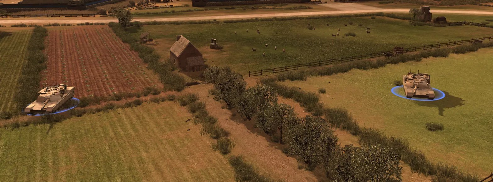
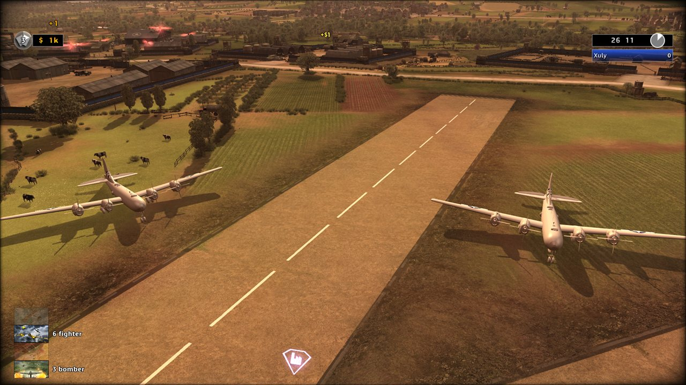
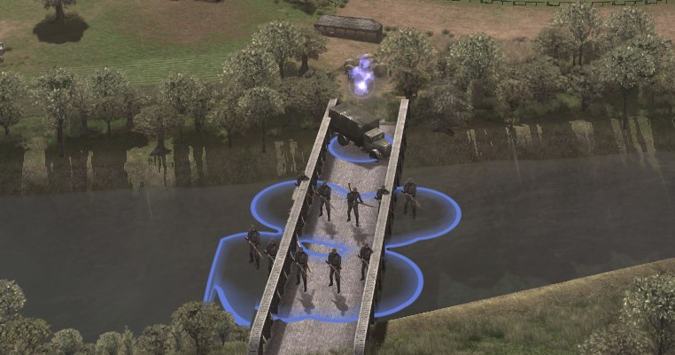
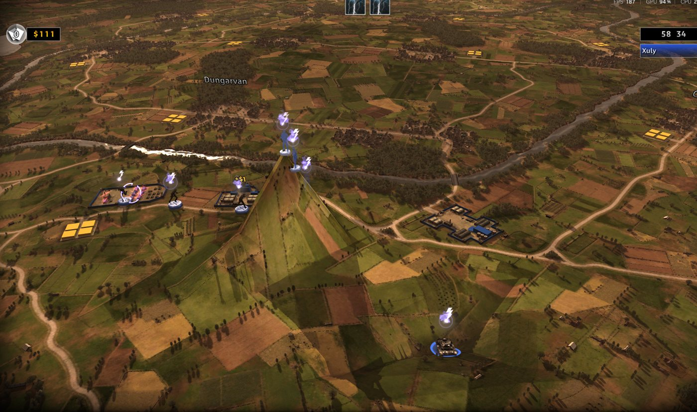
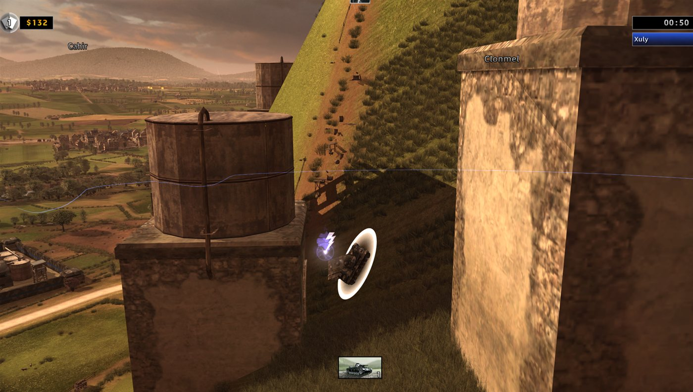
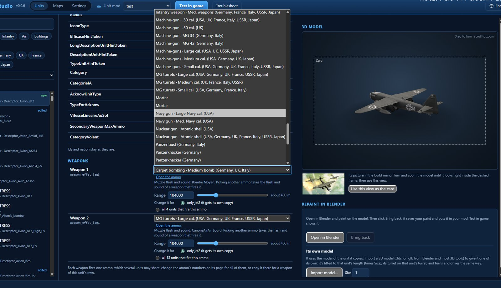
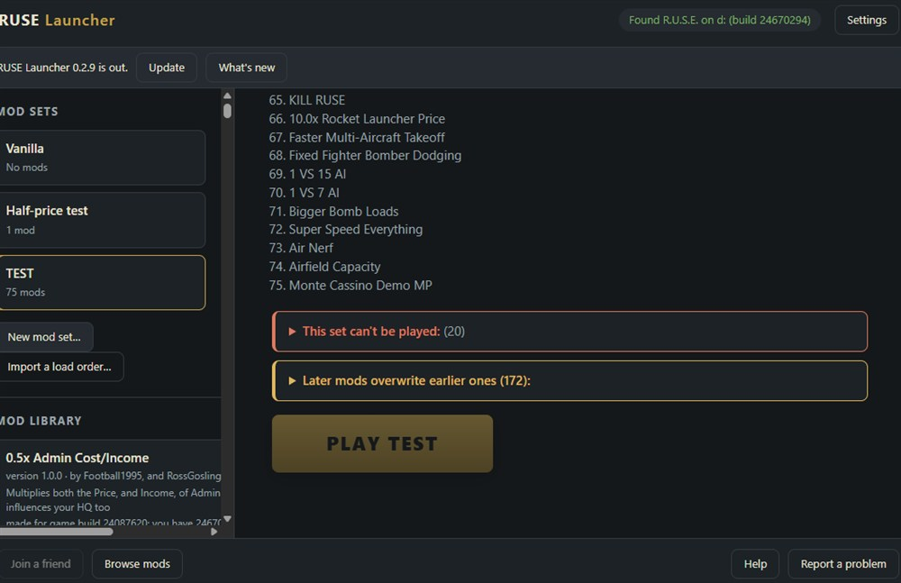

<div align="center">

# R.U.S.E. 2.0

**Construisez le champ de bataille, puis combattez dessus.**

[English](README.md) · **Français** · [Deutsch](README.ger.md) · [Italiano](README.ita.md) · [Español](README.spa.md) · [Polski](README.pol.md) · [Русский](README.ru.md) · [Čeština](README.cz.md) · [日本語](README.jpn.md) · [简体中文](README.sc.md) · [فارسی](README.fa.md)


[](https://github.com/sneadtristen6/R.U.S.E-2.0-Project/releases?q=launcher)
&nbsp;&nbsp;
[](https://github.com/sneadtristen6/R.U.S.E-2.0-Project/releases?q=studio)
&nbsp;&nbsp;
[](https://www.patreon.com/SneadTristen6)

<sub>Windows. Nécessite R.U.S.E. sur Steam. Ne touche jamais à votre installation Steam.</sub>

</div>

> [!TIP]
> **Comment installer et jouer (5 minutes) :**
> 1. Ouvrez les [versions du Launcher](https://github.com/sneadtristen6/R.U.S.E-2.0-Project/releases?q=launcher), prenez
>    la plus récente (marquée **Latest**), et sous **Assets** cliquez sur **RUSE-Launcher-Setup-0.4.8.9.exe**.
> 2. Lancez-le. Si Windows dit « Windows a protégé votre ordinateur » : **Informations complémentaires**, puis
>    **Exécuter quand même**.
> 3. Ouvrez **RUSE Launcher** : il trouve R.U.S.E. tout seul grâce à Steam.
> 4. Cliquez sur **Mods compatibles**, cochez les mods que vous voulez et appuyez sur **Installer**.
> 5. Mettez-les dans un ensemble de mods (**Nouvel ensemble de mods…**) et appuyez sur **Jouer**.
>
> Chaque étape, avec quoi faire quand quelque chose ne va pas : **[Installer et jouer](https://github.com/sneadtristen6/R.U.S.E-2.0-Project/wiki/Installer-et-jouer)**.
> Pour créer des mods, prenez **RUSE Studio** de la même façon depuis les
> [versions du Studio](https://github.com/sneadtristen6/R.U.S.E-2.0-Project/releases?q=studio) et commencez par
> [Votre premier mod](https://github.com/sneadtristen6/R.U.S.E-2.0-Project/wiki/Votre-premier-mod).

## Ce qu'est R.U.S.E.

**R.U.S.E.** (2010) est le jeu de stratégie en temps réel d'Eugen Systems sur la Seconde Guerre mondiale. Tout le
front s'étend sur une table de carte que vous pouvez zoomer de la salle de guerre jusqu'à un seul char, et les
batailles se gagnent autant par la tromperie que par la force : les **cartes ruse** cachent vos unités, simulent une
attaque, percent à jour les plans de l'ennemi ou accélèrent vos troupes. Il a une campagne, des Opérations, et des
batailles en escarmouche et en multijoueur sur des cartes de la Normandie à la Tunisie.

## Ce qu'est R.U.S.E. 2.0

**De nouvelles cartes, de nouvelles unités et le jeu moddé en un clic pour R.U.S.E.** Deux applications gratuites :

- **RUSE Launcher, pour les joueurs.** Choisissez un ensemble de mods et appuyez sur **Jouer**. C'est tout.
- **RUSE Studio, pour les moddeurs.** Changez n'importe quelle unité, créez-en de nouvelles avec leurs propres modèles
  3D, construisez des cartes à partir d'une page blanche ou remodelez celles du jeu, puis appuyez sur **Tester en jeu**.

**Vérifié avant le démarrage du jeu.** Le Studio lit votre mod comme le jeu le fera : tout ce qui casserait en jeu est
arrêté avant, avec une note qui dit quoi changer. Le but : ce que vous faites fonctionne en jeu à chaque fois, du
premier coup.

**Seulement des données.** Ici, un mod change les données du jeu, dans une copie séparée du jeu, et c'est tout. Votre
installation Steam n'est jamais modifiée.

**Open source** (GPL-3.0), en onze langues : les dix du jeu, et le persan.

<table>
  <tr>
    <td width="33%" valign="top">
      <br>
      <sub><b>Un char à vous.</b> Un M1 Abrams, modélisé dans un autre programme 3D, en jeu.</sub>
    </td>
    <td width="33%" valign="top">
      <br>
      <sub><b>De la Première Guerre mondiale à aujourd'hui, tout en un.</b> Biplans, bombardiers et avions à réaction sur un même aérodrome.</sub>
    </td>
    <td width="33%" valign="top">
      <br>
      <sub><b>Des routes que vous tracez.</b> Comme celles de la carte, vues de haut comme tout près du sol.</sub>
    </td>
  </tr>
</table>

## Ce que change R.U.S.E. 2.0

### Unités

- **Changez n'importe quelle unité :** son prix, son blindage, sa vitesse, ses armes et tous ses autres chiffres, avec
  Annuler, puis **Tester en jeu**.
- **Chaque drapeau et chaque chiffre expliqués**, en mots simples et en unités simples (mètres, km/h, secondes) : ce
  qu'il fait, où se situent les unités du jeu, et un curseur à partir de sa valeur de base. Les drapeaux connus pour
  faire planter le jeu sont bloqués, avec la correction.
- **De nouvelles unités :** partez de n'importe quelle unité, mettez-la dans le menu de construction de n'importe
  quelle nation, derrière une recherche ou achetable dès le départ.
- **Des avions dans n'importe quel rôle** (chasseur, chasseur bombardier, bombardier avec sa soute à bombes,
  éclaireur), des **véhicules de reconnaissance**, et des **armes qui touchent le sol, les avions ou les deux**.
- **Vos propres modèles 3D :** importez un modèle depuis Blender ou n'importe quel outil 3D, repeignez n'importe quelle
  unité dans Blender, donnez à une escouade son propre uniforme, choisissez le camion dans lequel une escouade se
  déplace, et faites sa carte pour le menu de construction.
- **366 unités de la Première Guerre mondiale à aujourd'hui :** des modèles gratuits d'autres créateurs, chacun
  crédité, à leur vraie taille, à rechercher comme les unités du jeu.
- **Nations :** changez l'une des sept nations du jeu en une autre, avec un nom et un drapeau à elle ; cachez ou
  remplissez les unités d'une nation en une fois.
- **Les bâtiments et ce qu'ils produisent :** les bâtiments de chaque nation en rangées des unités que leurs menus de
  construction offrent ; mettez-y des unités, déplacez-les, copiez celles d'une autre nation, faites-les rechercher
  depuis une autre unité. **Ajouter un bâtiment :** une copie d'un bâtiment du jeu, ou un bâtiment avec ses propres
  unités, son propre onglet dans la barre de construction, sa propre apparence 3D et sa propre image dans le menu de
  construction.
- **Des noms de munitions et des types de drapeaux à vous :** renommez une munition copiée dans toutes les langues ;
  faites un ensemble nommé de drapeaux du jeu et donnez-le à n'importe quelle unité.

### Cartes

- **De nouvelles cartes** listées dans BATAILLES à côté de celles du jeu. Partez d'une **terre vierge ou de la pleine
  mer**, à la taille du jeu ou plus grandes, donnez-leur leurs propres images dans les menus, et peignez leurs secteurs.
- **Modeler le terrain :** collines, cratères, plateaux, rampes, terrain nivelé et adouci ; lacs et rivières
  asséchées. Les unités y roulent et y combattent.
- **Routes et ponts :** des routes droites, courbes ou à main levée que suivent les camions de ravitaillement ; là où
  l'une traverse l'eau, le type de pont de la carte, que traversent les chars, l'infanterie et les camions. Retirez les
  ponts de la carte et fermez leurs passages.
- **Bâtiments, objets et arbres :** placez-les un par un, en grille, en rectangle, ou le long d'un tracé (haies et
  rangées d'arbres), les bâtiments face aux routes ; sélectionnez-les, déplacez-les, tournez-les, redimensionnez-les et
  supprimez-les, ceux de la carte aussi ; dégagez les bois et les objets de la carte. **Importer un modèle** fait d'un
  modèle 3D l'un des rochers, objets, plantes ou arbres de votre carte.
- **Couvert et déplacement :** peignez les villes et les bois où les unités se cachent, et fermez du terrain à toutes
  les unités, à l'infanterie ou aux véhicules. La carte montre ce que chaque trait a changé.
- **Peinture de carte :** peignez l'image du sol avec une couleur, le sol de la carte pris à un autre endroit, les
  textures du jeu, des images à vous ou des textures gratuites en ligne.
- **Scénarios et missions :** déplacez les points de départ, ajoutez les unités avec lesquelles une bataille commence,
  et des missions à vous avec des objectifs, des événements et des mouvements de caméra, pour les Opérations et les
  chapitres de campagne.

### Les règles du jeu

- **Réglages de l'IA et des joueurs**, un seul onglet :
  - **Réglages des joueurs :** argent de départ et revenu, dépôts de ravitaillement et leurs camions, les cartes ruse
    avec lesquelles chaque camp commence, pour les batailles normales et nucléaires séparément.
  - **Joueurs ordinateur :** chacune de leurs valeurs pour chaque difficulté et chaque personnalité, les unités qu'ils
    préfèrent et leurs cartes ruse, chaque valeur expliquée.
  - **Règles du jeu :** 172 autres valeurs du jeu en 16 groupes (bataille et reddition, population, déplacement, tir,
    dégâts, bois et couvert, avions, cartes ruse en action, les couleurs des camps et des secteurs, et plus), chacune
    expliquée.
- **Toutes les valeurs et fichiers :** chaque objet et chaque valeur des données du jeu, changés dans votre mod.

### Son et animation : RUSE Decoy

- **Chaque son du jeu** par type : écouté, rendu plus fort ou plus faible, ou remplacé ; de nouveaux morceaux dans les
  listes de bataille ; des répliques de mission redoublées.
- **Animations :** remplacez un clip par un autre, ralentissez-le ou accélérez-le, agrandissez un os ou tournez-le, et
  mettez de la capture de mouvement sur les soldats depuis une bibliothèque de 3 205 mouvements libres (la base de
  données CMU et 100STYLE, crédités).

### Pour les joueurs

- **Un seul clic :** choisissez un ensemble de mods et appuyez sur **Jouer** ; le Launcher construit une copie moddée
  séparée et la lance.
- **R.U.S.E. 2.0 en or :** le jeu moddé s'ouvre sur une scène de bataille, et ses menus et écrans de chargement
  affichent R.U.S.E. 2.0 en or (les Réglages gardent le titre du jeu si vous préférez).
- **Les mods de la communauté tels quels** (les `.rmod` de RUSE-Mod-Manager aussi), une liste de mods compatibles à
  cocher, des ordres de chargement partagés dans les deux sens avec RUSE-Mod-Manager, et un outil de dépannage qui
  trouve ce qui bloque Jouer et le corrige.
- **Se met à jour tout seul**, en onze langues : les dix du jeu, et le persan.

## Voir en jeu

<table>
  <tr>
    <td width="33%" valign="top">
      <br>
      <sub><b>En pleine campagne.</b> Deux M1 Abrams à côté d'une ferme.</sub>
    </td>
    <td width="33%" valign="top">
      <br>
      <sub><b>De nouveaux bombardiers</b> sur un aérodrome de R.U.S.E.</sub>
    </td>
    <td width="33%" valign="top">
      <br>
      <sub><b>Des unités avec leur propre apparence.</b> Repeignez n'importe quelle unité dans Blender et ramenez-la.</sub>
    </td>
  </tr>
  <tr>
    <td width="33%" valign="top">
      <br>
      <sub><b>Des ponts que les unités traversent.</b> Là où votre route rencontre l'eau, le type de pont de la carte.</sub>
    </td>
    <td width="33%" valign="top">
      <br>
      <sub><b>Un terrain que vous modelez.</b> Collines, cratères, lacs et rivières asséchées où les unités roulent et combattent.</sub>
    </td>
    <td width="33%" valign="top">
      <br>
      <sub><b>De nouvelles cartes</b>, parties d'une page blanche, avec leurs propres images de menu.</sub>
    </td>
  </tr>
  <tr>
    <td width="33%" valign="top">
      <br>
      <sub><b>Du couvert peint.</b> L'infanterie qui s'y trouve est cachée.</sub>
    </td>
    <td width="33%" valign="top">
      <br>
      <sub><b>Les bâtiments placés sont solides.</b> Les chars les contournent.</sub>
    </td>
    <td width="33%" valign="top">
      <br>
      <sub><b>Une rivière asséchée.</b> Les unités marchent dans son lit.</sub>
    </td>
  </tr>
</table>

## Dans le Studio

<table>
  <tr>
    <td width="50%" valign="top">
      <br>
      <sub><b>Chaque carte en 3D.</b> Blitz avec ses zones et ses villes ; les outils s'alignent en bas.</sub>
    </td>
    <td width="50%" valign="top">
      <br>
      <sub><b>Unités.</b> Les chiffres, les drapeaux et les armes d'une unité, son modèle 3D et sa carte.</sub>
    </td>
  </tr>
  <tr>
    <td width="50%" valign="top">
      <br>
      <sub><b>Peinture de carte.</b> Peignez l'image du sol.</sub>
    </td>
    <td width="50%" valign="top">
      <br>
      <sub><b>Routes et ponts.</b> Droites, courbes ou à main levée.</sub>
    </td>
  </tr>
  <tr>
    <td width="50%" valign="top">
      <br>
      <sub><b>Des unités d'autres époques</b>, le créateur de chaque modèle crédité.</sub>
    </td>
    <td width="50%" valign="top">
      <br>
      <sub><b>RUSE Launcher :</b> un ensemble de 75 mods de la communauté, et lesquels en écrasent d'autres.</sub>
    </td>
  </tr>
</table>

## À venir

- **Des villes que vous tracez :** tracez les rues, marquez des pâtés de maisons comme habitations, commerces ou
  industrie, et le Studio les remplit avec les bâtiments du jeu.
- **Un vrai lieu comme carte :** l'importateur de cartes (ci-dessous).
- **Des montagnes générées et nos propres textures de sol en haute résolution**, et le pinceau de champs de Peinture de
  carte, qui transforme des champs entiers en blé, en terre labourée ou en culture verte, comme les cartes du jeu les
  peignent.

### L'importateur de cartes : où il en est

L'importateur de cartes fait d'un vrai lieu une carte de R.U.S.E. : son sol et ses collines, ses champs, bois,
rivières, fossés, plage et mer, et, si vous les voulez, ses routes et ses bâtiments, le tout fait avec les pièces du jeu
pour que la carte ait l'air et se joue comme celles du jeu. Vous choisirez un lieu, et le Studio en fera une carte que
vous pourrez continuer à modifier.

Le Studio peut déjà construire un petit morceau d'un vrai lieu (une partie d'Utah Beach) en une carte qui s'ouvre en
jeu. Ce n'est pas encore juste : la plage, l'eau et le sol vus de près n'ont toujours pas l'air qu'ils devraient avoir.
Pourquoi cela prend du temps :

- **Une carte, ce sont de nombreuses couches qui doivent concorder :** la forme du sol, son aspect de près, l'image vue
  de haut, l'eau, où les unités peuvent rouler et se cacher, les routes et les ponts. Un vrai lieu doit être juste dans
  chacune d'elles à la fois, et un défaut dans l'une se voit dans les autres.
- **De près et de loin :** le jeu dessine son sol de deux façons, et elles doivent concorder. Faire que les couleurs
  d'un vrai lieu ressemblent à celles du jeu, de près comme vues du ciel, c'est l'essentiel du travail.
- **L'eau décide où vont les unités :** les rivières, les fossés et la côte fixent où les chars et l'infanterie peuvent
  se déplacer. Un seul endroit faux, et les chars traversent un fossé, ou ne peuvent pas atteindre une plage.
- **Chaque changement est vérifié en jeu :** c'est la seule preuve qui compte, et chaque vérification veut dire
  construire la carte et la regarder depuis de nombreux endroits.
- **Nous préférons attendre** qu'un vrai lieu ait l'air et se joue comme une vraie carte de R.U.S.E. plutôt que de
  sortir quelque chose de fait à moitié.

Ensuite : la petite carte de test juste, puis une carte entière, puis le bouton Importer une carte du Studio.

Tout ce qui a changé, version par version : les
[notes du Studio](https://github.com/sneadtristen6/R.U.S.E-2.0-Project/blob/main/.github/release-notes/studio.md) et les
[notes du Launcher](https://github.com/sneadtristen6/R.U.S.E-2.0-Project/blob/main/.github/release-notes/launcher.md).

**À propos du nom :** R.U.S.E. 2.0 est un nom provisoire. Avant la sortie de la version complète (1.0), nous
consulterons Eugen Systems, les créateurs de R.U.S.E., et le projet prendra un nom qui leur convient. Les idées de noms
et les critiques constructives sont les bienvenues dans
[la discussion sur le nom](https://github.com/sneadtristen6/R.U.S.E-2.0-Project/discussions/18).

**Ce qu'il y a dans ce dépôt.** Les deux applications, et ce dont les joueurs et les moddeurs ont besoin pour les
utiliser. Nos notes de travail sur les fichiers du jeu restent privées jusqu'à ce que nous ayons un accord explicite
des développeurs, Eugen Systems.

Tout ce que nous faisons ici, c'est pour aider la communauté et offrir à ce jeu un meilleur avenir. R.U.S.E. est l'un
de mes jeux préférés de tous les temps, et je veux simplement le rendre meilleur.

**Copies possédées seulement.** Le projet R.U.S.E. 2.0 ne prend en charge R.U.S.E. que si vous le possédez sur votre
compte Steam. Le jeu lui-même ne démarre que pour un compte Steam qui le possède, et nos outils ne contournent jamais
cela : ils trouvent le jeu par votre bibliothèque Steam, moddent une copie séparée du jeu, et ne distribuent jamais les
fichiers du jeu. Nous ne prenons pas en charge les émulateurs Steam, les copies piratées, ni rien d'autre qui permette
de jouer sans posséder le jeu. Si vous ne le possédez pas, ces outils ne fonctionneront pas pour vous et ne sont pas
faits pour vous. Nous ferons remonter tout ce que nous jugerons approprié.

Vous le possédez autrement, par exemple une copie en boîte d'avant l'arrivée de R.U.S.E. sur Steam, ou les applications
se sont trompées ? Le cadre dans l'application affiche votre code et deux boutons : ouvrez un ticket sur Discord ou sur
GitHub, et nous vous enverrons un code de déblocage pour votre PC.

## Installer en trois étapes

1. **Téléchargez** l'installateur depuis les [versions](https://github.com/sneadtristen6/R.U.S.E-2.0-Project/releases) :
   `RUSE-Launcher-Setup-<version>.exe` pour les joueurs, `RUSE-Studio-Setup-<version>.exe` pour les moddeurs. Windows
   seulement. Il vous faut R.U.S.E. dans votre bibliothèque Steam, installé.
2. **Lancez-le.** Pas besoin de droits d'administrateur ni de Python. Les installateurs ne sont pas encore signés, donc
   Windows peut avertir une fois (« Windows a protégé votre ordinateur ») : cliquez sur **Informations
   complémentaires**, puis sur **Exécuter quand même**. Pour vérifier que vous avez le vrai fichier, comparez son
   SHA-256 avec celui des notes de version.
3. **Démarrez-le** depuis le menu Démarrer. Il trouve R.U.S.E. grâce à Steam. Dans le Launcher, choisissez un ensemble
   de mods et appuyez sur **Jouer**. Dans le Studio, construisez l'index du jeu une fois quand il le demande (environ
   une minute), puis choisissez ou créez un mod.

La désinstallation garde vos mods et vos réglages. Les applications ont besoin de Microsoft Edge WebView2, que
Windows 11 a déjà. Plus d'infos dans [installers/README.md](installers/README.md).

<details>
<summary><b>État, documentation et contribution</b></summary>

[](https://github.com/sneadtristen6/R.U.S.E-2.0-Project/releases?q=launcher)
[](https://github.com/sneadtristen6/R.U.S.E-2.0-Project/releases?q=studio)
[](https://github.com/sneadtristen6/R.U.S.E-2.0-Project/actions/workflows/tests.yml)
[](LICENSE)

**Launcher** pour les joueurs (dernière version : 0.4.8.9) &middot; **Studio** pour les moddeurs, un aperçu (dernière version : 0.9.8.9) &middot; Windows &middot; nécessite R.U.S.E. sur Steam

**[Manuel de terrain (wiki)](https://github.com/sneadtristen6/R.U.S.E-2.0-Project/wiki/Manuel-de-terrain)** &middot;
**[Discussions](https://github.com/sneadtristen6/R.U.S.E-2.0-Project/discussions)** &middot;
**[Discord](https://discord.gg/h54t5baNsC)** &middot; **[Contribuer](CONTRIBUTING.md)** &middot;
**[Code de conduite](CODE_OF_CONDUCT.md)** &middot; [docs/MOD_FORMAT.md](docs/MOD_FORMAT.md) : tout ce qu'un mod peut
faire, fichier par fichier.

</details>

<a name="for-contributors"></a>
<details>
<summary><b>Pour les contributeurs</b></summary>

Comment signaler des bugs, tester en jeu et envoyer du code : [CONTRIBUTING.md](CONTRIBUTING.md).

<details>
<summary><b>Les deux applications depuis les sources, et les installateurs</b></summary>

Les deux applications tournent sur le moteur, séparément l'une de l'autre (aucune n'a besoin de l'autre). Ce sont
toutes deux des fenêtres de bureau construites comme des pages web ; une fois : `py -3 -m pip install pywebview`. Leurs
écrans s'ouvrent aussi dans un navigateur normal avec des données inventées : `src/ruse_launcher/ui/index.html?fake`,
`src/ruse_studio/ui/index.html?fake`.

- **RUSE Launcher** ([`src/ruse_launcher/`](src/ruse_launcher/)), pour les joueurs : il trouve le jeu, liste vos
  ensembles de mods et a un grand bouton Jouer qui construit la copie moddée de l'ensemble et lance le jeu (Jeu
  d'origine démarre par Steam). `py -3 -m ruse_launcher`. **Les joueurs ne touchent jamais à un fichier.** Une
  bibliothèque de mods (« Ajouter un fichier de mod… » pour un `.rusemod` du Studio, un `.rmod` ou un `.zip`, ou
  déposez un fichier ou un dossier de mod sur la fenêtre ; chaque mod est d'abord vérifié), des ensembles de mods faits
  à l'écran (nouveau, modifier et réordonner, renommer, dupliquer, supprimer), Partager et « Importer un ordre de
  chargement… » pour un ensemble de mods (le texte propre à RUSE-Mod-Manager, donc les ordres de chargement vont dans
  les deux sens ; [`src/rusemod/loadorder.py`](src/rusemod/loadorder.py)), un guide en trois étapes sur Jeu d'origine
  (« Jouer avec des mods, en trois étapes »), et le launcher dans la langue du PC (n'importe laquelle des dix du jeu, ou
  le persan). **Mods compatibles** (0.3.0) : notre liste de mods (un dépôt GitHub, MOD_FORMAT §15) avec des cases à
  cocher, plusieurs installés à la fois, chaque fichier vérifié par rapport à la liste avant d'entrer dans la
  bibliothèque, les mods de triche mis à part ; hors ligne, la dernière copie de la liste.
- **RUSE Studio** ([`src/ruse_studio/`](src/ruse_studio/)), pour les moddeurs : parcourez chaque unité et chaque
  bâtiment, voyez les valeurs d'une unité, ses pièces et ce qui l'utilise, et choisissez une langue : les noms du jeu
  par défaut, ou n'importe laquelle des dix langues du jeu, ou le persan. Choisissez ou créez un mod et changez les
  chiffres d'une unité directement sur sa page : chaque changement est enregistré dans le `src/studio.rndf` du mod
  (avec Annuler) ; une pièce que plusieurs unités partagent change pour l'une d'elles ou pour toutes. « Tester en jeu »
  construit le mod et lance le jeu. **Cartes** (sorti en 0.4) : chaque carte que le jeu liste, en 3D avec son vrai
  maillage de sol et ses textures de sol (décodés une fois par carte et gardés). **Aussi :**
  - **« Exporter le mod… »** fait du mod un seul fichier, `<id>-<version>.rusemod`, avec la version du jeu et
    l'empreinte du mod à l'intérieur, pour « Ajouter un fichier de mod… » du launcher (la boucle du moddeur au joueur).
  - **Nouvelle unité…** sur la page d'une unité fait une copie avec son propre nom (un seul nom, affiché dans les dix
    langues), son prix et son menu de construction (la même nation et la même usine, ou celles d'une autre nation) ;
    elle est listée comme nouvelle, se modifie comme n'importe quelle autre unité, et peut être supprimée.
  - **Dans Cartes :** les bâtiments de chaque carte et une partie de ses objets et arbres. Choisissez un pinceau et
    cliquez ou glissez sur le sol pour le modeler : chaque trait est dessiné tout de suite et enregistré dans le
    `maps/<map>/terrain.toml` du mod ; une rampe prend deux clics (son début, sa fin), Annuler reprend un trait, Tout
    effacer vide la carte. « Placer sur la carte » liste les types propres à la carte (les plus utilisés d'abord, avec
    une recherche) ; réglez Rotation et Taille, cliquez sur le sol, et l'objet est enregistré dans le
    `maps/<map>/scenery.toml` du mod. « Tester en jeu » construit tout cela dans la carte.

  `py -3 -m ruse_studio` (après `ruse index build`) ; `--spike` ouvre la vérification 3D.
- `py -3 -m pip install -e .[apps]` une fois donne deux commandes, `ruse-launcher` et `ruse-studio`, qui les ouvrent
  sans fenêtre de console.
- **Installateurs** ([`installers/`](installers/README.md)) : GitHub construit `RUSE-Launcher-Setup-<version>.exe` et
  `RUSE-Studio-Setup-<version>.exe` à chaque push qui change les applications (Actions, **apps**, Artifacts). Un tag
  `launcher-v<version>` ou `studio-v<version>` en publie un comme Release. Pas besoin de Python ni de Git, ni de droits
  d'administrateur. Pas encore signés, donc Windows avertit une fois (« Informations complémentaires », puis
  « Exécuter quand même »).

</details>

</details>

<details>
<summary><b>Outils et vérifications</b></summary>

- [`tools/check_public.py`](tools/check_public.py) : lancé par GitHub à chaque push ; échoue si du contenu privé, des
  fichiers du jeu ou des détails du programme du jeu allaient atteindre ce dépôt public.
- [`tools/rmod_to_mod.py`](tools/rmod_to_mod.py) : reconstruit un `.rmod` de RUSE-Mod-Manager en un mod à nous.

</details>

<details>
<summary><b>Lancer les tests</b></summary>

[`tests/`](tests) contient des tests sur de petits fichiers inventés ; pas besoin du jeu :

```
py -3 -m unittest discover -s tests
```

(avec `PYTHONPATH=src`). GitHub les lance à chaque push, sous Windows et Linux
([`.github/workflows/tests.yml`](.github/workflows/tests.yml)).

</details>

## Crédits

R.U.S.E. 2.0 repose sur le travail d'autres personnes. Rien de tout cela ne serait là sans elles.

### ProLution : le parrain du modding de R.U.S.E.

- A construit la **RUSE Modding Database** et écrit les guides avec lesquels les gens ont appris, entre autres sur les
  Opérations personnalisées.
- **Le code de ProLution est dans le nôtre :** le codec de terrain des cartes dans
  [`src/ruse_mod_engine/terrain_codec.py`](src/ruse_mod_engine/terrain_codec.py) repose sur le travail de ProLution sur
  le format du terrain (publié en CC0), et son encodeur est porté depuis l'encodeur de référence de ProLution. Notre
  propre lecteur des textures compressées du jeu ([`src/rusemod/tgu1.py`](src/rusemod/tgu1.py)) utilise aussi son codec.

### LittleGroove : le premier gestionnaire de mods

LittleGroove a ouvert la voie à une grande partie de ce que fait R.U.S.E. 2.0 : il a construit le premier vrai
gestionnaire de mods pour R.U.S.E., et son moteur fait toujours partie du nôtre.

- **RUSE-Mod-Manager et son format `.rmod` :** un mod comme une liste de changements aux données du jeu, pour que
  plusieurs mods fonctionnent ensemble. Les mods faits avec lui se jouent dans le Launcher, et les ordres de chargement
  se partagent dans son format texte, donc ils passent de son Mod Manager au Launcher et inversement.
- **Son moteur fait partie du nôtre** ([`src/ruse_mod_engine`](src/ruse_mod_engine/), écrit en Python), et c'est pour
  cela que tout le programme est sous GPL-3.0 :
  - il applique les mods `.rmod` dans nos constructions, et adapte un mod fait pour une autre version du jeu grâce à
    ses correspondances de versions ; « Convertir un ancien mod » du Launcher, c'est son convertisseur ;
  - nos outils de carte lisent et écrivent le couvert du jeu, la grille de l'ordinateur, les ponts, les routes et le
    déplacement avec son module `sdb` ;
  - le Studio montre les scripts du jeu en Python avec son lecteur de scripts, son résumé de ce que fait une mission et
    son catalogue des parties des scripts, compile un script modifié avec son compilateur et le Python 2.5.1 du jeu que
    son moteur emporte, et vérifie les fichiers et les textes d'une mission avec sa chaîne de scénario ;
  - nos changements à ce moteur : la racine d'un arbre SpatialDB est toujours divisée (une racine à une seule feuille
    faisait planter le jeu), et de petits ajouts à son lecteur de terrain et à son compilateur de scripts.
- **Ce que ses outils nous ont appris :** les distances qui gardent les dépôts de ravitaillement et les QG sur les
  routes et ce que contient un dépôt (les deux mesurés par lui en jeu), la caméra d'ouverture sur laquelle chaque
  partie commence, la somme de contrôle qui permet au jeu de charger un scénario modifié, comment de nouveaux fichiers
  entrent dans les packs du jeu, et la copie d'une munition pour donner à une arme la sienne.
- **Son Mod Manager les avait en premier ; le Studio les a dans son propre code :** les éditeurs Économie et IA,
  l'éditeur de valeurs brutes (Toutes les valeurs), la chaîne d'améliorations, le navigateur de fichiers, les menus,
  fichiers et textes d'une mission, et les noms, zones et détails des éléments de l'éditeur de cartes.

### DomesticNukes : les fondations de l'éditeur de cartes

- **DomesticNukes a posé les fondations de l'éditeur de cartes :** le sol sur lequel marchent les unités, l'endroit où
  se trouve chaque bâtiment, arbre et objet, et la recette que suivent les pinceaux de terrain pour qu'une carte
  remodelée se charge et se joue.
- **DomesticNukes a écrit les pinceaux d'eau :** lacs et rivières asséchées, fusionnés depuis la pull request de
  DomesticNukes.
- **Le travail de DomesticNukes sur les modèles du jeu** a mis les vrais modèles 3D du jeu dans la vue carte du Studio,
  et a aidé à faire fonctionner les unités d'une autre nation.
- Les notes sur les drapeaux des unités, les tabliers des ponts et la façon dont les unités se tiennent sur le sol sont
  entrées dans les vérifications de la construction et dans les ponts que les unités traversent maintenant.
  DomesticNukes teste aussi les versions en jeu.

### Les créateurs des modèles des unités d'époque

Les unités d'autres époques (Studio 0.9.8.2) sont des modèles 3D gratuits faits et partagés par leurs auteurs, sous
CC0 ou CC BY. Chaque créateur est nommé, avec le titre du modèle, sa licence et son lien, sur la page de l'unité dans le
Studio, dans le fichier de crédits de tout mod qui en utilise un (`CREDITS-era-units.md`), et dans la liste complète
sur la [version des unités d'époque](https://github.com/sneadtristen6/R.U.S.E-2.0-Project/releases/tag/era-units). Ce
que nous avons changé : chacun a été ajusté au jeu (tourné et mis à l'échelle) et a reçu les marquages de sa nation.

### sneadtristen6 et Claude : la construction de R.U.S.E. 2.0

**sneadtristen6 est l'esprit derrière R.U.S.E. 2.0.** Les idées sont les siennes, il décide de ce que cela devient, et
il joue chaque changement en jeu avant qu'il sorte. **Claude**, l'IA d'Anthropic, aide à transformer ses idées en plans
et écrit le code. Côte à côte depuis septembre 2026, ils ont construit :

- **De nouveaux modèles 3D en jeu :** l'importateur de modèles qui fait entrer le modèle d'une unité depuis Blender ou
  n'importe quel outil 3D (un M1 Abrams a été le premier), des unités repeintes dans Blender, des uniformes propres aux
  escouades, des cartes de menu de construction, et 366 unités d'autres époques à leur vraie taille.
- **Le travail sur les textures :** Peinture de carte et sa bibliothèque de textures : le sol d'une carte peint avec
  les textures du jeu, du sol pris n'importe où sur la carte, ou des images à vous.
- **De nouvelles cartes.** Le 3 octobre 2026, R.U.S.E. a reçu de nouvelles cartes : listées dans BATAILLES à côté de
  celles du jeu, chacune jouant son propre terrain. Pour trouver la limite, 101 sont entrées d'un coup ; toutes se sont
  affichées et ont fonctionné. À notre connaissance, ce sont les premières nouvelles cartes que le jeu ait eues depuis
  Le jour J. Les nouvelles cartes partent de rien, en terre ou en pleine mer, avec leurs propres images de menu.
- **Un éditeur de cartes qui fonctionne en jeu :** un sol sur lequel les unités roulent et combattent, des lacs et des
  rivières asséchées, des routes qui ressemblent à celles de la carte vues de haut comme tout près du sol, des ponts que
  traversent les chars, l'infanterie et les camions de ravitaillement, des bâtiments, objets et arbres qui s'affichent à
  toutes les distances, le couvert, et où les unités peuvent aller.
- **Unités :** changer n'importe laquelle, en créer de nouvelles, donner à une nation les chars et les avions d'une
  autre armée, des avions dans n'importe quel rôle, des véhicules de reconnaissance, des armes qui touchent les avions,
  chaque drapeau et chaque chiffre expliqués, et une nation changée en une autre.
- **Musique et missions :** des morceaux et des répliques remplacés dans le Studio, et des missions à vous.
- **Deux applications en onze langues** (les dix du jeu, et le persan), le Studio pour les moddeurs et le Launcher pour les joueurs, qui ne touchent jamais
  au dossier du jeu lui-même, avec une vérification qui arrête un mod qui casserait le jeu avant qu'il démarre.
- **Le code :** tout ce qui est dans `src/rusemod`, `src/ruse_studio` et `src/ruse_launcher` est à nous, écrit pour
  R.U.S.E. 2.0. Les autres personnes sur le travail desquelles il repose sont créditées ci-dessus et dans
  [THIRD_PARTY_NOTICES.md](THIRD_PARTY_NOTICES.md).

C'est encore le début, et il y a bien plus à venir. Merci à tous ceux cités ci-dessus, sans qui rien de tout cela
n'aurait commencé.

### (Anonyme) Oozaru : tests et débogage

**(Anonyme) Oozaru a testé les premières applications sur son propre mod de campagne et a envoyé le journal avec
chaque bug qu'il a trouvé.** Ses rapports ont mené à ces corrections :

- Les objets placés qui ne s'affichaient que de près sont maintenant dessinés jusqu'au lointain (Studio 0.9.3).
- Ses unités pour le joueur dans un chapitre de campagne n'apparaissaient jamais ; elles peuvent maintenant être
  données au joueur.
- Ses unités françaises sur la Hollande faisaient planter le jeu au chargement ; les unités d'une autre nation se
  chargent maintenant aussi dans les chapitres de campagne et les Opérations (0.9.5).
- Il a établi quel nom IR du chapitre 1 d'Italie correspond à quel camp : le joueur américain, la France, l'Italie, le
  Royaume-Uni et l'ordinateur américain.
- Son « attendre 30 minutes à chaque fois juste pour ajouter ou retirer une unité » est la raison pour laquelle
  **Jouer** démarre maintenant tout de suite quand rien n'a changé (Launcher 0.4.6).

Merci aussi à tous ceux qui ont essayé les applications, envoyé des captures d'écran et signalé des bugs.

### Crédits des soutiens

Les noms des soutiens sont ajoutés ici une fois que le soutien a choisi un nom public pour les crédits.

#### Monumental Supporters

Un remerciement bien visible et personnel pour les soutiens à 100 $ qui aident à poser les fondations de R.U.S.E. 2.0
et de la vision de Pacific Defense, avec Iwo Jima comme carte phare, et de la Chine. Ce groupe apparaît en premier dans
les crédits des soutiens.

#### Above & Beyond Supporters

Un remerciement et votre nom dans les crédits pour les soutiens à 20 $ qui vont au-delà pour aider le développement à
avancer.

## Soutenir le développement

R.U.S.E. 2.0 est mon premier projet de modding. Si vous voulez soutenir le développement et suivre le travail en
coulisses, [rendez-vous sur mon Patreon](https://www.patreon.com/SneadTristen6). Tout soutien m'aide à continuer à
construire.

### Options de soutien ponctuel

| Option | Montant | Reconnaissance |
| --- | --- | --- |
| [Above & Beyond Supporter](https://www.patreon.com/SneadTristen6/posts/171328212) | 20 $ une fois | Le nom de votre choix dans la section Above & Beyond Supporters des crédits sur GitHub et dans les mods. |
| [Monumental Supporter](https://www.patreon.com/SneadTristen6/posts/monumental-100-171328695) | 100 $ une fois | Une mention bien visible dans la section Monumental Supporters, avec un remerciement dédié pour avoir aidé à poser les fondations de la vision du projet. |

J'ai toujours imaginé **Iwo Jima comme la carte phare d'une extension de type DLC, Pacific Defense**, en plus d'ajouter
**la Chine** au jeu. Votre soutien m'aide à avancer vers ce rêve. Ce sont des objectifs de développement pour ce projet
de fan indépendant.

Le crédit est facultatif : après l'achat, envoyez un message Patreon avec le nom public de votre choix et l'autorisation
de le publier, ou choisissez de rester anonyme. Les crédits sont mis à jour avec les versions du projet. Ces achats de
la boutique ne se renouvellent pas automatiquement.

Vous pouvez aussi [demander une fonctionnalité pour 3 $, une seule fois](https://www.patreon.com/SneadTristen6/posts/request-r-u-s-e-171321812).

## Des questions ? Demandez à n'importe quelle IA

Tout ici est écrit en mots simples, donc n'importe quel assistant IA (ChatGPT, Claude, Gemini...) peut y trouver les
réponses. Donnez-lui le lien vers **[ai/START-HERE.md](ai/START-HERE.md)**, la page écrite pour les assistants IA (où
se trouve chaque réponse, les mots des applications, ce qui est testé), ou vers cette page, et demandez ce que vous
voulez savoir :

- *« Comment donner un Tiger allemand aux USA avec RUSE Studio ? »*
- *« Comment tracer une route avec un pont au-dessus d'une rivière ? »*
- *« Mon test en jeu s'est arrêté avec une erreur. Qu'est-ce que ça veut dire ? »*
- *« À quoi sert le fichier scenario.toml d'un mod ? »*

La meilleure page à lui indiquer : [docs/MOD_FORMAT.md](docs/MOD_FORMAT.md) (tout ce qu'un mod peut faire, fichier par
fichier). Toujours bloqué ? Ouvrez une [issue](https://github.com/sneadtristen6/R.U.S.E-2.0-Project/issues).

## Licence

GNU General Public License, version 3 ([LICENSE](LICENSE), GPL-3.0) : copyright (C) 2026 sneadtristen6 et les
contributeurs de RUSE Mod Platform. Les applications incluent [`src/ruse_mod_engine`](src/ruse_mod_engine/), le moteur
RUSE-Mod-Manager de LittleGroove (GPLv3), utilisé tel quel (voir Crédits), et sa licence exige que tout le programme
soit sous GPL-3.0 (il était sous MIT jusqu'au 2026-09-30). `src/ruse_mod_engine/python251` porte la licence de Python
([son LICENSE.txt](src/ruse_mod_engine/python251/LICENSE.txt)). Ceci est un outil indépendant fait par des fans, ni
affilié à Eugen Systems ni approuvé par eux. R.U.S.E. et ses données de jeu appartiennent à leurs propriétaires ; ce
projet ne distribue aucun fichier du jeu et ne fonctionne que sur une copie d'un jeu que vous possédez.
