<div align="center">

# R.U.S.E. 2.0

**Costruisci il campo di battaglia, poi combattici sopra.**

[English](README.md) · [Français](README.fr.md) · [Deutsch](README.ger.md) · **Italiano** · [Español](README.spa.md) · [Polski](README.pol.md) · [Русский](README.ru.md) · [Čeština](README.cz.md) · [日本語](README.jpn.md) · [简体中文](README.sc.md) · [فارسی](README.fa.md)

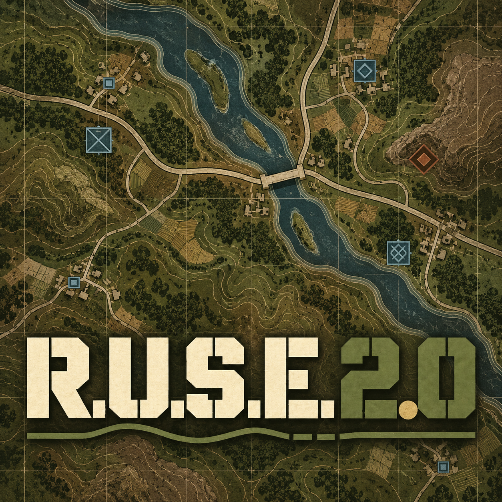

[](https://github.com/sneadtristen6/R.U.S.E-2.0-Project/releases?q=launcher)
&nbsp;&nbsp;
[](https://github.com/sneadtristen6/R.U.S.E-2.0-Project/releases?q=studio)
&nbsp;&nbsp;
[](https://www.patreon.com/SneadTristen6)

<sub>Windows. Serve R.U.S.E. su Steam. Le mod vanno in una copia separata, mai nella tua installazione di Steam.</sub>

</div>

> R.U.S.E. è un gioco sviluppato e pubblicato da Eugen Systems. R.U.S.E. 2.0 è un progetto gratuito di fan. Non è creato, approvato o supportato da Eugen Systems. Non ha legami nemmeno con Valve. Ti serve la tua copia di R.U.S.E.

> [!TIP]
> **Come installare e giocare (5 minuti):**
> 1. Apri le [release del launcher](https://github.com/sneadtristen6/R.U.S.E-2.0-Project/releases?q=launcher), prendi la
>    più recente (contrassegnata **Latest**), e sotto **Assets** clicca `RUSE-Launcher-Setup-<version>.exe`.
> 2. Eseguilo. Se Windows dice «Windows ha protetto il PC»: **Ulteriori informazioni**, poi **Esegui comunque**.
> 3. Apri **RUSE Launcher**: trova R.U.S.E. da solo tramite Steam.
> 4. Clicca **Mod supportate**, spunta le mod che vuoi e premi **Installa**.
> 5. Mettile in un set di mod (**Nuovo set di mod…**) e premi **Gioca**.
>
> Ogni passo, con cosa fare quando qualcosa va storto: **[Installare e giocare](https://github.com/sneadtristen6/R.U.S.E-2.0-Project/wiki/Installare-e-giocare)**.
> Per creare mod, prendi **RUSE Studio** allo stesso modo dalle
> [release dello studio](https://github.com/sneadtristen6/R.U.S.E-2.0-Project/releases?q=studio) e inizia con
> [La tua prima mod](https://github.com/sneadtristen6/R.U.S.E-2.0-Project/wiki/La-tua-prima-mod).

## Cos'è R.U.S.E. 2.0

**R.U.S.E. 2.0 è una piattaforma di mod gratuita, fatta dai fan, per R.U.S.E. (2010)**, il gioco di strategia in tempo reale di Eugen Systems sulla Seconda guerra mondiale: l'intero fronte su un tavolo da mappa, e battaglie vinte con l'inganno quanto con la forza. Aggiunge nuove mappe, nuove unità e partite con le mod con un solo clic, in due app gratuite:

- **RUSE Launcher, per i giocatori.** Scegli un set di mod e premi **Gioca**. Tutto qui.
- **RUSE Studio, per i modder.** Cambia qualsiasi unità, creane di nuove con modelli 3D tutti loro, costruisci mappe da un
  foglio bianco o rimodella quelle del gioco, poi premi **Prova in gioco**.

**Fair play integrato.** RUSE Guard, il nostro anti-cheat: un gioco costruito con trucchi o strumenti di test gioca in multigiocatore e in cooperativa solo con giocatori che hanno la stessa build, e i giocatori confrontano i codici partita per sapere che giocano allo stesso gioco.

**La tua copia del gioco.** Le app funzionano solo con una copia di R.U.S.E. che possiedi, e ne costruiscono a parte una copia moddata sul tuo PC. In alcuni casi i dati del gioco possono essere cambiati, ma ciò avviene con la tua copia del gioco: quella copia moddata. Le mod ne cambiano i dati e alcune ne cambiano gli script; le nostre app aggiungono gli script di RUSE Guard e alcune piccole protezioni proprie ai suoi script di gioco; e alcuni insiemi di mod hanno bisogno anche di una piccola patch al suo file del programma. La tua installazione di Steam resta com'è, a meno che tu chieda al Launcher o allo Studio di ripristinarla dal suo backup pulito.

**Open source** (GPL-3.0), in undici lingue: le dieci del gioco, e il persiano.

<table>
  <tr>
    <td width="33%" valign="top">
      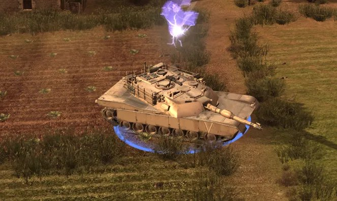<br>
      <sub><b>Un carro armato tutto tuo.</b> Un M1 Abrams, modellato in un altro programma 3D, nel gioco.</sub>
    </td>
    <td width="33%" valign="top">
      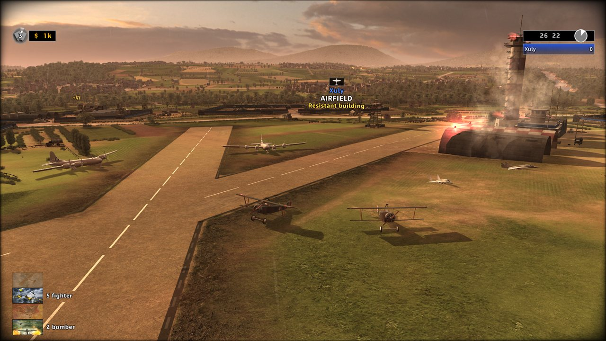<br>
      <sub><b>Dalla Prima guerra mondiale a oggi, tutto insieme.</b> Biplani, bombardieri e jet su un unico aeroporto.</sub>
    </td>
    <td width="33%" valign="top">
      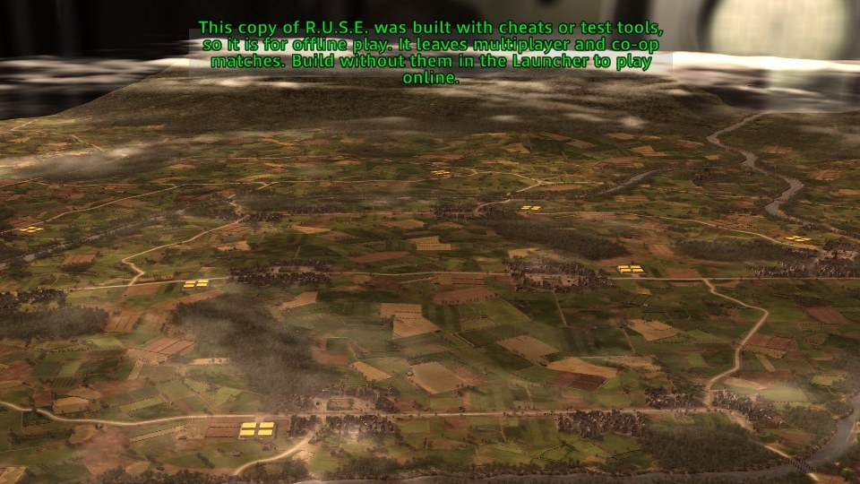<br>
      <sub><b>RUSE Guard.</b> Un messaggio precedente: oggi un gioco costruito con trucchi gioca solo con giocatori che hanno la stessa build.</sub>
    </td>
  </tr>
</table>

## Sostieni lo sviluppo

R.U.S.E. 2.0 è il mio primo progetto di modding, fatto nel mio tempo libero. È gratuito, e resta gratuito per tutti. Se vuoi sostenere il mio lavoro e seguire il lavoro dietro le quinte, puoi dare un sostegno una tantum tramite
[il mio Patreon](https://www.patreon.com/SneadTristen6). È facoltativo. Non è una donazione di beneficenza (quindi non è deducibile dalle tasse), e non compra le app, il gioco, alcuna mod né alcun diritto su di essi.

### Opzioni di sostegno una tantum

| Opzione | Importo | Ringraziamento |
| --- | --- | --- |
| [Offrimi un caffè](https://www.patreon.com/c/sneadtristen6/shop) | 5 $ una volta | Una piccola mancia che aiuta a far andare avanti il progetto. |
| [Above & Beyond Supporter](https://www.patreon.com/SneadTristen6/posts/171328212) | 20 $ una volta | Il nome che scegli nella sezione Above & Beyond Supporters dei crediti di GitHub e delle mod. |
| [Monumental Supporter](https://www.patreon.com/SneadTristen6/posts/monumental-100-171328695) | 100 $ una volta | Il nome che scegli per primo nella sezione Monumental Supporters dei crediti, il nostro massimo riconoscimento ai sostenitori. |

Il sostegno va nel tempo e negli strumenti dietro R.U.S.E. 2.0: nuove mappe, nuove unità, RUSE Studio, e tenere vivo il gioco per ogni giocatore.

Il riconoscimento è facoltativo: dopo il tuo pagamento, invia un messaggio su Patreon con il nome pubblico che hai scelto e il permesso di pubblicarlo, oppure scegli di restare anonimo. I riconoscimenti vengono aggiornati con le versioni del progetto. Sono pagamenti una tantum tramite il negozio di Patreon: non si rinnovano, e i rimborsi seguono le regole di Patreon.

## Cosa cambia R.U.S.E. 2.0

### Unità

- **Cambia qualsiasi unità:** prezzo, corazza, velocità, armi e ogni altro numero, con Annulla, poi **Prova in gioco**.
- **Ogni flag e ogni numero spiegati**, con parole semplici e unità semplici (metri, km/h, secondi): cosa fa, dove si
  collocano le unità del gioco, e un cursore a partire dal suo valore di base. I flag noti per far crashare il gioco
  vengono fermati, con la soluzione.
- **Nuove unità:** parti da qualsiasi unità, mettila nel menu di costruzione di qualsiasi nazione, dietro una ricerca o
  acquistabile dall'inizio.
- **Aerei in qualsiasi ruolo** (caccia, cacciabombardiere, bombardiere con il suo vano bombe, ricognitore), **veicoli da
  ricognizione**, e **armi che colpiscono il terreno, gli aerei o entrambi**.
- **I tuoi modelli 3D:** porta dentro un modello da Blender o da qualsiasi programma 3D, ridipingi qualsiasi unità in
  Blender, dai a una squadra la sua uniforme, scegli il camion su cui viaggia una squadra, e crea la sua carta per il menu
  di costruzione.
- **366 unità dalla Prima guerra mondiale a oggi:** modelli gratuiti di altri autori, ognuno citato, alla loro dimensione
  reale, da ricercare come le unità del gioco.
- **Nazioni:** trasforma una delle sette nazioni del gioco in un'altra, con un nome e una bandiera tutti suoi; nascondi o
  riempi le unità di una nazione in un colpo solo.
- **Gli edifici e ciò che producono:** gli edifici di ogni nazione come file delle unità che offrono i loro menu di
  costruzione; mettici unità, spostale, copia quelle di un'altra nazione, falle ricercare da un'altra unità. **Aggiungi un
  edificio:** la copia di uno degli edifici del gioco, o un edificio con unità proprie, una sua scheda nella barra di
  costruzione, un suo aspetto 3D e una sua immagine nel menu di costruzione.
- **Nomi di munizioni e tipi di flag tuoi:** rinomina una munizione copiata in ogni lingua; crea un insieme con un nome di
  flag del gioco e dallo a qualsiasi unità.

### Mappe

- **Nuove mappe** elencate in BATTAGLIE accanto a quelle del gioco. Parti da **terra vuota o mare aperto**, alla
  dimensione del gioco o più grandi, dagli le loro immagini nei menu, e dipingi i loro settori.
- **Modella il terreno:** colline, crateri, altopiani, rampe, terreno livellato e levigato; laghi e fiumi prosciugati. Le
  unità ci si muovono e ci combattono sopra.
- **Edifici, oggetti e alberi:** piazzali uno per uno, in una griglia, in un riquadro o lungo un percorso (siepi e fasce
  di alberi), gli edifici rivolti verso le strade; selezionali, spostali, ruotali, ridimensionali ed eliminali, anche quelli
  della mappa; ripulisci i boschi e gli oggetti della mappa. **Importa modello…** fa di un modello 3D una delle rocce, degli
  oggetti, delle piante o degli alberi della tua mappa.
- **Pittura mappa:** dipingi l'immagine del terreno con un colore, con il terreno della mappa stessa preso da un altro
  punto, con le texture del gioco, con immagini tue o con texture gratuite online.
- **Scenari e missioni:** sposta i punti di partenza, aggiungi le unità con cui inizia una battaglia, e missioni tue con
  obiettivi, eventi e movimenti di camera, per le Operazioni e i capitoli della campagna.

### Le regole del gioco

- **Impostazioni dell'IA e dei giocatori:** soldi e reddito iniziali, rifornimenti, le carte stratagemma con cui parte ogni schieramento, e ogni valore dei giocatori controllati dal computer, ciascuno spiegato.
- **Altre 172 regole del gioco** in 16 gruppi, e **ogni valore e ogni file** dei dati del gioco, cambiati nella tua mod.

### Suono e animazione: RUSE Decoy

- **Ogni suono del gioco** per tipo: da ascoltare, rendere più forte o più piano, o sostituire; nuovi brani nelle liste
  delle battaglie; battute delle missioni con una nuova voce.
- **Animazioni:** sostituisci un clip con un altro, rallentalo o acceleralo, ingrandisci un osso o ruotalo, e metti la
  motion capture sui soldati da una libreria di 3.205 movimenti gratuiti (il database CMU e 100STYLE, citati).

### Per i giocatori

- **Un solo clic:** scegli un set di mod e premi **Gioca**; il Launcher costruisce una copia moddata separata e la avvia.
- **R.U.S.E. 2.0 in oro:** il gioco con le mod si apre su una scena di battaglia, e i suoi menu e le sue schermate di
  caricamento dicono R.U.S.E. 2.0 in oro. È spento finché non lo attivi, nelle Impostazioni o con la casella della prima
  schermata: fino ad allora il gioco tiene il suo titolo e il video del logo di Eugen.
- **Le mod della community così come sono** (anche i `.rmod` di RUSE-Mod-Manager), un elenco di mod supportate da
  spuntare, ordini di caricamento condivisi in entrambe le direzioni con RUSE-Mod-Manager, e uno strumento di risoluzione
  dei problemi che trova cosa blocca Gioca e lo sistema.
- **Si aggiorna da solo**, in undici lingue: le dieci del gioco, e il persiano.

## Guardalo nel gioco

<table>
  <tr>
    <td width="33%" valign="top">
      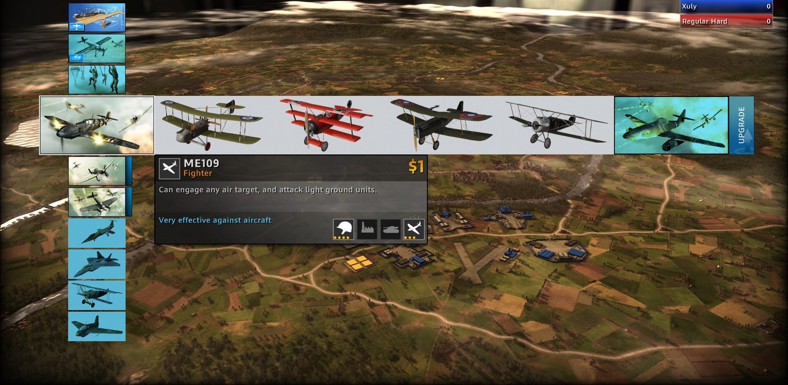<br>
      <sub><b>Liste di costruzione in gruppi.</b> Caccia della Prima guerra mondiale nel gruppo del Me 109.</sub>
    </td>
    <td width="33%" valign="top">
      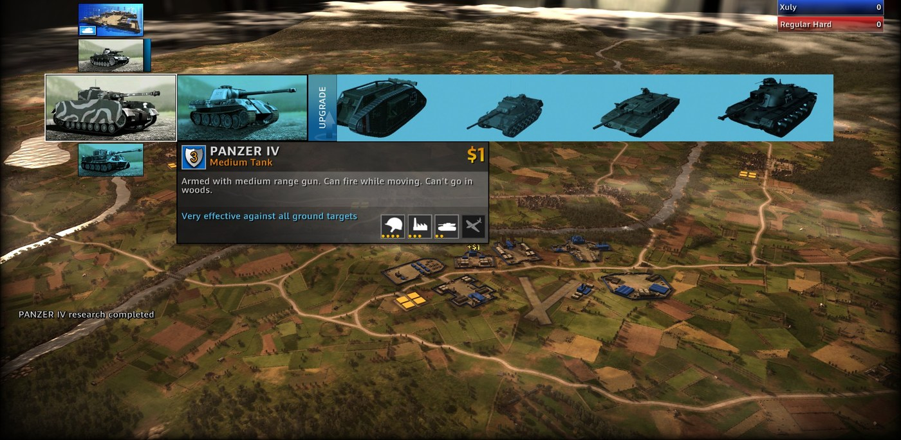<br>
      <sub><b>Ogni epoca in un gruppo.</b> Quello del Panzer IV, da un carro della Prima guerra mondiale a quelli moderni.</sub>
    </td>
    <td width="33%" valign="top">
      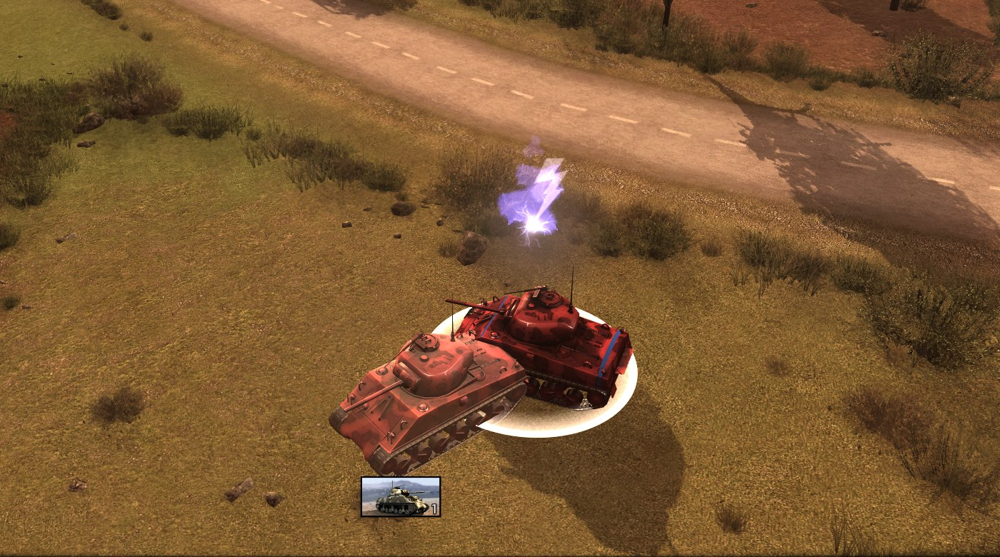<br>
      <sub><b>Unità con un aspetto tutto loro.</b> Ridipingi qualsiasi unità in Blender e riportala nel gioco.</sub>
    </td>
  </tr>
  <tr>
    <td width="33%" valign="top">
      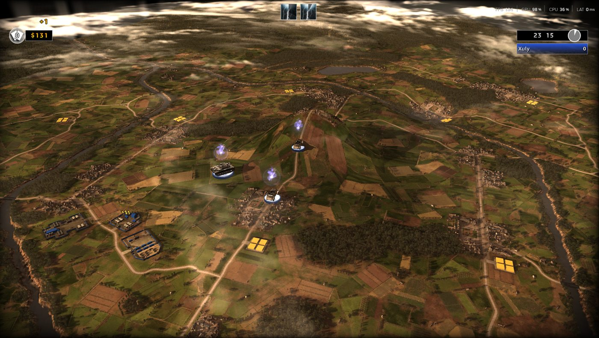<br>
      <sub><b>Terreno che modelli tu.</b> Colline, crateri, laghi e fiumi prosciugati su cui le unità si muovono e combattono.</sub>
    </td>
    <td width="33%" valign="top">
      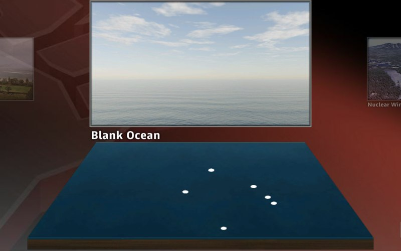<br>
      <sub><b>Nuove mappe</b>, partite vuote, con le loro immagini nei menu.</sub>
    </td>
    <td width="33%" valign="top">
      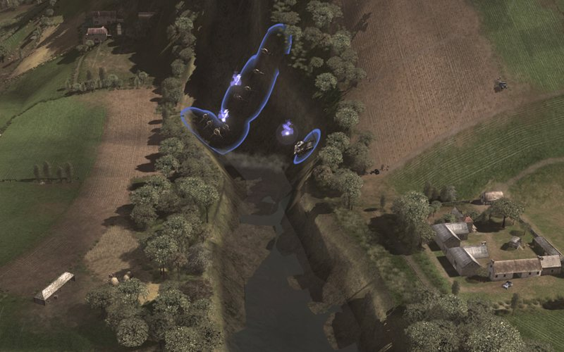<br>
      <sub><b>Un fiume prosciugato.</b> Le unità ne percorrono il letto.</sub>
    </td>
  </tr>
</table>

## Dentro lo Studio

<table>
  <tr>
    <td width="50%" valign="top">
      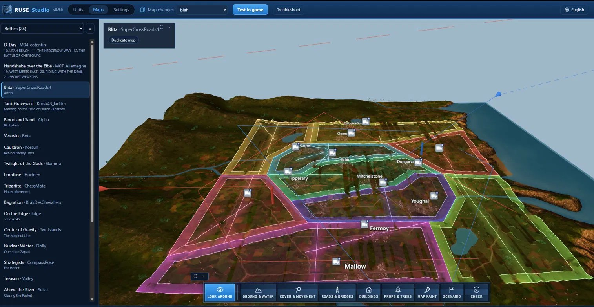<br>
      <sub><b>Ogni mappa in 3D.</b> Blitz con le sue zone e città; gli strumenti corrono lungo il fondo.</sub>
    </td>
    <td width="50%" valign="top">
      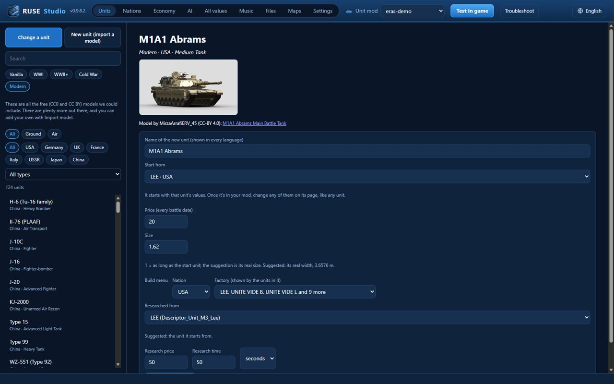<br>
      <sub><b>Unità di altre epoche</b>, con l'autore di ogni modello citato.</sub>
    </td>
  </tr>
  <tr>
    <td width="50%" valign="top">
      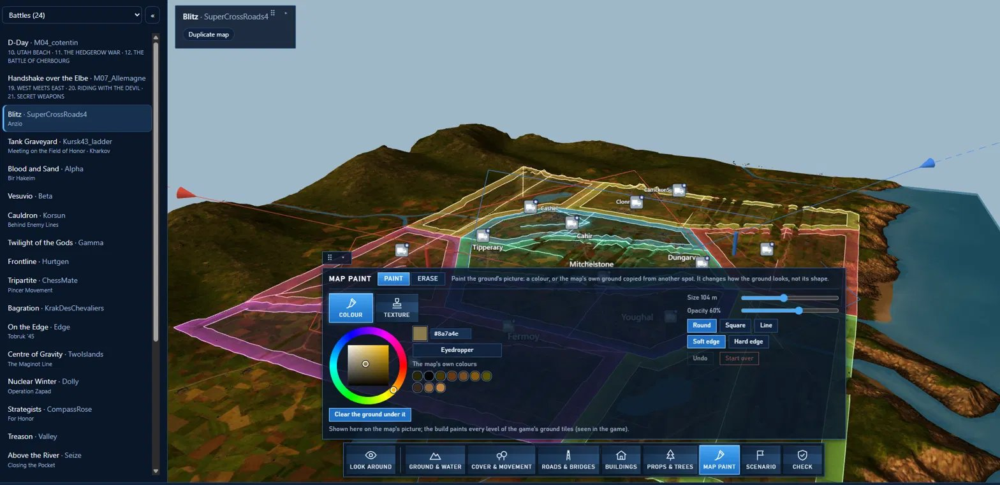<br>
      <sub><b>Pittura mappa.</b> Dipingi l'immagine del terreno.</sub>
    </td>
    <td width="50%" valign="top">
      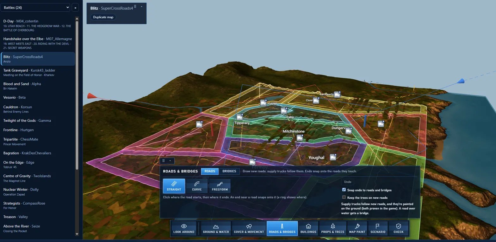<br>
      <sub><b>Strade e ponti.</b> Dritte, curve o a mano libera.</sub>
    </td>
  </tr>
  <tr>
    <td width="50%" valign="top">
      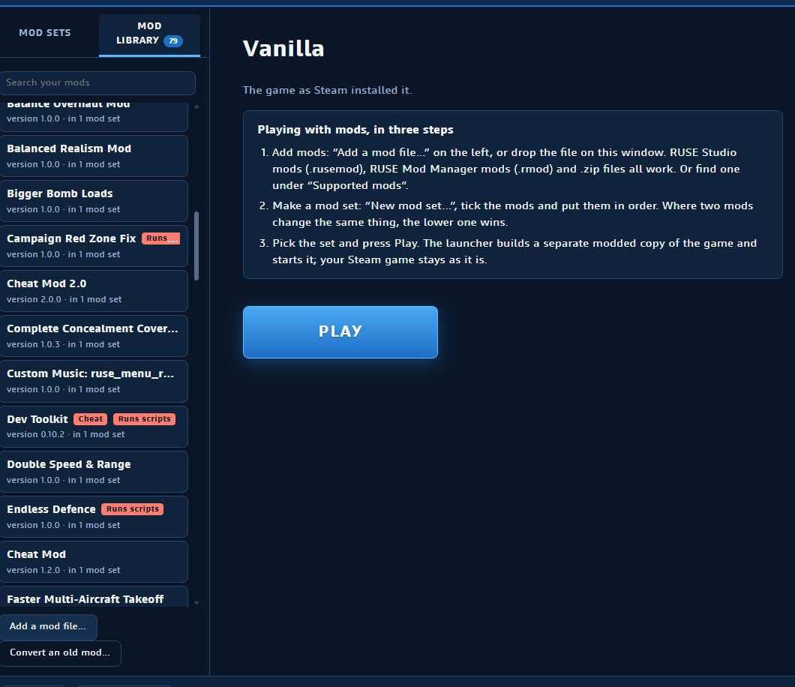<br>
      <sub><b>RUSE Launcher:</b> le tue mod, tre passi, e Gioca.</sub>
    </td>
    <td width="50%" valign="top">
      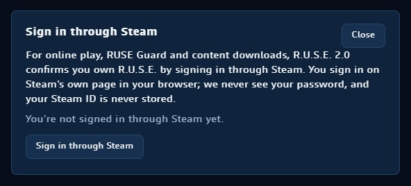<br>
      <sub><b>Accesso tramite Steam.</b> Conferma che possiedi R.U.S.E.; non vediamo mai la tua password.</sub>
    </td>
  </tr>
</table>

## In arrivo

- **Città che disegni tu:** traccia le vie, segna gli isolati come case, negozi o industria, e lo Studio li riempie con
  gli edifici del gioco stesso.
- **Un luogo reale come mappa:** l'importatore di mappe (qui sotto).
- **Montagne generate e nostre texture del terreno ad alta risoluzione**, e il pennello per i campi di Pittura mappa, che
  trasforma campi interi in grano, terra arata o una coltura verde, come li dipingono le mappe del gioco stesso.

### L'importatore di mappe: a che punto è

L'importatore di mappe trasforma un luogo reale in una mappa di R.U.S.E., fatta con i pezzi del gioco stesso, così che sembri e si giochi come le mappe del gioco. Costruisce già una parte di Utah Beach in una mappa che si apre nel gioco, ma la spiaggia, l'acqua e il terreno da vicino non sono ancora giusti, e nello Studio non funziona ancora del tutto. Preferiamo aspettare che un luogo reale sembri e si giochi come una vera mappa di R.U.S.E. piuttosto che pubblicare qualcosa fatto a metà.

## Il progetto

Tutto ciò che è cambiato, versione per versione: le
[note dello Studio](https://github.com/sneadtristen6/R.U.S.E-2.0-Project/blob/main/.github/release-notes/studio.md) e le
[note del Launcher](https://github.com/sneadtristen6/R.U.S.E-2.0-Project/blob/main/.github/release-notes/launcher.md).

**Sul nome:** R.U.S.E. 2.0 è un nome provvisorio. Prima che esca la versione completa (1.0), consulteremo Eugen
Systems, gli autori di R.U.S.E., e il progetto prenderà un nome che vada bene a loro. Idee per il nome e critiche
costruttive sono benvenute nella [discussione sul nome](https://github.com/sneadtristen6/R.U.S.E-2.0-Project/discussions/18).

**Cosa c'è in questo repository.** Le due app, e ciò che serve a giocatori e modder per usarle. I nostri appunti di
lavoro sui file del gioco restano privati finché non avremo un OK esplicito dagli sviluppatori, Eugen Systems.

Tutto ciò che facciamo qui serve ad aiutare la community e a portare questo gioco in un posto migliore. R.U.S.E. è uno dei
miei giochi preferiti di sempre, e voglio solo renderlo migliore.

**Solo copie possedute.** Il progetto R.U.S.E. 2.0 supporta R.U.S.E. solo quando lo possiedi. Il gioco stesso parte solo
per un account Steam che lo possiede, e i nostri strumenti non lo aggirano mai: trovano il gioco tramite la tua libreria
di Steam, ne moddano una copia separata, e non distribuiscono mai i file del gioco. Non supportiamo emulatori di Steam,
copie piratate, o qualsiasi altra cosa che permetta di giocare senza possedere il gioco. Se non lo possiedi, questi
strumenti non funzioneranno per te e non sono per te.

Lo possiedi in un altro modo, come una copia in scatola di prima che R.U.S.E. fosse su Steam, o le app si sono
sbagliate? La finestra nell'app ha il tuo codice e due pulsanti: apri un ticket su Discord o su GitHub, e ti invieremo
un codice di sblocco per il tuo PC. I ticket di GitHub sono pubblici, quindi puoi invece inviare il codice a
sneadtristen6 in un messaggio privato su Discord.

<details>
<summary><b>Stato, documentazione e contributi</b></summary>

[](https://github.com/sneadtristen6/R.U.S.E-2.0-Project/releases?q=launcher)
[](https://github.com/sneadtristen6/R.U.S.E-2.0-Project/releases?q=studio)
[](https://github.com/sneadtristen6/R.U.S.E-2.0-Project/actions/workflows/tests.yml)
[](LICENSE)

**Launcher** per i giocatori (ultima: 0.4.8.12) &middot; **Studio** per i modder, un'anteprima (ultima: 0.9.8.12) &middot; Windows &middot; serve R.U.S.E. su Steam

**[Manuale da campo (wiki)](https://github.com/sneadtristen6/R.U.S.E-2.0-Project/wiki/Manuale-da-campo)** &middot;
**[Discussioni](https://github.com/sneadtristen6/R.U.S.E-2.0-Project/discussions)** &middot;
**[Discord](https://discord.gg/h54t5baNsC)** &middot; **[Come contribuire](CONTRIBUTING.md)** &middot;
**[Codice di condotta](CODE_OF_CONDUCT.md)** &middot; [docs/MOD_FORMAT.md](docs/MOD_FORMAT.md): tutto ciò che una mod può
fare, file per file.

</details>

<a name="for-contributors"></a>
<details>
<summary><b>Per chi contribuisce</b></summary>

Come segnalare bug, provare nel gioco e inviare codice: [CONTRIBUTING.md](CONTRIBUTING.md).

<details>
<summary><b>Le due app dal codice sorgente, e i programmi di installazione</b></summary>

Le due app girano sul motore, separate l'una dall'altra (nessuna delle due ha bisogno dell'altra). Entrambe sono
finestre desktop costruite come pagine web; una volta: `py -3 -m pip install pywebview`. Le loro schermate si aprono anche
in un normale browser con dati inventati: `src/ruse_launcher/ui/index.html?fake`, `src/ruse_studio/ui/index.html?fake`.

- **RUSE Launcher** ([`src/ruse_launcher/`](src/ruse_launcher/)), per i giocatori: trova il gioco, elenca i tuoi set di
  mod e ha un grande pulsante Gioca che costruisce la copia moddata del set e avvia il gioco (anche Originale, senza
  mod). `py -3 -m ruse_launcher`. **I giocatori non toccano mai un file.** Una libreria di mod («Aggiungi un file di
  mod…» per un `.rusemod` dello Studio, un `.rmod` o uno `.zip`, oppure trascina un file o una cartella di mod sulla
  finestra; ogni mod viene prima controllata), set di mod creati sullo schermo (nuovo, modifica e riordina, rinomina,
  duplica, elimina), Condividi e «Importa un ordine di caricamento…» per un set di mod (il testo di RUSE-Mod-Manager
  stesso, così gli ordini di caricamento vanno in entrambe le direzioni;
  [`src/rusemod/loadorder.py`](src/rusemod/loadorder.py)), una guida in tre passi su Originale («Giocare con le mod, in
  tre passi»), e il launcher nella lingua del PC (una qualsiasi delle dieci del gioco, o il persiano). **Mod supportate**
  (0.3.0): il nostro elenco di mod (un repository GitHub, MOD_FORMAT §15) con caselle da spuntare, diverse installate
  insieme, ogni file controllato rispetto all'elenco prima di entrare nella libreria, le mod cheat tenute a parte;
  offline, l'ultima copia dell'elenco.
- **RUSE Studio** ([`src/ruse_studio/`](src/ruse_studio/)), per i modder: sfoglia ogni unità ed edificio, vedi i valori di
  un'unità, le sue parti e cosa la usa, e scegli una lingua: i nomi del gioco stesso di base, o una qualsiasi delle dieci
  lingue del gioco, o il persiano. Scegli o crea una mod e cambia i numeri di un'unità direttamente nella sua pagina: ogni
  modifica viene salvata nel `src/studio.rndf` della mod (con Annulla); una parte condivisa da più unità cambia per una di
  esse o per tutte. «Prova in gioco» costruisce la mod e avvia il gioco. **Mappe** (uscite con la 0.4): ogni mappa che il
  gioco elenca, in 3D con la sua vera mesh del terreno e le sue texture del terreno (decodificate una volta per mappa e
  conservate). **Inoltre:**
  - **«Esporta mod…»** trasforma la mod in un solo file, `<id>-<version>.rusemod`, con dentro la build del gioco e
    l'impronta della mod, per «Aggiungi un file di mod…» del launcher (il ciclo dal modder al giocatore).
  - **Nuova unità…** nella pagina di un'unità crea una copia con un suo nome (un solo nome, mostrato in tutte e dieci le
    lingue), un suo prezzo e un suo menu di costruzione (la stessa nazione e fabbrica, o quelli di un'altra nazione);
    viene elencata come nuova, si modifica come qualsiasi altra unità, e si può eliminare.
  - **In Mappe:** gli edifici di ogni mappa e una parte dei suoi oggetti e alberi. Scegli un pennello e clicca o trascina
    sul terreno per modellarlo: ogni tratto viene disegnato subito e salvato nel `maps/<map>/terrain.toml` della mod; una
    rampa richiede due clic (il suo inizio, la sua fine), Annulla toglie un tratto, Ricomincia ripulisce la mappa.
    «Posiziona sulla mappa» elenca i tipi propri della mappa (i più usati per primi, con una ricerca); imposta Rotazione e
    Dimensione, clicca sul terreno, e l'oggetto viene salvato nel `maps/<map>/scenery.toml` della mod. «Prova in gioco»
    costruisce tutto nella mappa.

  `py -3 -m ruse_studio` (dopo `ruse index build`); `--spike` apre il controllo 3D.
- `py -3 -m pip install -e .[apps]`, una volta, dà due comandi, `ruse-launcher` e `ruse-studio`, che le aprono senza una
  finestra di console.
- **Programmi di installazione** ([`installers/`](installers/README.md)): GitHub costruisce
  `RUSE-Launcher-Setup-<version>.exe` e `RUSE-Studio-Setup-<version>.exe` a ogni push che cambia le app (Actions,
  **apps**, Artifacts). Un tag `launcher-v<version>` o `studio-v<version>` ne pubblica uno come Release. Non servono
  Python né Git, né diritti di amministratore. Non ancora firmati, quindi Windows avvisa una volta («Ulteriori
  informazioni», poi «Esegui comunque»).

</details>

</details>

<details>
<summary><b>Strumenti e controlli</b></summary>

- [`tools/check_public.py`](tools/check_public.py): eseguito da GitHub a ogni push; fallisce se materiale privato, file
  del gioco o dettagli del programma del gioco finissero in questo repository pubblico.
- [`tools/rmod_to_mod.py`](tools/rmod_to_mod.py): ricostruisce un `.rmod` di RUSE-Mod-Manager come una mod nostra.

</details>

<details>
<summary><b>Eseguire i test</b></summary>

[`tests/`](tests) contiene test su piccoli file inventati; non serve il gioco:

```
py -3 -m unittest discover -s tests
```

(con `PYTHONPATH=src`). GitHub li esegue a ogni push, su Windows e Linux
([`.github/workflows/tests.yml`](.github/workflows/tests.yml)).

</details>

## Per i titolari di diritti

Se rappresenti Eugen Systems, o chiunque altro i cui diritti pensi siano toccati da questo progetto, scrivi a
sneadtristen6@gmail.com con l'oggetto "Rights holder". Leggiamo ogni messaggio e rispondiamo entro 7 giorni. Se ci
chiedi di cambiare o rimuovere qualcosa di tuo, lo faremo. Non devi prima inviare un avviso formale.

## Riconoscimenti

R.U.S.E. 2.0 è costruito da sneadtristen6 e Claude, con l'aiuto e il lavoro delle persone qui sotto.

### sneadtristen6 e Claude: costruire R.U.S.E. 2.0

**sneadtristen6 è la mente dietro R.U.S.E. 2.0.** Le idee sono sue, decide lui cosa diventa, e prova ogni modifica nel
gioco prima che esca. **Claude**, l'IA di Anthropic, aiuta a trasformare le sue idee in piani e scrive il codice. Fianco a
fianco da settembre 2026, hanno costruito:

- **Nuovi modelli 3D nel gioco:** l'importatore di modelli che porta dentro il modello di un'unità da Blender o da
  qualsiasi programma 3D (un M1 Abrams è stato il primo), unità ridipinte in Blender, uniformi proprie delle squadre, carte
  del menu di costruzione, e 366 unità di altre epoche alla loro dimensione reale.
- **Lavoro sulle texture:** Pittura mappa e la sua libreria di texture: il terreno di una mappa dipinto con le texture del
  gioco stesso, terreno preso da qualsiasi punto della mappa, o immagini tue.
- **Nuove mappe.** Il 3 ottobre 2026 R.U.S.E. ha avuto nuove mappe: elencate in BATTAGLIE accanto a quelle del gioco,
  ognuna giocata sul proprio terreno. Per trovare il limite, ne sono entrate 101 insieme; tutte si sono viste e si sono
  giocate. Per quanto ne sappiamo, sono le prime nuove mappe che il gioco abbia avuto dopo D-Day. Le nuove mappe partono
  vuote, come terra o mare aperto, con le loro immagini nel menu.
- **Un editor di mappe che funziona nel gioco:** terreno su cui le unità si muovono e combattono, laghi e fiumi
  prosciugati, strade che sembrano quelle della mappa stessa da molto in alto e giù fino al terreno, ponti che carri
  armati, fanteria e camion di rifornimento attraversano, edifici, oggetti e alberi che si vedono a ogni distanza,
  copertura, e dove le unità possono andare.
- **Unità:** cambiane qualsiasi, creane di nuove, dai a una nazione i carri armati e gli aerei di un altro esercito, aerei
  in qualsiasi ruolo, veicoli da ricognizione, armi che colpiscono gli aerei, ogni flag e numero spiegato, e una nazione
  trasformata in un'altra.
- **Musica e missioni:** brani e battute vocali sostituiti nello Studio, e missioni tue.
- **Due app in undici lingue** (le dieci del gioco, e il persiano), lo Studio per chi crea mod e il Launcher per chi
  gioca, che lasciano in pace la cartella del gioco a meno che tu chieda a una delle due app di ripristinarla dal suo
  backup pulito, con un controllo che ferma una mod che rovinerebbe il gioco prima che parta.
- **RUSE Guard, il nostro anti-cheat, costruito e attivato:** il blocco che lascia giocare un gioco moddato con trucchi solo con giocatori che hanno la stessa build, il controllo degli strumenti di trucco noti nelle partite multigiocatore e cooperative, il sorvegliante in ogni gioco moddato (dice sullo schermo quando una partita vede un ordine di generazione o un improvviso salto nei soldi di una fazione), i codici partita, il server con la sua schermata di revisione, e l'accordo che ogni giocatore vede.
- **Solo copie possedute:** il controllo che il gioco sia una copia tua, codici di sblocco per chi lo possiede ma Steam non può confermarlo, e l'accesso tramite Steam.
- **Bug Watch:** rapporti su crash e bug, se lo attivi, così i problemi vengono corretti prima.
- **Mod grandi:** set di mod oltre 4 GB, liste di costruzione divise in gruppi, e build circa quattro volte più veloci (tutte le 366 unità di altre epoche in circa 5 minuti).
- **Il primo importatore di mappe per R.U.S.E.**, per quanto ne sappiamo: un luogo reale trasformato in mappa con i pezzi del gioco stesso. Costruisce già una parte di Utah Beach in una mappa che si apre nel gioco; nello Studio non funziona ancora del tutto.
- **Il codice:** tutto in `src/rusemod`, `src/ruse_studio` e `src/ruse_launcher` è nostro, scritto per R.U.S.E. 2.0.
  Alcune cose che vengono con esso sono lavoro di altri: i modelli della scena di avvio. Esse, e gli altri sul cui lavoro si basa, sono riconosciute più sotto e in
  [THIRD_PARTY_NOTICES.md](THIRD_PARTY_NOTICES.md).

Siamo all'inizio, e c'è molto altro in arrivo. Grazie a tutte le persone qui sotto, senza le quali niente di tutto questo sarebbe cominciato.

### DomesticNukes: l'idea di RUSE Guard, i test più duri e le basi dell'editor di mappe

- **RUSE Guard è stata un'idea di DomesticNukes, e il nome è suo**, con il suo primo progetto. sneadtristen6 e Claude l'hanno costruita nelle app e online; lui e sneadtristen6 sono la sua squadra di revisione.
- **Una bella parte dei test più duri:** spinge ciò che costruiamo fino ai suoi limiti. Le prime partite multigiocatore di RUSE Guard, dove il blocco ha dato prova di funzionare, un modello importato che ha trovato un bug dell'importatore, e i ponti di Diplomats e Vesuvio.
- **Le basi dell'editor di mappe:** il terreno su cui camminano le unità, dove si trova ogni edificio, albero e oggetto, e la ricetta che seguono i pennelli del terreno; i pennelli dell'acqua (laghi e fiumi prosciugati) dalla sua pull request; i veri modelli 3D del gioco nella vista mappa dello Studio; e i suoi appunti sui flag delle unità e sui piani dei ponti, ora nei controlli della build.

### ProLution: il padrino del modding di R.U.S.E.

- Ha creato il **RUSE Modding Database** e ha scritto le guide da cui la gente ha imparato, tra cui quelle sulle
  Operazioni personalizzate.
- **Il codice di ProLution è nel nostro:** il codec del terreno delle mappe in
  [`src/ruse_mod_engine/terrain_codec.py`](src/ruse_mod_engine/terrain_codec.py) è costruito sul lavoro di ProLution sul
  formato del terreno (rilasciato in CC0), e il suo encoder è portato dall'encoder di riferimento di ProLution. Anche il
  nostro lettore delle texture compresse del gioco ([`src/rusemod/tgu1.py`](src/rusemod/tgu1.py)) usa il suo codec.

### LittleGroove: il primo mod manager

LittleGroove ha creato **RUSE-Mod-Manager**, il primo vero gestore di mod per R.U.S.E., e il suo formato `.rmod`. Il suo motore fa parte del nostro ([`src/ruse_mod_engine`](src/ruse_mod_engine/)), ed è per questo che l'intero programma è GPL-3.0. Le mod fatte con il suo Mod Manager si giocano nel Launcher, e gli ordini di caricamento passano dall'uno all'altro.

### Gli autori dei modelli delle unità d'epoca

Le unità di altre epoche (Studio 0.9.8.2) sono modelli 3D gratuiti delle persone che li hanno creati e condivisi, sotto
CC0 o CC BY. Ogni autore è nominato, con il titolo del modello, la licenza e il link, nella pagina dell'unità nello
Studio, nel file dei crediti di ogni mod che ne usa uno (`CREDITS-era-units.md`), e nell'elenco completo nella
[release delle unità d'epoca](https://github.com/sneadtristen6/R.U.S.E-2.0-Project/releases/tag/era-units). Cosa abbiamo
cambiato: ognuno è stato adattato al gioco (ruotato e scalato) e ha ricevuto le insegne della sua nazione.

### (Anonyme) Oozaru: test e debug

**(Anonyme) Oozaru ha provato le prime app sulla sua mod di campagna e ha mandato il log con ogni bug che ha trovato.**
Le sue segnalazioni hanno portato a queste correzioni:

- Gli oggetti piazzati che si vedevano solo da vicino ora vengono disegnati fino alla lunga distanza (Studio 0.9.3).
- Le sue unità per il giocatore in un capitolo della campagna non comparivano mai; ora si possono dare al giocatore.
- Le sue unità francesi su Holland facevano crashare il gioco durante il caricamento; ora le unità di un'altra nazione si
  caricano anche nei capitoli della campagna e nelle Operazioni (0.9.5).
- Ha ricostruito quale dei nomi IR del capitolo 1 dell'Italia corrisponde a quale schieramento: il giocatore USA, la
  Francia, l'Italia, il Regno Unito e il computer USA.
- Il suo «aspettare 30 minuti ogni volta solo per aggiungere o togliere un'unità» è il motivo per cui **Gioca** ora parte
  subito quando non è cambiato niente (Launcher 0.4.6).

Grazie anche a tutti quelli che hanno provato le app, mandato screenshot e segnalato bug.

### Riconoscimenti ai sostenitori

I nomi dei sostenitori vengono aggiunti qui dopo che il sostenitore ha scelto un nome pubblico per i crediti.

#### Monumental Supporters

Un ringraziamento personale e in evidenza per chi sostiene con $100 aiutando a gettare le basi di R.U.S.E. 2.0. Questo
gruppo compare per primo nei crediti dei sostenitori.

#### Above & Beyond Supporters

Un ringraziamento e il nome nei crediti per chi sostiene con $20 e va oltre per aiutare lo sviluppo ad andare avanti.

## Domande? Chiedi a un'IA qualsiasi

Tutto qui è scritto con parole semplici, così qualsiasi assistente IA (ChatGPT, Claude, Gemini...) può rispondere partendo
da qui. Dagli il link a **[ai/START-HERE.md](ai/START-HERE.md)**, la pagina scritta per gli assistenti IA (dove sta ogni
risposta, le parole delle app, cosa è stato provato), o a questa pagina, e chiedi quello che vuoi sapere:

- *«Come do agli USA un Tiger tedesco con RUSE Studio?»*
- *«Come traccio una strada con un ponte su un fiume?»*
- *«La mia prova in gioco si è fermata con un errore. Cosa vuol dire?»*
- *«Cosa fa il file scenario.toml di una mod?»*

La pagina migliore a cui indirizzarlo: [docs/MOD_FORMAT.md](docs/MOD_FORMAT.md) (tutto ciò che una mod può fare, file per
file). Non ne vieni ancora a capo? Apri una [issue](https://github.com/sneadtristen6/R.U.S.E-2.0-Project/issues).

## Note legali

- R.U.S.E. è un gioco sviluppato e pubblicato da Eugen Systems. R.U.S.E. 2.0 è un progetto gratuito di fan. Non è
  creato, approvato o supportato da Eugen Systems. Non ha legami con Ubisoft, l'editore del gioco fino al 2015, né con
  Valve. R.U.S.E., Eugen Systems e Ubisoft sono i nomi dei loro proprietari, e Steam è un marchio di Valve Corporation;
  usiamo questi nomi solo per dire con cosa funzionano le nostre app.
- Le nostre app non includono alcun file del gioco, e funzionano solo con una copia del gioco che possiedi. In alcuni
  casi i dati del gioco possono essere cambiati, ma ciò avviene con la tua copia del gioco: la copia moddata separata
  che le app costruiscono. Lasciano il tuo gioco installato com'è, a meno che tu chieda al Launcher o allo Studio di
  ripristinarlo dal suo backup pulito.
- Giocare online con una copia moddata: R.U.S.E. non ha un anti-cheat efficace, ed è per questo che RUSE Guard serve.
  Non possiamo promettere come Steam o il gioco tratteranno una copia moddata online; giocare online con una,
  soprattutto una costruita con strumenti di trucco o di test, è a tuo rischio.
- Sostenere il progetto su Patreon paga il tempo e gli strumenti di chi lo gestisce. Non è una donazione di beneficenza,
  e non compra il gioco, alcun suo contenuto né alcun diritto su di esso.
- Termini di utilizzo e privacy: [PRIVACY.md](PRIVACY.md). Parti di terzi e relative licenze:
  [THIRD_PARTY_NOTICES.md](THIRD_PARTY_NOTICES.md). Titolari di diritti: vedi "Per i titolari di diritti".

## Licenza

GNU General Public License, versione 3 ([LICENSE](LICENSE), GPL-3.0): copyright (C) 2026 sneadtristen6 e i contributori
di RUSE Mod Platform, scritto con l'aiuto di strumenti di IA. Le app includono [`src/ruse_mod_engine`](src/ruse_mod_engine/), il motore di RUSE-Mod-Manager di
LittleGroove (GPLv3), usato così com'è (vedi Riconoscimenti), e la sua licenza richiede che l'intero programma sia sotto
GPL-3.0 (era MIT fino al 2026-09-30). `src/ruse_mod_engine/python251` porta con sé la licenza di Python
([il suo LICENSE.txt](src/ruse_mod_engine/python251/LICENSE.txt)). Questo è uno strumento indipendente, fatto dai fan,
non affiliato a Eugen Systems né a Valve né approvato da esse. R.U.S.E. e i suoi dati di gioco appartengono ai loro
proprietari, e Steam è un marchio di Valve Corporation. Le nostre app non includono alcun file del gioco e funzionano
solo su una copia del gioco che possiedi.
