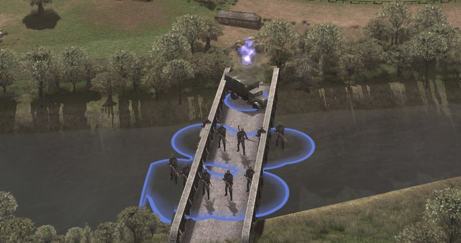
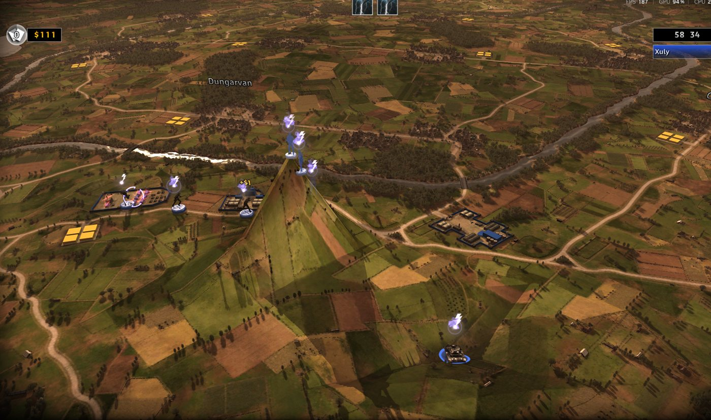

<div align="center">

# R.U.S.E. 2.0

**戦場を作り、そこで戦う。**

[English](README.md) · [Français](README.fr.md) · [Deutsch](README.ger.md) · [Italiano](README.ita.md) · [Español](README.spa.md) · [Polski](README.pol.md) · [Русский](README.ru.md) · [Čeština](README.cz.md) · **日本語** · [简体中文](README.sc.md) · [فارسی](README.fa.md)


[](https://github.com/sneadtristen6/R.U.S.E-2.0-Project/releases?q=launcher)
&nbsp;&nbsp;
[](https://github.com/sneadtristen6/R.U.S.E-2.0-Project/releases?q=studio)
&nbsp;&nbsp;
[](https://www.patreon.com/SneadTristen6)

<sub>Windows 用。Steam 版 R.U.S.E. が必要です。Steam のインストールには一切手を触れません。</sub>

</div>

> [!TIP]
> **インストールしてプレイする方法（5分）:**
> 1. [ランチャーのリリース](https://github.com/sneadtristen6/R.U.S.E-2.0-Project/releases?q=launcher)を開き、いちばん新しいもの（**Latest** の印が付いたもの）を選んで、**Assets** の下の **RUSE-Launcher-Setup-0.4.8.9.exe** をクリックします。
> 2. 実行します。Windows に「Windows によって PC が保護されました」と表示されたら、**詳細情報**、次に **実行** をクリックします。
> 3. **RUSE Launcher** を開きます。Steam を通じて R.U.S.E. を自動で見つけます。
> 4. **対応MOD** をクリックし、使いたいMODにチェックを入れて **インストール** を押します。
> 5. それらをMODセットに入れ（**新しいMODセット…**）、**プレイ** を押します。
>
> すべての手順と、うまくいかないときの対処: **[インストールとプレイ](https://github.com/sneadtristen6/R.U.S.E-2.0-Project/wiki/%E3%82%A4%E3%83%B3%E3%82%B9%E3%83%88%E3%83%BC%E3%83%AB%E3%81%A8%E3%83%97%E3%83%AC%E3%82%A4)**。
> MODを作るには、同じように [Studio のリリース](https://github.com/sneadtristen6/R.U.S.E-2.0-Project/releases?q=studio)から **RUSE Studio** を入手し、
> [はじめてのMOD](https://github.com/sneadtristen6/R.U.S.E-2.0-Project/wiki/%E3%81%AF%E3%81%98%E3%82%81%E3%81%A6%E3%81%AEMOD) から始めてください。

## R.U.S.E. とは

**R.U.S.E.**（2010年）は、Eugen Systems による第二次世界大戦のリアルタイムストラテジーゲームです。前線全体が作戦テーブルの上のマップに広がり、作戦室から戦車1両までズームできます。戦いは力と同じくらい欺きで勝敗が決まります。**計略カード** で部隊を隠したり、偽の攻撃を仕掛けたり、敵の計画を見破ったり、部隊を速くしたりします。キャンペーン、オペレーション、そしてノルマンディーからチュニジアまでのマップでのスカーミッシュとマルチプレイのバトルがあります。

## R.U.S.E. 2.0 とは

**R.U.S.E. に新しいマップ、新しいユニット、ボタン1つでMODプレイを。** 2つの無料アプリです。

- **RUSE Launcher はプレイヤー向け。** MODのセットを選んで **プレイ** を押す。それだけです。
- **RUSE Studio はモッダー向け。** どのユニットでも変更し、独自の3Dモデルを持つ新しいユニットを作り、白紙からマップを作ったりゲーム自身のマップを作り変えたりして、**ゲームでテスト** を押します。

**ゲームが始まる前にチェック。** Studio は、ゲームと同じ読み方であなたのMODを読み込みます。ゲームで壊れるものは先に止められ、何を変えればよいかを書いたメモが表示されます。目標は、作ったものが毎回、最初からゲームで動くことです。

**データのみ。** ここでのMODは、ゲームとは別のコピーの中でゲームのデータを変えるだけで、それがすべてです。Steam のインストールが変更されることはありません。

**オープンソース**（GPL-3.0）で、11言語に対応: ゲームの10言語とペルシア語です。

<table>
  <tr>
    <td width="33%" valign="top">
      <br>
      <sub><b>自分だけの戦車。</b> ほかの3Dプログラムでモデリングした M1 Abrams が、ゲームの中に。</sub>
    </td>
    <td width="33%" valign="top">
      <br>
      <sub><b>第一次世界大戦から現代まで、すべてを1つに。</b> 1つの飛行場に複葉機、爆撃機、ジェット機。</sub>
    </td>
    <td width="33%" valign="top">
      <br>
      <sub><b>自分で描く道路。</b> 高い所から見ても地面すれすれで見ても、マップ自身の道路のように。</sub>
    </td>
  </tr>
</table>

## R.U.S.E. 2.0 で変わること

### ユニット

- **どのユニットでも変更:** 価格、装甲、速度、武器、その他すべての数値を、元に戻す 付きで変更し、**ゲームでテスト**。
- **すべてのフラグと数値を説明**: わかりやすい言葉とわかりやすい単位（メートル、km/h、秒）で、何をするか、ゲームのユニットではどのあたりの値か、そして基本値からのスライダー。ゲームをクラッシュさせることがわかっているフラグは、直し方とともに止められます。
- **新しいユニット:** どのユニットからでも始め、どの国の生産メニューにでも入れ、研究の先に置くか、最初から購入できるようにします。
- **あらゆる役割の航空機**（戦闘機、戦闘爆撃機、爆弾倉を持つ爆撃機、偵察機）、**偵察車両**、そして **地上、航空機、またはその両方を攻撃する武器**。
- **自分の3Dモデル:** Blender やほかの3Dツールからモデルを取り込み、どのユニットでも Blender で塗り替え、分隊に独自の軍服を与え、分隊が乗るトラックを選び、生産メニュー用のカードを作れます。
- **第一次世界大戦から現代までの366ユニット:** ほかの作者による無料のモデルで、それぞれクレジット付き、実寸で、ゲーム自身のユニットと同じように調べて作られています。
- **国:** ゲームの7つの国の1つを、独自の名前と旗を持つ別の国に作り変えます。国のユニットを一度に隠したり埋めたりできます。
- **建物と、それが作るもの:** 各国の建物を、その生産メニューが出すユニットの列として表示します。ユニットを入れ、動かし、別の国のものをコピーし、別のユニットから研究させます。**建物を追加:** ゲームの建物のコピー、または独自のユニット、建設バーの独自のタブ、独自の3Dの見た目と生産メニューの画像を持つ建物。
- **独自の弾薬名とフラグの型:** コピーした弾薬の名前をすべての言語で変え、ゲームのフラグの名前付きセットを作って、どのユニットにでも与えられます。

### マップ

- **新しいマップ** を、ゲーム自身のマップと並べてバトルに表示。**何もない陸地か一面の海** から、ゲームと同じ大きさかそれより大きく始め、メニューに独自の画像を付け、セクターを塗れます。
- **地形を作る:** 丘、クレーター、台地、スロープ、平らにした地面となめらかにした地面。湖と干上がらせた川。ユニットはその上を走り、戦います。
- **道路と橋:** 補給トラックがたどる、直線、曲線、または自由な形の道路。道路が水を渡る所には、戦車、歩兵、トラックが渡れる、マップ自身の種類の橋。マップ自身の橋を取り除き、その渡り口を塞げます。
- **建物、小物、木:** 1つずつ、格子状に、四角の範囲に、または経路に沿って（生け垣や防風林）配置し、建物は道路に向けます。選択、移動、回転、大きさの変更、削除ができ、マップ自身のものも対象です。マップの林と小物を一掃できます。**モデルを読み込む** で、3Dモデルをマップ自身の岩、小物、植物、木の1つにします。
- **遮蔽と移動:** ユニットが隠れる町や林を塗り、地面をすべてのユニット、歩兵、または車両に対して閉じます。マップには、ストロークごとに何が変わったかが表示されます。
- **マップペイント:** 地面の画像を、色、別の場所のマップ自身の地面、ゲームのテクスチャ、自分の画像、オンラインの無料テクスチャで塗ります。
- **シナリオとミッション:** 開始地点を動かし、バトル開始時のユニットを加え、目標、イベント、カメラ移動のある独自のミッションを、オペレーションとキャンペーンの章のために作れます。

### ゲームのルール

- **AIとプレイヤーの設定**、1つのタブで:
  - **プレイヤーの設定:** 初期資金と収入、補給デポとそのトラック、各陣営が最初に持つ計略カード。通常のバトルと核戦争のバトルで別々に。
  - **コンピューター:** 全難易度と全性格での、そのすべての値、好むユニットと計略カード。どの値にも説明付き。
  - **ゲームのルール:** さらに172個のゲームの値を16のグループで（戦闘と降伏、人口、移動、射撃、ダメージ、林と遮蔽、航空機、計略カードの効果、陣営とセクターの色など）。それぞれに説明付き。
- **すべての値とファイル:** ゲームのデータのすべてのオブジェクトと値を、MODの中で変更できます。

### サウンドとアニメーション: RUSE Decoy

- **ゲームのすべてのサウンド** を種類ごとに: 再生、音量の上げ下げ、置き換え。バトルのリストに新しい曲、ミッションのセリフの吹き替え。
- **アニメーション:** クリップを別のものに差し替え、遅くしたり速くしたり、ボーンを大きくしたり回したり、3,205種の無料の動きのライブラリ（CMU データベースと 100STYLE、クレジット付き）から兵士にモーションキャプチャを付けたりできます。

### プレイヤー向け

- **ボタン1つ:** MODセットを選んで **プレイ** を押すと、Launcher がMOD入りの別のコピーをビルドして起動します。
- **金色の R.U.S.E. 2.0:** MOD入りのゲームはバトルの場面で開き、メニューとロード画面には金色で R.U.S.E. 2.0 と表示されます（設定 でゲーム自身のタイトルのままにもできます）。
- **コミュニティMODをそのまま**（RUSE-Mod-Manager の `.rmod` も）、チェックを入れるだけの対応MODのリスト、RUSE-Mod-Manager と双方向で共有できるロード順、そして プレイ を止めているものを見つけて直すトラブルシューティング。
- **自動で更新**、11言語に対応: ゲームの10言語とペルシア語です。

## ゲームで見る

<table>
  <tr>
    <td width="33%" valign="top">
      <br>
      <sub><b>グループ分けされた生産リスト。</b> Me 109 のグループに第一次世界大戦の戦闘機。</sub>
    </td>
    <td width="33%" valign="top">
      <br>
      <sub><b>すべての時代を1つのグループに。</b> Panzer IV のグループ、第一次世界大戦の戦車から現代の戦車まで。</sub>
    </td>
    <td width="33%" valign="top">
      <br>
      <sub><b>独自の見た目のユニット。</b> どのユニットでも Blender で塗り替えて、ゲームに戻せます。</sub>
    </td>
  </tr>
  <tr>
    <td width="33%" valign="top">
      <br>
      <sub><b>ユニットが渡れる橋。</b> 道路が水にぶつかる所に、マップ自身の種類の橋。</sub>
    </td>
    <td width="33%" valign="top">
      <br>
      <sub><b>自分で作る地形。</b> ユニットがその上を走り、戦う丘、クレーター、湖、干上がった川。</sub>
    </td>
    <td width="33%" valign="top">
      <br>
      <sub><b>新しいマップ</b>。白紙から始め、独自のメニュー画像付き。</sub>
    </td>
  </tr>
  <tr>
    <td width="33%" valign="top">
      <br>
      <sub><b>塗った遮蔽。</b> その上にいる歩兵は隠れます。</sub>
    </td>
    <td width="33%" valign="top">
      <br>
      <sub><b>RUSE Guard。</b> チートで作ったゲームはオフラインのまま。</sub>
    </td>
    <td width="33%" valign="top">
      <br>
      <sub><b>水を抜いた川。</b> ユニットが川床を歩きます。</sub>
    </td>
  </tr>
</table>

## Studio の中

<table>
  <tr>
    <td width="50%" valign="top">
      <br>
      <sub><b>すべてのマップを3Dで。</b> ゾーンと町のある電撃戦。ツールは下に並びます。</sub>
    </td>
    <td width="50%" valign="top">
      <br>
      <sub><b>他の時代のユニット</b>。各モデルの作者をクレジット。</sub>
    </td>
  </tr>
  <tr>
    <td width="50%" valign="top">
      <br>
      <sub><b>マップペイント。</b> 地面の画像を塗ります。</sub>
    </td>
    <td width="50%" valign="top">
      <br>
      <sub><b>道路と橋。</b> 直線、曲線、または自由な形。</sub>
    </td>
  </tr>
  <tr>
    <td width="50%" valign="top">
      <br>
      <sub><b>RUSE Launcher:</b> あなたの MOD、3つの手順、そして「プレイ」。</sub>
    </td>
    <td width="50%" valign="top">
      <br>
      <sub><b>Steam でサインイン。</b> R.U.S.E. を持っていることを確かめます。パスワードを私たちが見ることはありません。</sub>
    </td>
  </tr>
</table>

## 今後の予定

- **自分で描く町:** 通りを配置し、区画を住宅、商店、工業として指定すると、Studio がゲーム自身の建物でそれを埋めます。
- **実在の場所をマップに:** マップインポーター（下記）。
- **生成した山と、独自の高解像度の地面テクスチャ**、そしてマップペイントの畑ブラシ。ゲーム自身のマップと同じように、畑全体を小麦、耕した土、または緑の作物に変えます。

### マップインポーター: 今どこまで来ているか

マップインポーターは、実在の場所を R.U.S.E. のマップに変えます。地面と丘、畑、林、川、用水路、浜辺と海、そして望むなら道路と建物も、すべてゲーム自身の部品で作るので、マップの見た目とプレイはゲーム自身のマップと同じになります。場所を選ぶと、Studio がそれを、編集を続けられるマップにします。

Studio はすでに、実在の場所の小さな一部（ユタ・ビーチの一部）を、ゲームで開くマップにビルドできます。まだ正しくはありません。浜辺、水、そして近くで見た地面が、まだあるべき見た目になっていません。時間がかかっている理由:

- **マップは、互いに合っていなければならない多くのレイヤーです:** 地面の形、近くでの見た目、高い所から見た画像、水、ユニットが走れる場所と隠れられる場所、道路と橋。実在の場所は、そのすべてで同時に正しく出なければならず、1つのレイヤーの誤りがほかのレイヤーにも表れます。
- **近くと遠く:** ゲームは地面を2つの方法で描き、その2つは一致しなければなりません。実在の場所の色を、近くでも空からでもゲームと同じように見せることが、作業の大部分です。
- **水がユニットの行き先を決めます:** 川、用水路、海岸が、戦車と歩兵の動ける場所を決めます。1か所でも間違えば、戦車が用水路を突っ切ったり、浜辺にたどり着けなかったりします。
- **すべての変更をゲームで確認します:** それが意味のある唯一の証拠で、確認のたびにマップをビルドし、多くの場所から見ることになります。
- **待つほうを選びます:** 中途半端なものを出すより、実在の場所が本物の R.U.S.E. のマップのように見えて、そのようにプレイできるまで待ちます。

次は、小さなテストマップを正しくし、次にマップ全体、そして Studio の「マップを取り込む」ボタンです。

バージョンごとの、変わったことのすべて:
[Studio のノート](https://github.com/sneadtristen6/R.U.S.E-2.0-Project/blob/main/.github/release-notes/studio.md)と
[Launcher のノート](https://github.com/sneadtristen6/R.U.S.E-2.0-Project/blob/main/.github/release-notes/launcher.md)。

**名前について:** R.U.S.E. 2.0 は仮の名前です。完全版（1.0）を出す前に、R.U.S.E. の開発元である Eugen Systems に相談し、プロジェクトは彼らが認める名前になります。名前の案や建設的な批判は、[名前のディスカッション](https://github.com/sneadtristen6/R.U.S.E-2.0-Project/discussions/18)で歓迎します。

**このリポジトリにあるもの。** 2つのアプリと、プレイヤーとモッダーがそれを使うのに必要なもの。ゲーム自身のファイルについての作業メモは、開発元の Eugen Systems から明確な許可を得るまで非公開にしています。

ここでしていることはすべて、コミュニティを助け、このゲームをより良い場所へ連れていくためです。R.U.S.E. は私の大好きなゲームの1つで、ただもっと良くしたいだけなのです。

**所有しているコピーのみ。** R.U.S.E. 2.0 プロジェクトは、あなたが Steam アカウントで R.U.S.E. を所有している場合にのみ、R.U.S.E. をサポートします。ゲーム自体は、それを所有する Steam アカウントでしか起動せず、私たちのツールがそれを回避することは決してありません。ツールは Steam ライブラリからゲームを見つけ、ゲームとは別のコピーにMODを適用し、ゲームのファイルを配布することは決してありません。Steam エミュレーター、海賊版、その他ゲームを所有せずにプレイできるようにするものは、一切サポートしません。ゲームを所有していなければ、これらのツールは動作せず、あなた向けのものではありません。私たちが適切と判断したものは、すべてエスカレーションします。

別の方法で所有している場合（R.U.S.E. が Steam に来る前のパッケージ版など）や、アプリの判定が間違っていた場合は？ アプリのボックスには、あなたのコードと2つのボタンがあります。Discord か GitHub でチケットを作成すれば、あなたの PC 用のロック解除コードをお送りします。

## 3ステップでインストール

1. [Releases](https://github.com/sneadtristen6/R.U.S.E-2.0-Project/releases) からインストーラーを **ダウンロード** します。プレイヤーは `RUSE-Launcher-Setup-<version>.exe`、モッダーは `RUSE-Studio-Setup-<version>.exe` です。Windows のみ。Steam ライブラリに R.U.S.E. があり、インストールされている必要があります。
2. **実行します。** 管理者権限も Python も不要です。インストーラーにはまだコード署名がないため、Windows が一度だけ警告することがあります（「Windows によって PC が保護されました」）。**詳細情報**、次に **実行** をクリックしてください。本物のファイルか確かめるには、その SHA-256 をリリースノートにあるものと比べてください。
3. スタートメニューから **起動します。** Steam を通じて R.U.S.E. を見つけます。Launcher では、MODセットを選んで **プレイ** を押します。Studio では、求められたら一度だけゲーム索引を作成し（約1分）、MODを選ぶか作ります。

アンインストールしても、MODと設定は残ります。アプリには Microsoft Edge WebView2 が必要で、Windows 11 には入っています。詳しくは
[installers/README.md](installers/README.md) を見てください。

<details>
<summary><b>状況、ドキュメント、貢献</b></summary>

[](https://github.com/sneadtristen6/R.U.S.E-2.0-Project/releases?q=launcher)
[](https://github.com/sneadtristen6/R.U.S.E-2.0-Project/releases?q=studio)
[](https://github.com/sneadtristen6/R.U.S.E-2.0-Project/actions/workflows/tests.yml)
[](LICENSE)

**Launcher** はプレイヤー向け（最新: 0.4.8.9） &middot; **Studio** はモッダー向けのプレビュー版（最新: 0.9.8.9） &middot; Windows &middot; Steam 版 R.U.S.E. が必要

**[フィールドマニュアル（wiki）](https://github.com/sneadtristen6/R.U.S.E-2.0-Project/wiki/%E3%83%95%E3%82%A3%E3%83%BC%E3%83%AB%E3%83%89%E3%83%9E%E3%83%8B%E3%83%A5%E3%82%A2%E3%83%AB)** &middot;
**[ディスカッション](https://github.com/sneadtristen6/R.U.S.E-2.0-Project/discussions)** &middot;
**[Discord](https://discord.gg/h54t5baNsC)** &middot; **[貢献ガイド](CONTRIBUTING.md)** &middot;
**[行動規範](CODE_OF_CONDUCT.md)** &middot; [docs/MOD_FORMAT.md](docs/MOD_FORMAT.md): MODでできることのすべてを、
ファイルごとに。

</details>

<a name="for-contributors"></a>
<details>
<summary><b>貢献する人へ</b></summary>

バグの報告、ゲームでのテスト、コードの送り方: [CONTRIBUTING.md](CONTRIBUTING.md)。

<details>
<summary><b>ソースから動かす2つのアプリと、インストーラー</b></summary>

2つのアプリはエンジンの上で、互いに独立して動きます（どちらも、もう一方を必要としません）。どちらも Web ページのように作られたデスクトップウィンドウです。最初に一度: `py -3 -m pip install pywebview`。画面は、作り物のデータを使って通常のブラウザーでも開けます: `src/ruse_launcher/ui/index.html?fake`、`src/ruse_studio/ui/index.html?fake`。

- **RUSE Launcher**（[`src/ruse_launcher/`](src/ruse_launcher/)）、プレイヤー向け: ゲームを見つけ、MODセットを一覧にし、セットのMOD入りのコピーをビルドしてゲームを起動する大きなプレイボタンがあります（オリジナル は Steam を通じて起動）。`py -3 -m ruse_launcher`。**プレイヤーがファイルに触れることはありません。** MODライブラリ（Studio の `.rusemod`、`.rmod`、`.zip` を「MODファイルを追加…」で追加、またはMODファイルやフォルダーをウィンドウにドロップ。各MODは先にチェックされます）、画面上で作るMODセット（新規、編集と並べ替え、名前の変更、複製、削除）、MODセットの 共有 と「ロード順をインポート…」（RUSE-Mod-Manager 自身のテキストなので、ロード順は両方向に使えます。[`src/rusemod/loadorder.py`](src/rusemod/loadorder.py)）、オリジナル での3ステップのガイド（「MODで遊ぶための3ステップ」）、そして PC の言語で表示されるランチャー（ゲームの10言語のいずれか、またはペルシア語）。**対応MOD**（0.3.0）: チェックボックス付きの私たちのMODリスト（GitHub リポジトリ、MOD_FORMAT §15）。複数を一度にインストールでき、各ファイルはライブラリに入る前にリストと照合され、チート系のMODは分けて扱われます。オフラインでは、最後に取得したリストのコピーを使います。
- **RUSE Studio**（[`src/ruse_studio/`](src/ruse_studio/)）、モッダー向け: すべてのユニットと建物を閲覧し、ユニットの値、部品、それを使っているものを見て、言語を選べます。デフォルトはゲーム自身の名前で、ゲームの10言語のいずれか、またはペルシア語も選べます。MODを選ぶか作り、ユニットの数値をそのページで直接変更します。各変更はMODの `src/studio.rndf` に保存されます（元に戻す 付き）。複数のユニットが共有する部品は、そのうち1つだけ、またはすべてに対して変更できます。「ゲームでテスト」はMODをビルドしてゲームを起動します。**マップ**（0.4 でリリース）: ゲームが一覧にするすべてのマップを、実際の地面メッシュと地面テクスチャ付きの3Dで（マップごとに一度デコードして保存）。**その他:**
  - **「MODを書き出す…」** は、MODを1つのファイル `<id>-<version>.rusemod` にまとめます。中にはゲームのビルドとMODのフィンガープリントが入っていて、ランチャーの「MODファイルを追加…」で使えます（モッダーからプレイヤーへの流れ）。
  - ユニットのページの **新しいユニット…** は、独自の名前（10言語すべてで表示される1つの名前）、価格、生産メニュー（同じ国と工場、または別の国のもの）を持つコピーを作ります。新規として一覧に表示され、ほかのユニットと同じように編集でき、削除もできます。
  - **マップでは:** 各マップの建物と、小物や木の一部。ブラシを選び、地面をクリックまたはドラッグして形を変えます。ストロークはすぐに描かれ、MODの `maps/<map>/terrain.toml` に保存されます。スロープは2回のクリック（始点と終点）で、元に戻す でストロークを1つ取り消し、やり直す でマップをクリアします。「マップに配置」には、マップ自身の種類が並びます（よく使われるものが先で、検索付き）。向き と サイズ を設定して地面をクリックすると、その物体がMODの `maps/<map>/scenery.toml` に保存されます。「ゲームでテスト」が、そのすべてをマップにビルドします。

  `py -3 -m ruse_studio`（`ruse index build` のあとで）。`--spike` で3Dチェックが開きます。
- `py -3 -m pip install -e .[apps]` を一度実行すると、`ruse-launcher` と `ruse-studio` の2つのコマンドが使えるようになり、コンソールウィンドウなしでアプリを開けます。
- **インストーラー**（[`installers/`](installers/README.md)）: GitHub は、アプリを変更するプッシュのたびに `RUSE-Launcher-Setup-<version>.exe` と `RUSE-Studio-Setup-<version>.exe` をビルドします（Actions、**apps**、Artifacts）。タグ `launcher-v<version>` または `studio-v<version>` で、そのどちらかが Release として公開されます。Python も Git も管理者権限も不要です。まだ署名がないため、Windows が一度警告します（「詳細情報」、次に「実行」）。

</details>

</details>

<details>
<summary><b>ツールとチェック</b></summary>

- [`tools/check_public.py`](tools/check_public.py): GitHub がプッシュのたびに実行します。非公開の資料、ゲームのファイル、ゲームのプログラムの詳細がこの公開リポジトリに入りそうなときは失敗します。
- [`tools/rmod_to_mod.py`](tools/rmod_to_mod.py): RUSE-Mod-Manager の `.rmod` を、私たちのMODとして作り直します。

</details>

<details>
<summary><b>テストの実行</b></summary>

[`tests/`](tests) には、小さな作り物のファイルを使うテストがあります。ゲームは不要です:

```
py -3 -m unittest discover -s tests
```

（`PYTHONPATH=src` を付けて）。GitHub はプッシュのたびに、Windows と Linux でテストを実行します
（[`.github/workflows/tests.yml`](.github/workflows/tests.yml)）。

</details>

## クレジット

R.U.S.E. 2.0 は、ほかの人たちの仕事の上に成り立っています。その人たちがいなければ、ここには何もありませんでした。

### ProLution: R.U.S.E. モッディングのゴッドファーザー

- **RUSE Modding Database** を作り、多くの人が学んだガイドを書きました。その中にはカスタムオペレーションのガイドもあります。
- **ProLution のコードは私たちのコードの中にあります:** [`src/ruse_mod_engine/terrain_codec.py`](src/ruse_mod_engine/terrain_codec.py) のマップ地形コーデックは、ProLution の地形フォーマットの研究（CC0 で公開）をもとに作られ、そのエンコーダーは ProLution のリファレンスエンコーダーから移植したものです。ゲームの圧縮テクスチャを読む私たち自身のリーダー（[`src/rusemod/tgu1.py`](src/rusemod/tgu1.py)）も、彼のコーデックを使っています。

### LittleGroove: 最初のMODマネージャー

LittleGroove は、R.U.S.E. 2.0 がしていることの多くへの道を開きました。R.U.S.E. の最初の本格的なMODマネージャーを作ったのは彼で、彼のエンジンは今も私たちのエンジンの一部です。

- **RUSE-Mod-Manager とその `.rmod` 形式:** MODをゲームのデータへの変更のリストにすることで、複数のMODを一緒にプレイできます。それで作ったMODは Launcher でプレイでき、ロード順は彼のテキスト形式で共有されるので、彼の Mod Manager と Launcher の間で行き来できます。
- **彼のエンジンは私たちのエンジンの一部です**（[`src/ruse_mod_engine`](src/ruse_mod_engine/)、Python で書かれています）。プログラム全体が GPL-3.0 なのはそのためです:
  - 私たちのビルドで `.rmod` のMODを適用し、別のゲームビルド用に作られたMODを彼のバージョンマップで移行します。Launcher の 古いMODを変換 は彼のコンバーターです。
  - 私たちのマップツールは、彼の `sdb` モジュールで、ゲームの遮蔽、コンピューターのグリッド、橋、道路、通行を読み書きします。
  - Studio は、彼のスクリプトリーダー、ミッションが何をするかの彼の概要、スクリプトの部品の彼のカタログを使って、ゲームのスクリプトを Python として表示します。変更したスクリプトは、彼のコンパイラーと、彼のエンジンが持つゲームの Python 2.5.1 でコンパイルし、ミッションのファイルとテキストは彼のシナリオチェーンでチェックします。
  - 私たちによる変更: SpatialDB ツリーのルートを必ず分割するようにしたこと（葉が1つのルートはゲームをクラッシュさせていました）と、彼の地形リーダーとスクリプトコンパイラーへの小さな追加です。
- **彼のツールから学んだこと:** 補給デポと司令部を道路上に保つ距離と、デポが蓄える量（どちらも彼がゲームで測定）、各試合が始まるときの最初のカメラ、変更したシナリオをゲームに読み込ませるチェックサム、新しいファイルをゲームのパックに入れる方法、そして武器に独自の弾薬を与えるための弾薬のコピー。
- **彼の Mod Manager が最初に持っていて、Studio が独自のコードで持っているもの:** 経済とAIのエディター、生の値のエディター（すべての値）、アップグレードの連鎖、ファイルブラウザー、ミッションのメニュー、ファイル、テキスト、そしてマップエディターの名前、ゾーン、アイテムの詳細。

### DomesticNukes: マップメーカーの土台

- **DomesticNukes はマップメーカーの土台を作りました:** ユニットが歩く地面、すべての建物、木、小物が立つ場所、そして形を変えたマップが読み込まれてプレイできるように地形ブラシが従うレシピ。
- **DomesticNukes は水のブラシを書きました:** 湖と干上がらせた川で、DomesticNukes 自身のプルリクエストからマージされました。
- **DomesticNukes のゲームのモデルについての仕事** によって、ゲームの本物の3Dモデルが Studio のマップ表示に入り、別の国のユニットが動くようにする助けにもなりました。
- ユニットのフラグ、橋の床、ユニットが地面にどう立つかについてのメモは、ビルドのチェックと、今ユニットが渡っている橋に生かされています。DomesticNukes はリリースをゲームでテストもしています。

### 時代ユニットのモデル作者

他の時代のユニット（Studio 0.9.8.2）は、それを作って共有した人たちによる無料の3Dモデルで、CC0 または CC BY です。すべての作者の名前が、モデルのタイトル、ライセンス、リンクとともに、Studio のユニットのページ、それを使うMODのクレジットファイル（`CREDITS-era-units.md`）、そして
[時代ユニットのリリース](https://github.com/sneadtristen6/R.U.S.E-2.0-Project/releases/tag/era-units)の全リストに載っています。私たちが変えたこと: それぞれをゲームに合わせ（回転と拡大縮小）、その国のマーキングを付けました。

### sneadtristen6 と Claude: R.U.S.E. 2.0 を作る

**sneadtristen6 は R.U.S.E. 2.0 の頭脳です。** アイデアは彼のもので、何を目指すかを決めるのも彼で、公開する前にすべての変更をゲームでプレイしています。Anthropic の AI である **Claude** は、彼のアイデアを計画にまとめるのを手伝い、コードを書いています。2026年9月から肩を並べて、作ってきたもの:

- **ゲームに新しい3Dモデル:** Blender やほかの3Dツールからユニットのモデルを取り込むモデルインポーター（最初は M1 Abrams）、Blender で塗り替えたユニット、分隊独自の軍服、生産メニューのカード、そして実寸の他の時代のユニット366種。
- **テクスチャの仕事:** マップペイントとそのテクスチャライブラリ。マップの地面を、ゲーム自身のテクスチャ、マップのどこかの地面、または自分の画像で塗れます。
- **新しいマップ。** 2026年10月3日、R.U.S.E. に新しいマップが加わりました。バトルにゲーム自身のマップと並んで表示され、それぞれが独自の地形でプレイできます。限界を探るため101個を一度に入れたところ、すべて表示され、プレイできました。私たちの知る限り、Dデイ以来ゲームに加わった初めての新しいマップです。新しいマップは、陸地か一面の海として白紙から始まり、独自のメニュー画像を持ちます。
- **ゲームで動くマップエディター:** ユニットが走り戦う地面、湖と干上がった川、高い所から見ても地面すれすれで見てもマップ自身のもののように見える道路、戦車、歩兵、補給トラックが渡る橋、どの距離でも表示される建物、小物、木、遮蔽、そしてユニットが行ける場所。
- **ユニット:** どれでも変更し、新しいものを作り、ある国に別の軍の戦車や航空機を与え、あらゆる役割の航空機、偵察車両、航空機を攻撃する武器、すべてのフラグと数値の説明、そして別の国に作り変えた国。
- **音楽とミッション:** Studio で置き換える曲と音声のセリフ、そして独自のミッション。
- **11言語の2つのアプリ**（ゲームの10言語とペルシア語）。モッダー向けの Studio とプレイヤー向けの Launcher で、ゲーム自身のフォルダーには決して触れず、ゲームを壊すMODをゲームが始まる前に止めるチェック付きです。
- **コード:** `src/rusemod`、`src/ruse_studio`、`src/ruse_launcher` の中のすべては、R.U.S.E. 2.0 のために書いた私たち自身のコードです。もとにしたほかの人たちの仕事は、上記と
  [THIRD_PARTY_NOTICES.md](THIRD_PARTY_NOTICES.md) でクレジットしています。

まだ始まったばかりで、これからもっと多くのものが来ます。上に挙げたすべての人に感謝します。皆さんがいなければ、何も始まりませんでした。

### (Anonyme) Oozaru: テストとデバッグ

**(Anonyme) Oozaru は、初期のアプリを自分のキャンペーンMODでテストし、見つけたバグごとにログを送ってくれました。** 彼の報告から、次の修正が生まれました:

- 近くでしか表示されなかった配置済みの小物が、遠くまで描かれるようになりました（Studio 0.9.3）。
- キャンペーンの章でプレイヤー用の彼のユニットが一度も現れませんでしたが、今はプレイヤーに与えられます。
- オランダでの彼のフランスのユニットは、読み込み中にゲームをクラッシュさせていました。今では別の国のユニットが、キャンペーンの章とオペレーションでも読み込まれます（0.9.5）。
- 彼は、イタリアの第1章の IR 名のどれがどの陣営か（アメリカのプレイヤー、フランス、イタリア、イギリス、アメリカのコンピューター）を突き止めました。
- 彼の「ユニットを1つ追加したり外したりするだけで、毎回30分待つ」が、何も変わっていないときに **プレイ** がすぐ始まるようになった理由です（Launcher 0.4.6）。

アプリを試し、スクリーンショットを送り、バグを報告してくれたすべての人にも感謝します。

### 支援者のクレジット

支援者の名前は、支援者が公開用のクレジット名を選んだあとで、ここに追加されます。

#### Monumental Supporters

R.U.S.E. 2.0 と、硫黄島を旗艦マップとする Pacific Defense の構想、そして中国の土台作りを手伝ってくれる $100 の支援者への、目立つ形での個人的なお礼です。このグループは、支援者のクレジットの最初に載ります。

#### Above & Beyond Supporters

開発を進め続けるために、一歩踏み込んで支援してくれる $20 の支援者への、お礼と名前のクレジットです。

## 開発を支援する

R.U.S.E. 2.0 は私の初めてのモッディングプロジェクトです。開発を支援して舞台裏の作業を追いかけたい方は、
[私の Patreon をご覧ください](https://www.patreon.com/SneadTristen6)。どんな支援も、作り続ける助けになります。

### 1回限りの支援

| オプション | 金額 | 掲載 |
| --- | --- | --- |
| [Above & Beyond Supporter](https://www.patreon.com/SneadTristen6/posts/171328212) | 1回 $20 | GitHub とMODのクレジットの Above & Beyond Supporters の欄に、あなたが選んだ名前。 |
| [Monumental Supporter](https://www.patreon.com/SneadTristen6/posts/monumental-100-171328695) | 1回 $100 | Monumental Supporters の欄での目立つ謝辞と、プロジェクトの構想の土台作りを手伝ってくれたことへの専用のお礼。 |

私はずっと、**硫黄島を Pacific Defense という DLC 風の拡張の旗艦マップ** にし、あわせてゲームに **中国** を加えることを思い描いてきました。支援は、その夢に向かって進む助けになります。これらは、この独立したファンプロジェクトの開発目標です。

クレジットは任意です。購入後、公開する名前とそれを公開してよいという許可を Patreon のメッセージで送ってください。匿名のままでもかまいません。クレジットはプロジェクトのリリースとともに更新されます。これらのショップでの購入は、自動では更新されません。

[1回 $3 で機能をリクエストする](https://www.patreon.com/SneadTristen6/posts/request-r-u-s-e-171321812)こともできます。

## 質問は？ どの AI にでも聞いてください

ここにあるものはすべてわかりやすい言葉で書かれているので、どの AI アシスタント（ChatGPT、Claude、Gemini...）でも、そこから答えられます。
AI アシスタント向けに書かれたページ **[ai/START-HERE.md](ai/START-HERE.md)**（どの答えがどこにあるか、アプリの言葉、何がテスト済みか）か、このページへのリンクを渡して、知りたいことを聞いてください:

- *「RUSE Studio でアメリカにドイツの Tiger を与えるには？」*
- *「川を渡る橋のある道路を描くには？」*
- *「ゲームでのテストがエラーで止まりました。どういう意味ですか？」*
- *「MODの scenario.toml ファイルは何をしますか？」*

指し示すのにいちばん良いページ: [docs/MOD_FORMAT.md](docs/MOD_FORMAT.md)（MODでできることのすべてを、ファイルごとに）。
まだ困っていますか？ [issue](https://github.com/sneadtristen6/R.U.S.E-2.0-Project/issues) を開いてください。

## ライセンス

GNU General Public License バージョン 3（[LICENSE](LICENSE)、GPL-3.0）: Copyright (C) 2026 sneadtristen6 および RUSE Mod Platform の貢献者。アプリには、LittleGroove の RUSE-Mod-Manager エンジン（GPLv3）である [`src/ruse_mod_engine`](src/ruse_mod_engine/) がそのまま同梱されており（クレジットを参照）、そのライセンスによりプログラム全体が GPL-3.0 である必要があります（2026-09-30 までは MIT でした）。`src/ruse_mod_engine/python251` には Python のライセンス（[その LICENSE.txt](src/ruse_mod_engine/python251/LICENSE.txt)）が含まれます。これは独立したファン製のツールで、Eugen Systems とは関係がなく、その承認も受けていません。R.U.S.E. とそのゲームデータは、それぞれの所有者のものです。このプロジェクトはゲームのファイルを一切配布せず、あなたが所有するゲームのコピーでのみ動作します。
