<div align="center">

# R.U.S.E. 2.0

**Build the battlefield, then fight on it.**

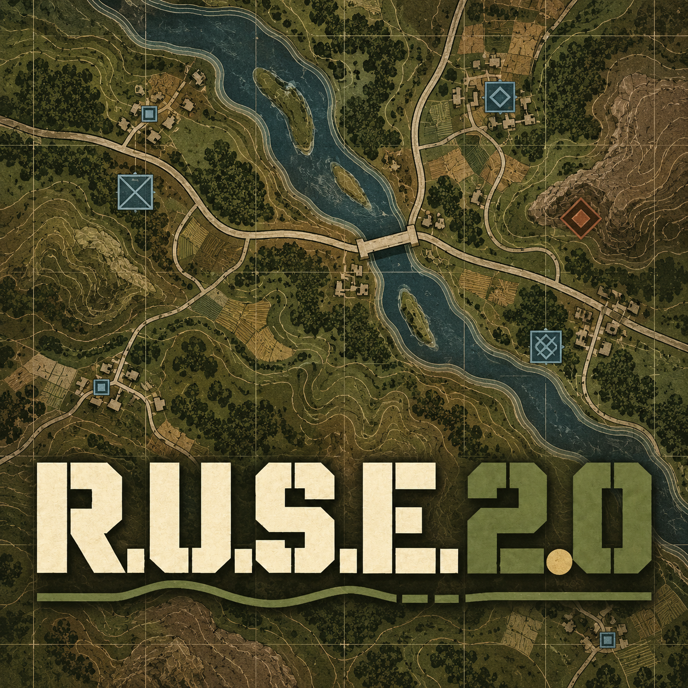

[](https://github.com/sneadtristen6/R.U.S.E-2.0-Project/releases?q=launcher)
&nbsp;&nbsp;
[](https://github.com/sneadtristen6/R.U.S.E-2.0-Project/releases?q=studio)
&nbsp;&nbsp;
[](https://www.patreon.com/SneadTristen6)

<sub>Windows. Needs R.U.S.E. on Steam. Never touches your Steam install.</sub>

</div>

> [!TIP]
> **How to install and play (5 minutes):**
> 1. Open the [launcher releases](https://github.com/sneadtristen6/R.U.S.E-2.0-Project/releases?q=launcher), take the
>    newest one (marked **Latest**), and under **Assets** click **RUSE-Launcher-Setup-0.4.8.7.exe**.
> 2. Run it. If Windows says "Windows protected your PC": **More info**, then **Run anyway**.
> 3. Open **RUSE Launcher**: it finds R.U.S.E. through Steam by itself.
> 4. Click **Supported mods**, tick the mods you want and press **Install**.
> 5. Put them in a mod set (**New mod set…**) and press **Play**.
>
> Every step, with what to do when something goes wrong: **[Install and play](https://github.com/sneadtristen6/R.U.S.E-2.0-Project/wiki/Install-and-Play)**.
> To make mods, get **RUSE Studio** the same way from the
> [studio releases](https://github.com/sneadtristen6/R.U.S.E-2.0-Project/releases?q=studio) and start with
> [Your first mod](https://github.com/sneadtristen6/R.U.S.E-2.0-Project/wiki/Your-First-Mod).

## What R.U.S.E. is

**R.U.S.E.** (2010) is Eugen Systems' real-time strategy game of the Second World War. The whole front lies on a
map table you can zoom from the war room down to a single tank, and battles are won as much by deception as by
force: **ruse cards** hide your units, fake an attack, crack the enemy's plans or speed your troops up. It has a
campaign, Operations, and skirmish and multiplayer battles on maps from Normandy to Tunisia.

## What R.U.S.E. 2.0 is

**New maps, new units and one-press modded play for R.U.S.E.** Two free apps:

- **RUSE Launcher, for players.** Pick a set of mods and press **Play**. That's it.
- **RUSE Studio, for modders.** Change any unit, make new ones with 3D models of their own, build maps from a blank
  sheet or reshape the game's own, then press **Test in game**.

**Checked before the game starts.** The Studio reads your mod the way the game will: anything that would break in
the game is stopped first, with a note saying what to change. The goal: what you make works in the game every time,
the first time.

**Data only.** A mod here changes the game's data, in a separate copy of the game, and that is all of it. Your Steam
install is never changed.

**Open source** (GPL-3.0), in the game's ten languages.

<table>
  <tr>
    <td width="33%" valign="top">
      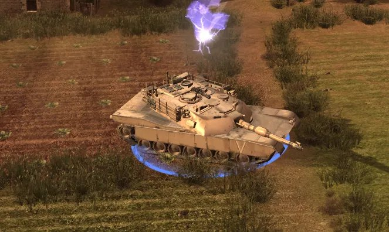<br>
      <sub><b>A tank of your own.</b> An M1 Abrams, modelled in another 3D program, in the game.</sub>
    </td>
    <td width="33%" valign="top">
      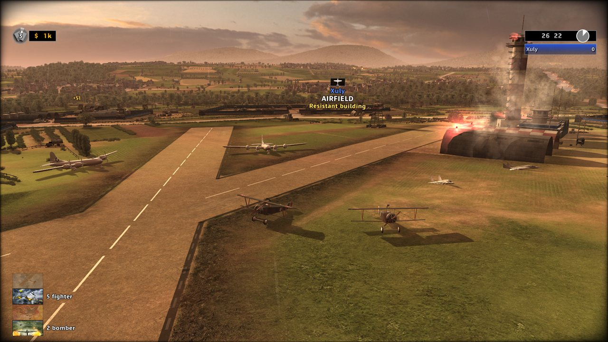<br>
      <sub><b>WWI to today, all in one.</b> Biplanes, bombers and jets on one airfield.</sub>
    </td>
    <td width="33%" valign="top">
      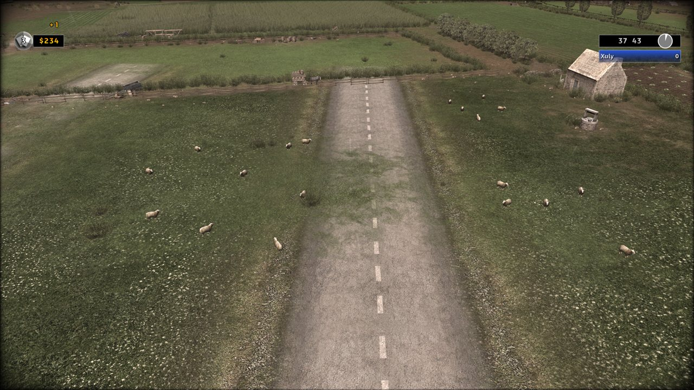<br>
      <sub><b>Roads you draw.</b> Like the map's own, from high up and right down at the ground.</sub>
    </td>
  </tr>
</table>

## What R.U.S.E. 2.0 changes

### Units

- **Change any unit:** its price, armour, speed, weapons and every other number, with Undo, then **Test in game**.
- **Every flag and number explained**, in plain words and plain units (metres, km/h, seconds): what it does, where
  the game's units sit, and a slider from its base stat. Flags known to crash the game are stopped, with the fix.
- **New units:** start from any unit, put it in any nation's build menu, behind research or buyable from the start.
- **Planes in any role** (fighter, fighter-bomber, bomber with its bomb bay, scout), **recon vehicles**, and
  **weapons that hit the ground, planes or both**.
- **Your own 3D models:** bring a model in from Blender or any 3D tool, repaint any unit in Blender, give a squad its
  own uniform, pick the truck a squad rides in, and make its card for the build menu.
- **366 units from WWI to today:** other makers' free models, each credited, at their real size, researched like the
  game's own units.
- **Nations:** make one of the game's seven nations into another, with a name and a flag of its own; hide or fill a
  nation's units in one go.

### Maps

- **New maps** listed in BATTLES beside the game's own. Start from **blank land or open sea**, at the game's size or
  bigger, give them their own pictures in the menus, and paint their sectors.
- **Shape the ground:** hills, craters, plateaus, ramps, levelled and smoothed ground; lakes and drained rivers. Units
  drive and fight on it.
- **Roads and bridges:** straight, curved or freehand roads that supply trucks follow; where one crosses water, the
  map's own kind of bridge that tanks, infantry and trucks cross.
- **Buildings, props and trees:** place them one by one, in a grid, a box, or along a path (hedges and tree belts),
  buildings facing the roads; select, move, turn, resize and delete them, the map's own too; clear the map's woods
  and props.
- **Cover and movement:** paint the towns and woods units hide in, and close ground to all units, infantry or
  vehicles. The map shows what each stroke changed.
- **Map Paint:** paint the ground's picture with a colour, the map's own ground from another spot, the game's
  textures, pictures of your own or free textures online.
- **Scenarios and missions:** move starting points, add the units a battle starts with, and missions of your own
  with goals, events and camera moves, for Operations and campaign chapters.

### The game's rules

- **Economy:** starting money and income, supply depots and their trucks, the ruse cards each side starts with, for
  normal and nuclear battles apart.
- **The computer players:** how they play, the units they prefer and their ruse cards, every value explained.
- **All values:** every object and value of the game's data, changed in your mod.

### Music and sound

- Every song by where it plays, replaced in the Studio's own small editor (cut, fade, volume); new songs added to the
  battle lists; a unit's voice lines; a map's background sound.

### For players

- **One press:** pick a mod set and press **Play**; the Launcher builds a separate modded copy and starts it.
- **Community mods as they are** (RUSE-Mod-Manager's `.rmod` too), a list of supported mods to tick, load orders
  shared both ways with RUSE-Mod-Manager, and a troubleshooter that finds what stops Play and fixes it.
- **Updates itself**, in the game's ten languages.

## See it in the game

<table>
  <tr>
    <td width="33%" valign="top">
      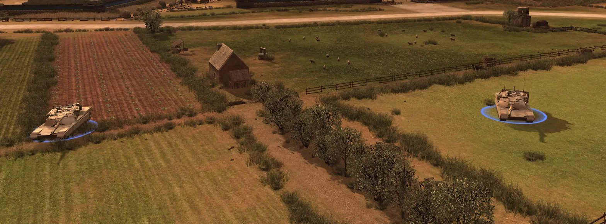<br>
      <sub><b>Out in the fields.</b> Two M1 Abrams beside a farm.</sub>
    </td>
    <td width="33%" valign="top">
      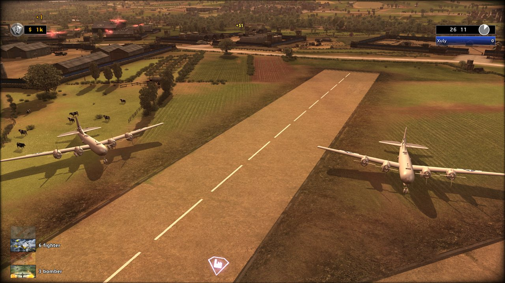<br>
      <sub><b>New bombers</b> on a R.U.S.E. airfield.</sub>
    </td>
    <td width="33%" valign="top">
      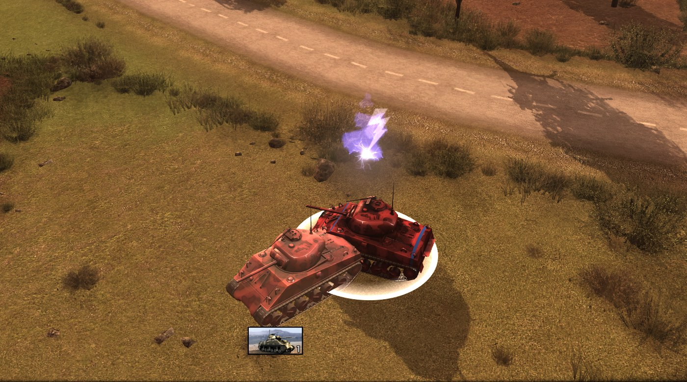<br>
      <sub><b>Units with their own look.</b> Repaint any unit in Blender and bring it back.</sub>
    </td>
  </tr>
  <tr>
    <td width="33%" valign="top">
      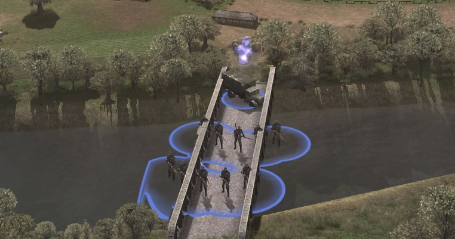<br>
      <sub><b>Bridges units cross.</b> Where your road meets water, the map's own kind of bridge.</sub>
    </td>
    <td width="33%" valign="top">
      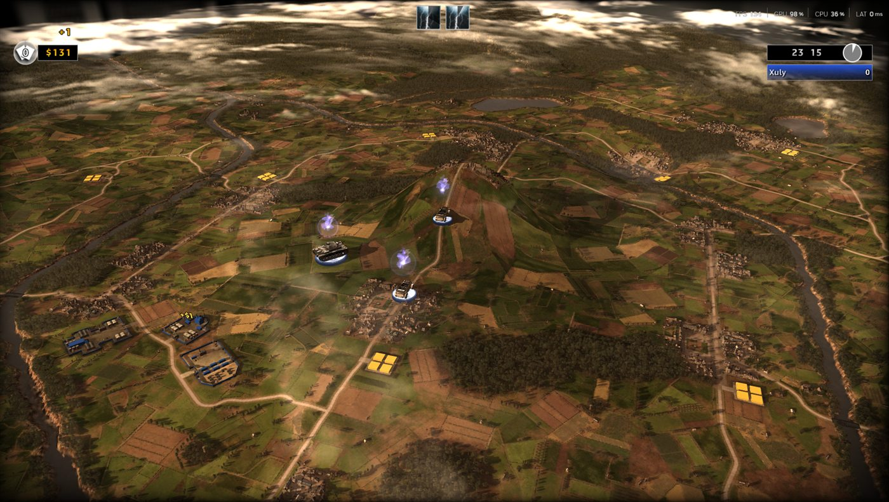<br>
      <sub><b>Ground you shape.</b> Hills, craters, lakes and dried rivers that units drive and fight on.</sub>
    </td>
    <td width="33%" valign="top">
      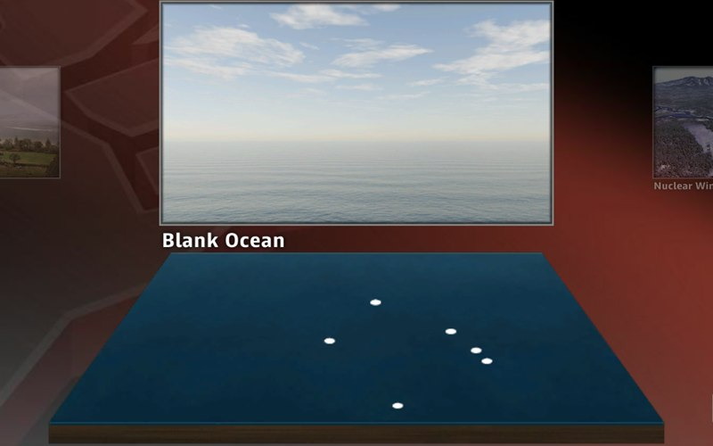<br>
      <sub><b>New maps</b>, started blank, with their own menu pictures.</sub>
    </td>
  </tr>
  <tr>
    <td width="33%" valign="top">
      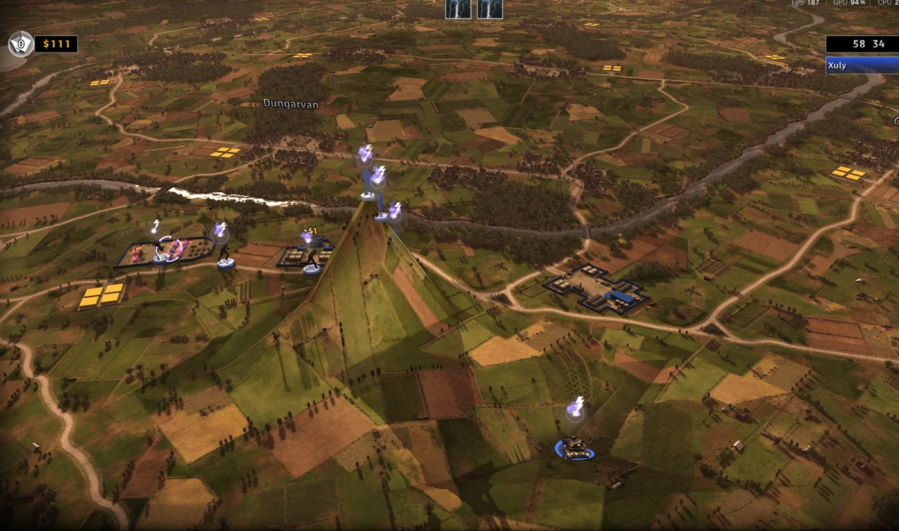<br>
      <sub><b>Painted cover.</b> Infantry on it are hidden.</sub>
    </td>
    <td width="33%" valign="top">
      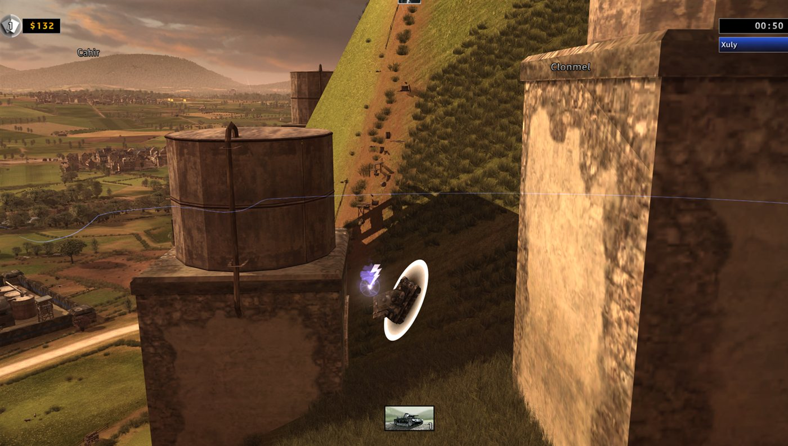<br>
      <sub><b>Placed buildings are solid.</b> Tanks go around.</sub>
    </td>
    <td width="33%" valign="top">
      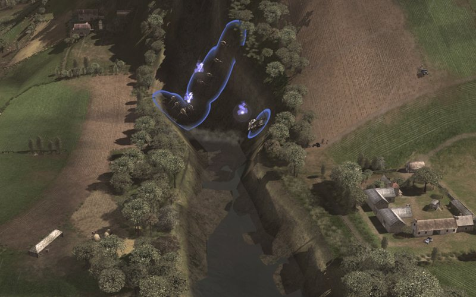<br>
      <sub><b>A river drained.</b> Units walk its bed.</sub>
    </td>
  </tr>
</table>

## Inside the Studio

<table>
  <tr>
    <td width="50%" valign="top">
      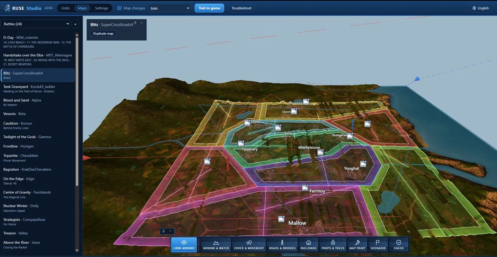<br>
      <sub><b>Every map in 3D.</b> Blitz with its zones and towns; the tools run along the bottom.</sub>
    </td>
    <td width="50%" valign="top">
      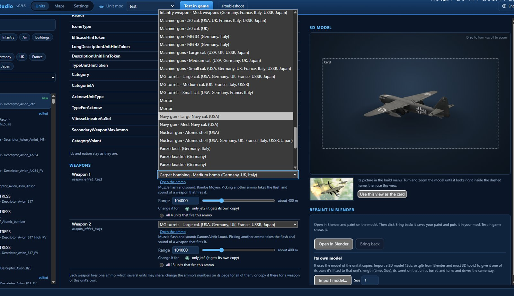<br>
      <sub><b>Units.</b> A unit's numbers, flags and weapons, its 3D model and its card.</sub>
    </td>
  </tr>
  <tr>
    <td width="50%" valign="top">
      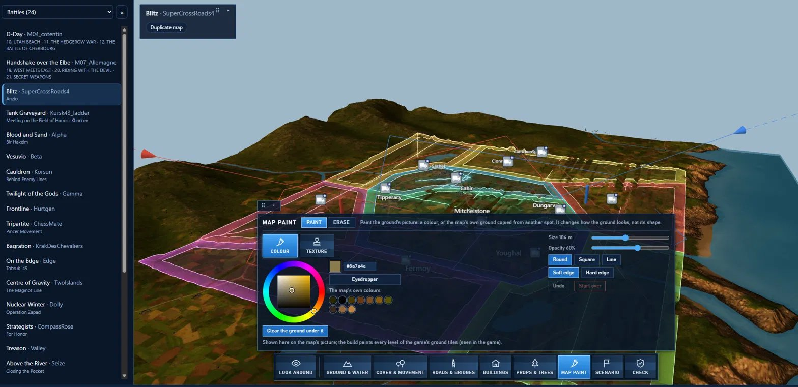<br>
      <sub><b>Map Paint.</b> Paint the ground's picture.</sub>
    </td>
    <td width="50%" valign="top">
      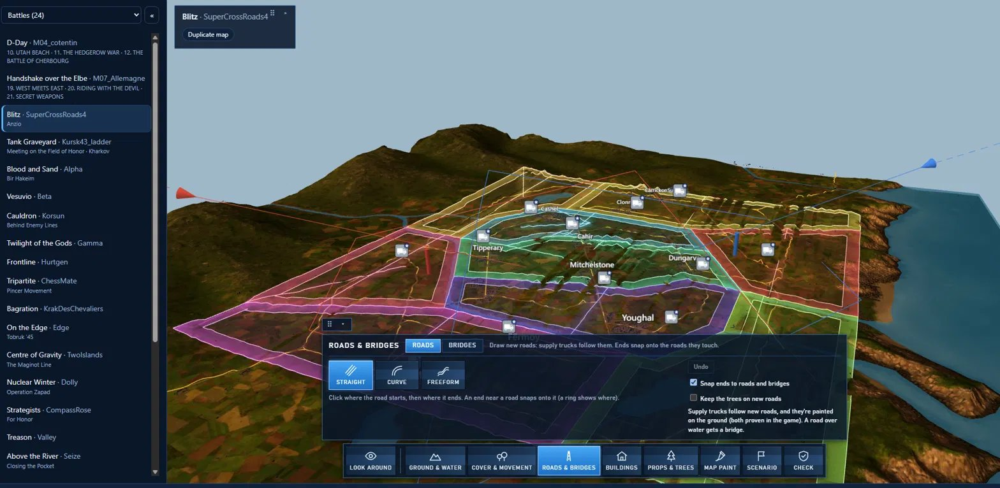<br>
      <sub><b>Roads and bridges.</b> Straight, curved or freehand.</sub>
    </td>
  </tr>
  <tr>
    <td width="50%" valign="top">
      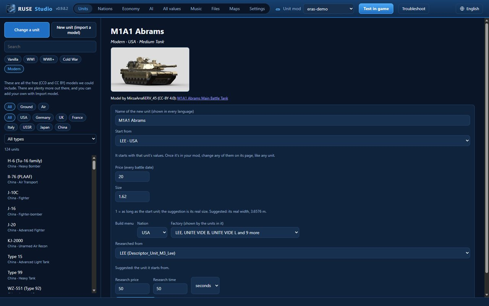<br>
      <sub><b>Units from other eras</b>, each model's maker credited.</sub>
    </td>
    <td width="50%" valign="top">
      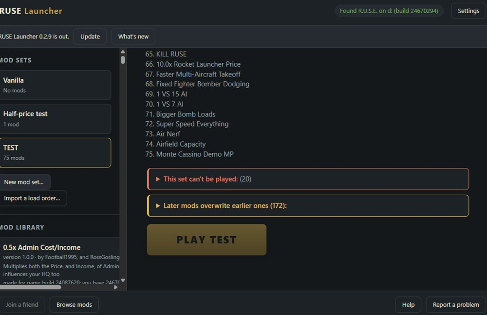<br>
      <sub><b>RUSE Launcher:</b> a set of 75 community mods, and which overwrite which.</sub>
    </td>
  </tr>
</table>

## Coming next

- **Towns you draw:** lay out the streets, mark blocks as homes, shops or industry, and the Studio fills them with
  the game's own buildings.
- **Map assets of your own:** trees, rocks, cliffs and props brought into maps, with an importer in the Maps tab.
- **Generated mountains and our own high-resolution ground textures**, and Map Paint's field brush, which turns whole
  fields into wheat, ploughed earth or a green crop the way the game's own maps paint them.

Everything that changed, version by version: the
[Studio notes](https://github.com/sneadtristen6/R.U.S.E-2.0-Project/blob/main/.github/release-notes/studio.md) and the
[Launcher notes](https://github.com/sneadtristen6/R.U.S.E-2.0-Project/blob/main/.github/release-notes/launcher.md).

**About the name:** R.U.S.E. 2.0 is a placeholder. Before the full version (1.0) comes out, we'll consult Eugen
Systems, the makers of R.U.S.E., and the project will take a name they're okay with. Name ideas and constructive
criticism are welcome in [the name discussion](https://github.com/sneadtristen6/R.U.S.E-2.0-Project/discussions/18).

**What's in this repository.** The two apps, and what players and modders need to use them. Our working notes on the
game's own files are kept private until we have an explicit OK from the developers, Eugen Systems.

Everything we do here is to help the community and bring this game to a better place. R.U.S.E. is one of my favorite
games ever, and I just want to make it better.

## Install in three steps

1. **Download** the installer from [Releases](https://github.com/sneadtristen6/R.U.S.E-2.0-Project/releases):
   `RUSE-Launcher-Setup-<version>.exe` for players, `RUSE-Studio-Setup-<version>.exe` for modders. Windows only. You
   need R.U.S.E. in your Steam library, installed.
2. **Run it.** No admin rights and no Python needed. The installers are not code-signed yet, so Windows may warn once
   ("Windows protected your PC"): click **More info**, then **Run anyway**. To check you have the real file, compare
   its SHA-256 with the one in the release notes.
3. **Start it** from the Start menu. It finds R.U.S.E. through Steam. In the Launcher, pick a mod set and press
   **Play**. In the Studio, build the game index once when it asks (about a minute), then pick or make a mod.

Uninstalling keeps your mods and settings. The apps need Microsoft Edge WebView2, which Windows 11 has. More in
[installers/README.md](installers/README.md).

<details>
<summary><b>Status, docs and contributing</b></summary>

[](https://github.com/sneadtristen6/R.U.S.E-2.0-Project/releases?q=launcher)
[](https://github.com/sneadtristen6/R.U.S.E-2.0-Project/releases?q=studio)
[](https://github.com/sneadtristen6/R.U.S.E-2.0-Project/actions/workflows/tests.yml)
[](LICENSE)

**Launcher** for players (latest: 0.4.8.7) &middot; **Studio** for modders, a preview (latest: 0.9.8.7) &middot; Windows &middot; needs R.U.S.E. on Steam

**[Field manual (wiki)](https://github.com/sneadtristen6/R.U.S.E-2.0-Project/wiki)** &middot;
**[Discussions](https://github.com/sneadtristen6/R.U.S.E-2.0-Project/discussions)** &middot;
**[Discord](https://discord.gg/DbufY4Jfg)** &middot; **[Contributing](CONTRIBUTING.md)** &middot;
**[Code of conduct](CODE_OF_CONDUCT.md)** &middot; [docs/MOD_FORMAT.md](docs/MOD_FORMAT.md): everything a mod can do,
file by file.

</details>

<a name="for-contributors"></a>
<details>
<summary><b>For contributors</b></summary>

How to report bugs, test in the game and send code: [CONTRIBUTING.md](CONTRIBUTING.md).

<details>
<summary><b>The two apps from source, and the installers</b></summary>

The two apps run on the engine, separate from each other (neither needs the other). Both are
desktop windows built like web pages; once: `py -3 -m pip install pywebview`. Their screens also open in a normal
browser with made-up data: `src/ruse_launcher/ui/index.html?fake`, `src/ruse_studio/ui/index.html?fake`.

- **RUSE Launcher** ([`src/ruse_launcher/`](src/ruse_launcher/)), for players: it finds the game,
  lists your mod sets and has a big Play button that builds the set's modded copy and starts the game (Vanilla
  starts through Steam). `py -3 -m ruse_launcher`. **Players never touch a file.** A
  mod library ("Add a mod file…" for a `.rusemod` from the Studio, a `.rmod` or a `.zip`, or drop a mod file or
  folder on the window; each mod is checked first), mod sets made on screen (new, edit and reorder, rename,
  duplicate, delete), Share and "Import a load order…" for a mod set (RUSE-Mod-Manager's own text, so load orders
  go both ways; [`src/rusemod/loadorder.py`](src/rusemod/loadorder.py)), a three-step guide on Vanilla ("Playing
  with mods, in three steps"), and the launcher in the PC's own language (any of the game's ten). **Supported
  mods** (0.3.0): our list of mods (a GitHub repository, MOD_FORMAT §15) with tick boxes, several installed at once,
  each file checked against the list before it goes into the library, cheat mods kept apart; offline, the last
  copy of the list.
- **RUSE Studio** ([`src/ruse_studio/`](src/ruse_studio/)), for modders: browse every unit and
  building, see a unit's values, parts and what uses it, and pick a language: the game's own names by default, or
  any of the game's ten languages. Pick or make a mod and change a unit's numbers right on its page: each change is
  saved in the mod's `src/studio.rndf` (with Undo); a part several units share changes for one of them or all.
  "Test in game" builds the mod and starts the game. **Maps** (released in 0.4): every map the game lists, in 3D
  with its real ground mesh and ground textures (decoded once per map and kept). **Also:**
  - **"Export mod…"** turns the mod into one file, `<id>-<version>.rusemod`, with the game build and the mod's
    fingerprint inside, for the launcher's "Add a mod file…" (the loop from modder to player).
  - **New unit…** on a unit's page makes a copy with its own name (one name, shown in all ten languages), price and
    build menu (the same nation and factory, or another nation's); it's listed as new, edited like any other unit,
    and can be deleted.
  - **In Maps:** each map's buildings and a share of its props and trees. Pick a brush and click or drag on the
    ground to shape it: each stroke is drawn at once and saved in the mod's `maps/<map>/terrain.toml`; a ramp takes
    two clicks (its start, its end), Undo takes a stroke back, Start over clears the map. "Place on the map" lists
    the map's own types (most used first, with a search); set Turn and Size, click the ground, and the object is
    saved in the mod's `maps/<map>/scenery.toml`. "Test in game" builds it all into the map.

  `py -3 -m ruse_studio` (after `ruse index build`); `--spike` opens the 3D check.
- `py -3 -m pip install -e .[apps]` once gives two commands, `ruse-launcher` and `ruse-studio`, that open them
  without a console window.
- **Installers** ([`installers/`](installers/README.md)): GitHub builds `RUSE-Launcher-Setup-<version>.exe` and
  `RUSE-Studio-Setup-<version>.exe` on every push that changes the apps (Actions, **apps**, Artifacts). A tag
  `launcher-v<version>` or `studio-v<version>` publishes one as a Release. No Python or Git needed, no admin rights.
  Not signed yet, so Windows warns once ("More info", then "Run anyway").

</details>

</details>

<details>
<summary><b>Tools and checks</b></summary>

- [`tools/check_public.py`](tools/check_public.py): run by GitHub on every push; fails if private material, game
  files or details of the game's program would reach this public repo.
- [`tools/rmod_to_mod.py`](tools/rmod_to_mod.py): rebuilds a RUSE-Mod-Manager `.rmod` as a mod of ours.

</details>

<details>
<summary><b>Running the tests</b></summary>

[`tests/`](tests) holds tests on small made-up files; no game needed:

```
py -3 -m unittest discover -s tests
```

(with `PYTHONPATH=src`). GitHub runs them on every push, on Windows and Linux
([`.github/workflows/tests.yml`](.github/workflows/tests.yml)).

</details>

## Credits

R.U.S.E. 2.0 stands on other people's work. None of it would be here without them.

### ProLution: the godfather of R.U.S.E. modding

- Built the **RUSE Modding Database** and wrote the guides people learned from, custom Operations among them.
- **ProLution's code is in ours:** the map terrain codec in
  [`src/ruse_mod_engine/terrain_codec.py`](src/ruse_mod_engine/terrain_codec.py) is built on ProLution's terrain
  format work (released CC0), and its encoder is ported from ProLution's reference encoder.

### LittleGroove: the first mod manager

- **The first real mod manager for R.U.S.E.:** RUSE-Mod-Manager and its `.rmod` format. Every community mod in the
  Launcher plays because of it.
- **His engine is in ours,** used as it is: [`src/ruse_mod_engine`](src/ruse_mod_engine/) applies `.rmod` mods in
  every build, and moves a mod made for another game build with his version maps. It's why the whole program is
  GPL-3.0.
- **His map editor led the way for ours:** supply depots and HQs sticking to roads (his measured distances), the
  opening camera each match starts on, and saving a changed scenario so the game loads it; and in the units editor,
  the ammo types and flag lists.
- **His tools, brought into the Studio and the Launcher:** the Economy and AI tabs, the script viewer, the Upgrade
  box, All values, the game's files, the missions' tools, and Convert an old mod.

### DomesticNukes: the map maker's groundwork

- **DomesticNukes laid the map maker's groundwork:** the ground units walk on, where every building, tree and prop
  stands, and the recipe the terrain brushes follow so a reshaped map loads and plays.
- **DomesticNukes wrote the water brushes:** lakes and drained rivers, merged from DomesticNukes' own pull request.
- **DomesticNukes' work on the game's models** put the game's real 3D models in the Studio's map view, and helped
  make units from another nation work.
- The notes on unit flags, bridge floors and how units stand on the ground went into the build's checks and the
  bridges units now drive over. DomesticNukes tests the releases in the game, too.

### The era units' model makers

The units from other eras (Studio 0.9.8.2) are free 3D models by the people who made and shared them, under CC0 or
CC BY. Every maker is named, with the model's title, licence and link, on the unit's page in the Studio, in the
credits file of any mod that uses one (`CREDITS-era-units.md`), and in the full list on the
[era units release](https://github.com/sneadtristen6/R.U.S.E-2.0-Project/releases/tag/era-units). What we changed:
each was fitted to the game (turned and scaled) and given its nation's markings.

### sneadtristen6 and Claude: building R.U.S.E. 2.0

**sneadtristen6 is the mind behind R.U.S.E. 2.0.** The ideas are his, he decides what it becomes, and he plays
every change in the game before it goes out. **Claude**, Anthropic's AI, helps shape his ideas into plans and writes
the code. Side by side since September 2026, they built:

- **New 3D models in the game:** the model importer that brings a unit's model in from Blender or any 3D tool (an M1
  Abrams was the first), units repainted in Blender, squads' own uniforms, build-menu cards, and 366 units from other
  eras at their real size.
- **Texture work:** Map Paint and its texture library: a map's ground painted with the game's own textures, ground
  from anywhere on the map, or pictures of your own.
- **New maps.** On 3 October 2026 R.U.S.E. got new maps: listed in BATTLES beside the game's own, each playing its
  own ground. To find the limit, 101 went in at once; all of them showed and played. As far as we know, they're the
  first new maps the game has had since D-Day. New maps start blank, as land or open sea, with their own menu
  pictures.
- **A map editor that works in the game:** ground that units drive and fight on, lakes and dried rivers, roads that
  look like the map's own from high up and right down at the ground, bridges that tanks, infantry and supply trucks
  cross, buildings, props and trees that show at every distance, cover, and where units can go.
- **Units:** change any of them, make new ones, give a nation another army's tanks and planes, planes in any role,
  recon vehicles, weapons that hit planes, every flag and number explained, and a nation made into another.
- **Music and missions:** songs and voice lines replaced in the Studio, and missions of your own.
- **Two apps in the game's ten languages,** the Studio for modders and the Launcher for players, that never touch
  the game's own folder, with a check that stops a mod that would break the game before it starts.

It's early, and there's much more to come. Thank you to everyone above, without whom none of it would have started.

### (Anonyme) Oozaru: testing and debugging

**(Anonyme) Oozaru tested the early apps on his own campaign mod and sent the log with every bug he found.** His
reports led to these fixes:

- Placed props that showed only up close are now drawn out to the far distance (Studio 0.9.3).
- His units for the player in a campaign chapter never appeared; they can now be given to the player.
- His French units on Holland crashed the game while loading; another nation's units now load in campaign chapters
  and Operations too (0.9.5).
- He mapped which of Italy chapter 1's IR names is which side: the US player, France, Italy, the UK and the US
  computer.
- His "waiting 30 minutes every time just to add or remove a unit" is why **Play** now starts at once when nothing
  changed (Launcher 0.4.6).

Thanks also to everyone who has tried the apps, sent screenshots and reported bugs.

### Supporter credits

Supporter names are added here after the supporter chooses a public credit name.

#### Monumental Supporters

A prominent, personal thank-you for $100 supporters helping lay the foundation for R.U.S.E. 2.0 and the vision
of Pacific Defense, with Iwo Jima as its flagship map, and China. This group appears first in the supporter credits.

#### Above & Beyond Supporters

A thank-you and name credit for $20 supporters who go above and beyond to help keep development moving.

## Support development

R.U.S.E. 2.0 is my first modding project. If you want to support development and follow the behind-the-scenes work,
[visit my Patreon](https://www.patreon.com/SneadTristen6). Any support helps me keep building.

### One-time support options

| Option | Amount | Recognition |
| --- | --- | --- |
| [Above & Beyond Supporter](https://www.patreon.com/SneadTristen6/posts/171328212) | $20 once | Your chosen name in the Above & Beyond Supporters section of the GitHub and mod credits. |
| [Monumental Supporter](https://www.patreon.com/SneadTristen6/posts/monumental-100-171328695) | $100 once | A prominent acknowledgment in the Monumental Supporters section, with a dedicated thank-you for helping lay the foundation for the project's vision. |

I've always envisioned **Iwo Jima as the flagship map for a Pacific Defense DLC-style expansion**, alongside
adding **China** to the game. Support helps me work toward that dream. These are development goals for this
independent fan project.

Credit is optional: after purchasing, send a Patreon message with your chosen public name and permission to
publish it, or choose to remain anonymous. Credits are updated with project releases. These Shop purchases do
not renew automatically.

You can also [request a feature for a one-time $3](https://www.patreon.com/SneadTristen6/posts/request-r-u-s-e-171321812).

## Questions? Ask any AI

Everything here is written down in plain words, so any AI assistant (ChatGPT, Claude, Gemini...) can answer from it.
Give it the link to **[ai/START-HERE.md](ai/START-HERE.md)**, the page written for AI assistants (where every answer
lives, the apps' words, what's tested), or to this page, and ask what you want to know:

- *"How do I give the US a German Tiger with RUSE Studio?"*
- *"How do I draw a road with a bridge across a river?"*
- *"My test in game stopped with an error. What does it mean?"*
- *"What does a mod's scenario.toml file do?"*

The best page to point it at: [docs/MOD_FORMAT.md](docs/MOD_FORMAT.md) (everything a mod can do, file by file).
Still stuck? Open an [issue](https://github.com/sneadtristen6/R.U.S.E-2.0-Project/issues).

## License

GNU General Public License, version 3 ([LICENSE](LICENSE), GPL-3.0): copyright (C) 2026 sneadtristen6 and the
RUSE Mod Platform contributors. The apps ship [`src/ruse_mod_engine`](src/ruse_mod_engine/), LittleGroove's
RUSE-Mod-Manager engine (GPLv3), used as it is (see Credits), and its license needs the whole program under
GPL-3.0 (it was MIT until 2026-09-30). `src/ruse_mod_engine/python251` carries
Python's license ([its LICENSE.txt](src/ruse_mod_engine/python251/LICENSE.txt)). This is an independent, fan-made
tool, not affiliated with or endorsed by Eugen Systems. R.U.S.E. and its game data belong to their owners; this
project ships no game files and works only on a copy of a game you own.
