<div align="center">

# R.U.S.E. 2.0

**Zbuduj pole bitwy, a potem na nim walcz.**

[English](README.md) · [Français](README.fr.md) · [Deutsch](README.ger.md) · [Italiano](README.ita.md) · [Español](README.spa.md) · **Polski** · [Русский](README.ru.md) · [Čeština](README.cz.md) · [日本語](README.jpn.md) · [简体中文](README.sc.md) · [فارسی](README.fa.md)

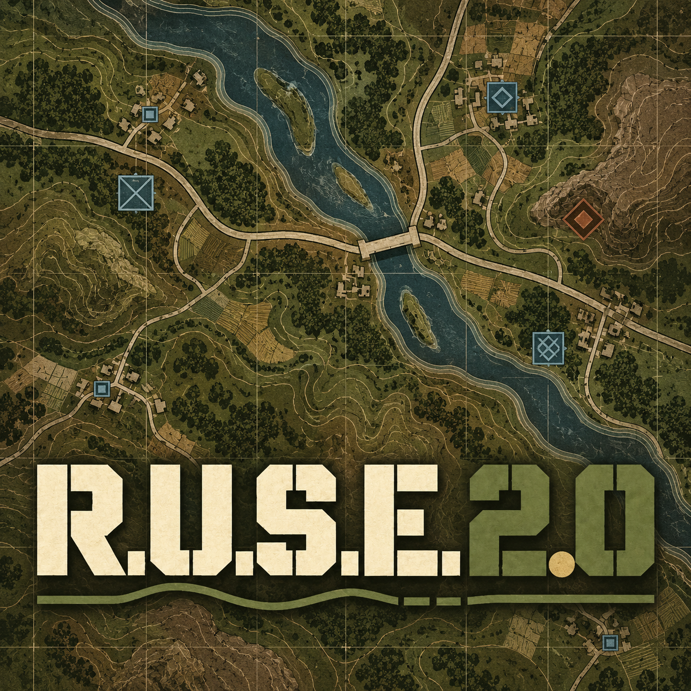

[](https://github.com/sneadtristen6/R.U.S.E-2.0-Project/releases?q=launcher)
&nbsp;&nbsp;
[](https://github.com/sneadtristen6/R.U.S.E-2.0-Project/releases?q=studio)
&nbsp;&nbsp;
[](https://www.patreon.com/SneadTristen6)

<sub>Windows. Wymaga R.U.S.E. na Steamie. Nigdy nie zmienia twojej instalacji Steam.</sub>

</div>

> [!TIP]
> **Jak zainstalować i grać (5 minut):**
> 1. Otwórz [wydania Launchera](https://github.com/sneadtristen6/R.U.S.E-2.0-Project/releases?q=launcher), weź
>    najnowsze (oznaczone **Latest**) i pod **Assets** kliknij **RUSE-Launcher-Setup-0.4.8.9.exe**.
> 2. Uruchom go. Jeśli Windows powie „System Windows ochronił ten komputer”: **Więcej informacji**, potem **Uruchom mimo to**.
> 3. Otwórz **RUSE Launcher**: sam znajduje R.U.S.E. przez Steam.
> 4. Kliknij **Obsługiwane mody**, zaznacz mody, które chcesz, i naciśnij **Zainstaluj**.
> 5. Umieść je w zestawie modów (**Nowy zestaw modów…**) i naciśnij **Graj**.
>
> Każdy krok, z tym, co zrobić, gdy coś pójdzie nie tak: **[Instalacja i gra](https://github.com/sneadtristen6/R.U.S.E-2.0-Project/wiki/Instalacja-i-gra)**.
> Aby tworzyć mody, pobierz w ten sam sposób **RUSE Studio** z
> [wydań Studio](https://github.com/sneadtristen6/R.U.S.E-2.0-Project/releases?q=studio) i zacznij od
> [Twój pierwszy mod](https://github.com/sneadtristen6/R.U.S.E-2.0-Project/wiki/Tw%C3%B3j-pierwszy-mod).

## Czym jest R.U.S.E.

**R.U.S.E.** (2010) to strategia czasu rzeczywistego od Eugen Systems o II wojnie światowej. Cały front leży na
stole z mapą, który przybliżysz od sali sztabowej aż do pojedynczego czołgu, a bitwy wygrywa się podstępem tak samo
jak siłą: **karty podstępu** ukrywają twoje jednostki, pozorują atak, łamią plany wroga albo przyspieszają twoje
wojska. Gra ma kampanię, Operacje oraz bitwy przeciw komputerowi i wieloosobowe na mapach od Normandii po Tunezję.

## Czym jest R.U.S.E. 2.0

**Nowe mapy, nowe jednostki i gra z modami jednym kliknięciem dla R.U.S.E.** Dwie darmowe aplikacje:

- **RUSE Launcher, dla graczy.** Wybierz zestaw modów i naciśnij **Graj**. To wszystko.
- **RUSE Studio, dla modderów.** Zmień dowolną jednostkę, zrób nowe z ich własnymi modelami 3D, buduj mapy od czystej
  kartki albo przekształcaj mapy samej gry, potem naciśnij **Testuj w grze**.

**Sprawdzone, zanim gra wystartuje.** Studio czyta twój mod tak, jak przeczyta go gra: wszystko, co zepsułoby się
w grze, jest zatrzymywane wcześniej, z notką, co zmienić. Cel: to, co zrobisz, działa w grze za każdym razem, już za
pierwszym razem.

**Tylko dane.** Mod tutaj zmienia dane gry, w osobnej kopii gry, i to wszystko. Twoja instalacja Steam nigdy nie
jest zmieniana.

**Otwarte źródło** (GPL-3.0), w jedenastu językach: dziesięciu językach gry i perskim.

<table>
  <tr>
    <td width="33%" valign="top">
      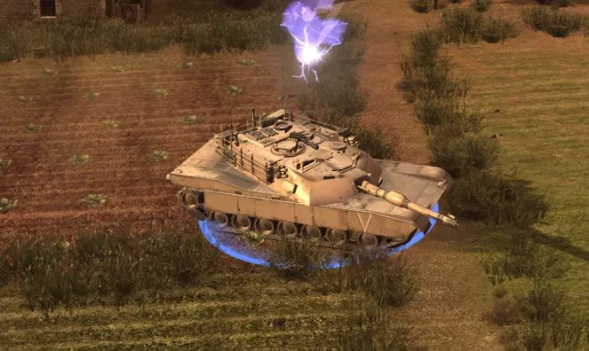<br>
      <sub><b>Twój własny czołg.</b> M1 Abrams, wymodelowany w innym programie 3D, w grze.</sub>
    </td>
    <td width="33%" valign="top">
      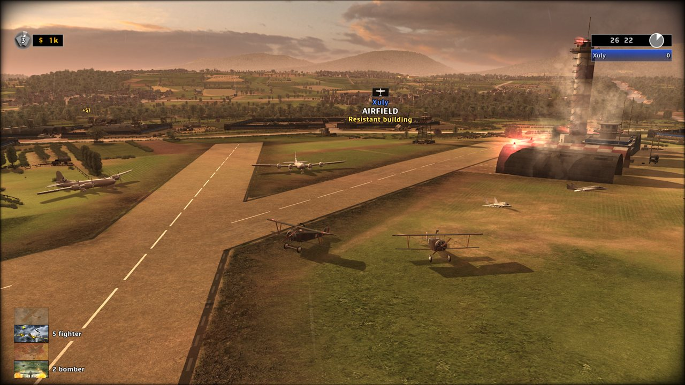<br>
      <sub><b>Od I wojny światowej po dziś, wszystko razem.</b> Dwupłatowce, bombowce i odrzutowce na jednym lotnisku.</sub>
    </td>
    <td width="33%" valign="top">
      <br>
      <sub><b>Drogi, które rysujesz.</b> Jak własne drogi mapy, z wysoka i tuż przy ziemi.</sub>
    </td>
  </tr>
</table>

## Co zmienia R.U.S.E. 2.0

### Jednostki

- **Zmień dowolną jednostkę:** jej cenę, pancerz, prędkość, broń i każdą inną liczbę, z Cofnij, potem **Testuj w grze**.
- **Każda flaga i liczba wyjaśniona**, prostymi słowami i w prostych jednostkach (metry, km/h, sekundy): co robi, gdzie
  wypadają jednostki gry, i suwak od jej wartości bazowej. Flagi, o których wiadomo, że wywołują crash gry, są
  zatrzymywane, z poprawką.
- **Nowe jednostki:** zacznij od dowolnej jednostki, umieść ją w menu budowy dowolnej nacji, za badaniem albo do
  kupienia od startu.
- **Samoloty w dowolnej roli** (myśliwiec, myśliwiec bombardujący, bombowiec z komorą bombową, zwiad), **pojazdy
  rozpoznawcze** i **broń, która trafia cele naziemne, samoloty albo jedno i drugie**.
- **Twoje własne modele 3D:** wprowadź model z Blendera lub dowolnego narzędzia 3D, przemaluj dowolną jednostkę
  w Blenderze, daj oddziałowi własny mundur, wybierz ciężarówkę, którą jedzie oddział, i zrób jego kartę do menu budowy.
- **366 jednostek od I wojny światowej po dziś:** darmowe modele innych twórców, każdy z podziękowaniem, w prawdziwym
  rozmiarze, badane jak własne jednostki gry.
- **Nacje:** zamień jedną z siedmiu nacji gry w inną, z własną nazwą i flagą; ukryj albo wypełnij jednostki nacji za
  jednym razem.
- **Budynki i to, co produkują:** budynki każdej nacji jako rzędy jednostek, które oferują ich menu budowy; wstawiaj
  jednostki, przesuwaj je, kopiuj jednostki innej nacji, każ je badać od innej jednostki. **Dodaj budynek:** kopia
  jednego z budynków gry albo budynek z własnymi jednostkami, własną zakładką na pasku budowy, własnym wyglądem 3D
  i obrazem w menu budowy.
- **Własne nazwy amunicji i typy flag:** zmień nazwę skopiowanej amunicji w każdym języku; zrób nazwany zestaw flag
  gry i daj go dowolnej jednostce.

### Mapy

- **Nowe mapy** na liście BITWY obok map gry. Zacznij od **pustego lądu albo otwartego morza**, w rozmiarze gry albo
  większe, daj im własne obrazy w menu i pomaluj ich sektory.
- **Kształtuj teren:** wzgórza, kratery, płaskowyże, rampy, wyrównany i wygładzony teren; jeziora i osuszone rzeki.
  Jednostki jeżdżą i walczą na nim.
- **Drogi i mosty:** proste, łukowe lub odręczne drogi, którymi jeżdżą ciężarówki zaopatrzenia; gdzie droga przecina
  wodę, most własnego rodzaju mapy, po którym przejeżdżają czołgi, piechota i ciężarówki. Usuń własne mosty mapy
  i zamknij ich przejścia.
- **Budynki, obiekty i drzewa:** stawiaj je pojedynczo, w siatce, w prostokącie albo wzdłuż ścieżki (żywopłoty i pasy
  drzew), budynki frontem do dróg; zaznaczaj, przesuwaj, obracaj, zmieniaj rozmiar i usuwaj je, także te samej mapy;
  wyczyść lasy i obiekty mapy. **Importuj model** robi z modelu 3D jedną z własnych skał, obiektów, roślin lub drzew
  twojej mapy.
- **Osłona i ruch:** maluj miasta i lasy, w których ukrywają się jednostki, i zamykaj teren dla wszystkich jednostek,
  piechoty lub pojazdów. Mapa pokazuje, co zmieniło każde pociągnięcie.
- **Malowanie mapy:** maluj obraz terenu kolorem, własnym terenem mapy z innego miejsca, teksturami gry, własnymi
  obrazami albo darmowymi teksturami online.
- **Scenariusze i misje:** przesuwaj punkty startowe, dodawaj jednostki, z którymi zaczyna się bitwa, i własne misje
  z celami, zdarzeniami i ruchami kamery, dla Operacji i rozdziałów kampanii.

### Zasady gry

- **Ustawienia SI i graczy**, jedna zakładka:
  - **Ustawienia graczy:** pieniądze na start i dochód, składy zaopatrzenia i ich ciężarówki, karty podstępu, z którymi
    zaczyna każda strona, osobno dla bitew normalnych i nuklearnych.
  - **Gracze komputerowi:** każda z ich wartości na każdym poziomie trudności i przy każdej osobowości, jednostki,
    które wolą, i ich karty podstępu, każda wartość wyjaśniona.
  - **Zasady gry:** 172 kolejne wartości gry w 16 grupach (bitwa i kapitulacja, populacja, ruch, ogień, obrażenia,
    lasy i osłona, samoloty, karty podstępu w działaniu, kolory stron i sektorów, i inne), każda wyjaśniona.
- **Wszystkie wartości i pliki:** każdy obiekt i każda wartość danych gry, zmienione w twoim modzie.

### Dźwięk i animacja: RUSE Decoy

- **Każdy dźwięk w grze** według rodzaju: odtworzony, głośniejszy lub cichszy, albo zastąpiony; nowe utwory na listach
  bitewnych; kwestie misji nagrane na nowo.
- **Animacje:** zamień klip na inny, spowolnij go lub przyspiesz, powiększ lub obróć kość i nałóż motion capture na
  żołnierzy z biblioteki 3205 darmowych ruchów (baza CMU i 100STYLE, z podziękowaniami).

### Dla graczy

- **Jedno kliknięcie:** wybierz zestaw modów i naciśnij **Graj**; Launcher buduje osobną zmodowaną kopię i ją
  uruchamia.
- **R.U.S.E. 2.0 w złocie:** zmodowana gra otwiera się sceną bitwy, a jej menu i ekrany ładowania mówią R.U.S.E. 2.0
  w złocie (Ustawienia zachowają oryginalny tytuł gry, jeśli wolisz).
- **Mody społeczności takie, jakie są** (także `.rmod` z RUSE-Mod-Manager), lista obsługiwanych modów do zaznaczenia,
  kolejności ładowania udostępniane w obie strony z RUSE-Mod-Manager oraz rozwiązywanie problemów, które znajduje, co
  blokuje Graj, i to naprawia.
- **Aktualizuje się sam**, w jedenastu językach: dziesięciu językach gry i perskim.

## Zobacz to w grze

<table>
  <tr>
    <td width="33%" valign="top">
      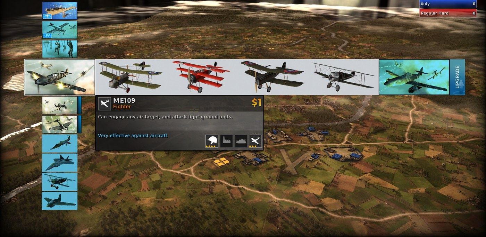<br>
      <sub><b>Listy budowy w grupach.</b> Myśliwce z pierwszej wojny światowej w grupie Me 109.</sub>
    </td>
    <td width="33%" valign="top">
      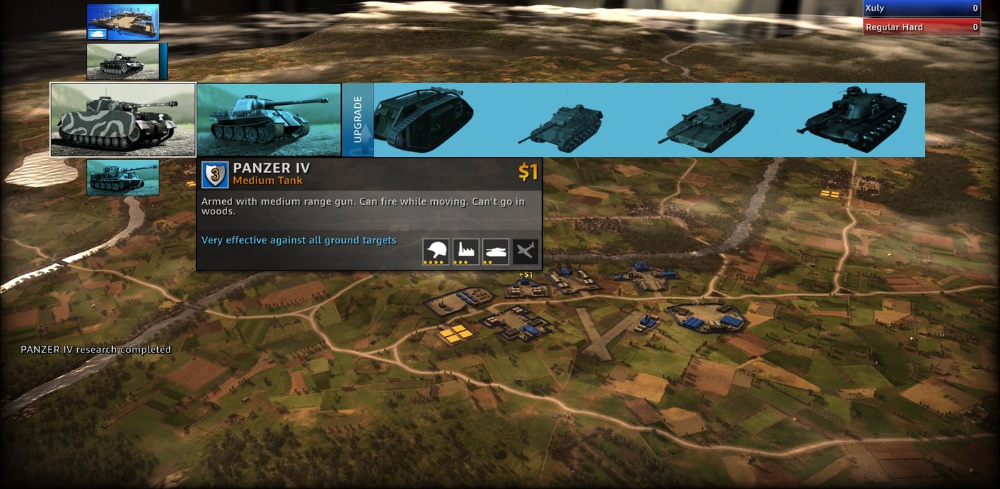<br>
      <sub><b>Każda epoka w jednej grupie.</b> Grupa Panzer IV, od czołgu z pierwszej wojny światowej po nowoczesne.</sub>
    </td>
    <td width="33%" valign="top">
      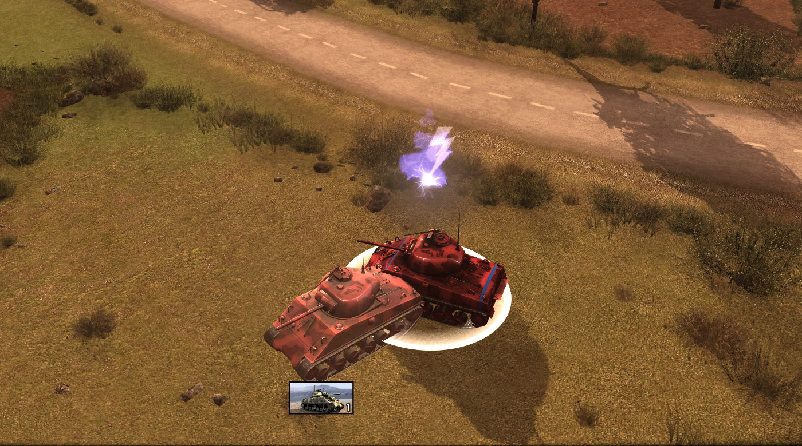<br>
      <sub><b>Jednostki z własnym wyglądem.</b> Przemaluj dowolną jednostkę w Blenderze i wprowadź ją z powrotem.</sub>
    </td>
  </tr>
  <tr>
    <td width="33%" valign="top">
      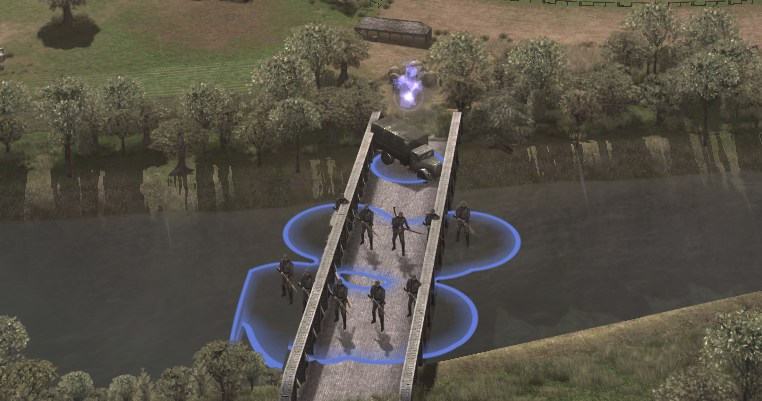<br>
      <sub><b>Mosty, po których przechodzą jednostki.</b> Tam, gdzie twoja droga spotyka wodę, most własnego rodzaju mapy.</sub>
    </td>
    <td width="33%" valign="top">
      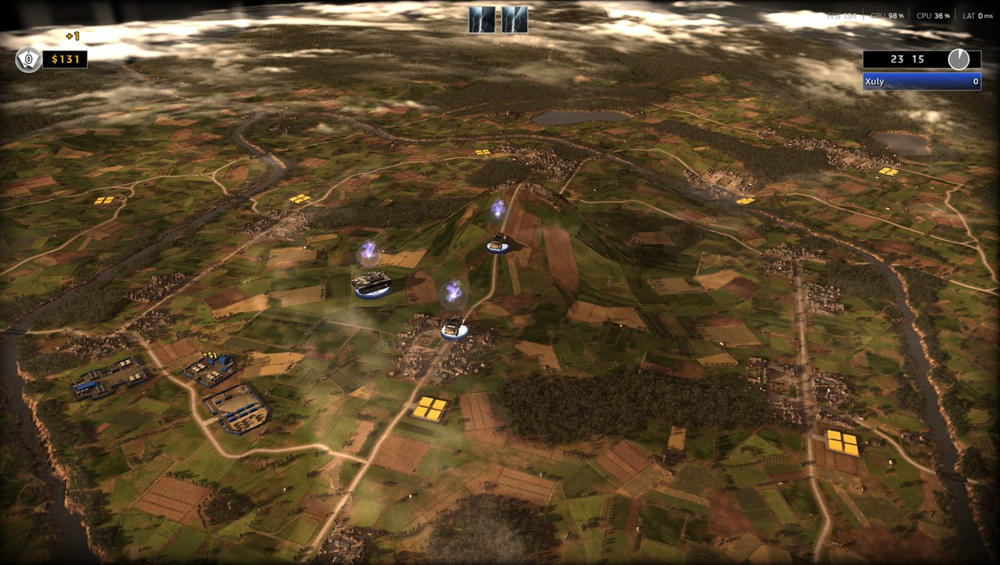<br>
      <sub><b>Teren, który kształtujesz.</b> Wzgórza, kratery, jeziora i wyschnięte rzeki, na których jednostki jeżdżą i walczą.</sub>
    </td>
    <td width="33%" valign="top">
      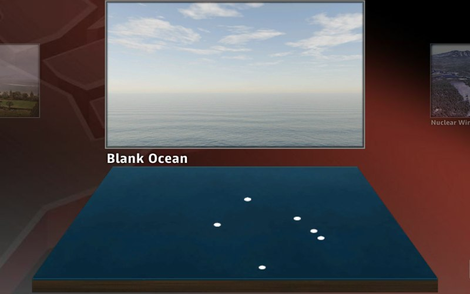<br>
      <sub><b>Nowe mapy</b>, zaczynane od zera, z własnymi obrazami w menu.</sub>
    </td>
  </tr>
  <tr>
    <td width="33%" valign="top">
      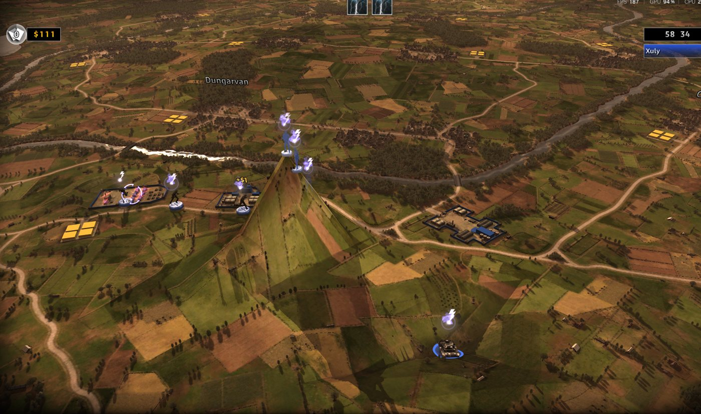<br>
      <sub><b>Namalowana osłona.</b> Piechota na niej jest ukryta.</sub>
    </td>
    <td width="33%" valign="top">
      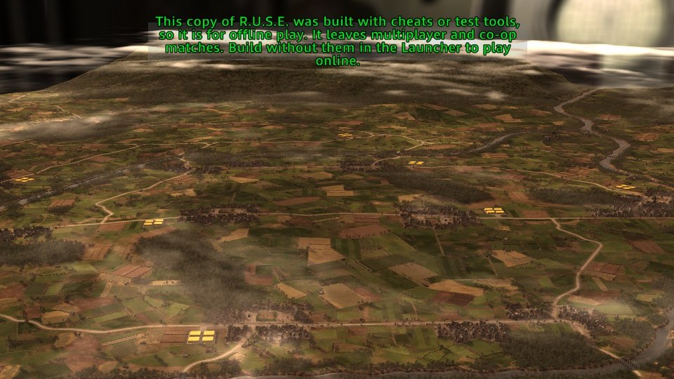<br>
      <sub><b>RUSE Guard.</b> Gra zbudowana z cheatami zostaje offline.</sub>
    </td>
    <td width="33%" valign="top">
      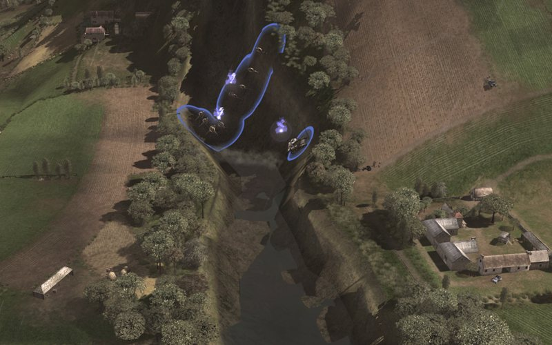<br>
      <sub><b>Osuszona rzeka.</b> Jednostki chodzą po jej korycie.</sub>
    </td>
  </tr>
</table>

## W środku Studio

<table>
  <tr>
    <td width="50%" valign="top">
      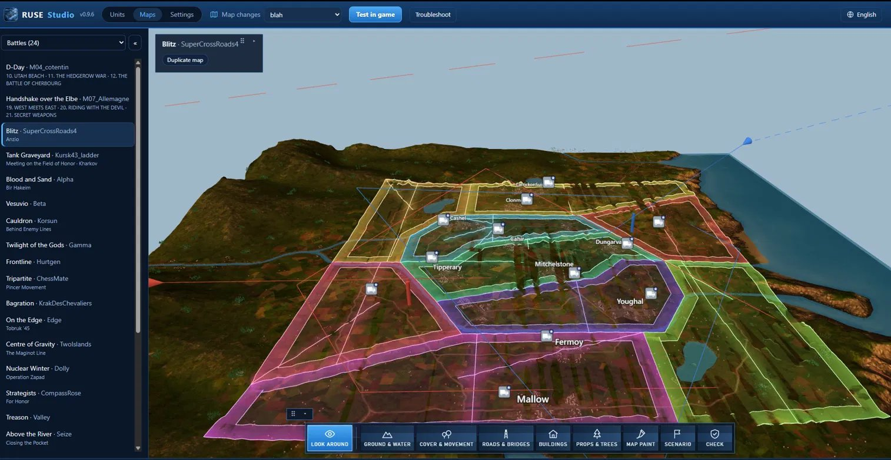<br>
      <sub><b>Każda mapa w 3D.</b> Blitz ze strefami i miastami; narzędzia biegną wzdłuż dołu.</sub>
    </td>
    <td width="50%" valign="top">
      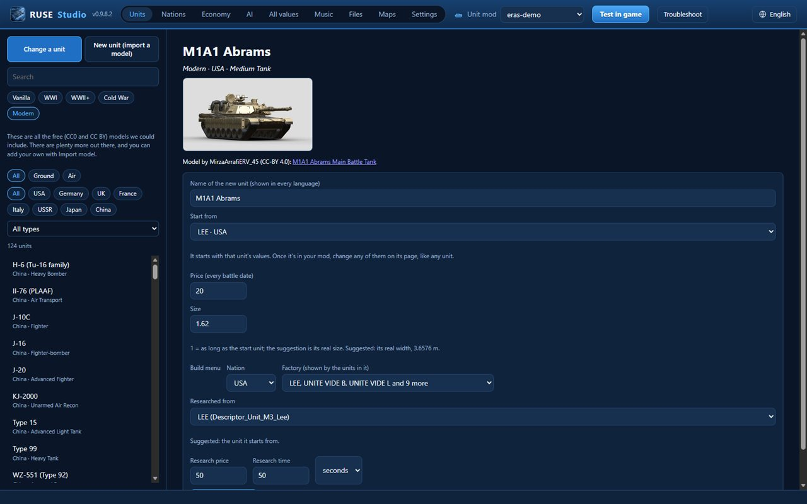<br>
      <sub><b>Jednostki z innych epok</b>, przy każdym modelu podziękowanie dla jego autora.</sub>
    </td>
  </tr>
  <tr>
    <td width="50%" valign="top">
      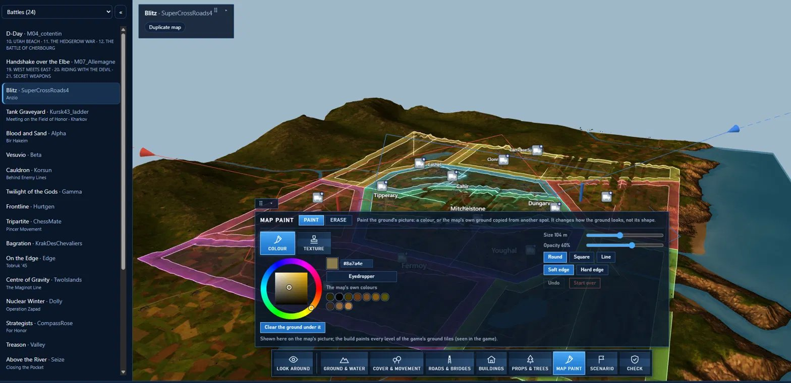<br>
      <sub><b>Malowanie mapy.</b> Maluj obraz terenu.</sub>
    </td>
    <td width="50%" valign="top">
      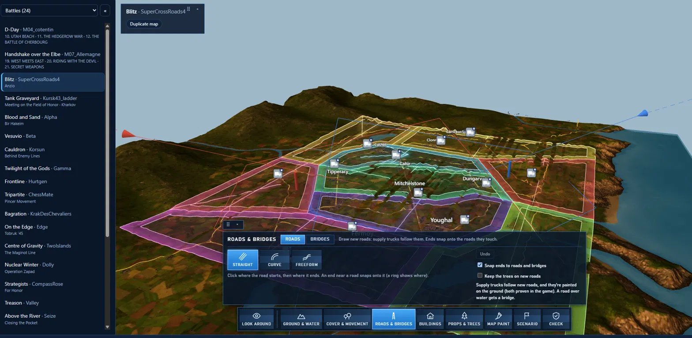<br>
      <sub><b>Drogi i mosty.</b> Proste, łukowe lub odręczne.</sub>
    </td>
  </tr>
  <tr>
    <td width="50%" valign="top">
      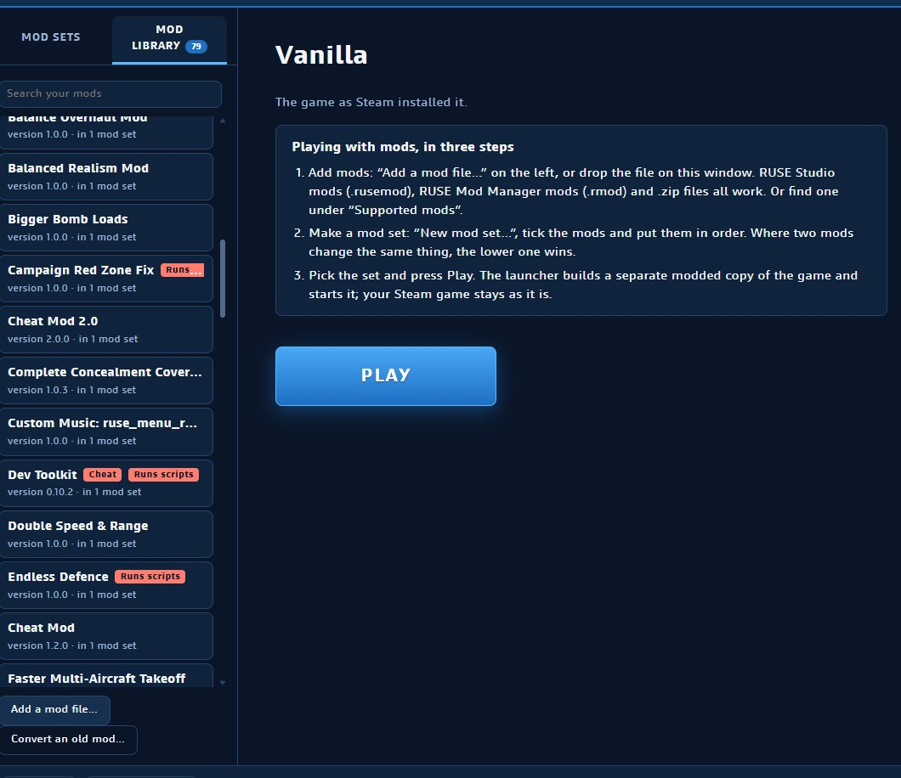<br>
      <sub><b>RUSE Launcher:</b> twoje mody, trzy kroki i Graj.</sub>
    </td>
    <td width="50%" valign="top">
      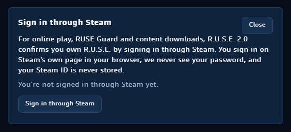<br>
      <sub><b>Logowanie przez Steam.</b> Potwierdza, że masz R.U.S.E.; nigdy nie widzimy twojego hasła.</sub>
    </td>
  </tr>
</table>

## Co dalej

- **Miasta, które rysujesz:** wytycz ulice, oznacz kwartały jako domy, sklepy lub przemysł, a Studio wypełni je
  własnymi budynkami gry.
- **Prawdziwe miejsce jako mapa:** importer map (poniżej).
- **Generowane góry i nasze własne tekstury terenu w wysokiej rozdzielczości**, oraz pędzel pól w Malowaniu mapy,
  który zamienia całe pola w pszenicę, zaoraną ziemię albo zieloną uprawę tak, jak malują je własne mapy gry.

### Importer map: jak stoją sprawy

Importer map zamienia prawdziwe miejsce w mapę R.U.S.E.: jego teren i wzgórza, pola, lasy, rzeki, rowy, plażę
i morze, a jeśli chcesz, także drogi i budynki, wszystko zrobione z własnych elementów gry, by mapa wyglądała i grała
jak mapy samej gry. Wybierzesz miejsce, a Studio zrobi z niego mapę, którą możesz dalej edytować.

Studio już potrafi zbudować mały kawałek prawdziwego miejsca (część Utah Beach) w mapę, która otwiera się w grze.
Jeszcze nie jest dobrze: plaża, woda i teren z bliska wciąż nie wyglądają tak, jak powinny. Dlaczego to trwa:

- **Mapa to wiele warstw, które muszą się zgadzać:** kształt terenu, jego wygląd z bliska, obraz widziany z wysoka,
  woda, to, gdzie jednostki mogą jeździć i się ukrywać, drogi i mosty. Prawdziwe miejsce musi wyjść dobrze w każdej
  z nich naraz, a błąd w jednej widać w pozostałych.
- **Z bliska i z daleka:** gra rysuje swój teren na dwa sposoby i muszą one do siebie pasować. Sprawienie, by kolory
  prawdziwego miejsca wyglądały jak w grze, zarówno z bliska, jak i z nieba, to większość pracy.
- **Woda decyduje, gdzie idą jednostki:** rzeki, rowy i wybrzeże wyznaczają, gdzie mogą poruszać się czołgi
  i piechota. Jedno złe miejsce i czołgi przejeżdżają przez rów albo nie mogą dotrzeć do plaży.
- **Każda zmiana jest sprawdzana w grze:** to jedyny dowód, który się liczy, a każde sprawdzenie oznacza zbudowanie
  mapy i oglądanie jej z wielu miejsc.
- **Wolimy poczekać**, aż prawdziwe miejsce będzie wyglądać i grać jak prawdziwa mapa R.U.S.E., niż wypuścić coś
  zrobionego w połowie.

Dalej: najpierw dopracowana mała mapa testowa, potem cała mapa, potem przycisk Importuj mapę w Studio.

Wszystko, co się zmieniło, wersja po wersji:
[notatki Studio](https://github.com/sneadtristen6/R.U.S.E-2.0-Project/blob/main/.github/release-notes/studio.md) i
[notatki Launchera](https://github.com/sneadtristen6/R.U.S.E-2.0-Project/blob/main/.github/release-notes/launcher.md).

**O nazwie:** R.U.S.E. 2.0 to nazwa tymczasowa. Zanim wyjdzie pełna wersja (1.0), skonsultujemy się z Eugen
Systems, twórcami R.U.S.E., a projekt przyjmie nazwę, która im odpowiada. Pomysły na nazwę i konstruktywna krytyka
są mile widziane w [dyskusji o nazwie](https://github.com/sneadtristen6/R.U.S.E-2.0-Project/discussions/18).

**Co jest w tym repozytorium.** Obie aplikacje i to, czego gracze i modderzy potrzebują, by ich używać. Nasze notatki
robocze o własnych plikach gry pozostają prywatne, dopóki nie dostaniemy wyraźnej zgody od twórców, Eugen Systems.

Wszystko, co tu robimy, ma pomóc społeczności i zaprowadzić tę grę w lepsze miejsce. R.U.S.E. to jedna z moich
ulubionych gier w ogóle i po prostu chcę ją ulepszyć.

**Tylko posiadane kopie.** Projekt R.U.S.E. 2.0 wspiera R.U.S.E. tylko wtedy, gdy masz tę grę na swoim koncie Steam.
Sama gra uruchamia się tylko dla konta Steam, które ją posiada, a nasze narzędzia nigdy tego nie obchodzą: znajdują
grę przez twoją bibliotekę Steam, modują jej osobną kopię i nigdy nie rozpowszechniają plików gry. Nie wspieramy
emulatorów Steam, pirackich kopii ani niczego innego, co pozwala grać bez posiadania gry. Jeśli jej nie masz, te
narzędzia nie zadziałają u ciebie i nie są dla ciebie. Każdą sprawę, którą uznamy za stosowne, zgłosimy dalej.

Masz grę w inny sposób, na przykład w wersji pudełkowej sprzed czasów, gdy R.U.S.E. było na Steamie, albo aplikacje
się pomyliły? Okno w aplikacji pokazuje twój kod i dwa przyciski: otwórz zgłoszenie na Discordzie lub na GitHubie,
a wyślemy ci kod odblokowujący dla twojego PC.

## Instalacja w trzech krokach

1. **Pobierz** instalator z [Releases](https://github.com/sneadtristen6/R.U.S.E-2.0-Project/releases):
   `RUSE-Launcher-Setup-<version>.exe` dla graczy, `RUSE-Studio-Setup-<version>.exe` dla modderów. Tylko Windows.
   Potrzebujesz R.U.S.E. w swojej bibliotece Steam, zainstalowanego.
2. **Uruchom go.** Nie potrzeba uprawnień administratora ani Pythona. Instalatory nie są jeszcze podpisane cyfrowo,
   więc Windows może raz ostrzec („System Windows ochronił ten komputer”): kliknij **Więcej informacji**, potem
   **Uruchom mimo to**. Aby sprawdzić, czy masz prawdziwy plik, porównaj jego SHA-256 z tym w informacjach o wydaniu.
3. **Włącz aplikację** z menu Start. Znajduje R.U.S.E. przez Steam. W Launcherze wybierz zestaw modów i naciśnij
   **Graj**. W Studio zbuduj raz indeks gry, gdy o to poprosi (około minuty), potem wybierz lub zrób mod.

Odinstalowanie zachowuje twoje mody i ustawienia. Aplikacje potrzebują Microsoft Edge WebView2, który ma Windows 11.
Więcej w [installers/README.md](installers/README.md).

<details>
<summary><b>Stan, dokumentacja i współtworzenie</b></summary>

[](https://github.com/sneadtristen6/R.U.S.E-2.0-Project/releases?q=launcher)
[](https://github.com/sneadtristen6/R.U.S.E-2.0-Project/releases?q=studio)
[](https://github.com/sneadtristen6/R.U.S.E-2.0-Project/actions/workflows/tests.yml)
[](LICENSE)

**Launcher** dla graczy (najnowszy: 0.4.8.9) &middot; **Studio** dla modderów, wersja zapoznawcza (najnowsza: 0.9.8.9) &middot; Windows &middot; wymaga R.U.S.E. na Steamie

**[Podręcznik polowy (wiki)](https://github.com/sneadtristen6/R.U.S.E-2.0-Project/wiki/Podr%C4%99cznik-polowy)** &middot;
**[Discussions](https://github.com/sneadtristen6/R.U.S.E-2.0-Project/discussions)** &middot;
**[Discord](https://discord.gg/h54t5baNsC)** &middot; **[Współtworzenie](CONTRIBUTING.md)** &middot;
**[Kodeks postępowania](CODE_OF_CONDUCT.md)** &middot; [docs/MOD_FORMAT.md](docs/MOD_FORMAT.md): wszystko, co może
zrobić mod, plik po pliku.

</details>

<a name="for-contributors"></a>
<details>
<summary><b>Dla współtwórców</b></summary>

Jak zgłaszać błędy, testować w grze i wysyłać kod: [CONTRIBUTING.md](CONTRIBUTING.md).

<details>
<summary><b>Obie aplikacje ze źródeł i instalatory</b></summary>

Obie aplikacje działają na silniku, oddzielnie od siebie (żadna nie potrzebuje drugiej). Obie są oknami na pulpicie
zbudowanymi jak strony internetowe; jednorazowo: `py -3 -m pip install pywebview`. Ich ekrany otwierają się też
w zwykłej przeglądarce z wymyślonymi danymi: `src/ruse_launcher/ui/index.html?fake`, `src/ruse_studio/ui/index.html?fake`.

- **RUSE Launcher** ([`src/ruse_launcher/`](src/ruse_launcher/)), dla graczy: znajduje grę,
  wymienia twoje zestawy modów i ma duży przycisk Graj, który buduje zmodowaną kopię zestawu i uruchamia grę (Oryginał
  uruchamia się przez Steam). `py -3 -m ruse_launcher`. **Gracze nigdy nie dotykają żadnego pliku.** Biblioteka
  modów („Dodaj plik moda…” dla `.rusemod` ze Studio, `.rmod` albo `.zip`, albo upuść plik lub folder moda na okno;
  każdy mod jest najpierw sprawdzany), zestawy modów tworzone na ekranie (nowy, edycja i zmiana kolejności, zmiana
  nazwy, duplikowanie, usuwanie), Udostępnij i „Importuj kolejność ładowania…” dla zestawu modów (własny tekst
  RUSE-Mod-Manager, więc kolejności ładowania przechodzą w obie strony;
  [`src/rusemod/loadorder.py`](src/rusemod/loadorder.py)), trzykrokowy przewodnik w Oryginale („Gra z modami w trzech
  krokach”) i launcher w języku PC (dowolnym z dziesięciu języków gry albo perskim). **Obsługiwane
  mody** (0.3.0): nasza lista modów (repozytorium GitHub, MOD_FORMAT §15) z polami do zaznaczania, kilka instalowanych
  naraz, każdy plik sprawdzany z listą, zanim trafi do biblioteki, mody z cheatami trzymane osobno; offline ostatnia
  kopia listy.
- **RUSE Studio** ([`src/ruse_studio/`](src/ruse_studio/)), dla modderów: przeglądaj każdą jednostkę
  i budynek, zobacz wartości jednostki, jej części i to, co jej używa, i wybierz język: domyślnie własne nazwy gry albo
  dowolny z dziesięciu języków gry, albo perski. Wybierz lub zrób mod i zmieniaj liczby jednostki od razu na jej
  stronie: każda zmiana jest zapisywana w `src/studio.rndf` moda (z Cofnij); część, którą dzieli kilka jednostek,
  zmienia się dla jednej z nich albo dla wszystkich. „Testuj w grze” buduje mod i uruchamia grę. **Mapy** (wydane
  w 0.4): każda mapa, którą wymienia gra, w 3D z jej prawdziwą siatką terenu i teksturami terenu (dekodowanymi raz na
  mapę i zachowywanymi). **Także:**
  - **„Eksportuj mod…”** zamienia mod w jeden plik, `<id>-<version>.rusemod`, z wersją gry i odciskiem moda
    w środku, dla „Dodaj plik moda…” w launcherze (pętla od moddera do gracza).
  - **Nowa jednostka…** na stronie jednostki robi kopię z własną nazwą (jedna nazwa, pokazywana we wszystkich
    dziesięciu językach), ceną i menu budowy (ta sama nacja i fabryka albo inna nacja); jest wymieniona jako nowa,
    edytowana jak każda inna jednostka i można ją usunąć.
  - **W Mapach:** budynki każdej mapy i część jej obiektów i drzew. Wybierz pędzel i kliknij lub przeciągnij po
    terenie, by go kształtować: każde pociągnięcie jest rysowane od razu i zapisywane w `maps/<map>/terrain.toml`
    moda; rampa wymaga dwóch kliknięć (początek, koniec), Cofnij zabiera pociągnięcie, Zacznij od nowa czyści mapę.
    „Umieść na mapie” wymienia własne typy mapy (najczęściej używane najpierw, z wyszukiwaniem); ustaw Obrót
    i Rozmiar, kliknij teren, a obiekt zostaje zapisany w `maps/<map>/scenery.toml` moda. „Testuj w grze” wbudowuje to
    wszystko w mapę.

  `py -3 -m ruse_studio` (po `ruse index build`); `--spike` otwiera sprawdzenie 3D.
- `py -3 -m pip install -e .[apps]` jednorazowo daje dwa polecenia, `ruse-launcher` i `ruse-studio`, które otwierają
  je bez okna konsoli.
- **Instalatory** ([`installers/`](installers/README.md)): GitHub buduje `RUSE-Launcher-Setup-<version>.exe`
  i `RUSE-Studio-Setup-<version>.exe` przy każdym pushu, który zmienia aplikacje (Actions, **apps**, Artifacts). Tag
  `launcher-v<version>` lub `studio-v<version>` publikuje jeden z nich jako Release. Nie potrzeba Pythona ani Gita,
  ani uprawnień administratora. Jeszcze niepodpisane, więc Windows raz ostrzega („Więcej informacji”, potem „Uruchom
  mimo to”).

</details>

</details>

<details>
<summary><b>Narzędzia i kontrole</b></summary>

- [`tools/check_public.py`](tools/check_public.py): uruchamiane przez GitHub przy każdym pushu; zgłasza błąd, jeśli
  prywatne materiały, pliki gry albo szczegóły programu gry trafiłyby do tego publicznego repozytorium.
- [`tools/rmod_to_mod.py`](tools/rmod_to_mod.py): przebudowuje `.rmod` z RUSE-Mod-Manager na nasz mod.

</details>

<details>
<summary><b>Uruchamianie testów</b></summary>

[`tests/`](tests) zawiera testy na małych wymyślonych plikach; gra nie jest potrzebna:

```
py -3 -m unittest discover -s tests
```

(z `PYTHONPATH=src`). GitHub uruchamia je przy każdym pushu, na Windows i Linux
([`.github/workflows/tests.yml`](.github/workflows/tests.yml)).

</details>

## Podziękowania

R.U.S.E. 2.0 stoi na pracy innych ludzi. Bez nich nie byłoby tu nic z tego.

### ProLution: ojciec chrzestny moddingu R.U.S.E.

- Zbudował **RUSE Modding Database** i napisał poradniki, z których ludzie się uczyli, między innymi o własnych
  Operacjach.
- **Kod ProLutiona jest w naszym:** kodek terenu map w
  [`src/ruse_mod_engine/terrain_codec.py`](src/ruse_mod_engine/terrain_codec.py) jest zbudowany na pracy ProLutiona
  nad formatem terenu (wydanej jako CC0), a jego koder jest przeniesiony z kodera referencyjnego ProLutiona. Nasz
  własny czytnik skompresowanych tekstur gry ([`src/rusemod/tgu1.py`](src/rusemod/tgu1.py)) też używa jego kodeka.

### LittleGroove: pierwszy menedżer modów

LittleGroove przetarł szlak dla dużej części tego, co robi R.U.S.E. 2.0: zbudował pierwszy prawdziwy menedżer modów
dla R.U.S.E., a jego silnik wciąż jest częścią naszego.

- **RUSE-Mod-Manager i jego format `.rmod`:** mod jako lista zmian w danych gry, dzięki czemu kilka modów działa
  razem. Mody zrobione w nim działają w Launcherze, a kolejności ładowania są udostępniane w jego formacie tekstowym,
  więc przechodzą między jego Mod Managerem a Launcherem.
- **Jego silnik jest częścią naszego** ([`src/ruse_mod_engine`](src/ruse_mod_engine/), napisany w Pythonie) i to
  przez niego cały program jest na GPL-3.0:
  - nakłada mody `.rmod` w naszych buildach i przenosi mod zrobiony dla innego buildu gry dzięki jego mapom wersji;
    Przekształć stary mod w Launcherze to jego konwerter;
  - nasze narzędzia map czytają i zapisują osłonę gry, siatkę komputera, mosty, drogi i ruch jego modułem `sdb`;
  - Studio pokazuje skrypty gry jako Python dzięki jego czytnikowi skryptów, jego zarysowi tego, co robi misja,
    i jego katalogowi części skryptów, kompiluje zmieniony skrypt jego kompilatorem i Pythonem 2.5.1 gry, który
    zawiera jego silnik, i sprawdza pliki i teksty misji jego łańcuchem scenariusza;
  - nasze zmiany w nim: korzeń drzewa SpatialDB jest zawsze dzielony (korzeń z jednym liściem wywoływał crash gry)
    oraz małe dodatki do jego czytnika terenu i kompilatora skryptów.
- **Czego nauczyły nas jego narzędzia:** odległości, które trzymają składy zaopatrzenia i kwatery główne przy
  drogach, i co mieści skład (oba zmierzone przez niego w grze), kamera otwierająca, od której zaczyna się każdy mecz,
  suma kontrolna, która pozwala grze wczytać zmieniony scenariusz, jak nowe pliki trafiają do paczek gry, i kopiowanie
  amunicji, by dać broni jej własną.
- **Jego Mod Manager miał to pierwszy; Studio ma to we własnym kodzie:** edytory Ekonomii i SI, edytor surowych
  wartości (Wszystkie wartości), łańcuch ulepszeń, przeglądarkę plików, menu, pliki i teksty misji oraz nazwy, strefy
  i szczegóły elementów w edytorze map.

### DomesticNukes: podstawy kreatora map

- **DomesticNukes położył podstawy kreatora map:** teren, po którym chodzą jednostki, miejsce, gdzie stoi każdy
  budynek, drzewo i obiekt, i przepis, którego trzymają się pędzle terenu, by przekształcona mapa się wczytywała i dało
  się na niej grać.
- **DomesticNukes napisał pędzle wody:** jeziora i osuszone rzeki, scalone z własnego pull requesta DomesticNukes.
- **Praca DomesticNukes nad modelami gry** wstawiła prawdziwe modele 3D gry do widoku mapy w Studio i pomogła
  sprawić, że jednostki innej nacji działają.
- Notatki o flagach jednostek, podłogach mostów i tym, jak jednostki stoją na terenie, trafiły do kontroli budowania
  i do mostów, po których jednostki teraz jeżdżą. DomesticNukes testuje też wydania w grze.

### Autorzy modeli jednostek epok

Jednostki z innych epok (Studio 0.9.8.2) to darmowe modele 3D ludzi, którzy je zrobili i udostępnili, na licencji
CC0 lub CC BY. Każdy autor jest wymieniony, z tytułem modelu, licencją i linkiem, na stronie jednostki w Studio,
w pliku podziękowań każdego moda, który go używa (`CREDITS-era-units.md`), i na pełnej liście w
[wydaniu jednostek epok](https://github.com/sneadtristen6/R.U.S.E-2.0-Project/releases/tag/era-units). Co
zmieniliśmy: każdy został dopasowany do gry (obrócony i przeskalowany) i dostał oznaczenia swojej nacji.

### sneadtristen6 i Claude: budowanie R.U.S.E. 2.0

**sneadtristen6 to umysł stojący za R.U.S.E. 2.0.** Pomysły są jego, to on decyduje, czym się to stanie, i każdą
zmianę sam sprawdza, grając, zanim zostanie wydana. **Claude**, SI od Anthropic, pomaga przekuć jego pomysły w plany
i pisze kod. Ramię w ramię od września 2026 zbudowali:

- **Nowe modele 3D w grze:** importer modeli, który wprowadza model jednostki z Blendera lub dowolnego narzędzia 3D
  (pierwszy był M1 Abrams), jednostki przemalowane w Blenderze, własne mundury oddziałów, karty menu budowy i 366
  jednostek z innych epok w prawdziwym rozmiarze.
- **Praca nad teksturami:** Malowanie mapy i jego biblioteka tekstur: teren mapy malowany własnymi teksturami gry,
  terenem z dowolnego miejsca mapy albo własnymi obrazami.
- **Nowe mapy.** 3 października 2026 R.U.S.E. dostało nowe mapy: na liście BITWY obok map gry, każda z własnym
  terenem. Żeby znaleźć limit, dodano 101 naraz; wszystkie się pokazały i dało się na nich grać. Z tego, co wiemy, to
  pierwsze nowe mapy, jakie gra dostała od D-Day. Nowe mapy zaczynają się puste, jako ląd albo otwarte morze, z własnymi
  obrazami w menu.
- **Edytor map, który działa w grze:** teren, po którym jednostki jeżdżą i walczą, jeziora i wyschnięte rzeki, drogi,
  które wyglądają jak własne drogi mapy z wysoka i tuż przy ziemi, mosty, po których przejeżdżają czołgi, piechota
  i ciężarówki zaopatrzenia, budynki, obiekty i drzewa widoczne z każdej odległości, osłona i to, gdzie mogą wejść
  jednostki.
- **Jednostki:** zmiana dowolnej z nich, tworzenie nowych, czołgi i samoloty innej armii dla nacji, samoloty
  w dowolnej roli, pojazdy rozpoznawcze, broń, która trafia samoloty, każda flaga i liczba wyjaśniona oraz nacja
  zamieniona w inną.
- **Muzyka i misje:** utwory i kwestie głosowe zastępowane w Studio oraz własne misje.
- **Dwie aplikacje w jedenastu językach** (dziesięciu językach gry i perskim), Studio dla modderów i Launcher dla graczy, które nigdy nie dotykają
  własnego folderu gry, z kontrolą, która zatrzymuje mod, który zepsułby grę, zanim ta wystartuje.
- **Kod:** wszystko w `src/rusemod`, `src/ruse_studio` i `src/ruse_launcher` jest nasze, napisane dla
  R.U.S.E. 2.0. Inni, na których pracy się opiera, są wymienieni powyżej i w
  [THIRD_PARTY_NOTICES.md](THIRD_PARTY_NOTICES.md).

To dopiero początek i przed nami dużo więcej. Dziękujemy wszystkim powyżej, bez których nic z tego by się nie zaczęło.

### (Anonyme) Oozaru: testowanie i debugowanie

**(Anonyme) Oozaru testował wczesne aplikacje na swoim własnym modzie kampanii i wysyłał log z każdym znalezionym
błędem.** Jego zgłoszenia doprowadziły do tych poprawek:

- Postawione obiekty, które pokazywały się tylko z bliska, są teraz rysowane aż do dalekiej odległości (Studio 0.9.3).
- Jego jednostki dla gracza w rozdziale kampanii nigdy się nie pojawiały; teraz można je dać graczowi.
- Jego francuskie jednostki na Holandii wywoływały crash gry podczas wczytywania; jednostki innej nacji wczytują się
  teraz także w rozdziałach kampanii i Operacjach (0.9.5).
- Ustalił, która z nazw IR rozdziału 1 Włoch jest którą stroną: gracz USA, Francja, Włochy, Wielka Brytania
  i komputer USA.
- Jego „czekanie 30 minut za każdym razem tylko po to, by dodać albo usunąć jednostkę” to powód, dla którego **Graj**
  startuje teraz od razu, gdy nic się nie zmieniło (Launcher 0.4.6).

Dziękujemy też wszystkim, którzy wypróbowali aplikacje, wysłali zrzuty ekranu i zgłosili błędy.

### Podziękowania dla wspierających

Nazwy wspierających są dodawane tutaj, gdy wspierający wybierze publiczną nazwę do podziękowań.

#### Monumental Supporters

Wyraźne, osobiste podziękowanie dla wspierających za $100, którzy pomagają położyć fundamenty pod R.U.S.E. 2.0
i wizję Pacific Defense, z Iwo Jimą jako mapą flagową, oraz Chin. Ta grupa pojawia się jako pierwsza
w podziękowaniach dla wspierających.

#### Above & Beyond Supporters

Podziękowanie i nazwa w podziękowaniach dla wspierających za $20, którzy robią więcej, niż trzeba, by pomóc utrzymać
tempo prac.

## Wspieraj rozwój

R.U.S.E. 2.0 to mój pierwszy projekt moddingowy. Jeśli chcesz wspierać rozwój i śledzić pracę za kulisami,
[odwiedź mój Patreon](https://www.patreon.com/SneadTristen6). Każde wsparcie pomaga mi dalej budować.

### Jednorazowe opcje wsparcia

| Opcja | Kwota | Wyróżnienie |
| --- | --- | --- |
| [Above & Beyond Supporter](https://www.patreon.com/SneadTristen6/posts/171328212) | $20 jednorazowo | Wybrana przez ciebie nazwa w sekcji Above & Beyond Supporters podziękowań na GitHubie i w modach. |
| [Monumental Supporter](https://www.patreon.com/SneadTristen6/posts/monumental-100-171328695) | $100 jednorazowo | Wyraźne wyróżnienie w sekcji Monumental Supporters, z osobnym podziękowaniem za pomoc w kładzeniu fundamentów pod wizję projektu. |

Zawsze wyobrażałem sobie **Iwo Jimę jako mapę flagową rozszerzenia w stylu DLC Pacific Defense**, obok dodania
**Chin** do gry. Wsparcie pomaga mi zbliżać się do tego marzenia. To cele rozwoju tego niezależnego projektu
fanowskiego.

Podziękowanie jest opcjonalne: po zakupie wyślij wiadomość na Patreonie z wybraną publiczną nazwą i zgodą na jej
opublikowanie albo pozostań anonimowo. Podziękowania są aktualizowane wraz z wydaniami projektu. Te zakupy w Sklepie
nie odnawiają się automatycznie.

Możesz też [zamówić funkcję za jednorazowe $3](https://www.patreon.com/SneadTristen6/posts/request-r-u-s-e-171321812).

## Pytania? Zapytaj dowolną SI

Wszystko tutaj jest spisane prostymi słowami, więc dowolny asystent SI (ChatGPT, Claude, Gemini...) może na tej
podstawie odpowiedzieć. Daj mu link do **[ai/START-HERE.md](ai/START-HERE.md)**, strony napisanej dla asystentów SI
(gdzie jest każda odpowiedź, słowa aplikacji, co jest przetestowane), albo do tej strony, i zapytaj, o co chcesz:

- *„Jak dać USA niemieckiego Tigera za pomocą RUSE Studio?”*
- *„Jak narysować drogę z mostem przez rzekę?”*
- *„Mój test w grze zatrzymał się z błędem. Co to znaczy?”*
- *„Co robi plik scenario.toml moda?”*

Najlepsza strona, na którą go skierować: [docs/MOD_FORMAT.md](docs/MOD_FORMAT.md) (wszystko, co może zrobić mod, plik
po pliku). Nadal nie wiesz, co robić? Otwórz [issue](https://github.com/sneadtristen6/R.U.S.E-2.0-Project/issues).

## Licencja

GNU General Public License, wersja 3 ([LICENSE](LICENSE), GPL-3.0): copyright (C) 2026 sneadtristen6 i współtwórcy
RUSE Mod Platform. Aplikacje zawierają [`src/ruse_mod_engine`](src/ruse_mod_engine/), silnik RUSE-Mod-Manager
autorstwa LittleGroove'a (GPLv3), używany taki, jaki jest (zobacz Podziękowania), a jego licencja wymaga, by cały
program był na GPL-3.0 (był na MIT do 2026-09-30). `src/ruse_mod_engine/python251` zawiera licencję Pythona
([jej LICENSE.txt](src/ruse_mod_engine/python251/LICENSE.txt)). To niezależne narzędzie zrobione przez fanów,
niezwiązane z Eugen Systems ani przez nie niepopierane. R.U.S.E. i jego dane gry należą do ich właścicieli; ten
projekt nie rozpowszechnia żadnych plików gry i działa tylko na kopii gry, którą posiadasz.
