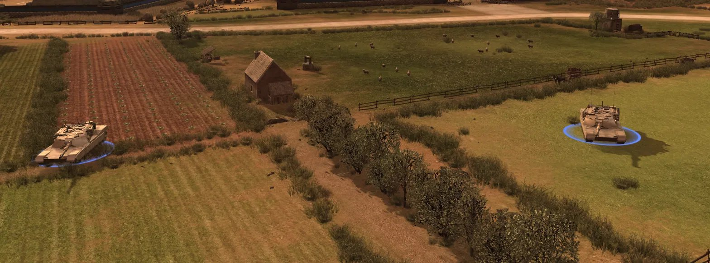
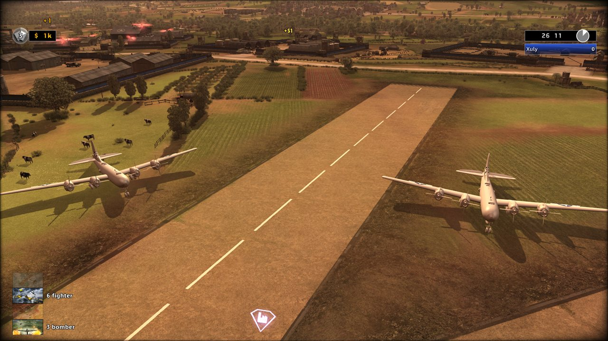
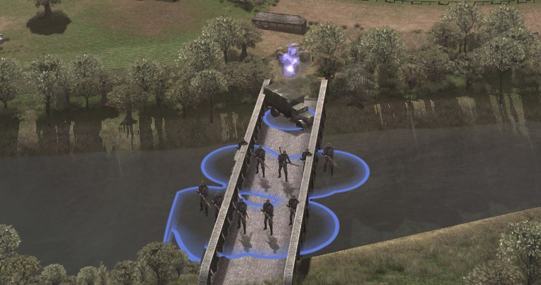
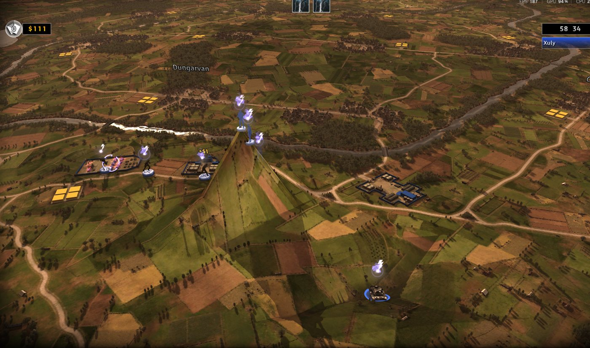
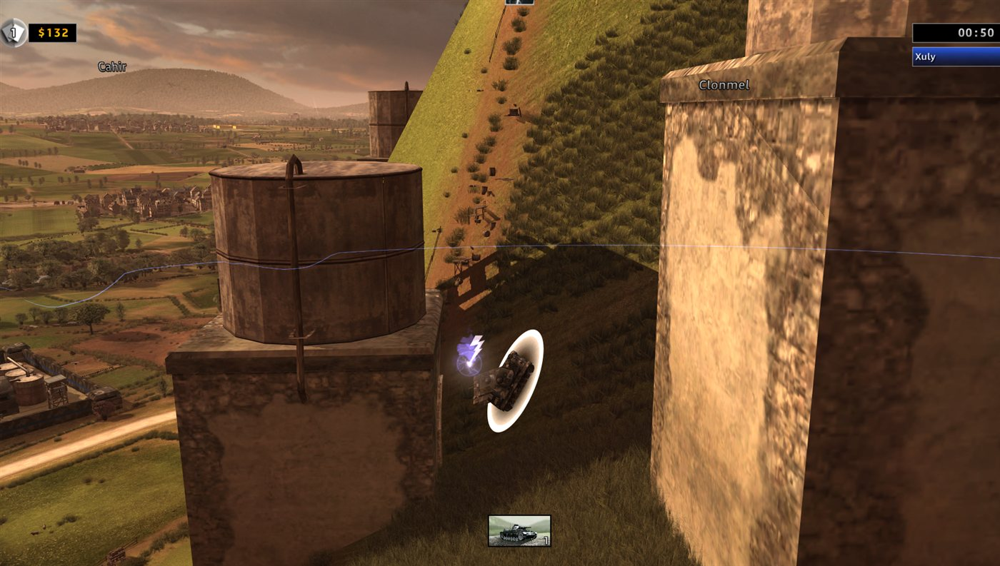
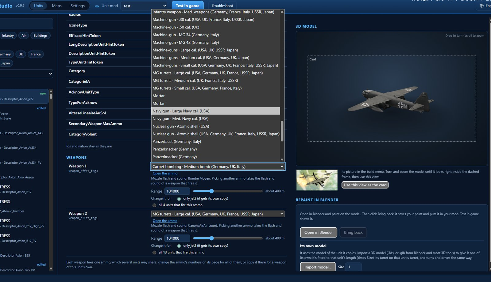
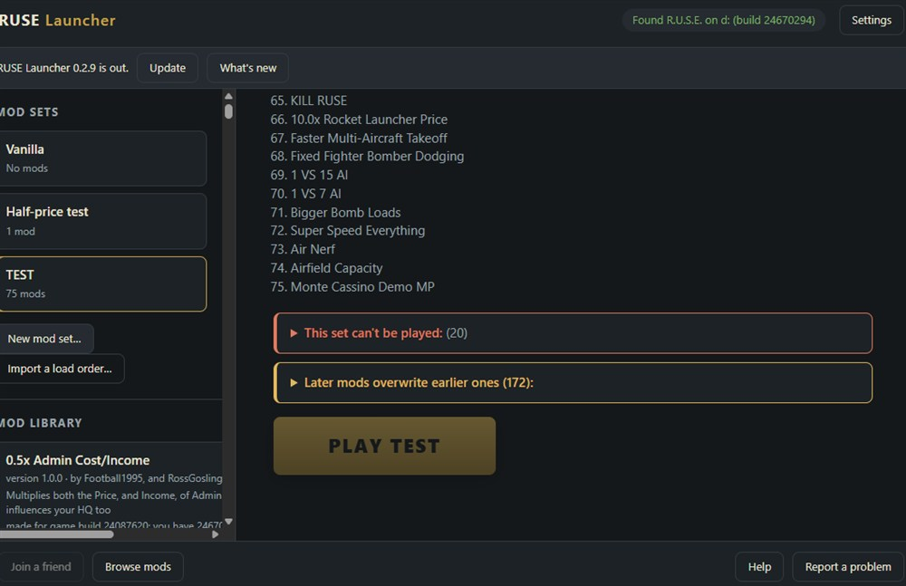

<div align="center">

# R.U.S.E. 2.0

**先打造战场，再在上面作战。**

[English](README.md) · [Français](README.fr.md) · [Deutsch](README.ger.md) · [Italiano](README.ita.md) · [Español](README.spa.md) · [Polski](README.pol.md) · [Русский](README.ru.md) · [Čeština](README.cz.md) · [日本語](README.jpn.md) · **简体中文** · [فارسی](README.fa.md)


[](https://github.com/sneadtristen6/R.U.S.E-2.0-Project/releases?q=launcher)
&nbsp;&nbsp;
[](https://github.com/sneadtristen6/R.U.S.E-2.0-Project/releases?q=studio)
&nbsp;&nbsp;
[](https://www.patreon.com/SneadTristen6)

<sub>Windows。需要 Steam 上的 R.U.S.E.。绝不会改动你的 Steam 安装。</sub>

</div>

> [!TIP]
> **如何安装和游玩（5 分钟）：**
> 1. 打开 [Launcher 发布页](https://github.com/sneadtristen6/R.U.S.E-2.0-Project/releases?q=launcher)，选最新的那个（标有 **Latest**），在 **Assets** 下点击 **RUSE-Launcher-Setup-0.4.8.9.exe**。
> 2. 运行它。如果 Windows 显示“Windows 已保护你的电脑”：点 **更多信息**，再点 **仍要运行**。
> 3. 打开 **RUSE Launcher**：它会自己通过 Steam 找到 R.U.S.E.。
> 4. 点击 **支持的模组**，勾选你想要的模组，然后按 **安装**。
> 5. 把它们放进一个模组组合（**新建模组组合…**），然后按 **开始游戏**。
>
> 每一步的做法，以及出问题时该怎么办：**[安装与游玩](https://github.com/sneadtristen6/R.U.S.E-2.0-Project/wiki/%E5%AE%89%E8%A3%85%E4%B8%8E%E6%B8%B8%E7%8E%A9)**。
> 想制作模组的话，用同样的方法从
> [Studio 发布页](https://github.com/sneadtristen6/R.U.S.E-2.0-Project/releases?q=studio) 获取 **RUSE Studio**，然后从
> [你的第一个模组](https://github.com/sneadtristen6/R.U.S.E-2.0-Project/wiki/%E4%BD%A0%E7%9A%84%E7%AC%AC%E4%B8%80%E4%B8%AA%E6%A8%A1%E7%BB%84) 开始。

## R.U.S.E. 是什么

**R.U.S.E.**（2010）是 Eugen Systems 制作的第二次世界大战即时战略游戏。整条战线都摆在一张地图桌上，你可以从作战室一路缩放到单独一辆坦克；战斗的胜负既靠武力，也同样靠欺骗：**计谋卡** 能隐藏你的单位、佯装进攻、破解敌人的计划，或让你的部队加速。游戏有战役、行动，以及在从诺曼底到突尼斯的各种地图上进行的遭遇战和多人战斗。

## R.U.S.E. 2.0 是什么

**为 R.U.S.E. 带来新地图、新单位，以及一键开玩的模组游戏。** 两个免费应用：

- **RUSE Launcher，给玩家用。** 选一组模组，按 **开始游戏**。就这么简单。
- **RUSE Studio，给模组作者用。** 修改任何单位，用它们自己的 3D 模型制作新单位，从一张白纸开始制作地图或重塑游戏自带的地图，然后按 **在游戏中测试**。

**在游戏启动前就检查好。** Studio 用游戏读取的方式读取你的模组：任何会在游戏中出问题的东西都会先被拦下，并附上一条说明要改什么的提示。目标是：你做的东西每次都能在游戏中运行，而且第一次就能。

**只改数据。** 这里的模组只修改游戏的数据，而且是在一份单独的游戏副本中修改，仅此而已。你的 Steam 安装永远不会被改动。

**开源**（GPL-3.0），支持十一种语言：游戏的十种，再加上波斯语。

<table>
  <tr>
    <td width="33%" valign="top">
      <br>
      <sub><b>你自己的坦克。</b> 一辆在别的 3D 程序中建模的 M1 Abrams，出现在游戏里。</sub>
    </td>
    <td width="33%" valign="top">
      <br>
      <sub><b>从一战到今天，全在一起。</b> 同一座机场上的双翼机、轰炸机和喷气机。</sub>
    </td>
    <td width="33%" valign="top">
      <br>
      <sub><b>你画的道路。</b> 和地图自带的道路一样，无论从高处看还是贴近地面看。</sub>
    </td>
  </tr>
</table>

## R.U.S.E. 2.0 带来的改变

### 单位

- **修改任何单位：** 它的价格、装甲、速度、武器以及其他每一个数值，可以撤销，然后 **在游戏中测试**。
- **每个旗标和数值都有说明**，用简单的话和简单的单位（米、km/h、秒）：它的作用、游戏中的单位处在什么范围，以及一个从其基础数值出发的滑块。已知会让游戏崩溃的旗标会被拦下，并给出修复办法。
- **新单位：** 从任意单位开始，把它放进任何国家的建造菜单，需要研究或开局就能购买。
- **任何角色的飞机**（战斗机、战斗轰炸机、带弹舱的轰炸机、侦察机）、**侦察车辆**，以及 **能打地面、飞机或两者都能打的武器**。
- **你自己的 3D 模型：** 从 Blender 或任何 3D 工具导入模型，在 Blender 中重新涂装任何单位，给一个班组它自己的制服，选择班组乘坐的卡车，并制作它在建造菜单中的卡片。
- **从一战到今天的 366 个单位：** 其他作者的免费模型，每个都已署名，按真实尺寸制作，并像游戏自带的单位一样经过考证。
- **国家：** 把游戏七个国家中的一个变成另一个国家，拥有自己的名称和旗帜；一次隐藏或填满一个国家的单位。
- **建筑和它们生产的东西：** 每个国家的建筑，按它们建造菜单提供的单位排成行；放入单位、移动它们、复制另一个国家的，或让它们从另一个单位研究而来。**添加建筑：** 游戏中某座建筑的副本，或一座拥有自己单位的建筑，在建造栏中有它自己的标签，有它自己的 3D 外观和建造菜单图片。
- **你自己的弹药名称和旗标类型：** 用所有语言为复制的弹药重新命名；把游戏的旗标组成一个有名称的组合，交给任何单位。

### 地图

- **新地图**，在“战斗”中和游戏自带的地图列在一起。从 **空白陆地或开阔海面** 开始，按游戏的尺寸或更大，在菜单中给它们自己的图片，并绘制它们的扇区。
- **塑造地形：** 山丘、弹坑、高台、斜坡、整平和平滑过的地面；湖泊和排干的河流。单位能在上面行驶和作战。
- **道路和桥梁：** 直线、曲线或手绘的道路，补给卡车会沿着走；道路跨水的地方会有地图自带的那种桥，坦克、步兵和卡车都能通过。还可以拆掉地图自带的桥并封闭它们的通行处。
- **建筑、道具和树木：** 一个一个地放置，或按网格、方框放置，或沿路径放置（树篱和林带），建筑会面向道路；选择、移动、旋转、缩放和删除它们，地图自带的也可以；清除地图的树林和道具。**导入模型** 把一个 3D 模型变成你地图自己的岩石、道具、植物或树木。
- **掩护与通行：** 绘制单位隐蔽其中的城镇和树林，并对所有单位、步兵或车辆封闭地面。地图会显示每一笔改变了什么。
- **地图绘制：** 用一种颜色、地图上别处的地面、游戏的纹理、你自己的图片或网上的免费纹理来绘制地面的图像。
- **场景和任务：** 移动起始点，添加战斗开始时就有的单位，以及带目标、事件和镜头移动的你自己的任务，用于行动和战役章节。

### 游戏规则

- **AI 与玩家设置**，一个标签页：
  - **玩家设置：** 初始资金和收入、补给站及其卡车、每一方开局拥有的计谋卡，普通战斗和核战争战斗分开设置。
  - **电脑玩家：** 他们在每个难度和每种性格下的每一个数值、他们偏好的单位和他们的计谋卡，每个数值都有说明。
  - **游戏规则：** 另外 172 个游戏数值，分为 16 组（战斗与投降、人口、移动、射击、伤害、树林与掩护、飞机、计谋卡的效果、阵营和扇区的颜色，及其他），每个都有说明。
- **所有数值和文件：** 游戏数据中的每一个对象和数值，都可以在你的模组中修改。

### 声音与动画：RUSE Decoy

- **游戏中的每个声音**，按类别：播放、调大或调小，或替换；在战斗列表中加入新歌曲；为任务台词重新配音。
- **动画：** 把一个片段换成另一个，让它变慢或变快，放大或旋转一根骨骼，或把动作捕捉放到士兵身上，来自一个包含 3,205 个免费动作的库（CMU 数据库和 100STYLE，已署名）。

### 给玩家

- **一键开玩：** 选一个模组组合，按 **开始游戏**；Launcher 会构建一份单独的模组版副本并启动它。
- **金色的 R.U.S.E. 2.0：** 模组游戏以一段战斗场景开场，它的菜单和加载画面都显示金色的 R.U.S.E. 2.0（如果你更喜欢游戏自己的标题，可以在 设置 中保留它）。
- **社区模组原样可用**（也包括 RUSE-Mod-Manager 的 `.rmod`），一个可以勾选的支持模组列表，与 RUSE-Mod-Manager 双向共享的加载顺序，以及一个能找出是什么阻止了开始游戏、并把它修好的故障排除工具。
- **自动更新**，支持十一种语言：游戏的十种，再加上波斯语。

## 在游戏中看看

<table>
  <tr>
    <td width="33%" valign="top">
      <br>
      <sub><b>在田野里。</b> 农场旁的两辆 M1 Abrams。</sub>
    </td>
    <td width="33%" valign="top">
      <br>
      <sub><b>新的轰炸机</b>，停在 R.U.S.E. 的机场上。</sub>
    </td>
    <td width="33%" valign="top">
      <br>
      <sub><b>有自己外观的单位。</b> 在 Blender 中重新涂装任何单位，再把它带回游戏。</sub>
    </td>
  </tr>
  <tr>
    <td width="33%" valign="top">
      <br>
      <sub><b>单位能通过的桥。</b> 你的道路遇到水的地方，会有地图自带的那种桥。</sub>
    </td>
    <td width="33%" valign="top">
      <br>
      <sub><b>你塑造的地形。</b> 单位能在上面行驶和作战的山丘、弹坑、湖泊和干涸的河流。</sub>
    </td>
    <td width="33%" valign="top">
      <br>
      <sub><b>新地图</b>，从空白开始，有它们自己的菜单图片。</sub>
    </td>
  </tr>
  <tr>
    <td width="33%" valign="top">
      <br>
      <sub><b>绘制的掩护。</b> 站在上面的步兵会被隐藏。</sub>
    </td>
    <td width="33%" valign="top">
      <br>
      <sub><b>放置的建筑是实体的。</b> 坦克会绕过去。</sub>
    </td>
    <td width="33%" valign="top">
      <br>
      <sub><b>排干的河流。</b> 单位可以在河床上走。</sub>
    </td>
  </tr>
</table>

## Studio 里面

<table>
  <tr>
    <td width="50%" valign="top">
      <br>
      <sub><b>每张地图都是 3D 的。</b> 带有区域和城镇的“闪电战”；工具排在底部。</sub>
    </td>
    <td width="50%" valign="top">
      <br>
      <sub><b>单位。</b> 一个单位的数值、旗标和武器，它的 3D 模型和它的卡片。</sub>
    </td>
  </tr>
  <tr>
    <td width="50%" valign="top">
      <br>
      <sub><b>地图绘制。</b> 绘制地面的图像。</sub>
    </td>
    <td width="50%" valign="top">
      <br>
      <sub><b>道路和桥梁。</b> 直线、曲线或手绘。</sub>
    </td>
  </tr>
  <tr>
    <td width="50%" valign="top">
      <br>
      <sub><b>其他时代的单位</b>，每个模型的作者都已署名。</sub>
    </td>
    <td width="50%" valign="top">
      <br>
      <sub><b>RUSE Launcher：</b> 一个包含 75 个社区模组的组合，以及哪些覆盖哪些。</sub>
    </td>
  </tr>
</table>

## 接下来

- **你画的城镇：** 规划好街道，把街区标为住宅、商店或工业，Studio 会用游戏自带的建筑把它们填满。
- **把真实地点做成地图：** 地图导入器（见下文）。
- **生成的山脉和我们自己的高分辨率地面纹理**，以及地图绘制的田地画笔，它能把整片田地变成小麦、翻耕过的泥土或绿色作物，就像游戏自带的地图那样绘制。

### 地图导入器：进展如何

地图导入器把一个真实的地点变成一张 R.U.S.E. 地图：它的地面和山丘、田地、树林、河流、沟渠、海滩和大海，以及（如果你需要的话）它的道路和建筑，全部用游戏自己的部件制作，让地图的外观和玩法都像游戏自带的一样。你选一个地点，Studio 就会把它做成一张你可以继续编辑的地图。

Studio 已经能把真实地点的一小块（犹他海滩的一部分）构建成一张能在游戏中打开的地图。但它还不对：海滩、水面和近处的地面看起来仍然不是应有的样子。为什么要花这么久：

- **一张地图由许多必须彼此吻合的图层组成：** 地面的形状、它近看的样子、从高处看到的图像、水、单位能在哪里行驶和隐蔽、道路和桥梁。一个真实的地点必须同时在每一层都做对，一层出错就会在其他层显现出来。
- **近处和远处：** 游戏用两种方式绘制地面，而这两种必须一致。让一个真实地点的颜色看起来像游戏的颜色，无论近看还是从空中看，这是大部分的工作。
- **水决定单位能去哪里：** 河流、沟渠和海岸决定坦克和步兵能在哪里移动。一处出错，坦克就会开过沟渠，或者到不了海滩。
- **每一项改动都要在游戏中检查：** 这是唯一算数的证明，而每次检查都意味着要构建地图，并从许多地方去看它。
- **我们宁愿等待**，直到一个真实地点的外观和玩法都像真正的 R.U.S.E. 地图，也不愿推出半成品。

下一步：先把小测试地图做对，然后是一整张地图，然后是 Studio 的“导入地图”按钮。

每个版本改了什么：
[Studio 更新说明](https://github.com/sneadtristen6/R.U.S.E-2.0-Project/blob/main/.github/release-notes/studio.md) 和
[Launcher 更新说明](https://github.com/sneadtristen6/R.U.S.E-2.0-Project/blob/main/.github/release-notes/launcher.md)。

**关于名称：** R.U.S.E. 2.0 只是一个暂定名。在完整版（1.0）推出之前，我们会咨询 R.U.S.E. 的制作者 Eugen
Systems，项目会采用一个他们认可的名称。欢迎在[名称讨论](https://github.com/sneadtristen6/R.U.S.E-2.0-Project/discussions/18)中提出名称建议和建设性的批评。

**这个仓库里有什么。** 两个应用，以及玩家和模组作者使用它们所需的东西。我们关于游戏自身文件的工作笔记会保持私有，直到我们得到开发者 Eugen Systems 的明确同意。

我们在这里做的一切，都是为了帮助社区，让这款游戏变得更好。R.U.S.E. 是我一直以来最喜欢的游戏之一，我只是想让它变得更好。

**仅限正版。** R.U.S.E. 2.0 项目只在你的 Steam 账号拥有 R.U.S.E. 时才提供支持。游戏本身只会为拥有它的 Steam 账号启动，我们的工具绝不会绕过这一点：它们通过你的 Steam 库找到游戏，修改它的一份单独副本，并且从不分发游戏的文件。我们不支持 Steam 模拟器、盗版副本，或任何让人不拥有游戏也能玩的东西。如果你没有这款游戏，这些工具对你无法使用，也不是为你准备的。凡是我们认为有必要的情况，我们都会进一步处理。

用别的方式拥有它，比如 R.U.S.E. 上架 Steam 之前的盒装版，或者应用判断错了？应用里的那个框中有你的代码和两个按钮：在 Discord 或 GitHub 上开一个工单，我们会给你发送一个适用于你这台电脑的解锁码。

## 三步安装

1. 从 [Releases](https://github.com/sneadtristen6/R.U.S.E-2.0-Project/releases) **下载** 安装程序：
   玩家用 `RUSE-Launcher-Setup-<version>.exe`，模组作者用 `RUSE-Studio-Setup-<version>.exe`。仅限 Windows。你的 Steam 库中需要有 R.U.S.E.，并且已经安装。
2. **运行它。** 不需要管理员权限，也不需要 Python。安装程序还没有代码签名，所以 Windows 可能会警告一次
   （“Windows 已保护你的电脑”）：点击 **更多信息**，再点 **仍要运行**。要确认你拿到的是真正的文件，可以把它的 SHA-256 与更新说明中的对比。
3. 从开始菜单 **启动它**。它会通过 Steam 找到 R.U.S.E.。在 Launcher 中，选一个模组组合，然后按
   **开始游戏**。在 Studio 中，它询问时先构建一次游戏索引（大约一分钟），然后选择或新建一个模组。

卸载会保留你的模组和设置。应用需要 Microsoft Edge WebView2，Windows 11 自带。更多内容见
[installers/README.md](installers/README.md)。

<details>
<summary><b>状态、文档和参与贡献</b></summary>

[](https://github.com/sneadtristen6/R.U.S.E-2.0-Project/releases?q=launcher)
[](https://github.com/sneadtristen6/R.U.S.E-2.0-Project/releases?q=studio)
[](https://github.com/sneadtristen6/R.U.S.E-2.0-Project/actions/workflows/tests.yml)
[](LICENSE)

**Launcher** 给玩家（最新：0.4.8.9）&middot; **Studio** 给模组作者，预览版（最新：0.9.8.9）&middot; Windows &middot; 需要 Steam 上的 R.U.S.E.

**[野战手册（wiki）](https://github.com/sneadtristen6/R.U.S.E-2.0-Project/wiki/%E9%87%8E%E6%88%98%E6%89%8B%E5%86%8C)** &middot;
**[Discussions](https://github.com/sneadtristen6/R.U.S.E-2.0-Project/discussions)** &middot;
**[Discord](https://discord.gg/h54t5baNsC)** &middot; **[参与贡献](CONTRIBUTING.md)** &middot;
**[行为准则](CODE_OF_CONDUCT.md)** &middot; [docs/MOD_FORMAT.md](docs/MOD_FORMAT.md)：一个模组能做的一切，
逐个文件说明。

</details>

<a name="for-contributors"></a>
<details>
<summary><b>给贡献者</b></summary>

如何报告错误、在游戏中测试和提交代码：[CONTRIBUTING.md](CONTRIBUTING.md)。

<details>
<summary><b>从源码运行两个应用，以及安装程序</b></summary>

两个应用都运行在引擎之上，彼此独立（谁都不需要另一个）。两者都是像网页一样构建的桌面窗口；只需执行一次：`py -3 -m pip install pywebview`。它们的界面也能在普通浏览器中用虚构的数据打开：`src/ruse_launcher/ui/index.html?fake`、`src/ruse_studio/ui/index.html?fake`。

- **RUSE Launcher**（[`src/ruse_launcher/`](src/ruse_launcher/)），给玩家：它找到游戏，列出你的模组组合，有一个大大的“开始游戏”按钮，会构建该组合的模组版副本并启动游戏（原版通过 Steam 启动）。`py -3 -m ruse_launcher`。**玩家从不需要碰任何文件。** 一个模组库（“添加模组文件…”可添加 Studio 导出的 `.rusemod`、`.rmod` 或 `.zip`，也可以把模组文件或文件夹拖到窗口上；每个模组都会先经过检查），在界面上制作的模组组合（新建、编辑和排序、重命名、复制、删除），模组组合的“分享”和“导入加载顺序…”（使用 RUSE-Mod-Manager 自己的文本格式，所以加载顺序可以双向互通；[`src/rusemod/loadorder.py`](src/rusemod/loadorder.py)），原版上的三步指南（“使用模组游玩，只需三步”），以及使用电脑自身语言的 Launcher（游戏十种语言中的任意一种，或波斯语）。**支持的模组**（0.3.0）：我们的模组列表（一个 GitHub 仓库，MOD_FORMAT §15），带勾选框，可一次安装多个，每个文件进入模组库前都会与列表核对，作弊模组单独存放；离线时使用列表的最后一份副本。
- **RUSE Studio**（[`src/ruse_studio/`](src/ruse_studio/)），给模组作者：浏览每个单位和建筑，查看一个单位的数值、部件以及有什么在使用它，并选择语言：默认是游戏自己的名称，也可以是游戏十种语言中的任意一种，或波斯语。选择或新建一个模组，直接在单位页面上修改它的数值：每个修改都保存在模组的 `src/studio.rndf` 中（可撤销）；几个单位共用的部件可以只为其中一个修改，也可以全部一起修改。“在游戏中测试”会构建模组并启动游戏。**地图**（在 0.4 中发布）：游戏列出的每张地图，以 3D 显示，带有真实的地面网格和地面纹理（每张地图解码一次并保留）。**另外：**
  - **“导出模组…”** 把模组变成一个文件 `<id>-<version>.rusemod`，里面包含游戏版本和模组的指纹，供 Launcher 的“添加模组文件…”使用（从模组作者到玩家的闭环）。
  - 单位页面上的 **新单位…** 会制作一个副本，有它自己的名称（一个名称，以全部十种语言显示）、价格和建造菜单（相同的国家和工厂，或另一个国家的）；它会被列为新单位，像其他单位一样编辑，也可以删除。
  - **在地图中：** 每张地图的建筑，以及它的一部分道具和树木。选择一个画笔，在地面上点击或拖动来塑造它：每一笔会立即画出来，并保存在模组的 `maps/<map>/terrain.toml` 中；斜坡需要点击两次（起点、终点），撤销会撤回一笔，重新开始会清空这张地图。“放置到地图上”列出地图自己的类型（最常用的在前，可以搜索）；设置朝向和大小，点击地面，物体就会保存在模组的 `maps/<map>/scenery.toml` 中。“在游戏中测试”会把这一切构建进地图。

  `py -3 -m ruse_studio`（在 `ruse index build` 之后）；`--spike` 会打开 3D 检查。
- 执行一次 `py -3 -m pip install -e .[apps]` 会得到两个命令，`ruse-launcher` 和 `ruse-studio`，可以不带控制台窗口
  打开它们。
- **安装程序**（[`installers/`](installers/README.md)）：GitHub 会在每次修改应用的推送时构建 `RUSE-Launcher-Setup-<version>.exe` 和
  `RUSE-Studio-Setup-<version>.exe`（Actions、**apps**、Artifacts）。标签
  `launcher-v<version>` 或 `studio-v<version>` 会把其中一个发布为 Release。不需要 Python 或 Git，也不需要管理员权限。
  还没有签名，所以 Windows 会警告一次（“更多信息”，然后“仍要运行”）。

</details>

</details>

<details>
<summary><b>工具和检查</b></summary>

- [`tools/check_public.py`](tools/check_public.py)：GitHub 在每次推送时运行它；如果私有资料、游戏文件或游戏程序的细节会进入这个公开仓库，它就会失败。
- [`tools/rmod_to_mod.py`](tools/rmod_to_mod.py)：把 RUSE-Mod-Manager 的 `.rmod` 重建为我们的模组。

</details>

<details>
<summary><b>运行测试</b></summary>

[`tests/`](tests) 中是在虚构的小文件上运行的测试；不需要游戏：

```
py -3 -m unittest discover -s tests
```

（需设置 `PYTHONPATH=src`）。GitHub 会在每次推送时在 Windows 和 Linux 上运行它们
（[`.github/workflows/tests.yml`](.github/workflows/tests.yml)）。

</details>

## 致谢

R.U.S.E. 2.0 建立在其他人的工作之上。没有他们，这里的一切都不会存在。

### ProLution：R.U.S.E. 模组制作的教父

- 建立了 **RUSE Modding Database**，并撰写了大家学习用的指南，其中包括自定义行动。
- **ProLution 的代码就在我们的代码里：** [`src/ruse_mod_engine/terrain_codec.py`](src/ruse_mod_engine/terrain_codec.py) 中的地图地形编解码器建立在 ProLution 的地形格式研究（以 CC0 发布）之上，它的编码器移植自 ProLution 的参考编码器。我们自己的游戏压缩纹理读取器（[`src/rusemod/tgu1.py`](src/rusemod/tgu1.py)）也使用了他的编解码器。

### LittleGroove：第一个模组管理器

LittleGroove 为 R.U.S.E. 2.0 所做的许多事情铺平了道路：他为 R.U.S.E. 打造了第一个真正的模组管理器，他的引擎至今仍是我们引擎的一部分。

- **RUSE-Mod-Manager 及其 `.rmod` 格式：** 把模组作为对游戏数据的一系列修改，这样几个模组就能一起玩。用它制作的模组可以在 Launcher 中游玩，加载顺序以他的文本格式共享，所以能在他的 Mod Manager 和 Launcher 之间互通。
- **他的引擎是我们引擎的一部分**（[`src/ruse_mod_engine`](src/ruse_mod_engine/)，用 Python 编写），这也是整个程序采用 GPL-3.0 的原因：
  - 它在我们的构建中应用 `.rmod` 模组，并用他的版本映射把为另一个游戏版本制作的模组迁移过来；Launcher 的“转换旧模组”就是他的转换器；
  - 我们的地图工具用他的 `sdb` 模块读写游戏的掩护、电脑的网格、桥梁、道路和通行；
  - Studio 用他的脚本读取器把游戏的脚本显示为 Python，用上他对任务内容的概要和他整理的脚本部件目录，用他的编译器和他的引擎附带的游戏 Python 2.5.1 编译修改过的脚本，并用他的场景链检查任务的文件和文本；
  - 我们对它的修改：SpatialDB 树的根总是会被拆分（只有一片叶子的根会让游戏崩溃），以及对他的地形读取器和脚本编译器的少量补充。
- **他的工具教会我们的：** 让补给站和指挥部保持在道路上的距离，以及补给站里装着什么（两者都是他在游戏中测出来的）、每局开始时的开场镜头、让游戏能加载修改过的场景的校验和、新文件如何放进游戏的包里，以及复制一种弹药，让武器拥有它自己的弹药。
- **这些功能最早出现在他的 Mod Manager 中；Studio 用自己的代码实现了它们：** 经济和 AI 编辑器、原始数值编辑器（所有数值）、升级链、文件浏览器、任务的菜单、文件和文本，以及地图编辑器的名称、区域和物品详情。

### DomesticNukes：地图制作的基础

- **DomesticNukes 为地图制作打下了基础：** 单位行走的地面、每座建筑、每棵树和每个道具所在的位置，以及地形画笔所遵循的方法，让重塑过的地图能够加载并正常游玩。
- **DomesticNukes 编写了水画笔：** 湖泊和排干的河流，从 DomesticNukes 自己的拉取请求合并而来。
- **DomesticNukes 对游戏模型的研究** 把游戏真正的 3D 模型放进了 Studio 的地图视图，并帮助让来自另一个国家的单位正常运作。
- 关于单位旗标、桥面以及单位如何站在地面上的笔记，被用到了构建的检查中，也用到了单位现在能开过去的桥梁上。DomesticNukes 也会在游戏中测试各个版本。

### 时代单位的模型作者

其他时代的单位（Studio 0.9.8.2）是由制作并分享它们的人提供的免费 3D 模型，采用 CC0 或 CC BY 许可。每位作者都会署名，连同模型的标题、许可和链接，出现在 Studio 中该单位的页面上、任何使用它的模组的署名文件中（`CREDITS-era-units.md`），以及
[时代单位发布页](https://github.com/sneadtristen6/R.U.S.E-2.0-Project/releases/tag/era-units)上的完整列表中。我们做的修改：每个模型都已适配游戏（旋转和缩放），并加上了所属国家的标志。

### sneadtristen6 和 Claude：打造 R.U.S.E. 2.0

**sneadtristen6 是 R.U.S.E. 2.0 背后的灵魂人物。** 想法是他的，由他决定它会变成什么样，每个改动在发布前他都会在游戏中亲自玩过。**Claude**，Anthropic 的 AI，帮助把他的想法变成计划，并编写代码。自 2026 年 9 月以来，他们并肩打造了：

- **游戏中的新 3D 模型：** 从 Blender 或任何 3D 工具导入单位模型的模型导入器（第一个是 M1 Abrams）、在 Blender 中重新涂装的单位、班组自己的制服、建造菜单卡片，以及来自其他时代、按真实尺寸制作的 366 个单位。
- **纹理工作：** 地图绘制和它的纹理库：用游戏自带的纹理、地图上任何地方的地面，或你自己的图片来绘制地图的地面。
- **新地图。** 2026 年 10 月 3 日，R.U.S.E. 有了新地图：和游戏自带的地图一起列在“战斗”中，每张都在自己的地面上进行。为了找到上限，一次加入了 101 张；全部都显示出来并能游玩。据我们所知，它们是这款游戏自“D日”以来的第一批新地图。新地图从空白开始，可以是陆地或开阔海面，有它们自己的菜单图片。
- **能在游戏中运行的地图编辑器：** 单位能在上面行驶和作战的地面，湖泊和干涸的河流，无论从高处还是贴近地面看都和地图自带道路一样的道路，坦克、步兵和补给卡车都能通过的桥梁，在任何距离都会显示的建筑、道具和树木，掩护，以及单位能去的地方。
- **单位：** 修改其中任何一个，制作新单位，给一个国家另一支军队的坦克和飞机，任何角色的飞机，侦察车辆，能打飞机的武器，每个旗标和数值都有说明，以及把一个国家变成另一个。
- **音乐和任务：** 在 Studio 中替换的歌曲和语音台词，以及你自己的任务。
- **两个应用，十一种语言**（游戏的十种，再加上波斯语），给模组作者的 Studio 和给玩家的 Launcher，绝不碰游戏自己的文件夹，并带有一项检查，会在游戏启动前拦下会让游戏出问题的模组。
- **代码：** `src/rusemod`、`src/ruse_studio` 和 `src/ruse_launcher` 中的一切都是我们自己的，为 R.U.S.E. 2.0 编写。它所依靠的其他人的工作已在上文和
  [THIRD_PARTY_NOTICES.md](THIRD_PARTY_NOTICES.md) 中致谢。

现在还很早，还有更多内容会到来。感谢上面的每一位，没有你们，这一切都不会开始。

### (Anonyme) Oozaru：测试和调试

**(Anonyme) Oozaru 在他自己的战役模组上测试了早期的应用，并为他发现的每个错误都附上了日志。** 他的报告促成了这些修复：

- 只在近处显示的放置道具，现在会一直绘制到远处（Studio 0.9.3）。
- 他在一个战役章节中给玩家的单位从未出现；现在可以把它们交给玩家。
- 他放在荷兰（Holland）上的法国单位让游戏在加载时崩溃；现在另一个国家的单位在战役章节和行动中也能加载（0.9.5）。
- 他弄清楚了意大利第 1 章的 IR 名称中哪个是哪一方：美国玩家、法国、意大利、英国和美国电脑。
- 他那句“每次只为了添加或移除一个单位就要等 30 分钟”，正是现在没有任何改动时 **开始游戏** 会立即启动的原因（Launcher 0.4.6）。

也感谢所有试用过应用、发送过截图和报告过错误的人。

### 支持者致谢

支持者选择了公开署名用的名称后，会在这里加上他们的名字。

#### 丰碑级支持者（Monumental Supporters）

一份醒目的、个人的感谢，献给 $100 的支持者，他们帮助为 R.U.S.E. 2.0 打下基础，也为 Pacific Defense 的愿景打下基础：以硫磺岛为旗舰地图，还有中国。这一组在支持者致谢中排在最前面。

#### 卓越支持者（Above & Beyond Supporters）

一份感谢和署名，献给 $20 的支持者，他们付出额外的努力，帮助开发持续推进。

## 支持开发

R.U.S.E. 2.0 是我的第一个模组项目。如果你想支持开发、关注幕后的工作，
[欢迎访问我的 Patreon](https://www.patreon.com/SneadTristen6)。任何支持都能帮助我继续做下去。

### 一次性支持选项

| 选项 | 金额 | 致谢方式 |
| --- | --- | --- |
| [卓越支持者（Above & Beyond Supporter）](https://www.patreon.com/SneadTristen6/posts/171328212) | 一次 $20 | 你选择的名称会出现在 GitHub 和模组致谢的“卓越支持者”部分。 |
| [丰碑级支持者（Monumental Supporter）](https://www.patreon.com/SneadTristen6/posts/monumental-100-171328695) | 一次 $100 | 在“丰碑级支持者”部分得到醒目的致谢，并专门感谢你帮助为项目的愿景打下基础。 |

我一直设想 **把硫磺岛作为一个 Pacific Defense DLC 式扩展的旗舰地图**，同时
**把中国加入游戏**。支持能帮助我朝这个梦想努力。这些是这个独立粉丝项目的开发目标。

署名是可选的：购买后，通过 Patreon 发一条消息，写明你选择的公开名称并允许公布它，或者选择保持匿名。致谢会随项目的发布更新。这些商店购买不会自动续费。

你也可以[一次性花 $3 提出一个功能请求](https://www.patreon.com/SneadTristen6/posts/request-r-u-s-e-171321812)。

## 有问题？问任何 AI

这里的一切都用简单的话写了下来，所以任何 AI 助手（ChatGPT、Claude、Gemini……）都能根据它来回答。
把 **[ai/START-HERE.md](ai/START-HERE.md)** 的链接给它，这是为 AI 助手写的页面（每个答案在哪里、应用里的用词、哪些已经测试过），或者给它这个页面的链接，然后问你想知道的：

- *“我怎样用 RUSE Studio 给美国一辆德国的 Tiger？”*
- *“我怎样画一条带桥、跨过河的道路？”*
- *“我的在游戏中测试因为一个错误停下了。这是什么意思？”*
- *“模组的 scenario.toml 文件是做什么的？”*

最适合给它看的页面：[docs/MOD_FORMAT.md](docs/MOD_FORMAT.md)（一个模组能做的一切，逐个文件说明）。
还是卡住了？开一个 [issue](https://github.com/sneadtristen6/R.U.S.E-2.0-Project/issues)。

## 许可证

GNU 通用公共许可证第 3 版（[LICENSE](LICENSE)，GPL-3.0）：版权所有 (C) 2026 sneadtristen6 和
RUSE Mod Platform 贡献者。应用附带 [`src/ruse_mod_engine`](src/ruse_mod_engine/)，即 LittleGroove 的
RUSE-Mod-Manager 引擎（GPLv3），按原样使用（见致谢），它的许可证要求整个程序采用
GPL-3.0（在 2026-09-30 之前是 MIT）。`src/ruse_mod_engine/python251` 附带
Python 的许可证（[它的 LICENSE.txt](src/ruse_mod_engine/python251/LICENSE.txt)）。这是一个独立的、由粉丝制作的
工具，与 Eugen Systems 没有关联，也未获其认可。R.U.S.E. 及其游戏数据归其所有者所有；本项目不附带任何游戏文件，只在你拥有的游戏的副本上工作。
