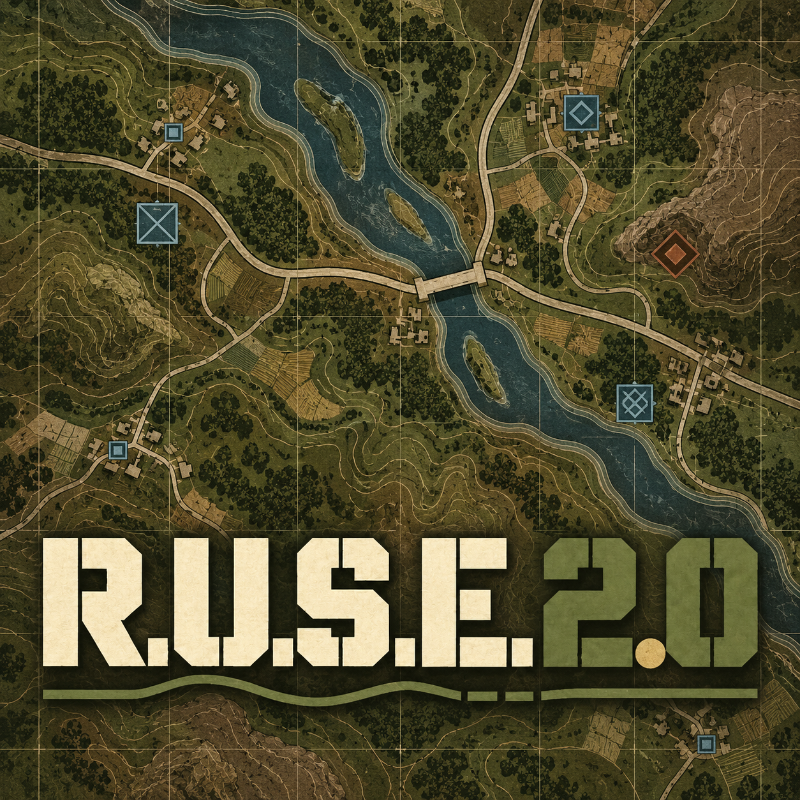

**RUSE Studio 0.9.8.23** and **RUSE Launcher 0.4.8.23** are out:
[Releases](https://github.com/sneadtristen6/R.U.S.E-2.0-Project/releases). This update is required: both apps install
it by themselves when they open, and Play and Test in game wait until it's in.

**New terms of use and privacy notice.** When an app opens, it shows version 5 of our terms of use and privacy notice
once; **Accept** to go on. They now say plainly what RUSE Guard, Bug Watch and the apps do on your PC, what they send
and to whom, how long it's kept, and how to ask us to delete it. Read them again any time in **Settings > Terms,
credits and licences**. **Settings > Your RUSE Guard code** is the code to give us with a privacy request.

**The game's own title by default.** Your game now keeps its own R.U.S.E. title and Eugen's logo video, with mods or
without, Vanilla too. R.U.S.E. 2.0's gold title and intro are yours to tick, in **Settings** or on the terms screen.

**Signed updates.** An update now installs only when it carries our signature and is exactly the file we signed. The
apps look for updates only after you've accepted the terms, and if a download fails three times they stop trying by
themselves and point to the release's page.

**A crash code for every crash.** When a game the Launcher started crashes, or a Test in game in the Studio, the app
says so and gives a short crash code with a **Copy code** button, Bug Watch on or off. Please send that code and a
screenshot of the message to XUL on Discord (XUL6x3) or on GitHub: it tells us where the game stopped, so we can look
into why. With Bug Watch on, a crash we know is also explained: the unit the game was making, and why it crashed. Our
list of known crashes now comes from our server, signed, and is checked on your PC.

**RUSE Guard.** Its check for known cheat programs now really runs in multiplayer and co-op matches, with its list
inside the app (nothing is downloaded for it). **Vanilla** in the Launcher builds a plain copy with RUSE Guard in it,
started like a mod set's; to play R.U.S.E. without our apps, start it from Steam.

**Fixes for your reports:**

- **Roads** (a report on Discord): the Studio refused every road you drew, even on a game map, as cut off. An end you
  draw onto a road now joins it wherever it lies along the road.
- **A new map crashed the game on load** when the game folder held leftover revision folders (GitHub issue 25). The
  build now reads the newest by its number.
- **Troubleshoot said you were good to go while Play couldn't build:** it now checks the app's own data files too.
- **Mods with mission scripts:** one more kind of mission script failure is guarded (a zone check on a zone with no
  zone info), so the game no longer stops on it.
- **Installing mods from the list** (Bug Watch showed installs failing): a download that comes cut off or loses its
  connection is tried once more, and a broken-off download no longer stops an install of several mods part-way.
- **Saving a mod set** while a mod in the library was being installed or replaced came back as failed, though the set
  was saved (and saving again made a second one). It no longer does.
- **The Studio's Nations tab** before the game index is built says so, with a **Build the index** button, instead of
  an error.
- **Microsoft WebView2**, which the apps' window needs, is offered where it's missing, never forced: a ticked box in
  the installer, a Yes/No box when an app opens, and a card in Settings.

**The fixes promised in 0.9.8.22's announcement.** Of the problems and changes we listed for this update, these are in:

- **Making units:** the mod menu shows each mod's real name; a unit price below 0 refused, as a research price already
  is; a second unit with exactly the same name refused in every alphabet; plainer limits ("too big: the game takes at
  most 2,147,483,647"); a word when a copy of an upgrade stops being an upgrade; a copy of an upgrade made after its
  research unit was hidden no longer stops the mod building; when two of your mods change the same value, the set
  screen says which one wins; a warning before deleting a copied ammo that a weapon still fires, and on Delete anyway
  the weapons go back to the game's ammo; the building that builds a unit picked from a list of the nation's own
  buildings.
- **Squads, Blender and animations:** the same soldier removed twice within a second keeps both looks; old Blender work
  under the same name set aside, not picked up; unticked bones bring the animations back untouched; Import model says
  what it left out of a model's animations; Custom uniform and Back to the default uniform in all 11 languages; on
  tanks and planes Blender's first hint says "Change the model", and Open in Blender is the Model row's own button;
  "Repaint in Blender" where only paint comes back; "Automatic" in place of "Nearest"; plainer words in the bones and
  squad boxes, with Having trouble? links and links to the wiki's how-tos; the German "Sie" lines say "du"; a new unit
  never wearing a deleted unit's old look; one way back from Blender, Open in Blender (Add a soldier keeps its own
  Blender button); a broken animations or build-menu groups file said in plain words, with a Set aside button, and the
  box saying first what the build goes without. These last three are checked by tests, not yet tried in the game.
- **Export and the Launcher:** your README, credits, licence and docs folder packed with the mod; your whole user name
  taken out of your README; a mod saved by a newer Studio added with a word to update; a join code after a Studio test
  says so and offers Play; Export names what it replaced; Export finishes when a file of the mod's older copy in the
  Launcher's library is open, and names the file to close; a download cut short says so; a mod too big for the
  Launcher refused before packing; a zip holding two mods refused, naming both; two map mods making a map of one name
  named by the mod check before Play.
- **Test in game and maps:** Delete waits for a file another program holds, then names it; the build cache kept with
  the Studio's own folder; a copy named like a game map refused at once; a new map made with only a units mod picked
  gets a map mod of its own; a crash during Test in game told in the Studio too, with its crash code; the build's quick
  checks run first, so fewer starts fail; Rename for maps (the name in the menus); a warning for blocks and water
  painted over the map's own HQ.

**What's next: 0.9.8.24.** These need more work or a test in the game first, so they come in the next update:
a copy built with cheats that has to leave a match closing the game without a crash (our test in the game still
crashed it as it closed); one name, Import model, everywhere; Researched from linking to Edit Units' research section; repainting a unit with a model you
imported (Open in Blender with only its paint); mods named with no letter a to z
getting the same short file name; two mods in one set that each make a unit of the same name, or each have the
Generic Horse; the Blank Terrain and Blank Ocean starts on one game map; the crash code naming the kind of crash;
Rename for mods and new units; a copy of a unit you changed starting from your changed values; a change to an animation
a RUSE Decoy copy plays going into that copy; a bone moved too little to keep; nothing changed in Blender meaning no
files rewritten; an older mod keeping its era unit's model; Resize making the horse's own files; a river on a Blank
Terrain start keeping units off; Map size offering only sizes that build; Test in game's "To see your changes" in your
language; the Mission and Map Paint refusals in all 11 languages; a mistake in a mod's file said in your language,
with where it is; more of a mod's checks in plain words; and the last
word slips (after a trip to Blender for paint only, "Bring back" in English only; a squad's uniform refusal and
"Blender isn't found" naming buttons those boxes haven't got).

0.9.8.22, before it, changed only the project page (its support options), and 0.9.8.21 added a fix behind the scenes:
our own tests pass again on every system GitHub runs them on. Everything below came with 0.9.8.20 or earlier.

**New in 0.9.8.20: your own animated models, animations for one unit or for the units you pick, the Generic
Horse, and squads soldier by soldier.** Bring in a horse and rider, or any creature, with its own bones and
animations; give one unit an animation of its own, or make a copy that only the units you tick play; put riflemen
and a bazooka man on horses with the Generic Horse; and change a squad one soldier at a time, with one Open in
Blender for a unit's model, bones and paint.

- **Models with bones and animations of their own:** **Import model…** now also takes a .glb on bones of its own with
  its animations: a horse and rider, or any creature. **Its animations** shows which animation the unit plays for each
  thing it does; pick another, or leave it on **Nearest**. **On long moves** a squad can go as itself, playing one of
  them, instead of in its truck. **Its two halves** picks the bone where the model splits into the upper and lower
  halves the game animates at once (a rider aims while his horse runs), and **Will it work in the game?** says what in
  the model could stop the game or look wrong. In a squad, the riflemen and the heavy-weapon soldier each take a model
  of their own on their own line. Tested in the game with a Generic Horse made this way: riflemen and a bazooka man on
  horses, firing, riding as themselves on long moves, each horse falling with its rider; another animation picked by
  hand or another split, not yet.
- **The Generic Horse:** riflemen and a heavy-weapon soldier, each on a horse of his own, now listed in the **Units**
  tab with the units from other eras (**WWII+**, USA), off until you add it. **Add to my mod** makes its horses and
  riders on your PC from your own copy of the game (nothing is downloaded), adds it as a new unit of your mod and puts
  sneadtristen6 in your mod's credits; **Take it out of my mod** takes it all out again. There is one Generic Horse for
  every nation: its riders are always made from the G.I. squad, and in your mod it's a unit like any other, in the build
  menu you pick when you add it (the **Nations** tab moves it to another nation). Tested in the game added from the
  **Units** tab. Not yet tried in the game: in a mod someone shares with you, its Generic Horse can now be resized and
  moved on your PC once your Studio has made the same horse files (adding it to any mod of yours makes them); and when
  the Studio makes those files again and they come out different, they go beside the old ones, so a mod's Generic Horse
  never changes when you resize or move it (if its own files are gone or changed, **Resize** and **Move it** say so and
  leave it as it is).
- **Animations for one unit:** a unit's page now has **Look and moves**: its model, its soldiers, its sounds and
  animations and what it rides in, row by row. **Change in RUSE Decoy** on the **Sounds and animation** row opens
  RUSE Decoy on that unit, and a change to one of its animations can be for **Only this unit**, which then plays its
  own copy, or for every unit that plays it. **Back to what every unit plays** takes the unit's own copy out. **Motion
  capture** goes on one unit the same way. Tested in the game with a squad dancing on the spot while every other squad
  stood as before; a speed, a stand-in or a bone changed for one unit, not yet.
- **Copies of an animation for the units you pick:** in RUSE Decoy, **Copy this animation…** makes a copy of an
  animation in your mod, listed under **Your copies**. Change the copy, then tick under **Who plays it** the units that
  play it in place of the animation, or under a unit only some of its soldiers or parts; every other unit plays the
  animation as before. **Back to the game's animation** takes your changes to the copy out again, and **Delete the
  copy** takes it out of your mod. Tested in the game with two copies of the soldiers' standing animations with a dance
  in them, ticked for a new squad and for the G.I. squad's bazooka man alone.
- **Animations changed in Blender:** for a new unit made in your mod, **Change its animations in Blender** in RUSE
  Decoy opens Blender with the unit and every animation it plays, each named for what it does in it. Change one, click
  **Send to the R.U.S.E. Studio**, then **Bring my changes back**: the changed ones become that unit's own, and every
  other unit keeps the game's. A sending you never brought back is set aside, and **Bring back the set-aside sending**
  takes it in. Tested in the game with a squad standing and running with an arm raised, and a Generic Horse whose horses
  hold their heads up.
- **A squad, soldier by soldier:** a squad's page now starts with its squad card and a line for each soldier, in place
  of its **Its own model** box. **Open in Blender** on its card opens its soldiers side by side, each with his own copy
  of his pictures; after **Send to the R.U.S.E. Studio** in Blender, **Bring my changes back** gives each soldier only
  what was done to him. On his line a soldier has **Import a model…** and, once he has a model of his own, **Back to the
  game's look**. Seen from far away, the squad's little figures wear the look most of its soldiers wear. Tested in the
  game with a squad whose bazooka man alone was painted red.
- **More or fewer soldiers:** **Add a soldier** brings in a copy of one in the squad, a soldier from another squad, or
  a model file; **Remove** takes one out; **+1 soldier** and **−1 soldier** add or take away a rifleman at once,
  without Blender. A squad has 2 to 8 soldiers, and a soldier can have a look of his own that no other soldier wears.
  The game gets these through a small game patch, downloaded once and applied only to your modded copy, never to the
  game in your Steam folder; every other squad stays as the game has it. Tested in the game with squads of 3 and 7
  made with these buttons, and with one rifleman alone painted red; a soldier from another squad or a model file, and
  squads of 2 or 8, not yet.
- **One Open in Blender:** a unit's page has one **Open in Blender**: on a squad's card, and for any other unit in its
  **Model** row, under **More**, in the **Change it in Blender** box. **What goes to Blender ▾** beside it ticks what
  goes: a squad's soldiers (for a squad on bones of its own, such as the Generic Horse, which model), **Its bones** for
  a model on bones of its own, and **Its paint**; untick one and **Bring my changes back** leaves it as it was. While
  Blender has the unit, the button reads **Bring my changes back**. One of the game's own units that isn't a squad sends
  its paint alone, as **Repaint in Blender** did: copy it first to change its model. A model on bones of its own goes to
  Blender with its animations: one you don't change there comes back exactly as it went out, and of one you change, only
  the bones you changed are new; a change made in RUSE Decoy while Blender has the model stays when that animation comes
  back unchanged, and the page says so. Tested: a new M4 Sherman's whole model changed in Blender, then in the game; in
  the Studio, a copied G.I. squad's soldiers, the Generic Horse with **Its bones** unticked, and the game's own M4
  Sherman's paint. The animations coming back unchanged were checked with Blender on our PC, not yet in the game.
- **Its own shine after Blender:** a model sent to Blender with **Open in Blender** and brought back with **Bring my
  changes back** keeps its own shine and side-colour layer; before, it came back with the plain one a model from a file
  gets. When one can't be kept, the page says which. Not yet tried in the game.
- **Where your model is kept:** the **Model** row (on a squad's page, **More options**) says where your mod keeps the
  unit's own model on your PC, with **Show in folder**.
- **Having trouble? Read the guide:** a small link at the end of the help in 7 boxes where bones, animations or Blender
  need explaining (the squad card, the Blender box of a unit that isn't a squad, **Its two halves**, **Its animations**,
  **Will it work in the game?** and two in RUSE Decoy) opens that topic's wiki page in your language. The wiki has three
  new pages in all 11 languages, Models and Bones, Unit Animations and Open in Blender, and five pages mended where they
  no longer matched the apps (Play With Friends now explains join codes). The link was seen in a preview of the page,
  not yet in the installed Studio.
- **Plain words, in your language (Studio and Launcher):** 279 more messages now come in all 11 languages, in plain
  words: the Launcher's refusals and the line at the top of its window; how **Test in game**, **Play** and installs end,
  and a Play refused before it starts; a build's lines from its steps; why the update check, the mod list or the list of
  units from other eras can't be reached without the internet, never in Windows' own words; a damaged mod file; the game
  backup in Settings and Sign in through Steam; the refusals of RUSE Decoy, the **Music** and **Nations** tabs, the
  maps' ground paint and the missions; your mod's changes file broken by hand; and a name already taken, said by the
  unit's name instead of a code name, or a number that doesn't fit, said by its label on the page. Checked by tests.
- **Players, update your Launcher:** a mod whose squads have soldiers of their own, or whose units have animations of
  their own, needs Launcher 0.4.8.20 or newer: an older one can't give them. This Launcher gets the small game patch
  such squads need by itself, downloaded once and applied only to your modded copy. Not yet tried in the game from the
  Launcher.

**Fixes and smaller changes in 0.9.8.20.** Players' crash reports, sent by Bug Watch, showed the game stopping
as soon as the Armor Base was placed with the R.U.S.E. Field Manual and the Balance Overhaul Mod together: every
modded game now has guards where the game's own scripts stopped it, and an upgrade made in another building keeps
its unit.

- **Guards where mods stopped the game:** every modded game now has a guard on three places where the game's own
  scripts stopped it: research cards in a building's list for a unit that is in another building, a mission starting
  the computer player of a side a person plays, and a mission changing units after one of them was killed. A guard
  does nothing unless the game would have stopped. Tested in the game with the Armor Base; the two mission guards were
  tested outside the game.
- **An upgrade made in another building keeps its unit:** with the same two mods, researching the T-34 in the Armor
  Base took the T-26 out of the Barracks, because the game takes a unit away as soon as any upgrade of it is
  researched, wherever that upgrade is made. The build now makes such an upgrade a research of its own and says so in
  a warning. Tested in the game with the USSR and Italy. It changes some sets with the Balance Overhaul Mod, and sets
  with the Field Manual before the Balanced Realism Mod; the warning names each unit.
- **Join codes:** a set the build changes this way gets a new join code, so every player in a match with it needs this
  version. A set with a mod that gives a gun crew a model of its own gets a new join code too: the crew's little
  far-away figure now wears that model. A set with the Balanced Realism Mod, the Navy Mod, Sand Box, either Static
  Commandable Battleship - All Operations mod or the R.U.S.E. Field Manual 1.0.0 gets a new join code too: for some of
  their units, another nation's unit packs now load in every skirmish (below). So does a set with Operation Overlord or
  Operation Fortress Europa: with either of them, the US, German, British and French unit packs now load in every match
  (below). After the update, the next **Play** or **Test in game** builds your game
  again by itself.
- **Missions a set leaves without their places (Studio and Launcher):** when a set's mods leave a campaign chapter, an
  Operation or the tutorial without a place its mission watches from its start, the build warns, naming the mod and how
  many campaign chapters or Operations it does this to, or the tutorial: the game stops about a second after such a
  mission starts. Every mod is checked, whatever its version, your own too: the build reads the missions from your own
  game when it builds. The set still builds and plays as before, and the build's count of warnings includes these. 1 VS
  7 AI and 1 VS 15 AI get such a warning too: they replace the maps of one campaign chapter with ones that lack places
  its missions use, and the warning stays until that chapter is tried with them in the game. Checked with builds of the
  community mods; not yet tried in the game.
- **.rmod mods' units get their models (Studio and Launcher):** a unit an .rmod mod (RUSE Mod Manager's format) makes,
  or moves to another nation, now gets the same model check as a Studio mod's unit, in any set and with the mod alone:
  when its model is only in another nation's unit packs, the build makes those packs load in every skirmish, so it has
  its model in matches where no player has that nation, and a note names the unit as its card does; where that can't be
  done, the build refuses the set and says why. The same goes for a unit an .rmod mod's map places that the game's own
  version of that map doesn't: Operation Overlord and Operation Fortress Europa place British and French units, beside
  American and German ones, on the map of the campaign's Utah Beach chapter, so with either of them the US, German,
  British and French unit packs now load in every skirmish, campaign chapter and Operation. Not yet tried in the game.
- **The Launcher's mod set editor says why:** when it can't make or save a set (no mod ticked, or a mod that is no
  longer in your library), it now says so inside the editor, under its buttons. Before, the message went to the set's
  page, hidden behind the editor, so nothing seemed to happen. **Create** and **Save** wait until a mod is ticked.
- **Play waits for the mods' check (Launcher):** **Play** stays off until the Launcher has checked whether the set's
  mods go together, and its tooltip says why. Before, a quick **Play** could send a set whose mods can't go together to
  the build, which refused it there. Checked by tests; not yet tried in the installed Launcher.
- **Missions of your own (Studio):** a new map's mission that makes units of a nation its copied mission doesn't load
  now gets that nation's packs, so those units have their models (the game stopped when such a unit was made). The
  mission check also refuses an event that hands a side a person plays to the computer. Not yet tried in the game.
- **Models from Blender, and a Custom uniform (Studio):** a modder asked on Discord how to change infantry models; the
  squad card (below) is the way now. Points Blender leaves with no bone follow the root bone, and the page says how
  many. **Import model…** also works now on a unit with a **Custom uniform**: it takes the copy out, and **Use the
  copied unit's model** gives it back in one click. The wiki's Import a Model page has the steps. Tested in the game
  with a squad's soldier weighted in Blender; the Custom uniform part was checked outside the game.
- **Squads and Blender:** **Custom uniform** is refused, in words, while a soldier of the squad wears a model of his
  own, as the mod would then no longer build: click **Back to the game's look** on that soldier first. The squad page
  says where a sending from Blender you never brought back, or a removed soldier's own look, was kept aside. **Will it
  work in the game?** reads a model's own animations as the build plays them, so a squad given a model with animations
  of its own, such as the Generic Horse's riflemen, isn't said to stop the game for animations the build never plays. A
  repaint brought back from Blender stays when a later trip leaves **Its paint** unticked. Checked by tests, the repaint
  also with Blender on our PC; not yet tried in the game.
- **Delete goes through:** **Delete this unit**, **Take it out of my mod** and the **Nations** tab's take-outs no longer
  stop when another program has one of the unit's files open: the unit goes all the same, and a file still held stays in
  the mod's folder for now. **Test in game** and **Export mod…** leave it out, and the Studio removes it by itself
  later, once that program lets go of it. A list file of the mod that another program holds for more than 3 seconds
  still stops Delete, with everything put back and the file named. Checked by tests; not yet tried in the game.
- **A unit with no card picture (Studio and Launcher):** a unit shown in a build menu with no card picture is now
  refused when the game is built, with what to change. In a test the game stopped as it started with such a unit (a
  copy of the HQ truck shown in a build menu).
- **Export leaves your PC's folders out:** an exported mod no longer carries the folders of your PC that the Studio
  wrote into its model records (often with your Windows user name in them): only the file's own name goes. In your own
  README files, each folder path is cut to its own name, and a path that ends at a user's own folder, and so names that
  user, is taken out whole; Export lists each cut, and the README in your mod stays as you wrote it. A README Export
  can't read goes out as you wrote it, and Export names it. Your other texts (descriptions, credits) go out as you wrote
  them, and Export tells you if one names your home folder. The credits of units from other eras, the Generic Horse's
  too, now go with the mod.
- **New mod… and Export with unusual names and texts:** **New mod…** now makes a mod whose name holds an emoji or a rare
  character such as 𠮷, or is very long; before, it failed, and an emoji left a broken mod in the mod menu. In the mod's
  folder name and its exported file's name, an accented letter loses only its accent (Équipe gives equipe, before quipe;
  ß, ł and ø are still left out), and a long name gives them at most 40 letters; the name itself stays whole. **Export
  mod…** sends a version typed with full-width or Persian digits (１.０.０, ۱.۰.۰) in plain digits (1.0.0), and a character
  pasted into the author or the description no longer stops it. When another program has one of the mod's files open,
  Export names that file (before, it only said permission was denied), and an Export started while another one runs is
  refused in words (before, the two wrote one file and left a half-written one behind). Checked by tests; not yet tried
  in the installed Studio.
- **Names and numbers:** **New unit…** refuses a name that differs from another unit's only in its capitals (tiger ii
  beside Tiger II), as a name already taken: Windows doesn't tell capitals apart in file names, so the two shared their
  files, and deleting one took the other's card and model. A mod that already has such a pair keeps it. A decimal number
  too big for the game (1e39, say) is refused on the **Units** tab and the **AI and player settings** tab, as on the
  **All values** tab, instead of stopping every build of the mod. An emoji or a rare character in the credit of a
  building's own look no longer makes that look unreadable, on its page or for the build. Checked by tests.
- **A mod's files not saved as UTF-8 (Studio and Launcher):** a mod's file saved by Excel as "CSV (Comma delimited)" or
  by Notepad as "Unicode" is now named, with its line and how to save it again as UTF-8, by the build, by the check
  before **Test in game** (which offers **Set aside** for it) and by the Launcher when you add the mod; before, an error
  in programmers' words came up, naming no file. A file Notepad saved as "UTF-8 with BOM" is read. When the check's
  **Set aside**, or its rename, meets a file another program has open, it names that file, not the name it would have
  got. Checked by tests.
- **Maps:** **Map size** no longer stops the build when a **Blank Terrain** or **Blank Ocean** map made from one of 16
  of the game's 32 maps (Frontline, Tank Graveyard and Vesuvio among them) is made bigger; anything placed on its new
  ground still stops the build (a bigger Frontline with a tree there did), and that is still to be mended. A new map,
  new map changes or the copy **Edit an installed mod** makes, named Nul or another name Windows keeps for itself, gets
  a folder Windows can make, its name kept as typed. When **Duplicate map** is refused for a character the map's file
  can't hold, nothing is left behind; before, a half-made map stayed, and every later **Test in game** stopped. **Make
  sectors** with sectors too small for the map is refused and nothing is saved; before, the setting was saved anyway,
  and the sectors view failed until **Undo**. Checked by tests; not yet tried in the game.
- **A folder too deep for Windows:** when the Generic Horse's **Add to my mod** is refused because the Studio's folders
  are too deep for Windows, its page now offers a short folder, such as C:\RUSE2: **Copy everything to C:\RUSE2 and
  start again** copies the Studio's settings, the Launcher's library and mod sets, and your mods, maps, exported files
  and backups there, checks every file, makes both apps use that folder from then on and starts the Studio again from
  it; **Choose another folder…** picks another one instead. Nothing is deleted: your old folders stay where they are.
  Checked by tests; not yet tried in a real Studio.
- **The Nations tab:** **Start a new mod** now asks only for a name and opens the Studio on the new mod; the guided
  steps are off for now. What only they had is on the **Nations** tab: **Keep its units** or **Start it empty** for
  each nation, and **No research** or **Keep the game's research** for the whole mod.
- **Smaller things:** each factory is called by its building's name; in Persian, the game's names show in English, never
  as code names; the check before **Test in game** also reads the map you're editing when it is a folder of its own, and
  offers its fixes there too.
- **Bug Watch says why, if you ticked it:** which check refused a build or found a mistake (a fixed name from our code),
  how far a **Play** or **Test in game** got, which mods from our list were on and how many of your own, Plays refused
  before they started, and updates offered, installed or failed. Never the words shown, a path, or the names, words or
  files of your own mods. A game's crash report after a script error also says how often the guards above kept that game
  going (not yet tried in the game).
- **A game crash we know names its unit (Launcher, if you ticked Bug Watch):** when the game crashes in one of the ways
  we know, the Launcher says so after **Play**, in your language: the unit the game was making, by the name on its card
  (and whether a mod added it), and why, in plain words. It reads this on your PC, from the game's own crash report and
  your modded copy; the name and the reason are never sent. The unit is told once you've accepted the agreement's
  version 4 (below). The Studio's **Test in game** doesn't say it. Checked on earlier crash reports; not yet tried in
  the game.
- **The agreement, version 4:** it now lists more of what Bug Watch sends, if you ticked it: how many mods of your own
  you had and what kinds of things they hold, such as units, maps, missions or scripts (counted by kind, never named,
  and never their words, paths or files); at a game crash, the map it was on (one of the game's own maps by its name, a
  map a mod made only as "a mod's map") and the unit the game was making (one of the game's own units by its number, a
  unit a mod added only as "a mod's unit"), each only when the game's crash report shows it; and which version of the
  agreement you accepted. It also says now that the names and words of your own mods are never sent. Nothing else in it
  changed. Because it changed, both apps show it to you once more when they open; your username stays, and the Bug Watch
  box stays as you had it.

**The map importer is still in progress.** It builds part of Utah Beach into a map that opens in the game, but the
beach, the water and the ground up close aren't right yet, and it isn't fully working in the Studio. We'd rather wait
until a real place looks and plays like a real R.U.S.E. map than put out something half done:
[where it stands](https://github.com/sneadtristen6/R.U.S.E-2.0-Project#the-map-importer-where-it-stands).

**In 0.9.8.19, right before it: RUSE Guard lets players with the same build play together, cheat mods or not. Not fully
supported yet.** A player told us that he and a friend, both with the same mod pack, were thrown out of every
multiplayer match, because one mod in it (Infinite Supply Depot) is tagged as a cheat. RUSE Guard treated every game
built with a cheat mod or a test tool as offline only: it left each multiplayer and co-op match a few seconds in, and
never looked at who else was playing.

- **What we changed:** one second into a multiplayer or co-op match, such a game now tells the other players' games
  which build it is: a short code made from the game version and the mods, nothing about you. About seven seconds in
  it decides. If every player has the same build (the same game version, the same mods in the same order, the same
  mod versions), it says so on screen and the match goes on. If anyone has another build or no mods, it leaves the
  match as before.
- **A join code for these sets:** in the Launcher, a mod set with a cheat mod now gets a join code like any other.
  The same code means the same build, so compare codes before you play.
- **Every player needs this version:** the game of each player in the match must be built by Launcher 0.4.8.19 or
  Studio 0.9.8.19, or newer. After the update, the next **Play** or **Test in game** builds it again by itself.
- **Not fully supported yet, and it may still be buggy:** we tested it in the game with one player hosting a
  multiplayer match alone against the computer, and outside the game with 20 simulated matches of up to four players.
  Nobody has played it with two people in a real match yet. Use it in multiplayer at your own discretion, try it, and
  tell us what happened on Discord or GitHub: which RUSE Guard message you saw, and whether the match went on.
- **Unchanged:** a game built without cheat mods, skirmish against the computer and the campaign.

**In 0.9.8.18: a fix behind the scenes.** The check of a modded copy (which game files changed
after it was built) now lists what it finds in the same order on Windows and Linux. What it finds doesn't change.

**New in 0.9.8.17: imported models sit where the unit stands.** A modder told us his models were drawn
ahead of their selection rings. The Studio's **Import model…** now puts a new model on the middle of the unit it copies
and gives it a skeleton of its own, so its turret turns where the turret is on your model. Every new import is fitted
this way. A model imported before keeps its old place until you import it again or move it, and the era units keep
theirs. Tested in the game with the game's own Sherman, opened in Blender and brought back, on other units; not yet
with a model from elsewhere, another turret tank, or a turret that turns all the way round.

- **Move it:** if a model still doesn't sit right, open **Move it** under its size on the unit's page (folded away
  until you need it). **Forward**, **Right** and **Up** move it from where it's fitted, in the game's units; a minus
  goes the other way, and 0, 0, 0 puts it back. Its turret and propellers go with it, so they still turn in the right
  place. In the 3D view a blue ring shows where the unit stands, its mark at the front. Tested in the game with tanks
  moved forward, back, right and up.
- **Planes keep their own propellers:** a plane opened in Blender from the Studio and brought back keeps its
  propellers where your model has them, as many as it has: blades on the ground, spinning discs in the air. Tested in
  the game with a three-engined bomber's model on a one-engined fighter, and the other way round. A plane model from
  anywhere else keeps its propellers as drawn, standing still, for now.
- **Any unit can take a model:** soldiers, a gun's crew and planes the Studio couldn't fit a model to before (the
  P-47, for one) take one of their own, rigged to the unit's own bones, such as one of the game's models opened in
  Blender from the Studio and changed there. Tested in the game with a rifle squad, a gun's crew and the P-47.
- **Players, update your Launcher:** a mod with a model imported by Studio 0.9.8.17 or newer needs Launcher 0.4.8.17
  or newer. An older Launcher gives the model the copied unit's skeleton, so its turret turns around the wrong point.
  Mods made before play as they did.

**Also new in 0.9.8.17: a weapon class of an ammo's own.** On an ammo's page, the **Weapon class** box sets how much
of its damage the ammo does to each kind of target, and **New weapon class…** opens one number for each: buildings and
fortifications, aircraft, paratroopers coming down, infantry, light vehicles, armour 1 to 5, and construction trucks.
1 is full damage, 2 double, 0.5 half, and 0 means it can't attack that target at all. Saving gives the ammo its own
copy of the game's damage table, so no other ammo's damage moves (every unit that fires that ammo gets it: copy the
ammo first for one unit only). **Back to the game's class** takes it out again. Tested in the game: rifle squads
whose round got numbers against tanks shot at tanks with their rifles and damaged them.

**Fixed in 0.9.8.16: Troubleshoot's "Clear them" deleted copies you made yourself.** A copy of the game you built by
hand in the copies folder, a test copy or a reference copy, counted as a leftover, and "Clear them" removed it for
good, not to the Recycle Bin. Every copy built anywhere but the app's own modded copy now carries a small keep note,
and a copy with one is never a leftover: Troubleshoot clears only the apps' own leftovers (half-built copies, the ones
older versions made per mod set). It is one code for both apps, so the Studio's Troubleshoot has the fix too. A copy
built before 0.9.8.16 has no note yet: rebuild it once with 0.9.8.16 or newer, or leave "Clear them" alone until you
do.

**New in 0.9.8.15: Vanilla gets the gold R.U.S.E. 2.0 title too.** Play on Vanilla in the Launcher used to start the
plain game through Steam, so only modded games had the gold title. Now it builds the modded copy with no mods and the
gold title, and starts the game from it, the way a mod set does: the first time it builds, then it starts at once
unless you played a mod set in between. RUSE Guard runs in its multiplayer matches, as in every set's. Untick the gold
title in Settings (the Launcher's or the Studio's: it's one setting) and Vanilla starts through Steam as before. Your
Steam install is never changed.

**Fixed in 0.9.8.14:** a few mods bring a match script of their own whose header asks for more room than the script
needs (1 VS 7 AI, 1 VS 15 AI, Operation Overlord and Sand Box among them). The game runs those scripts fine, but Play
and Test in game refused them with "RUSE Guard's scripts can't be added: .xyz says ... bytes but holds ...", so no
modded game with one of those mods could be built. The apps now read them the way the game does.

**Also new, in 0.9.8.13:** if you ticked Bug Watch and the game crashes, its report now also says what the game was
trying to read or write, and up to 16 places in the game that led to the crash. Both are read from the game's own
crash report on your PC, which still never leaves it. The agreement listed these two things then (version 3; nothing
else in it changed), so both apps showed it to you once more.

**Fixed in 0.9.8.12:** 0.9.8.10 / 0.4.8.10 and 0.9.8.11 / 0.4.8.11 couldn't build a modded game: Play and Test in game
stopped with "No such file or directory: ...fairplay_watch.bin", because their installers left out three of RUSE
Guard's files. Update, and both work.

0.9.8.10 made big mods work, and brought fair play and trust:

- **Mods past 4 GB** (reported by a player): a modded game whose packs passed 4 GB stopped building. Packs now carry
  their full length, and one past 4 GB uses a small game patch, downloaded once and applied only to your modded copy,
  never to the game in your Steam folder. Tested in the game with all 366 era units.
- **Build lists in groups:** with many units, a building's build list ran off the screen. Each list now shows one row
  per group (the game's own lines), at most 6 units a group and 10 groups a building, so every unit can be reached.
- **Faster builds:** a mod with 366 era units took about 18 minutes to build on an 8-core PC; now about 5 the first
  time and about 3 after.
- **From testers' reports:** imported turret parts and towed guns; one Bridges tab, where the map's own bridges go out
  with their crossings; a unit mod and map changes of one name build together.
- **Your files in Documents\RUSE 2.0:** the Studio keeps your mods, maps, exports and backups where File Explorer
  shows them, and Delete a mod sends one to the Recycle Bin.
- **0.9.8.11, right after 0.9.8.10:** Sign in through Steam finishes in the apps (after Steam's page, the window
  waited and never checked); and on Linux a build's helper programs start fresh, the way they always have on Windows.

The first time an app opens it shows a short agreement and asks you for a username (a # and four numbers are added so
it's unique, like Nick#4821; one name works for both apps). Then:

- **RUSE Guard, our anti-cheat** (from DomesticNukes' design): it works only in real multiplayer and co-op matches,
  never in single-player, skirmish against the computer, the campaign, or while you make mods. A modded copy built
  with a cheat or a test tool plays multiplayer and co-op only with players who have the same build, and leaves any
  other match by itself (new in 0.9.8.19, above; before it, such a copy left every match). During a real match
  it checks the names of your running programs against a list of known cheat tools (names only; nothing else is
  read), and what it collects is filed under your username, never your Steam account. The Launcher gives your modded
  game a **join code**: the same code means the same game, so a match can't drift apart.
- **Bug Watch (optional):** tick it and the apps count what you use and when something goes wrong (their crashes and
  the game's, with which mods were on) and send it once a day to our developers with your username. No real names,
  no Steam account, no files. Off unless you tick it; untick it any time and what was kept is deleted.
- **Sign in through Steam:** a sign-in on Steam's own page in your browser confirms you own R.U.S.E.; we never see
  your password, and your Steam ID is never stored, only a pass kept on your PC for 30 days. In the Launcher's
  Settings. Nothing needs it yet.
- **Owned copies only:** the apps start a modded game only from a copy of R.U.S.E. you own. If yours can't be
  confirmed (a boxed copy from before R.U.S.E. was on Steam, say), a box gives you a code for a ticket on Discord or
  GitHub, and we send you an unlock code.
- **Every language:** the apps, their README and the wiki now speak Persian too, eleven languages in all. An update
  can now be marked required, for the rare fix that matters to everyone; the apps install it by themselves.

The full notes are with each release. R.U.S.E. belongs to Eugen Systems and Ubisoft; R.U.S.E. 2.0 is a free
community project, not made, approved or supported by them, and it needs your own copy of the game.
